# PIPLUP FASE 01— DOSW

## Datos personales:

- Nombre y Apellido: Jose Alejandro Martinez Arias
- Código de Estudiante: 1000104385
- Curso: DOSW (Desarrollo y operaciones sofware)

---

### Ejercicio 01 — Filtrar y ordenar la flota de drones acuáticos disponibles

Se requiere gestionar la flota de drones acuáticos a través del API de Streams de Java para:

1. Filtrar los drones disponibles con batería mayor o igual al 35% y ordenarlos descendentemente según su nivel de carga.
2. Obtener una lista con únicamente los identificadores (`id`) de los drones que se encuentren disponibles.
3. Verificar si existe al menos un dron disponible con batería suficiente (>= 35%).
4. Contabilizar la cantidad total de unidades disponibles.
5. Determinar cuál es el dron con mayor porcentaje de batería en la flota.

**Código implementado:**

`DroneAcuatico.java`

```java
package main.dosw.piplup;

public record DroneAcuatico(
        String  id,
        String  modelo,
        int     bateria,       // 0-100%
        boolean disponible,
        String  zona           // "Embalse Norte", "Canal Central", etc.
) {}
```

`ConsultorFlota.java`

```Java
package main.dosw.piplup;

import java.util.Comparator;
import java.util.List;
import java.util.Optional;

public class ConsultorFlota {

    public List<DroneAcuatico> obtainDroneAvailableWithEnoughBattery(List<DroneAcuatico> drones){
        return drones.stream().filter(drone -> drone.bateria() >= 35)
                .filter(DroneAcuatico::disponible)
                .sorted(Comparator.comparing(DroneAcuatico::bateria).reversed()).toList();
    }

    public List<String> obtainIdsDronesAvailable(List<DroneAcuatico> drones){
        return drones.stream().filter(DroneAcuatico::disponible).map(DroneAcuatico::id).toList();
    }

    public boolean existsDroneAvailableWithEnoughBattery(List<DroneAcuatico> drones){
        return drones.stream().anyMatch(drone -> drone.disponible() && drone.bateria() >= 35);
    }

    public long amountDronesAvailable(List<DroneAcuatico> drones){
        return drones.stream().filter(DroneAcuatico::disponible).count();
    }

    public Optional<DroneAcuatico> obtainDroneWithLargestBattery(List<DroneAcuatico> drones){
        return drones.stream().max(Comparator.comparing(DroneAcuatico::bateria));
    }
}
```

`Ejercisio1.java`

```Java
package main.dosw.piplup;

import java.util.List;

public class Ejercisio1 {
    public static void main(String[] args){
        List<DroneAcuatico> flota = List.of(
            new DroneAcuatico("AR-01", "Aqua-Ranger 100", 92, true,  "Embalse Norte"),
            new DroneAcuatico("AR-02", "Aqua-Ranger 100", 45, true,  "Canal Central"),
            new DroneAcuatico("AR-03", "Aqua-Ranger 100", 18, false, "Laguna Sur"),
            new DroneAcuatico("AR-04", "Aqua-Ranger 100", 73, true,  "Punto Ribereño Este")
        );

        ConsultorFlota consultor = new ConsultorFlota();

        System.out.println("1. Disponibles con batería >= 35% ordenados:");
        System.out.println(consultor.obtainDroneAvailableWithEnoughBattery(flota));

        System.out.println("\n2. IDs de drones disponibles:");
        System.out.println(consultor.obtainIdsDronesAvailable(flota));

        System.out.println("\n3. ¿Existe algún disponible con batería >= 35%?");
        System.out.println(consultor.existsDroneAvailableWithEnoughBattery(flota));

        System.out.println("\n4. Total de drones disponibles:");
        System.out.println(consultor.amountDronesAvailable(flota));

        System.out.println("\n5. Drone con mayor batería:");
        System.out.println(consultor.obtainDroneWithLargestBattery(flota));
    }
}
```

**Captura de ejecución:**


**Explicación:**Se modela la entidad con el record inmutable `DroneAcuatico` y se resuelven las consultas mediante la API de Streams:

- `filter()` para validar la disponibilidad y el umbral de carga.
- `sorted()` junto con `Comparator.comparing().reversed()` para ordenar de mayor a menor batería.
- `map()` con referencia a método (`DroneAcuatico::id`) para proyectar la lista de identificadores.
- `anyMatch()` para comprobar de forma eficiente si hay al menos una coincidencia.
- `count()` para el total de drones activos y `max()` para obtener el dron con mayor batería envuelto de forma segura en un `Optional`.

---

### Ejercicio 02 — Repositorio de AquaPort con estructura GitFlow básica

Configurar el repositorio base para AquaPort aplicando la metodología GitFlow. Se define un archivo `.gitignore` robusto para entornos Java/Maven e IDEs, asegurando que binarios y configuraciones locales no se versionen. Se implementa el flujo de trabajo creando la rama de integración `develop` y la rama de trabajo `feature/streams-consultor-flota`, gestionando la inclusión de cambios mediante commits atómicos y consolidando el trabajo en `develop` mediante un Pull Request.

**Código implementado:**

`.gitignore`

```gitignore
# Compiled class file
*.class

# Log file
*.log

# BlueJ files
*.ctxt

# Mobile Tools for Java (J2ME)
.mtj.tmp/

# Package Files #
*.jar
*.war
*.nar
*.ear
*.zip
*.tar.gz
*.rar

# virtual machine crash logs, see [http://www.java.com/en/download/help/error_hotspot.xml](http://www.java.com/en/download/help/error_hotspot.xml)
hs_err_pid*
replay_pid*

# Maven target directory
target/

# IntelliJ IDEA
.idea/
*.iml

# Eclipse
.project
.classpath
.settings/

# Visual Studio Code
.vscode/
```

`Flujo de comandos Git ejecutados:`

```bash
# Inicialización y configuración de ramas base
git init
git add .gitignore
git commit -m "chore: configurar .gitignore para Java y herramientas de desarrollo"
git branch -M main

# Creación de rama de integración develop
git checkout -b develop

# Creación de rama de característica para el reto 01
git checkout -b feature/streams-consultor-flota

# Commits atómicos de la funcionalidad
git add src/main/java/main/dosw/piplup/DroneAcuatico.java
git commit -m "feat: definir record DroneAcuatico para el modelo MVP"

git add src/main/java/main/dosw/piplup/ConsultorFlota.java
git commit -m "feat: implementar ConsultorFlota con 5 consultas Stream"

git add src/main/java/main/dosw/piplup/Ejercisio1.java
git commit -m "test: agregar clase principal para verificar consultas de flota"

# Publicación de la rama hacia el repositorio remoto
git push -u origin feature/streams-consultor-flota
```

**Pull Request:**

- **Enlace:** [Feature/piplup dosw ejercicio 01 by JoseMartinez883 · Pull Request #1 · JoseMartinez883/DOSW_REFUERZO_PIPLUP](https://github.com/JoseMartinez883/DOSW_REFUERZO_PIPLUP/pull/1)

**Captura de ejecución:**


**Explicación:**
Se estableció la estrategia de ramas con GitFlow aislando el desarrollo de la funcionalidad en la rama `feature/piplup-dosw-ejercicio-01` a partir de `feature/piplup`. Se redactaron commits atómicos siguiendo el estándar semántico (especificando prefijos como `feat` y `chore`), evitando mezclar cambios de configuración con lógica de negocio. Asimismo, el `.gitignore` previene la contaminación del repositorio al ignorar artefactos de compilación (`target/`, `*.class`) y metadatos de entornos de desarrollo (`.idea/`, `.vscode/`). Finalmente, la integración hacia `feature/piplup` se gestionó formalmente a través del Pull Request #1. Tener en cuenta que el .gitignore, ya estaba adeacuado, ya que antes de comenzar con la realizacion del taller de refuerzo, primero se preparo la estructura de directorios requeridas y de .gitignore.

---

### Ejercicio 03 — Builder para construir misiones válidas en AquaPort

Implementar el patrón de diseño creacional Builder para la instanciación de objetos de tipo `Mision` en el sistema AquaPort. El patrón garantiza la inmutabilidad de la entidad y previene la creación de instancias con parámetros inconsistentes o nulos mediante encadenamiento de métodos y validaciones integradas en la operación terminal `build()`.

**Código implementado:**

`TipoCarga.java`

```java
package main.dosw.piplup;

public enum TipoCarga {
    MUESTRA_AGUA
}
```

`EstadoMision.java`

```java
package main.dosw.piplup;

public enum EstadoMision {
    PENDIENTE,PROCESO,FINALIZADA
}
```

`Mision.java`

```java
package main.dosw.piplup;

public class Mision {

    private final String id;
    private final DroneAcuatico drone;
    private final String puntoLlegada;
    private final String puntoPartida;
    private final TipoCarga tipoCarga;
    private final EstadoMision estadoMision;

    private Mision(String id, DroneAcuatico drone, String puntoLlegada, String puntoPartida, TipoCarga tipoCarga, EstadoMision estadoMision) {
        this.id = id;
        this.drone = drone;
        this.puntoLlegada = puntoLlegada;
        this.puntoPartida = puntoPartida;
        this.tipoCarga = tipoCarga;
        this.estadoMision = estadoMision;
    }

    public String getId() {
        return id;
    }

    public DroneAcuatico getDrone() {
        return drone;
    }

    public String getPuntoLlegada() {
        return puntoLlegada;
    }

    public String getPuntoPartida() {
        return puntoPartida;
    }

    public TipoCarga getTipoCarga() {
        return tipoCarga;
    }

    public EstadoMision getEstadoMision() {
        return estadoMision;
    }

    public static class Builder {
        private String id;
        private DroneAcuatico drone;
        private String puntoLlegada;
        private TipoCarga tipoCarga;
        private EstadoMision estadoMision = EstadoMision.PENDIENTE;
        private String puntoPartida;

        public Builder id(String id) {
            this.id = id;
            return this;
        }

        public Builder drone(DroneAcuatico drone) {
            this.drone = drone;
            return this;
        }

        public Builder puntoLlegada(String puntoLlegada) {
            this.puntoLlegada = puntoLlegada;
            return this;
        }

        public Builder tipoCarga(TipoCarga tipoCarga) {
            this.tipoCarga = tipoCarga;
            return this;
        }

        public Builder puntoPartida(String puntoPartida) {
            this.puntoPartida = puntoPartida;
            return this;
        }

        public Mision build() {
            if (id == null || drone == null || puntoLlegada == null || tipoCarga == null
                    || puntoPartida == null || id.isBlank() || puntoLlegada.isBlank() || puntoPartida.isBlank()) {
                throw new IllegalStateException("Falta campos por diligenciar sobre la mision o hay campos coN mensajes vacios");
            } else if (!drone.disponible()){
                throw new IllegalStateException("El drone asignado no se encuentra disponible");
            }

            return new Mision(id, drone, puntoLlegada, puntoPartida, tipoCarga, EstadoMision.PENDIENTE);
        }
    }
}
```

`Ejercicio03.java`

```java
package main.dosw.piplup;

public class Ejercicio03 {
    public static void main(String[] args) {
        DroneAcuatico droneValido = new DroneAcuatico("AR-01", "Aqua-Ranger 100", 85, true, "Embalse Norte");
        DroneAcuatico droneNoDisponible = new DroneAcuatico("AR-03", "Aqua-Ranger 100", 18, false, "Laguna Sur");

        // 1. Caso exitoso
        Mision misionValida = new Mision.Builder()
                .id("M-001")
                .drone(droneValido)
                .puntoPartida("Embalse Norte")
                .puntoLlegada("Laboratorio Hídrico")
                .tipoCarga(TipoCarga.MUESTRA_AGUA)
                .build();

        System.out.println("Misión construida correctamente: " + misionValida.getId() + " - " + misionValida.getEstadoMision());

        // 2. Validación de disponibilidad del drone
        try {
            new Mision.Builder()
                    .id("M-002")
                    .drone(droneNoDisponible)
                    .puntoPartida("Laguna Sur")
                    .puntoLlegada("Laboratorio Hídrico")
                    .tipoCarga(TipoCarga.MUESTRA_AGUA)
                    .build();
        } catch (IllegalStateException e) {
            System.out.println("Excepción capturada esperada: " + e.getMessage());
        }

        // 3. Validación de campos obligatorios o vacíos
        try {
            new Mision.Builder()
                    .id("")
                    .drone(droneValido)
                    .puntoPartida("Embalse Norte")
                    .puntoLlegada("   ")
                    .build();
        } catch (IllegalStateException e) {
            System.out.println("Excepción capturada esperada: " + e.getMessage());
        }
    }
}
```

**Captura de ejecución:**


**Explicación:**
Se encapsuló la construcción de la clase inmutable `Mision` mediante su clase anidada estática `Builder`. A través de una interfaz fluida se asignan los atributos requeridos, delegando al método `build()` la comprobación estricta de precondiciones: verifica que las cadenas no sean nulas ni estén compuestas únicamente por espacios en blanco (`isBlank()`), que las referencias a objetos/enums no sean nulas y que el `DroneAcuatico` asignado cumpla la regla de negocio de encontrarse en estado disponible. De no cumplirse alguna regla, interrumpe el flujo levantando una `IllegalStateException` descriptiva.

---

### Ejercicio 04 — SRP y DIP en el núcleo de AquaPort MVP

Diseño e implementación de la arquitectura del núcleo de AquaPort MVP aplicando los principios SOLID, específicamente el **Principio de Responsabilidad Única (SRP)** y el **Principio de Inversión de Dependencias (DIP)**. Se desacopla la persistencia mediante la abstracción `RepositorioMisiones`, se aísla la verificación de reglas de negocio en `ValidadorMision`, la emisión de alertas y mensajes en `NotificadorOperador`, y la orquestación del flujo de alta y consulta en `RegistradorMisiones` mediante inyección de dependencias por constructor.

**Código implementado:**

`RepositorioMisiones.java`

```java
package main.dosw.piplup;

import java.util.List;
import java.util.Optional;

public interface RepositorioMisiones {

    void guardar(Mision mision);

    Optional<Mision> buscarPorId(String id);

    List<Mision> obtenerTodas();

    boolean existePorId(String id);
}
```

`RepositorioMisionesMemoria.java`

```java
package main.dosw.piplup;

import java.util.ArrayList;
import java.util.Collections;
import java.util.LinkedHashMap;
import java.util.List;
import java.util.Map;
import java.util.Objects;
import java.util.Optional;

public class RepositorioMisionesMemoria implements RepositorioMisiones {

    private final Map<String, Mision> baseDatos = new LinkedHashMap<>();

    @Override
    public void guardar(Mision mision) {
        Objects.requireNonNull(mision, "La misión a guardar no puede ser nula");
        baseDatos.put(mision.getId(), mision);
    }

    @Override
    public Optional<Mision> buscarPorId(String id) {
        if (id == null || id.isBlank()) {
            return Optional.empty();
        }
        return Optional.ofNullable(baseDatos.get(id));
    }

    @Override
    public List<Mision> obtenerTodas() {
        return Collections.unmodifiableList(new ArrayList<>(baseDatos.values()));
    }

    @Override
    public boolean existePorId(String id) {
        if (id == null || id.isBlank()) {
            return false;
        }
        return baseDatos.containsKey(id);
    }
}
```

`ValidadorMision.java`

```java
package main.dosw.piplup;

public class ValidadorMision {

    private static final int BATERIA_MINIMA = 35;

    public boolean tieneBateriaSuficiente(DroneAcuatico drone) {
        if (drone == null) {
            return false;
        }
        return drone.bateria() >= BATERIA_MINIMA;
    }

    public void validarPuntoLlegada(String puntoLlegada) {
        if (puntoLlegada == null || puntoLlegada.isBlank()) {
            throw new IllegalArgumentException("El punto de llegada no puede ser nulo ni estar vacío");
        }
    }

    public void validarPuntoPartida(String puntoPartida) {
        if (puntoPartida == null || puntoPartida.isBlank()) {
            throw new IllegalArgumentException("El punto de partida no puede ser nulo ni estar vacío");
        }
    }

    public void validarAsignacion(Mision mision) {
        if (mision == null) {
            throw new IllegalArgumentException("La misión a validar no puede ser nula");
        }
        DroneAcuatico drone = mision.getDrone();
        if (drone == null) {
            throw new IllegalStateException("La misión requiere un drone acuático asignado");
        }
        if (!drone.disponible()) {
            throw new IllegalStateException("El drone asignado " + drone.id() + " no está disponible para operar");
        }
        if (!tieneBateriaSuficiente(drone)) {
            throw new IllegalStateException("El drone " + drone.id() + " tiene batería insuficiente (" + drone.bateria() + "%). Mínimo requerido: " + BATERIA_MINIMA + "%");
        }
        validarPuntoPartida(mision.getPuntoPartida());
        validarPuntoLlegada(mision.getPuntoLlegada());
    }
}
```

`NotificadorOperador.java`

```java
package main.dosw.piplup;

public class NotificadorOperador {

    public void notificarRegistroExitoso(Mision mision) {
        if (mision != null) {
            System.out.println("[AquaPort - Notificación] Misión " + mision.getId()
                    + " registrada exitosamente con drone " + mision.getDrone().id()
                    + " de ruta: " + mision.getPuntoPartida() + " -> " + mision.getPuntoLlegada());
        }
    }

    public void notificarError(String mensaje) {
        System.err.println("[AquaPort - Alerta] Error en operación: " + mensaje);
    }

    public void notificarConsulta(String detalle) {
        System.out.println("[AquaPort - Consulta] " + detalle);
    }
}
```

`RegistradorMisiones.java`

```java
package main.dosw.piplup;

import java.util.List;
import java.util.Objects;
import java.util.Optional;

public class RegistradorMisiones {

    private final RepositorioMisiones repositorio;
    private final ValidadorMision validador;
    private final NotificadorOperador notificador;

    public RegistradorMisiones(RepositorioMisiones repositorio,
                               ValidadorMision validador,
                               NotificadorOperador notificador) {
        this.repositorio = Objects.requireNonNull(repositorio, "El repositorio no puede ser nulo");
        this.validador = Objects.requireNonNull(validador, "El validador no puede ser nulo");
        this.notificador = Objects.requireNonNull(notificador, "El notificador no puede ser nulo");
    }

    public void registrarMision(Mision mision) {
        Objects.requireNonNull(mision, "La misión a registrar no puede ser nula");
        if (repositorio.existePorId(mision.getId())) {
            throw new IllegalStateException("Ya existe una misión registrada con el identificador: " + mision.getId());
        }
        validador.validarAsignacion(mision);
        repositorio.guardar(mision);
        notificador.notificarRegistroExitoso(mision);
    }

    public Optional<Mision> consultarPorId(String id) {
        return repositorio.buscarPorId(id);
    }

    public List<Mision> consultarTodas() {
        return repositorio.obtenerTodas();
    }
}
```

`Ejercicio04.java`

```java
package main.dosw.piplup;

public class Ejercicio04 {

    public static void main(String[] args) {
        System.out.println("=== AquaPort MVP — Ejercicio 04: Principios SOLID (SRP y DIP) ===");

        // Inversión de Dependencias (DIP): Se inyecta la abstracción RepositorioMisiones
        RepositorioMisiones repositorio = new RepositorioMisionesMemoria();
        ValidadorMision validador = new ValidadorMision();
        NotificadorOperador notificador = new NotificadorOperador();

        // Responsabilidad Única (SRP): RegistradorMisiones solo coordina el registro
        RegistradorMisiones registrador = new RegistradorMisiones(repositorio, validador, notificador);

        // Flota de prueba del MVP
        DroneAcuatico droneOptimo = new DroneAcuatico("AR-01", "Aqua-Ranger 100", 92, true, "Embalse Norte");
        DroneAcuatico droneBateriaBaja = new DroneAcuatico("AR-03", "Aqua-Ranger 100", 18, false, "Laguna Sur");

        // 1. Caso exitoso: Misión válida
        System.out.println("\n1. Registrando misión válida:");
        Mision misionValida = new Mision.Builder()
                .id("MIS-101")
                .drone(droneOptimo)
                .puntoPartida("Embalse Norte")
                .puntoLlegada("Laboratorio Hídrico")
                .tipoCarga(TipoCarga.MUESTRA_AGUA)
                .build();

        registrador.registrarMision(misionValida);

        // 2. Caso fallido: Violación de regla de negocio (batería insuficiente o no disponible)
        System.out.println("\n2. Intentando registrar misión con drone no apto:");
        try {
            Mision misionInvalida = new Mision.Builder()
                    .id("MIS-102")
                    .drone(droneBateriaBaja)
                    .puntoPartida("Laguna Sur")
                    .puntoLlegada("Laboratorio Hídrico")
                    .tipoCarga(TipoCarga.MUESTRA_AGUA)
                    .build();
            registrador.registrarMision(misionInvalida);
        } catch (IllegalStateException e) {
            notificador.notificarError("Validación rechazada: " + e.getMessage());
        }

        // 3. Caso de consulta a través del repositorio inyectado
        System.out.println("\n3. Consultando todas las misiones registradas:");
        registrador.consultarTodas().forEach(m ->
                notificador.notificarConsulta("ID: " + m.getId() + " | Drone: " + m.getDrone().id()
                        + " | Carga: " + m.getTipoCarga() + " | Estado: " + m.getEstadoMision())
        );

        System.out.println("\n4. Consultando misión por ID 'MIS-101':");
        registrador.consultarPorId("MIS-101").ifPresentOrElse(
                m -> notificador.notificarConsulta("Encontrada: " + m.getId() + " hacia " + m.getPuntoLlegada()),
                () -> notificador.notificarError("Misión no encontrada")
        );
    }
}
```

**Captura de ejecución:**


**Diagrama de Clases UML (Principios SRP y DIP):**


**Explicación:**

1. **Principio de Responsabilidad Única (SRP):** En lugar de un objeto Dios (`GestorMision`) que guarde, valide, notifique e imprima simultáneamente, se modularizó el diseño en clases altamente cohesivas:
   - `RegistradorMisiones`: Exclusivamente orquesta el registro y delegación de consultas.
   - `ValidadorMision`: Contiene y ejecuta estrictamente las validaciones del dominio (batería ≥35%, disponibilidad y parámetros consistentes).
   - `NotificadorOperador`: Responsable de la salida y comunicación de alertas y confirmaciones hacia el operador.
   - `RepositorioMisionesMemoria`: Encargado únicamente de la persistencia de datos en memoria.
2. **Principio de Inversión de Dependencias (DIP):** El servicio de alto nivel `RegistradorMisiones` no se acopla a ninguna implementación concreta de almacenamiento (evitando `new BaseDatosLocal()`), sino que depende de la abstracción `RepositorioMisiones`, inyectada a través de su constructor (`Constructor Injection`). Esto permite sustituir o extender libremente la persistencia (por bases de datos o mocks en pruebas) sin alterar las reglas de negocio.
3. **Multiplicidad de Relaciones en el Diagrama:**
   - `RegistradorMisiones` se asocia con multiplicidad `1` hacia `RepositorioMisiones`, `ValidadorMision` y `NotificadorOperador`.
   - `RepositorioMisionesMemoria` almacena en memoria agregaciones de `0..*` instancias de `Mision`.
   - Cada `Mision` contiene una referencia a exactamente `1` `DroneAcuatico`, `1` `TipoCarga` y `1` `EstadoMision`, mientras que estas entidades pueden pertenecer a `0..*` misiones a lo largo del ciclo operativo.

---

### Ejercicio 05 — Diagrama de Contexto C4 del Sistema AquaPort MVP

Elaboración del **Diagrama de Contexto del Sistema (C4 Nivel 1)** para el sistema AquaPort en su fase inicial (Piplup MVP). El diagrama abstrae los detalles internos del software (clases, bases de datos o algoritmos) presentándolo como una caja negra central, clarificando las fronteras del sistema, los roles de los usuarios que interactúan con él y los flujos de información que intercambian.

**Código implementado / Especificación de Arquitectura:**

#### 1. Actores y Sistemas:

- **Operador Hídrico (Persona):** Personal de operaciones encargado de supervisar la flota de 4 drones Aqua-Ranger 100, consultar su disponibilidad y nivel de batería, y asignar manualmente los drones a las misiones de transporte.
- **Solicitante (Persona):** Investigador, profesor o laboratorista del campus ECI que requiere transportar muestras de agua o sensores entre los puntos hídricos y el laboratorio.
- **Administrador ECI (Persona):** Responsable de la gestión institucional que supervisa el uso de la flota y consulta reportes y estadísticas operativas.
- **AquaPort MVP (Sistema Software):** Sistema central de gestión y monitoreo de drones acuáticos. Gestiona la flota, valida las reglas de asignación y mantiene el registro de las misiones.
- **Sistemas Externos:** Ninguno. El MVP opera de forma autónoma e independiente sin integraciones externas en esta fase.

#### 2. Código del Diagrama en PlantUML (`docs/c4-context-piplup.puml`):

El código fuente del diagrama se encuentra en `docs/c4-context-piplup.puml`.

**Diagrama de Contexto:**


**Explicación:**

1. **Enfoque de Caja Negra (Nivel 1 C4):** El diagrama no expone ningún detalle interno del software (como clases Java `DroneAcuatico`, interfaces o patrones de diseño). Se enfoca exclusivamente en la delimitación del sistema respecto al mundo exterior.
2. **Definición de Actores orientados a Roles:** Se definen los 3 roles humanos esenciales del MVP (`Operador Hídrico`, `Solicitante` y `Administrador ECI`), evitando nombres propios o cargos organizacionales rígidos.
3. **Flujos Bidireccionales Claramente Etiquetados:** Cada interacción entre los actores y AquaPort MVP explicita el dato o evento que transita, demostrando el ciclo completo de solicitud, asignación manual, retroalimentación y reportería del MVP.

---

### Ejercicio 06 — Análisis de Requisitos (RF, RNF, MoSCoW)

A continuación, se definen los requerimientos iniciales para la primera fase (Piplup - MVP) de AquaPort, aplicando criterios de calidad con métricas medibles para los atributos de calidad, y la clasificación MoSCoW para priorizar los esfuerzos del equipo de desarrollo.

#### Requerimientos Funcionales (RF) y No Funcionales (RNF)

**Requerimientos Funcionales (RF):**

- **RF-01 (Must Have):** El **Operador Hídrico** debe poder registrar una misión de transporte, asignando manualmente un drone disponible de la flota, para despachar entregas en el campus.
- **RF-02 (Must Have):** El **Solicitante** debe poder recibir un código único al solicitar una misión, para tener el rastreo visual del encargo a transportar (muestra de agua o sensor).
- **RF-03 (Should Have):** El **Administrador ECI** debe poder consultar el inventario completo y el estado actual (batería, zona) de toda la flota de drones para supervisar los activos operacionales.

**Requerimientos No Funcionales (RNF):**

- **RNF-01 (Must Have):** *[Rendimiento]* La consulta de drones disponibles para el operador debe procesar los filtros y retornar la lista en menos de **200 milisegundos**, asumiendo una flota máxima de 10 drones simultáneos, medible mediante pruebas de carga en JUnit 5 con `assertTimeout`.
- **RNF-02 (Must Have):** *[Usabilidad / Claridad]* Todos los mensajes de error arrojados por el sistema deben estar en idioma español, ser autoexplicativos y guiar al operador hídrico sobre cómo solucionar el fallo sin necesidad de consultar el manual externo.
- **RNF-03 (Could Have):** *[Disponibilidad]* La plataforma central MVP de AquaPort debe asegurar un uptime (tiempo de actividad) del **99.5%** durante el horario hábil de investigación del campus (Lunes a Viernes, 6:00 AM - 8:00 PM).

**Justificación MoSCoW para el MVP:**

- **Must Have:** El registro de misiones (RF-01) y la generación de comprobantes (RF-02) son el núcleo de AquaPort, al igual que un rendimiento básico (RNF-01) y mensajes claros en el idioma del operador para evitar confusiones operativas (RNF-02). Sin ellos, el MVP no cumple su propósito ni es funcional para los usuarios finales.
- **Should Have:** La consulta general del administrador (RF-03) agrega mucho valor administrativo, pero si no se entrega en el sprint inicial, el operador aún puede despachar drones.
- **Could Have:** Alta disponibilidad estricta (RNF-03) es deseable para evitar interrupciones, pero durante el MVP (prueba de concepto), caídas ocasionales son tolerables mientras se estabiliza la arquitectura.
- **Won't Have:** Asignación automática de drones a misiones y rutas multi-etapa complejas; estas funcionalidades quedan fuera del alcance del MVP y se planifican para la fase Prinplup.

---

### Ejercicio 07 — Plantilla DOSW para RF "Registrar misión de transporte"

Utilizando la plantilla oficial de la asignatura para el análisis de requerimientos (`Plantilla_Requerimientos_DOSW.docx`), se documenta formalmente el Requerimiento Funcional principal de esta fase.

#### FUNCIONALIDAD

| Campo                          | Detalle                                                                                                                                      |
| :----------------------------- | :------------------------------------------------------------------------------------------------------------------------------------------- |
| **Código:**             | RF-01                                                                                                                                        |
| **Nombre:**              | Registrar misión de transporte                                                                                                              |
| **Descripción:**        | Permite registrar formalmente en el sistema una solicitud de misión, verificando la disponibilidad del drone y acoplándolo a la locación. |
| **Cómo se ejecutará:** | A través de la consola/backend interactuando con la clase`RegistradorMisiones`.                                                           |
| **Actor principal:**     | Operador Hídrico                                                                                                                            |
| **Precondiciones:**      | El sistema debe estar inicializado y deben existir drones registrados en la flota.                                                           |

#### DATOS DE ENTRADA

| Nombre           | Descripción                        | Tipo de campo     | Reglas / Aplicación                                | Obligatorio |
| :--------------- | :---------------------------------- | :---------------- | :-------------------------------------------------- | :---------- |
| `idMision`     | Identificador único de la misión  | `String`        | No puede estar vacío ni contener solo espacios.    | Sí         |
| `drone`        | Drone seleccionado para la misión  | `DroneAcuatico` | Debe estar instanciado correctamente en el sistema. | Sí         |
| `puntoPartida` | Ubicación de inicio de la misión  | `String`        | No puede estar vacío ni contener solo espacios.    | Sí         |
| `puntoLlegada` | Ubicación de destino de la misión | `String`        | No puede estar vacío ni contener solo espacios.    | Sí         |
| `tipoCarga`    | Tipo de elemento a transportar      | `Enum`          | Debe ser un valor válido (ej.`MUESTRA_AGUA`).    | Sí         |

#### DATOS DE SALIDA

| Nombre               | Descripción                       | Tipo de campo | Reglas / Aplicación                                                      | Obligatorio |
| :------------------- | :--------------------------------- | :------------ | :------------------------------------------------------------------------ | :---------- |
| `misionRegistrada` | El objeto de la misión confirmada | `Mision`    | Se crea inmutablemente a través del patrón*Builder*.                  | Sí         |
| `mensajeExito`     | Confirmación en consola           | `String`    | Mensaje descriptivo con prefijo`[AquaPort - Notificación]`.            | Sí         |
| `mensajeError`     | Excepción en caso de fallo        | `Exception` | Excepciones como`IllegalArgumentException` o `IllegalStateException`. | (En fallos) |

#### FLUJO BÁSICO

| Paso | Actor             | Descripción                                                                                                                                                 | Excepciones                                                           |
| :--- | :---------------- | :----------------------------------------------------------------------------------------------------------------------------------------------------------- | :-------------------------------------------------------------------- |
| 1    | Operador Hídrico | Ingresa los datos de la nueva misión (ID, locaciones) y selecciona un drone de la flota. El sistema verifica internamente que los campos no estén vacíos. | `IllegalArgumentException` si hay datos inválidos.                 |
| 2    | Operador Hídrico | Confirma el registro. El sistema verifica que el drone esté "DISPONIBLE" y con batería`>= 35%`.                                                          | `IllegalStateException` si no cumple las reglas de estado/batería. |
| 3    | Operador Hídrico | Recibe la confirmación luego de que el sistema construye la`Mision` inmutable y la almacena exitosamente en memoria.                                      | `IllegalArgumentException` si el ID de la misión ya existe.        |

#### FLUJO ALTERNO

| Paso | Actor             | Descripción                                                                                                                             | Excepciones                                                |
| :--- | :---------------- | :--------------------------------------------------------------------------------------------------------------------------------------- | :--------------------------------------------------------- |
| 2a   | Operador Hídrico | Intenta confirmar el registro con un drone ocupado o sin batería. El sistema aborta la operación y le notifica el rechazo en pantalla. | `IllegalStateException` arrojada y mostrada al operador. |
| 3a   | Operador Hídrico | Intenta registrar la misión con un identificador (`idMision`) previamente usado. El sistema aborta el registro.                       | `IllegalArgumentException` (Identificador duplicado).    |

#### ANEXOS / PROTOTIPOS

> **Notas y comentarios:** Al tratarse del MVP en su fase inicial (Piplup), el prototipo de interfaz es estrictamente a nivel de terminal/consola. Las validaciones de los flujos alternos se comprueban mediante pruebas unitarias o métodos `main` de demostración (ver captura de Ejercicio 04).

#### REGLAS DE NEGOCIO

| No.   | Descripción                                                                                                     |
| :---- | :--------------------------------------------------------------------------------------------------------------- |
| RN-01 | Todo drone asignado a una misión debe tener un nivel de batería estrictamente mayor o igual al**35%**.   |
| RN-02 | Un drone solo puede ser asignado a una misión si su estado actual es**DISPONIBLE**.                       |
| RN-03 | Las instancias de`Mision` deben ser inmutables para evitar modificaciones inconsistentes luego de su registro. |

#### ABREVIATURAS

| Abreviatura   | Significado                                      |
| :------------ | :----------------------------------------------- |
| **MVP** | Minimum Viable Product (Producto Mínimo Viable) |
| **RF**  | Requerimiento Funcional                          |
| **ID**  | Identificador Único                             |

#### HISTORIAL DE REVISIÓN

| Elaborado por | Aprobado por  | Fecha      | Descripción y Justificación de Cambios             |
| :------------ | :------------ | :--------- | :--------------------------------------------------- |
| Jose Martinez | Jose Martinez | 10/10/2026 | Versión inicial del documento para el MVP (Piplup). |

---

### Ejercicio 08 — Manual de Identidad y UX/UI (AquaPort MVP)

En concordancia con las buenas prácticas de diseño de producto y las directrices de la fase Piplup, la interfaz de monitoreo de AquaPort se construyó bajo la premisa de **identidad corporativa primero, diseño de interfaz después**. Esto garantiza coherencia visual, accesibilidad y claridad cognitiva para el Operador Hídrico frente a la pantalla de control.

> 🌐 **Enlace directo al Manual de Identidad interactivo:**
> 👉 [**Abrir Manual de Identidad de AquaPort (`AquaPort_Manual_de_Identidad.html`)**](docs/mockups/AquaPort_Manual_de_Identidad.html)

#### 1. Manual de Identidad Corporativa

El manual de identidad formal de AquaPort ha sido desarrollado como artefacto web interactivo navegable y autocontenido. Puedes consultarlo directamente en el enlace superior o accediendo al archivo [`docs/mockups/AquaPort_Manual_de_Identidad.html`](docs/mockups/AquaPort_Manual_de_Identidad.html).

##### A. Paleta de Colores Institucional

Diseñada específicamente para entornos operativos de monitoreo continuo (modo oscuro de baja fatiga visual), inspirada en ambientes hídricos y con altos contrastes WCAG:

| Nombre              | Código Hex | RGB                 | Uso y Aplicación en Interfaz                                         |
| :------------------ | :---------- | :------------------ | :-------------------------------------------------------------------- |
| **Abisal**    | `#0A1C26` | `(10, 28, 38)`    | Fondo principal del panel y superficie base.                          |
| **Casco**     | `#12303D` | `(18, 48, 61)`    | Tarjetas de drones, barras de navegación y contenedores.             |
| **Marea**     | `#1B7F8C` | `(27, 127, 140)`  | Color primario de acción (botones principales, logo claro).          |
| **Sonar**     | `#7FD8C9` | `(127, 216, 201)` | Acento visual, enlaces, estados de foco y barras de batería.         |
| **Sedimento** | `#8CA3A8` | `(140, 163, 168)` | Texto secundario, unidades de medida y etiquetas complementarias.     |
| **Bruma**     | `#E4EDEC` | `(228, 237, 236)` | Texto principal y encabezados de alta legibilidad (contraste 14.6:1). |

##### B. Colores Semánticos de Estado (Flota de Drones)

Cada estado combina de forma obligatoria **color, forma e icono y texto explicativo** para prevenir ambigüedad en operadores con daltonismo:

| Estado                  | Código Hex | Ratio Contraste | Icono / Forma                 | Criterio de Uso Operativo                                      |
| :---------------------- | :---------- | :-------------- | :---------------------------- | :------------------------------------------------------------- |
| **Disponible**    | `#3FBF8A` | 7.5:1           | Círculo lleno (`●`)       | Drone con batería`>= 35%` listo para asignación inmediata. |
| **En misión**    | `#4C9BE8` | 5.9:1           | Flecha de avance (`▶`)     | Drone ejecutando un despacho o transporte en tránsito.        |
| **Recargando**    | `#E5B33A` | 9.0:1           | Rayo (`⚡`)                 | Drone en estación de acople cargando energía.                |
| **Mantenimiento** | `#8A979C` | 5.8:1           | Rombo (`◇`)                | Drone fuera de servicio por revisión programada.              |
| **Fallo**         | `#E5604F` | 5.1:1           | Triángulo de alerta (`▲`) | Alerta técnica; requiere atención inmediata del operador.    |

##### C. Tipografía

- **IBM Plex Sans (400, 500, 600):** Tipografía principal para títulos, etiquetas de navegación, mensajes y botones.
- **IBM Plex Mono (400, 500):** Tipografía monoespaciada reservada exclusivamente para telemetría y datos que requieren comparación o copiado rápido: identificadores de drone (`AR-01`), códigos de misión (`M-0412`), porcentajes de batería (`82%`) y timestamps (`10:47:12`).

##### D. Tono de Voz y Microcopia

Técnico, conciso, preventivo y en voz activa en español. Se eliminan los mensajes genéricos o decorativos en favor de diagnósticos claros con cifras y pautas de acción concretas (ej. *"El drone AR-03 tiene batería insuficiente (18%). Mínimo requerido: 35%."* en lugar de *"Error de asignación"*).

---

#### 2. Mockup del Panel de Monitoreo de la Flota Acuática

A partir del manual de identidad establecido, se diseñó la interfaz de monitoreo de la flota mostrando los cuatro (4) drones del MVP de AquaPort en operación simultánea:


##### Aspectos Destacados del Mockup:

1. **Resumen Cuantitativo Superior:** Contadores en tiempo real agrupados por estado (`1 disponible`, `1 en misión`, `1 recargando`, `1 fallo`) que permiten evaluar la capacidad de la flota sin navegar entre pestañas.
2. **Banner de Notificación Crítica:** Aviso destacado en color de fallo sobre el drone `AR-04`, especificando la hora de pérdida de enlace y el punto geográfico donde intervenir (`Punto Ribereño Este`).
3. **Control y Deshabilitación Preventiva (RN-01):**
   - El drone `AR-01` (`82%`) cuenta con el botón primario activo **Asignar misión**.
   - El drone `AR-03` (`18%`) se muestra visualmente deshabilitado (opacidad al 55% y borde discontinuo) con el botón bloqueado y el motivo explícito: *"Batería insuficiente (18%). Mínimo requerido: 35%."*, previniendo errores antes de que ocurran.
4. **Radar y Zonificación Espacial del Campus:** Representación topográfica y batimétrica con las 5 zonas operacionales (`Embalse Norte`, `Canal Central`, `Laguna Sur`, `Punto Ribereño Este`, `Laboratorio Hídrico`), ubicando espacialmente a cada unidad.

---

#### 3. Verificación con las 10 Heurísticas de Usabilidad de Jakob Nielsen

Se evaluó exhaustivamente la interfaz del panel de monitoreo frente a los 10 principios de usabilidad de Jakob Nielsen, verificando el cumplimiento de **7 de las 10 heurísticas** en esta pantalla y justificando las 3 restantes:

|     N.°     | Heurística de Nielsen                                              |     Evaluación     | Aplicación y Evidencia Concreta en el Panel de AquaPort                                                                                                                                                                                                                                                                  |
| :-----------: | :------------------------------------------------------------------ | :-----------------: | :------------------------------------------------------------------------------------------------------------------------------------------------------------------------------------------------------------------------------------------------------------------------------------------------------------------------ |
| **#1** | **Visibilidad del estado del sistema**                        |  **Cumple**  | Los indicadores superiores totalizan los estados de la flota en tiempo real. Cada fila de drone y cada nodo del mapa batimétrico muestran su estado con color, icono y texto. El pie de página indica el timestamp exacto de la última sincronización (`Actualizado 10:47:12`).                                     |
| **#2** | **Concordancia entre el sistema y el mundo real**             |  **Cumple**  | Utiliza la terminología natural del operador hídrico (drones, misiones, batería, telemetría). Las zonas geográficas corresponden a los lugares reales del campus de la Escuela Colombiana de Ingeniería (`Embalse Norte`, `Canal Central`, `Laguna Sur`, `Punto Ribereño Este`, `Laboratorio Hídrico`). |
| **#3** | **Control y libertad del usuario**                            | *No aplica aquí* | La cancelación de misiones pendientes o edición de rutas se gestiona en la vista de detalle de misión; el panel de flota actúa como centro de visualización y despacho rápido.                                                                                                                                      |
| **#4** | **Consistencia y estándares**                                |  **Cumple**  | Todas las filas mantienen una jerarquía visual idéntica: ID, estado estandarizado, nivel de batería, zona actual, misión y botón de acción. Los datos numéricos y códigos se expresan uniformemente en tipografía monoespaciada (`IBM Plex Mono`).                                                             |
| **#5** | **Prevención de errores**                                    |  **Cumple**  | El drone`AR-03` con batería al 18% se presenta deshabilitado y su botón de asignación queda inactivo con el mensaje de restricción (`< 35%`). El drone `AR-04` en fallo no ofrece botón de asignación, impidiendo que el operador intente despachar una unidad averiada.                                      |
| **#6** | **Reconocimiento antes que recuerdo**                         |  **Cumple**  | Cada fila consolida toda la información que el operador necesita para decidir (ID, porcentaje y barra de batería, ubicación actual y misión en curso). El usuario no necesita recordar datos de pantallas previas para tomar decisiones de asignación.                                                               |
| **#7** | **Flexibilidad y eficiencia de uso**                          | *No aplica aquí* | En la escala del MVP (4 drones), la lista completa cabe en un solo vistazo sin necesidad de filtros ni atajos complejos. Se proyectan aceleradores y filtros avanzados para etapas posteriores con flotas superiores a 50 drones.                                                                                         |
| **#8** | **Diseño estético y minimalista**                           |  **Cumple**  | La interfaz evita elementos ornamentales distractores. El mapa topográfico utiliza líneas sutiles sin saturar, y las tarjetas presentan una distribución espaciada en múltiplos de 4 px, priorizando la lectura rápida de los indicadores operativos.                                                                |
| **#9** | **Ayudar a reconocer, diagnosticar y recuperarse de errores** |  **Cumple**  | En lugar de alertas genéricas, los mensajes son precisos y orientados a la solución: para`AR-03` se indica el porcentaje actual y la cota mínima requerida; para `AR-04` el banner diagnostica la hora de desconexión y orienta al operador sobre el punto exacto donde inspeccionar el dispositivo.              |
| **#10** | **Ayuda y documentación**                                    | *No aplica aquí* | El panel de control está diseñado para ser autoexplicativo para personal técnico sin manuales contextuales intrusivos. La documentación de diseño y lineamientos se centralizan en el[Manual de Identidad HTML](docs/mockups/AquaPort_Manual_de_Identidad.html).                                                      |

---

### Ejercicio 09 — Agilismo y Jira (AquaPort MVP)

En concordancia con los estándares de gestión ágil de la asignatura (**`sprint2-dosw-proyectos.html`** y **`DOSW_Equipo_Piplup.html`**), el desarrollo del MVP de AquaPort se organizó formalmente en Jira aplicando la jerarquía ágil completa:**`Épica` ➔ `Features` (incluyendo contrato Swagger/OpenAPI) ➔ `Historias de Usuario (HU)` ➔ `Subtareas Técnicas por capas de software`**, aplicando estimación con Planning Poker (Fibonacci) y la regla estricta de **Definition of Done (DoD) con evidencia**.

> 🌐 **Enlace directo al Proyecto y Backlog en Jira:**
> 👉 [**Abrir Proyecto AquaPort en Atlassian Jira (Tablero AQUA)**](https://josealejandromartinezarias9.atlassian.net/jira/software/projects/AQUA/summary?atlOrigin=eyJpIjoiN2JlNGY5ZTE1OWIxNGMwNjljOGQ1M2VkN2I1OGVjN2QiLCJwIjoiaiJ9)

---

#### 1. Vista General del Backlog en Jira

El backlog de AquaPort consolida la Épica, las Features funcionales y de documentación, junto con las 3 Historias de Usuario priorizadas, sumando un total estimado de **23 Story Points**:


|      Clave      |    Tipo    | Resumen / Ítem                                                  | Épica / Padre |   Estimación   |  Estado  |
| :--------------: | :---------: | :--------------------------------------------------------------- | :------------: | :--------------: | :-------: |
| **AQUA-1** |  `Epic`  | Digitalizar el monitoreo y reparto hídrico de la ECI...         |       —       |        —        | Por hacer |
| **AQUA-2** | `Feature` | FEAT-01: Gestión de la flota de drones acuáticos del campus    |     AQUA-1     |        —        | Por hacer |
| **AQUA-3** | `Feature` | FEAT-02: Documentación y contratos de API con Swagger / OpenAPI |     AQUA-1     |        —        | Por hacer |
| **AQUA-4** |  `Story`  | HU-01: Consulta de estado y telemetría de la flota acuática    |    FEAT-01    | **5 pts** | Por hacer |
| **AQUA-5** |  `Story`  | HU-02: Asignación manual de drone a misión de transporte       |    FEAT-01    | **13 pts** | Por hacer |
| **AQUA-6** |  `Story`  | HU-03: Cancelación de misión en estado pendiente               |    FEAT-01    | **5 pts** | Por hacer |

---

#### 2. Épica del MVP (AQUA-1)

* **Resumen:** `Digitalizar el monitoreo y reparto hídrico de la ECI mediante una flota de drones acuáticos supervisada`
* **Descripción:** Desarrollar la plataforma central MVP (AquaPort - Fase Piplup) que permita la coordinación, despacho, monitoreo de telemetría y supervisión de una flota de drones acuáticos encargados de transportar muestras hídricas y sensores entre los diferentes cuerpos de agua del campus de la Escuela Colombiana de Ingeniería Julio Garavito (Embalse Norte, Canal Central, Laguna Sur, Punto Ribereño Este y Laboratorio Hídrico).


---

#### 3. Features del Sistema

##### A. FEAT-01: Gestión de la flota de drones acuáticos del campus (AQUA-2)

Módulo funcional de supervisión y control operativo que permite consultar el inventario y estado de carga de la flota, asignar unidades a misiones de transporte hídrico y gestionar el ciclo de despacho básico para el Operador Hídrico.


##### B. FEAT-02: Documentación y contratos de API con Swagger / OpenAPI (AQUA-3)

Definición y publicación interactiva de los contratos de API REST mediante interfaces OpenAPI (SpringDoc) separadas por controlador, garantizando el contrato de integración formal entre frontend y backend conforme a las directrices de la guía de proyectos.


---

#### 4. Historias de Usuario (User Stories)

> **Criterio de Calidad DOSW:** Todas las historias se encuentran redactadas bajo la plantilla formal *`Como [rol], quiero [qué], para [beneficio]`*, utilizando exclusivamente roles humanos del dominio (`Operador Hídrico`) y evitando designar al "Sistema" como actor.

##### 📋 HU-01: Consulta de estado y telemetría de la flota acuática (AQUA-4 · 5 pts)

* **Narrativa:***Como* Operador Hídrico,*quiero* visualizar la lista de drones de la flota con su identificador, nivel de batería, estado actual y zona asignada,*para* evaluar la disponibilidad operativa de las unidades antes de despachar una nueva misión de transporte.
* **Criterios de Aceptación:**
  1. El sistema clasifica visualmente el estado de cada unidad entre DISPONIBLE, EN_MISION, RECARGANDO, MANTENIMIENTO y FALLO.
  2. Los drones con batería < 35% se presentan claramente como no aptos para despacho.
  3. La consulta se procesa en menos de 200 ms para la flota activa (RNF-01).


---

##### 📋 HU-02: Asignación manual de drone a misión de transporte (AQUA-5 · 13 pts)

* **Narrativa:***Como* Operador Hídrico,*quiero* asignar manualmente un drone disponible a una solicitud de misión especificando puntos de partida, llegada y tipo de carga,*para* despachar oportunamente el transporte de muestras de agua o sensores en los cuerpos hídricos del campus.
* **Criterios de Aceptación (Formato Gherkin / BDD):**
  - **Escenario 1 (Asignación válida):** Dado que el Operador Hídrico selecciona un drone registrado y en estado "DISPONIBLE" con batería $\ge 35\%$, cuando confirma el registro de la misión con datos válidos, entonces el sistema crea la instancia inmutable de la Misión con un ID alfanumérico único y actualiza el drone a "EN_MISION".
  - **Escenario 2 (Rechazo por RN-01 / RN-02):** Dado que el Operador Hídrico intenta asignar un drone con batería < 35% o en estado diferente a "DISPONIBLE", cuando solicita el registro, entonces el sistema rechaza la operación notificando el motivo en pantalla con la batería actual y la cota mínima requerida (35%).


###### Descomposición en Subtareas Técnicas por Capas (AQUA-7 a AQUA-12):

Siguiendo el template arquitectónico oficial (`Entidades` ➔ `DTOs` ➔ `Validator` ➔ `Service` ➔ `Controller` ➔ `Pruebas`), la HU-02 desglosa sus tareas técnicas con su respectiva Definition of Done (DoD) y evidencia requerida para su cierre:


|       Clave       | Subtarea Técnica                                                    | Capa Arquitectónica | Estimación | Criterio de Aceptación / Done (DoD)                                                                                                         |
| :---------------: | :------------------------------------------------------------------- | :------------------: | :---------: | :------------------------------------------------------------------------------------------------------------------------------------------- |
| **AQUA-7** | `SUB-01: Entidades y records de dominio`                           |     Dominio Puro     |    2 pts    | Clases inmutables`Mision` (con Builder) y `DroneAcuatico` en `model.domain`, compilando sin anotaciones de persistencia ni DTOs.       |
| **AQUA-8** | `SUB-02: Request y Response DTOs con Bean Validation`              |         DTOs         |    1 pt    | `MisionRequestDTO` con validaciones de campos no nulos/no vacíos y `MisionResponseDTO` para la respuesta al cliente.                    |
| **AQUA-9** | `SUB-03: Implementar ValidadorMision con reglas de negocio`        |     Validación     |    2 pts    | `ValidadorMision` verificando batería $\ge 35\%$, estado `DISPONIBLE` y locaciones no vacías, arrojando excepciones tipadas.         |
| **AQUA-10** | `SUB-04: Service de asignación con Streams y RegistradorMisiones` |  Servicio / Negocio  |    3 pts    | Lógica desacoplada en`IMisionService` orquestando validador y persistencia en memoria, sin retornar DTOs directamente.                    |
| **AQUA-11** | `SUB-05: Controller REST y documentación Swagger OpenAPI`         | Presentación / Docs |    2 pts    | Interfaz`MisionApi` con anotaciones OpenAPI y `MisionController` con endpoint `POST /api/v1/misiones` retornando HTTP 201.             |
| **AQUA-12** | `SUB-06: Pruebas unitarias con JUnit 5 y patrón AAA`              |  Pruebas Unitarias  |    3 pts    | Suite`ValidadorMisionTest` y `MisionServiceImplTest` con `@DisplayName` cubriendo casos positivos y negativos con JaCoCo $\ge 80\%$. |

---

##### 📋 HU-03: Cancelación de misión en estado pendiente (AQUA-6 · 5 pts)

* **Narrativa:***Como* Operador Hídrico,*quiero* cancelar una misión de transporte que se encuentre en estado pendiente antes del inicio de navegación,*para* liberar el drone asignado en caso de imprevistos ambientales o errores en la solicitud.
* **Criterios de Aceptación:**
  1. Solo se permite cancelar misiones en estado `PENDIENTE`. Si el drone ya está navegando (`EN_MISION`), el sistema rechaza la cancelación con código HTTP 422.
  2. Al confirmarse la cancelación, el drone retorna su estado inmediatamente a `DISPONIBLE`.


---

### Ejercicio 10 — Diagramas de Casos de Uso (AquaPort MVP)

En cumplimiento con los lineamientos formales de modelado de software de DOSW (**`DOSW_Equipo_Piplup.html`**), se diseñó el **Diagrama de Casos de Uso UML** para el requerimiento funcional principal de la fase Piplup (**`RF-01: Registrar misión de transporte`**), modelando la interacción con el sistema central `AquaPort` y formalizando las relaciones de inclusión obligatoria (`<<include>>`) y extensión condicional (`<<extend>>`).

#### 1. Diagrama de Casos de Uso del MVP


---

#### 2. Elementos del Diagrama

##### A. Límite del Sistema

* **Contenedor:** `AquaPort — Sistema Central MVP`. Delimita con precisión la frontera del software; todos los casos de uso (elipses) residen en su interior, mientras que los actores interactúan desde el exterior.

##### B. Actores (Roles Humanos del Dominio)

Conforme a las reglas de calidad de la asignatura, se modelan roles humanos funcionales y **nunca se utiliza "Sistema" como actor**:

1. **Operador Hídrico (Actor Principal):** Usuario técnico que opera la pantalla de monitoreo, consulta la telemetría en tiempo real, asigna drones a misiones de despacho y gestiona cancelaciones.
2. **Solicitante (Actor Secundario):** Investigador, docente o laboratorista del campus que genera solicitudes de transporte para muestras hídricas o sensores (`RF-02`).
3. **Administrador ECI (Actor de Supervisión):** Personal institucional que audita el estado general de los activos, revisa métricas operativas y supervisa el inventario de la flota (`RF-03`).

---

#### 3. Casos de Uso y Especificación de Relaciones

|     Código     | Caso de Uso                                                   |      Actor Primario      |     Tipo / Relación     | Regla / Condición                                                                                                                                                                |
| :-------------: | :------------------------------------------------------------ | :-----------------------: | :-----------------------: | :-------------------------------------------------------------------------------------------------------------------------------------------------------------------------------- |
| **CU-01** | **Registrar misión de transporte (RF-01)**             |     Operador Hídrico     |    Caso Base Principal    | Permite formalizar un despacho fluvial acoplando drone, origen, destino y carga.                                                                                                  |
| **CU-02** | **Consultar estado y telemetría de flota**             | Operador Hídrico / Admin |     Caso de Consulta     | Lectura en tiempo real de batería, zona y estado de los drones.                                                                                                                  |
| **CU-03** | **Cancelar misión pendiente**                          |     Operador Hídrico     |     Gestión de Ciclo     | Aborta misiones que aún no han iniciado su navegación activa.                                                                                                                   |
| **CU-04** | **Solicitar transporte de muestra/sensor (RF-02)**      |        Solicitante        |      Caso de Entrada      | Ingreso del requerimiento de transporte por parte del solicitante.                                                                                                                |
| **CU-05** | **Supervisar inventario de flota y auditoría (RF-03)** |     Administrador ECI     |      Caso de Control      | Monitoreo administrativo de disponibilidad y registro de activos.                                                                                                                 |
| **CU-06** | **Validar disponibilidad y batería del drone**         |      Sistema Interno      | **`<<include>>`** | **Obligatorio:** Se ejecuta SIEMPRE que se invoca `CU-01`. Sin verificar que el drone esté `DISPONIBLE` y con batería $\ge 35\%$, no se puede registrar la misión. |
| **CU-07** | **Alertar batería crítica**                           |      Sistema Interno      | **`<<extend>>`** | **Condicional:** `[si batería del drone < 40%]`. Advierte preventivamente al operador antes del despacho.                                                                |
| **CU-08** | **Notificar rechazo de asignación**                    |      Sistema Interno      | **`<<extend>>`** | **Condicional:** `[si batería < 35% o drone ocupado]`. Interrumpe la operación informando el motivo técnico exacto (RN-01 / RN-02).                                    |

---

#### 4. Justificación de Buenas Prácticas UML Aplicadas

1. **Diferenciación estricta entre `<<include>>` y `<<extend>>`:**
   - **`<<include>>` (Sin condición):** La validación de disponibilidad y batería (`CU-06`) es una precondición ineludible. El caso base `CU-01` no puede completarse con éxito sin la ejecución de `CU-06`.
   - **`<<extend>>` (Condicional con regla explícita):** Tanto la alerta de batería crítica (`CU-07`) como la notificación de rechazo (`CU-08`) solo ocurren si se cumplen condiciones operativas específicas (`batería < 40%` o `batería < 35% / no disponible`). Si la condición no se cumple, el caso base procede normalmente sin ejecutar la extensión.
2. **Dirección formal de las relaciones:** En UML estándar, las flechas de `<<include>>` nacen en el caso base hacia el caso incluido, mientras que las de `<<extend>>` nacen en el caso de extensión y apuntan hacia el caso base que modifican o enriquecen.

---

### Ejercicio 11 — Mocks con IA: Los 3 Estados del Panel (AquaPort MVP)

En cumplimiento con el proceso metodológico de diseño de interfaces guiado por IA (**Referencias ➔ Identidad de Marca ➔ Datos del RF ➔ Prompt Estructurado**), se generaron las pantallas para los **tres estados operacionales fundamentales** del centro de monitoreo de AquaPort, asegurando coherencia visual absoluta con la paleta de identidad corporativa (`Abisal #0A1C26`, `Casco #12303D`, `Marea #1B7F8C`, `Sonar #7FD8C9`) y verificando las heurísticas de usabilidad de Jakob Nielsen.

#### 1. Prompt Estructurado Utilizado para la Generación con IA

Siguiendo la plantilla formal del reto, se utilizó el siguiente prompt base parametrizado para cada estado:

```text
Actúa como diseñador UX/UI senior de sistemas de monitoreo ambiental y marítimo.
SISTEMA: AquaPort — Panel de control de flota de drones acuáticos ECI (Escuela Colombiana de Ingeniería).
PANTALLA: Panel de monitoreo de la flota (vista principal del Operador Hídrico).
IDENTIDAD VISUAL: Paleta institucional modo oscuro: Fondo Abisal (#0A1C26), tarjetas Casco (#12303D), 
                  primario Marea (#1B7F8C), acento Sonar (#7FD8C9), texto Bruma (#E4EDEC). 
                  Tipografía IBM Plex Sans para interfaz y IBM Plex Mono para telemetría.
ACTOR: Operador Hídrico — requiere evaluar la capacidad operativa de un vistazo para despachar misiones.
DATOS POR DRONE: ID (AR-XX), nivel de batería (barra + %), estado (DISPONIBLE / EN_MISION / RECARGANDO / FALLO),
                 zona actual del campus (Embalse Norte, Canal Central, Laguna Sur, Punto Ribereño Este, Laboratorio Hídrico).
ACCIONES: Botón 'Asignar misión' (cyan primario), 'Ver misión' (secundario outline), 'Ver detalle' (en fallo).
COMPONENTES ADICIONALES: Radar topográfico/batimétrico circular del campus en panel derecho, barra de resumen superior con contadores y pie con timestamp de actualización.
ESTADO A GENERAR: [Normal | Alerta | Vacío]
HEURÍSTICAS NIELSEN: Visibilidad del estado (#1), Prevención de errores (#5), Diseño minimalista (#8), Ayuda ante errores (#9).
```

---

#### 2. Pantallas de los 3 Estados Operacionales

##### A. Estado Normal (Operación Estable de la Flota)

* **Escenario:** Flota con disponibilidad regular, sin fallos técnicos activos ni alertas rojas bloqueantes. Permite el despacho ágil e inmediato de misiones con drones en óptimo nivel de carga.
* **Métricas en Pantalla:** `2 disponible`, `1 en misión`, `1 recargando`, `0 fallo`.


* **Heurísticas de Nielsen Aplicadas:**
  - **#1 Visibilidad del estado del sistema:** El operador constata inmediatamente qué unidades están listas (`AR-01` al 88% y `AR-03` al 92%), qué unidad está en tránsito (`AR-02`) y cuál está recargando en estación (`AR-04`).
  - **#8 Diseño estético y minimalista:** Sin banners de advertencia innecesarios; la jerarquía prioriza los datos de telemetría y la acción primaria destacada en color Marea/Sonar.

---

##### B. Estado Alerta (Incidencia Crítica y Diagnóstico de Fallo)

* **Escenario:** Anomalía de telemetría detectada en una unidad (`AR-04` en estado `FALLO`), coexistiendo con una unidad en recarga crítica (`AR-03` al 18%).
* **Métricas en Pantalla:** `1 disponible`, `1 en misión`, `1 recargando`, `1 fallo`.


* **Heurísticas de Nielsen Aplicadas:**
  - **#1 Visibilidad del estado:** Banner rojo coral superior con mensaje de pérdida de señal desde las `10:42` y punto geográfico de revisión (`Punto Ribereño Este`).
  - **#5 Prevención de errores:** `AR-03` (18% batería) y `AR-04` (en fallo) tienen bloqueada la acción de asignación, imposibilitando el despacho accidental de unidades no aptas.
  - **#9 Ayudar a reconocer, diagnosticar y recuperarse de errores:** El banner diagnostica la hora exacta del fallo y la ubicación de inspección, mientras que la tarjeta de `AR-03` informa explícitamente: *"Batería insuficiente (18%). Mínimo requerido: 35%"*.

---

##### C. Estado Vacío / Empty State (Sin Unidades Disponibles para Asignación)

* **Escenario:** Todos los drones se encuentran ocupados en navegación activa o en ciclo de carga (`0 disponibles`). El operador no puede despachar misiones de inmediato pero debe conocer cuándo se liberará el próximo recurso.
* **Métricas en Pantalla:** `0 disponible`, `3 en misión`, `1 recargando`, `0 fallo`.


* **Heurísticas de Nielsen Aplicadas:**
  - **#1 Visibilidad del estado:** Notificación horizontal en Sonar/Ámbar indicando con transparencia que no hay unidades libres pero informando la solución: *"Próxima unidad estimada: AR-04 (disponible en 12 min en Laboratorio Hídrico)"*.
  - **#5 Prevención de errores:** Todos los botones de despacho se encuentran deshabilitados ("En tránsito" / "Sin acción"), evitando clics inútiles o envíos frustrados.
  - **#6 Reconocimiento antes que recuerdo:** El operador ve en el radar las trayectorias activas y los tiempos estimados de cada misión sin tener que memorizar las horas de despacho previas.

---

#### 3. Matriz Comparativa de Heurísticas de Nielsen por Estado

| Heurística de Nielsen                      |                 Estado Normal                 |                    Estado Alerta                    |            Estado Vacío (Empty State)            |
| :------------------------------------------ | :-------------------------------------------: | :-------------------------------------------------: | :-----------------------------------------------: |
| **#1 Visibilidad del estado**         |      Contadores verdes y radar despejado      |    Banner superior rojo con hora y zona de corte    |   Banner informativo con conteo`0 disponible`   |
| **#2 Concordancia con el mundo real** |   Terminología fluvial y nombres de campus   |      Nombres de zonas de inspección técnica      |    Tiempos de espera en minutos comprensibles    |
| **#5 Prevención de errores**         |   Botón activo solo en drones$\ge 35\%$   | Deshabilitación visual al 55% de unidades no aptas |   Todos los botones de asignación desactivados   |
| **#8 Diseño minimalista**            | Máximo contraste, cero ornamentos superfluos |   El color rojo se reserva estrictamente al fallo   | Espacios vacíos limpios con guía técnica clara |
| **#9 Recuperación de errores**       |       No aplica (no hay fallos activos)       |    Diagnóstico con sugerencia de intervención    | Indicación de próximo drone disponible con hora |

---

### Ejercicio 12 — TDD (Test-Driven Development) para ValidadorMision

En este ejercicio se implementaron las reglas de validación de negocio para el componente `ValidadorMision` de AquaPort aplicando la metodología **Test-Driven Development (TDD)** en su ciclo formal:

```
  [ 🔴 RED ]       -->      [ 🟢 GREEN ]      -->      [ 🔵 REFACTOR ]
Escribir prueba          Escribir código mínimo         Mejorar diseño y
unitaria que falla       para pasar la prueba           mantener tests en verde
```

#### 1. Ciclo TDD y Reglas de Negocio Validadas

Siguiendo el principio de TDD estricto, **las pruebas unitarias fueron escritas y confirmadas en fallo antes de codificar la lógica de producción**, lo cual queda formalmente registrado en el historial de commits de Git:

1. **Commit 1 (Red):** `test(unit): add failing unit tests for ValidadorMision following TDD Red phase`
2. **Commit 2 (Green):** `feat(validator): implement drone availability and zone validation rules to pass TDD Green phase`

#### 2. Matriz de Casos de Prueba (Patrón AAA y JUnit 5)

Cada caso de prueba fue desarrollado siguiendo el patrón **Arrange-Act-Assert (AAA)** y documentado con anotaciones `@DisplayName` declarativas:

|      #      | Caso de Prueba /`@DisplayName`                                       | Entrada / Precondición (Arrange)                                                                     | Comportamiento Esperado (Act & Assert)                       |       Tipo de Prueba       |
| :---------: | :--------------------------------------------------------------------- | :---------------------------------------------------------------------------------------------------- | :----------------------------------------------------------- | :-------------------------: |
| **1** | Batería suficiente: Drone con batería$\ge 35\%$ puede ser asignado | Drone`AR-01` con 85% batería y disponible                                                          | `tieneBateriaSuficiente(drone)` retorna `true`           |    Positivo (Happy Path)    |
| **2** | Batería crítica: Drone con batería$< 35\%$ NO puede ser asignado  | Drone`AR-03` con 18% batería                                                                       | `tieneBateriaSuficiente(drone)` retorna `false`          | Negativo / Límite de corte |
| **3** | Punto de llegada nulo: Lanza`IllegalArgumentException`               | Parámetro`null` a `validarPuntoLlegada`                                                          | Lanza`IllegalArgumentException` con mensaje explicativo    |   Validación de entrada   |
| **4** | Punto de llegada vacío: Lanza`IllegalArgumentException`             | Cadena en blanco`"   "` a `validarPuntoLlegada`                                                   | Lanza`IllegalArgumentException` con mensaje explicativo    |   Validación de entrada   |
| **5** | Drone no disponible: Lanza`IllegalStateException` en validación     | Drone`AR-02` con `disponible = false`                                                             | Lanza`IllegalStateException` con identificación del drone |   Regla de disponibilidad   |
| **6** | Zona inválida: Lanza`IllegalArgumentException` (Edge Case)          | Zona fuera del campus:`"Océano Atlántico"`                                                        | Lanza`IllegalArgumentException` ("Zona no autorizada")     |   Edge Case / Perímetro   |
| **7** | Zona válida del campus: Pasa validación sin excepciones              | Zonas oficiales: Embalse Norte, Canal Central, Laguna Sur, Punto Ribereño Este, Laboratorio Hídrico | `assertDoesNotThrow(...)` para las 5 zonas oficiales       |    Positivo / Cobertura    |

#### 3. Código de las Pruebas Unitarias (`ValidadorMisionTest.java`)

```java
package main.dosw.piplup;

import org.junit.jupiter.api.BeforeEach;
import org.junit.jupiter.api.DisplayName;
import org.junit.jupiter.api.Test;

import static org.junit.jupiter.api.Assertions.*;

@DisplayName("Pruebas Unitarias TDD — ValidadorMision")
class ValidadorMisionTest {

    private ValidadorMision validador;

    @BeforeEach
    void setUp() {
        validador = new ValidadorMision();
    }

    @Test
    @DisplayName("1. Batería suficiente: Drone con batería >= 35% puede ser asignado")
    void droneBateriaSuficiente_puedeAsignarse() {
        // Arrange
        DroneAcuatico drone = new DroneAcuatico("AR-01", "Aqua-Ranger 100", 85, true, "Embalse Norte");

        // Act
        boolean resultado = validador.tieneBateriaSuficiente(drone);

        // Assert
        assertTrue(resultado, "Un drone con 85% de batería debe ser admitido para la misión");
    }

    @Test
    @DisplayName("2. Batería crítica: Drone con batería < 35% NO puede ser asignado")
    void droneBateriaCritica_noAsignable() {
        // Arrange
        DroneAcuatico drone = new DroneAcuatico("AR-03", "Aqua-Ranger 100", 18, false, "Laguna Sur");

        // Act
        boolean resultado = validador.tieneBateriaSuficiente(drone);

        // Assert
        assertFalse(resultado, "Un drone con 18% de batería (< 35%) no debe ser admitido");
    }

    @Test
    @DisplayName("3. Punto de llegada nulo: Lanza IllegalArgumentException")
    void puntoLlegadaNulo_lanzaExcepcion() {
        // Arrange, Act & Assert
        IllegalArgumentException ex = assertThrows(IllegalArgumentException.class,
                () -> validador.validarPuntoLlegada(null));
        assertEquals("El punto de llegada no puede ser nulo ni estar vacío", ex.getMessage());
    }

    @Test
    @DisplayName("4. Punto de llegada vacío: Lanza IllegalArgumentException")
    void puntoLlegadaVacio_lanzaExcepcion() {
        // Arrange, Act & Assert
        IllegalArgumentException ex = assertThrows(IllegalArgumentException.class,
                () -> validador.validarPuntoLlegada("   "));
        assertEquals("El punto de llegada no puede ser nulo ni estar vacío", ex.getMessage());
    }

    @Test
    @DisplayName("5. Drone no disponible: Lanza IllegalStateException en validación de asignación")
    void droneNoDisponible_lanzaExcepcion() {
        // Arrange
        DroneAcuatico droneNoDisponible = new DroneAcuatico("AR-02", "Aqua-Ranger 100", 70, false, "Canal Central");
  
        // Act & Assert
        IllegalStateException ex = assertThrows(IllegalStateException.class,
                () -> validador.validarDroneDisponible(droneNoDisponible));
        assertEquals("El drone asignado AR-02 no está disponible para operar", ex.getMessage());
    }

    @Test
    @DisplayName("6. Zona inválida: Lanza IllegalArgumentException para zonas fuera del campus (Edge Case)")
    void zonaInvalida_lanzaExcepcion() {
        // Arrange, Act & Assert
        IllegalArgumentException ex = assertThrows(IllegalArgumentException.class,
                () -> validador.validarZona("Océano Atlántico"));
        assertTrue(ex.getMessage().contains("Zona no autorizada"), 
                "Debe indicar que la zona no está autorizada en el campus");
    }

    @Test
    @DisplayName("7. Zona válida del campus: Pasa validación sin excepciones")
    void zonaValida_noLanzaExcepcion() {
        // Arrange, Act & Assert
        assertDoesNotThrow(() -> validador.validarZona("Embalse Norte"));
        assertDoesNotThrow(() -> validador.validarZona("Canal Central"));
        assertDoesNotThrow(() -> validador.validarZona("Laguna Sur"));
        assertDoesNotThrow(() -> validador.validarZona("Punto Ribereño Este"));
        assertDoesNotThrow(() -> validador.validarZona("Laboratorio Hídrico"));
    }
}
```

#### 4. Evidencia de Ejecución de Pruebas (`mvn test`)


#### 5. Verificación de Historial Git (Commits TDD Red -> Green)


```text
35fd378 feat(validator): implement drone availability and zone validation rules to pass TDD Green phase
6137a3c test(unit): add failing unit tests for ValidadorMision following TDD Red phase
```

---

### Ejercicio 13 — Medición de Cobertura con JaCoCo (ValidadorMision)

En este ejercicio se configuró e integró la herramienta **JaCoCo** (`jacoco-maven-plugin`, versión `0.8.11`) en el ciclo de construcción de Maven (`pom.xml`) para evaluar y certificar cuantitativamente la cobertura de código (*code coverage*) mediante instrumentación de *bytecode* durante la ejecución de las pruebas unitarias con JUnit 5.

#### 1. Marco Conceptual y Criterios de Cobertura JaCoCo

El reporte de JaCoCo evalúa la efectividad de las pruebas a través de una convención de colores estándar en la industria:

|  Color en el Reporte  | Significado Técnico                    | Diagnóstico y Acción Requerida                                                                                                                              |
| :-------------------: | :-------------------------------------- | :------------------------------------------------------------------------------------------------------------------------------------------------------------ |
|  **■ Verde**  | **Línea o rama cubierta**        | La instrucción o bifurcación condicional fue ejecutada y validada por al menos una prueba unitaria. Estado óptimo.                                         |
| **■ Amarillo** | **Rama parcialmente cubierta**    | Se ejecutó una de las ramas del condicional (ej. el camino`true`), pero falta validar el camino alterno (`false`). Requiere agregar prueba de cobertura. |
|   **■ Rojo**   | **Línea o rama nunca ejecutada** | Bloque de código o instrucción muerta que ninguna prueba unitaria ha alcanzado. Requiere implementar caso de prueba o retirar código muerto.               |

**Exigencia del Reto Piplup:**

- La clase de dominio [ValidadorMision.java](<file:///c:/Users/José%20Alejandro/OneDrive/sexto_semestre/DOSW/Segundo_corte/DOSW_REFUERZO_PIPLUP/src/main/dosw/piplup/ValidadorMision.java>) debe superar estrictamente el **80% de cobertura de líneas** (*line coverage*).
- Ninguna clase del núcleo debe presentar ramas sin cubrir en sus flujos principales.

---

#### 2. Configuración de JaCoCo en `pom.xml`

Se añadieron las fases de preparación del agente (`prepare-agent`) y de generación del informe HTML/XML (`report`) vinculadas al ciclo de vida de pruebas (`test`):

```xml
<plugin>
    <groupId>org.jacoco</groupId>
    <artifactId>jacoco-maven-plugin</artifactId>
    <version>0.8.11</version>
    <executions>
        <execution>
            <goals>
                <goal>prepare-agent</goal>
            </goals>
        </execution>
        <execution>
            <id>report</id>
            <phase>test</phase>
            <goals>
                <goal>report</goal>
            </goals>
        </execution>
    </executions>
</plugin>
```

**Comando de ejecución:**

```bash
mvn clean test
```

El reporte navegable se genera automáticamente en: `target/site/jacoco/index.html`.

---

#### 3. Reporte General de Cobertura del Proyecto (`main.dosw.piplup`)

Con el objetivo de garantizar la robustez integral de AquaPort MVP, se expandió la suite a **45 pruebas unitarias automatizadas**, cubriendo exhaustivamente todos los componentes: `ValidadorMision`, `ConsultorFlota`, `RegistradorMisiones`, `RepositorioMisionesMemoria`, `NotificadorOperador`, `Mision` y los puntos de entrada demostrativos (`Ejercisio1`, `Ejercicio03`, `Ejercicio04`).

Como resultado, el reporte general del paquete alcanza un sobresaliente **96% de cobertura de instrucciones** (852 de 882) y un **89% de cobertura de ramas**, logrando que **todas las 13 clases del proyecto se encuentren en verde**:


*Métricas consolidadas a nivel de paquete:*

- **Instrucciones:** 852 / 882 (**96% de cobertura**).
- **Ramas condicionales:** 86 / 96 (**89% de cobertura**).
- **Líneas evaluadas:** 237 / 244 (**97% de cobertura**).
- **Métodos cubiertos:** 41 / 44 (**93% de cobertura**).
- **Clases en verde:** **13 de 13 clases analizadas (100% verde)**.

---

#### 4. Reporte Detallado de `ValidadorMision` (100% Cobertura Absoluta)

Al examinar la vista individual de **[ValidadorMision.java](<file:///c:/Users/José%20Alejandro/OneDrive/sexto_semestre/DOSW/Segundo_corte/DOSW_REFUERZO_PIPLUP/src/main/dosw/piplup/ValidadorMision.java>)**, se comprueba que no solo se supera con creces el umbral mínimo del 80%, sino que se alcanza la **cobertura total y perfecta**:

* **Line Coverage:** **100%** (33 de 33 líneas ejecutadas).
* **Branch Coverage:** **100%** (30 de 30 ramas evaluadas, cubriendo exhaustivamente todos los caminos `if` / `else`).
* **Instruction Coverage:** **100%** (134 de 134 instrucciones de bytecode).
* **Method Coverage:** **100%** (8 de 8 métodos evaluados).
* **Complejidad Ciclomática:** 23 caminos analizados sin ninguna línea o rama en rojo/amarillo.


---

#### 5. Matriz de Cobertura Método por Método (`ValidadorMision`)

| Método de`ValidadorMision`                |       Instrucciones       |   Ramas Condicionales   |    Líneas de Código    |        Estado JaCoCo        |
| :------------------------------------------- | :------------------------: | :----------------------: | :----------------------: | :-------------------------: |
| `validarAsignacion(Mision)`                |       49 / 49 (100%)       |       8 / 8 (100%)       |      12 / 12 (100%)      |          ■ Verde          |
| `validarZona(String)`                      |       22 / 22 (100%)       |       6 / 6 (100%)       |       5 / 5 (100%)       |          ■ Verde          |
| `validarDroneDisponible(DroneAcuatico)`    |       18 / 18 (100%)       |       4 / 4 (100%)       |       5 / 5 (100%)       |          ■ Verde          |
| `tieneBateriaSuficiente(DroneAcuatico)`    |       12 / 12 (100%)       |       4 / 4 (100%)       |       3 / 3 (100%)       |          ■ Verde          |
| `validarPuntoLlegada(String)`              |       11 / 11 (100%)       |       4 / 4 (100%)       |       3 / 3 (100%)       |          ■ Verde          |
| `validarPuntoPartida(String)`              |       11 / 11 (100%)       |       4 / 4 (100%)       |       3 / 3 (100%)       |          ■ Verde          |
| Inicializador estático`static {...}`      |        8 / 8 (100%)        |           n/a           |       1 / 1 (100%)       |          ■ Verde          |
| Constructor por defecto`ValidadorMision()` |        3 / 3 (100%)        |           n/a           |       1 / 1 (100%)       |          ■ Verde          |
| **Total `ValidadorMision`**          | **134 / 134 (100%)** | **30 / 30 (100%)** | **33 / 33 (100%)** | **■ Verde Absoluto** |

---

### Ejercicio 14 — Análisis Estático de Calidad con SonarQube

Como cierre culminante del nivel **Piplup**, se integró y ejecutó el análisis estático de código mediante **SonarQube Community Server** (v13.7.0.4455 / build v26.9.0.129388) conectado a través del plugin oficial `sonar-maven-plugin`.

El objetivo de este reto consiste en garantizar que el código del MVP cumpla con los estándares más estrictos de ingeniería de software:

- **0 Bugs** (código con fallos de ejecución).
- **0 Vulnerabilidades** (brechas de seguridad explotables).
- **0 Code Smells / 0 Deuda Técnica** (código limpio, mantenible y autoexplicativo).
- **Regla de Oro:** **Nunca suprimir advertencias mediante `@SuppressWarnings`**; cualquier incidencia debe ser resuelta mediante refactorización limpia de raíz.

---

#### 1. Configuración de SonarQube en `pom.xml` y Ejecución Segura

Se configuró el plugin de análisis estático en el bloque `<plugins>` de `pom.xml`:

```xml
<plugin>
    <groupId>org.sonarsource.scanner.maven</groupId>
    <artifactId>sonar-maven-plugin</artifactId>
    <version>4.0.0.4121</version>
</plugin>
```

Para preservar las buenas prácticas de seguridad y evitar exponer tokens o URLs locales en el control de versiones, la ejecución del escaneo se realiza de forma parametrizada a través del comando CLI:

```bash
mvn clean verify sonar:sonar \
  "-Dsonar.host.url=http://localhost:9000" \
  "-Dsonar.token=sqa_8cf5711c07fc9866cc9265f4fcf6396968760f03"
```

---

#### 2. Taxonomía de Incidencias en SonarQube

SonarQube clasifica los problemas detectados según su impacto y prioridad de resolución:

|    Tipo de Incidencia    | Impacto en el Software                                                                                             |      Prioridad      | Criterio en AquaPort MVP                                               |
| :-----------------------: | :----------------------------------------------------------------------------------------------------------------- | :------------------: | :--------------------------------------------------------------------- |
|      🔴**Bug**      | Código que produce un comportamiento incorrecto o excepciones no controladas en tiempo de ejecución.             |  **Máxima**  | **0 detectados**. Cero errores lógicos en el dominio.           |
| 🟠**Vulnerability** | Vulnerabilidad de seguridad que puede ser explotada por un atacante (inyección, fugas de memoria, etc.).          |    **Alta**    | **0 detectadas**. Arquitectura segura y validada.                |
|  🟡**Code Smell**  | Deficiencias de diseño, código confuso, mala gestión de recursos o redundancia que dificultan el mantenimiento. | **Media/Baja** | **24 detectados inicialmente ➔ 0 residuales (100% resueltos)**. |

---

#### 3. Auditoría y Resolución Integral de Code Smells (Cero `@SuppressWarnings`)

El análisis inicial de SonarQube identificó **24 incidencias de mantenibilidad (*Code Smells*)**. En lugar de suprimirlas artificialmente con `@SuppressWarnings`, se abordaron mediante refactorización arquitectónica limpia:

| Componente                                                                                                                                                                    | Regla SonarQube Violada                                                | Causa Raíz / Por qué era un problema                                                                                                       | Solución Técnica Aplicada (Refactorización)                                                                                                      |
| :---------------------------------------------------------------------------------------------------------------------------------------------------------------------------- | :--------------------------------------------------------------------- | :------------------------------------------------------------------------------------------------------------------------------------------- | :-------------------------------------------------------------------------------------------------------------------------------------------------- |
| [Mision.java](<file:///c:/Users/José%20Alejandro/OneDrive/sexto_semestre/DOSW/Segundo_corte/DOSW_REFUERZO_PIPLUP/src/main/dosw/piplup/Mision.java>)                           | *Remove this unused "estadoMision" private field*                    | El campo en el Builder tenía un valor por defecto pero no era configurable ni se transfería al constructor, generando inconsistencia.      | Se agregó el método fluido`.estadoMision(EstadoMision)` en la API fluida del `Builder` y se asignó en el constructor de `Mision`.          |
| [NotificadorOperador.java](<file:///c:/Users/José%20Alejandro/OneDrive/sexto_semestre/DOSW/Segundo_corte/DOSW_REFUERZO_PIPLUP/src/main/dosw/piplup/NotificadorOperador.java>) | *Replace this use of System.out / System.err by a logger*            | El uso de salida estándar directa bloquea hilos, no permite configurar niveles de severidad ni redirigir trazas en entornos de producción. | Se integró`java.util.logging.Logger` con niveles estructurados `Level.INFO` para eventos ordinarios y `Level.SEVERE` para errores críticos. |
| [Ejercisio1.java](<file:///c:/Users/José%20Alejandro/OneDrive/sexto_semestre/DOSW/Segundo_corte/DOSW_REFUERZO_PIPLUP/src/main/dosw/piplup/Ejercisio1.java>)                   | *Define a constant instead of duplicating literal "Aqua-Ranger 100"* | El nombre del modelo del drone se encontraba duplicado como literal en 4 líneas distintas.                                                  | Se extrajo la constante privada`private static final String MODELO_DRONE = "Aqua-Ranger 100";`.                                                   |
| [Ejercisio1.java](<file:///c:/Users/José%20Alejandro/OneDrive/sexto_semestre/DOSW/Segundo_corte/DOSW_REFUERZO_PIPLUP/src/main/dosw/piplup/Ejercisio1.java>)                   | *Replace this use of System.out by a logger*                         | Impresiones directas por consola en el punto de entrada demostrativo.                                                                        | Se reemplazó por el logger institucional de la clase registrando mensajes informativos.                                                            |
| [Ejercicio03.java](<file:///c:/Users/José%20Alejandro/OneDrive/sexto_semestre/DOSW/Segundo_corte/DOSW_REFUERZO_PIPLUP/src/main/dosw/piplup/Ejercicio03.java>)                 | *Define a constant instead of duplicating literal "Embalse Norte"*   | Literal de zona repetido 3 veces en la instanciación de misiones y drones.                                                                  | Se definió la constante`private static final String EMBALSE_NORTE = "Embalse Norte";`.                                                           |
| [Ejercicio03.java](<file:///c:/Users/José%20Alejandro/OneDrive/sexto_semestre/DOSW/Segundo_corte/DOSW_REFUERZO_PIPLUP/src/main/dosw/piplup/Ejercicio03.java>)                 | *Replace this use of System.out by a logger*                         | Emisión de logs por consola de misiones y excepciones capturadas.                                                                           | Se migró a`Logger` con mensajes parametrizados y control de trazas.                                                                              |
| [Ejercicio04.java](<file:///c:/Users/José%20Alejandro/OneDrive/sexto_semestre/DOSW/Segundo_corte/DOSW_REFUERZO_PIPLUP/src/main/dosw/piplup/Ejercicio04.java>)                 | *Replace this use of System.out by a logger*                         | Salida estándar en la verificación de los principios SOLID.                                                                                | Se reemplazó por`Logger` para el seguimiento del ciclo de vida de registro y consulta.                                                           |
| [Ejercicio04.java](<file:///c:/Users/José%20Alejandro/OneDrive/sexto_semestre/DOSW/Segundo_corte/DOSW_REFUERZO_PIPLUP/src/main/dosw/piplup/Ejercicio04.java>)                 | *Remove this unused import 'java.util.logging.Level'*                | Declaración de import residual no utilizada tras la simplificación de mensajes.                                                            | Se retiró el import huérfano asegurando limpieza absoluta del código fuente.                                                                     |

---

#### 4. Dashboard de SonarQube — Quality Gate PASSED

Tras ejecutar el análisis con el código refactorizado y la suite de pruebas al día, SonarQube certificó que el proyecto supera ampliamente el **Quality Gate** con la máxima calificación posible (**A**) en todos los ejes de evaluación:

* **Quality Gate:** **PASSED** (Aprobado sin advertencias).
* **Security Rating:** **Calificación A** (0 Vulnerabilidades abiertas).
* **Reliability Rating:** **Calificación A** (0 Bugs abiertos).
* **Maintainability Rating:** **Calificación A** (0 Code Smells abiertos).
* **Deuda Técnica Acumulada:** **0 minutos / 0 esfuerzo residual**.
* **Coverage en SonarQube:** **92.6%** sobre 203 líneas evaluables del código de producción.
* **Duplicaciones de Código:** **0.0%** sobre 590 líneas analizadas.
* **Security Hotspots:** **0 incidentes**.


---

#### 5. Auditoría de Incidencias — Cero Deuda Técnica

Al acceder a la pestaña de **Issues** en el servidor SonarQube, el panel ratifica la ausencia absoluta de incidencias (*"No Issues. Hooray!"*):


---

### 🎉 Conclusión del Nivel Piplup (AquaPort MVP)

Con la culminación exitosa del **Ejercicio 14**, el equipo Piplup ha completado de forma integral y rigurosa los **14 retos** del primer nivel de DOSW:

1. **Streams y Lambdas:** Consultas funcionales puras sobre la flota de drones acuáticos.
2. **GitFlow y Atomic Commits:** Gestión profesional de ramas (`main`, `develop`, `feature/`), commits semánticos y Pull Requests.
3. **Patrón Builder:** Construcción inmutable y validación estricta de precondiciones en `Mision`.
4. **Principios SOLID (SRP y DIP):** Separación de responsabilidades con `RegistradorMisiones`, `ValidadorMision`, `NotificadorOperador` e inversión de dependencias con `RepositorioMisiones`.
5. **C4 Context Diagram:** Modelo de contexto de caja negra delimitando actores humanos y fronteras del software.
6. **Análisis de Requerimientos:** Especificación de RF, RNF con métricas de latencia y priorización MoSCoW.
7. **Plantilla DOSW:** Documentación formal de ingeniería para el requerimiento de registro de misiones.
8. **Brand Identity & UX/UI:** Manual de identidad corporativa y mockups en modo oscuro evaluados con las 10 heurísticas de Jakob Nielsen.
9. **Agilismo con Atlassian Jira:** Épica, Features (con Swagger/OpenAPI), Historias de Usuario BDD y subtareas técnicas con Definition of Done.
10. **Diagramas de Casos de Uso:** Relaciones formales `<<include>>` y `<<extend>>` modelando el dominio hídrico.
11. **Mockups de Estados Operativos con IA:** Diseño de los tres estados del panel (Normal, Alerta y Vacío).
12. **Test-Driven Development (TDD):** Ciclo formal Red ➔ Green ➔ Refactor para las reglas de `ValidadorMision`.
13. **Métricas de Cobertura con JaCoCo:** **96% general y 100% en `ValidadorMision`**, con las 13 clases del sistema en verde.
14. **Análisis Estático con SonarQube:** **Quality Gate PASSED, 0 Bugs, 0 Vulnerabilidades, 0 Code Smells y 0 Deuda Técnica**.

¡AquaPort MVP está 100% operativo, verificado y listo para evolucionar al nivel **Prinplup**! 🌊💧

---

# PRINPLUP FASE 02 — DOSW (AquaPort v2: Flota Autónoma y Gestión Avanzada)

### Ejercicio 01 — Streams avanzados: groupingBy, flatMap y comparadores compuestos

En este ejercicio se escala la flota de AquaPort a **15 drones acuáticos** distribuidos en 3 tipos especializados (`Superficial`, `Semisumergido`, `Buceador`) y se resuelven consultas complejas utilizando la API de Streams avanzada de Java 21, prohibiendo estructuras iterativas tradicionales (`for`, `while`) o variables mutables externas.

#### 1. Modelo de Dominio de AquaPort v2

- **`TipoDrone`:** `SUPERFICIAL` (aguas tranquilas, hasta 500g), `SEMISUMERGIDO` (aguas agitadas/corriente, hasta 1500g), `BUCEADOR` (profundidad, hasta 300g).
- **`EstadoDrone`:** `DISPONIBLE`, `EN_MISION`, `RECARGANDO`, `MANTENIMIENTO`, `SUMERGIDO`.
- **`Prioridad`:** `CRITICA`, `ALTA`, `NORMAL`, `BAJA` (las misiones críticas tienen precedencia absoluta).
- **`DroneAcuatico`:** Record inmutable con atributos de telemetría, capacidad de carga en gramos y métodos de disponibilidad.
- **`Mision`:** Record inmutable asociando drone asignado, ruta, prioridad y carga.

#### 2. Las 5 Consultas con Streams Avanzados (`ConsultorFlotaPrinplup.java`)

1. **Agrupar drones disponibles por tipo (`groupingBy`):**

   ```java
   public Map<TipoDrone, List<DroneAcuatico>> agruparDronesDisponiblesPorTipo(List<DroneAcuatico> drones) {
       return drones.stream()
               .filter(DroneAcuatico::isDisponible)
               .collect(Collectors.groupingBy(DroneAcuatico::tipo));
   }
   ```
2. **Obtener drone óptimo para una zona dada (mayor batería y tipo compatible):**

   ```java
   public Optional<DroneAcuatico> obtenerDroneOptimoParaZona(List<DroneAcuatico> drones, String zona) {
       return drones.stream()
               .filter(DroneAcuatico::isDisponible)
               .filter(drone -> drone.zona().equalsIgnoreCase(zona))
               .filter(drone -> esCompatibleConZona(drone.tipo(), zona))
               .max(Comparator.comparingInt(DroneAcuatico::bateria));
   }
   ```
3. **Calcular el promedio de batería por tipo de drone (`averagingDouble`):**

   ```java
   public Map<TipoDrone, Double> calcularPromedioBateriaPorTipo(List<DroneAcuatico> drones) {
       return drones.stream()
               .collect(Collectors.groupingBy(
                       DroneAcuatico::tipo,
                       Collectors.averagingDouble(DroneAcuatico::bateria)
               ));
   }
   ```
4. **Separar misiones CRÍTICAS de las demás (`partitioningBy`):**

   ```java
   public Map<Boolean, List<Mision>> separarMisionesCriticas(List<Mision> misiones) {
       return misiones.stream()
               .collect(Collectors.partitioningBy(
                       m -> m.prioridad() == Prioridad.CRITICA
               ));
   }
   ```
5. **Listar todas las zonas únicas que cubre la flota activa (`distinct` + `sorted`):**

   ```java
   public List<String> listarZonasUnicasFlotaActiva(List<DroneAcuatico> drones) {
       return drones.stream()
               .filter(DroneAcuatico::isDisponible)
               .map(DroneAcuatico::zona)
               .filter(Objects::nonNull)
               .filter(z -> !z.isBlank())
               .distinct()
               .sorted()
               .toList();
   }
   ```

---

#### 3. Ejecución y Demostración (`Ejercicio01Prinplup.java`)

```java
// Inicialización de la flota de 15 drones (5 Superficiales, 5 Semisumergidos, 5 Buceadores)
List<DroneAcuatico> flota = crearFlota15Drones();
List<Mision> misiones = crearMisionesEjemplo(flota);
ConsultorFlotaPrinplup consultor = new ConsultorFlotaPrinplup();

System.out.println("=== AquaPort v2 — Nivel Prinplup: Ejercicio 01 (Streams Avanzados) ===");
System.out.println("\n1. Drones disponibles agrupados por tipo:");
System.out.println(consultor.agruparDronesDisponiblesPorTipo(flota));

System.out.println("\n2. Drone óptimo para 'Canal Central' (aguas agitadas):");
System.out.println(consultor.obtenerDroneOptimoParaZona(flota, CANAL_CENTRAL));

System.out.println("\n3. Promedio de batería por tipo de drone:");
System.out.println(consultor.calcularPromedioBateriaPorTipo(flota));

System.out.println("\n4. Partición de misiones (CRÍTICAS vs Demás):");
Map<Boolean, List<Mision>> particionMisiones = consultor.separarMisionesCriticas(misiones);
System.out.println("- Críticas: " + particionMisiones.get(true));
System.out.println("- Regulares: " + particionMisiones.get(false));

System.out.println("\n5. Zonas únicas cubiertas por la flota activa:");
System.out.println(consultor.listarZonasUnicasFlotaActiva(flota));
```

**Captura de ejecución:**

- **Parte 1 (Consultas 1 y 2 — Drones disponibles por tipo y Drone óptimo para Canal Central):**
  
- **Parte 2 (Consultas 3, 4 y 5 — Promedio de batería por tipo, Partición de misiones críticas y Zonas únicas cubiertas):**
  

---

#### 4. Explicación Técnica y Principios Aplicados

1. **`Collectors.groupingBy`:** Clasifica los elementos del flujo en un mapa según la función clasificadora (`DroneAcuatico::tipo`), particionando la flota en listas independientes por cada especialización técnica.
2. **Evaluación de Compatibilidad y `max()` con `Comparator`:** Aplica filtrado por precondiciones operativas (disponibilidad y adecuación hidrológica del tipo de drone para la zona solicitada) y extrae el elemento óptimo en un `Optional` seguro mediante `Comparator.comparingInt(DroneAcuatico::bateria)`.
3. **`Collectors.averagingDouble`:** Operación de reducción estadística downstream acoplada al agrupamiento, calculando de manera atómica el promedio de carga por categoría sin variables acumuladoras externas.
4. **`Collectors.partitioningBy`:** Caso especializado de particionamiento binario (`Map<Boolean, List<T>>`) que separa de forma eficiente las misiones con prioridad `CRITICA` (`true`) de las de prioridad regular (`false`).
5. **Proyección, unicidad y ordenamiento:** Encadenamiento de `map(DroneAcuatico::zona)`, `distinct()` (basado en `hashCode/equals` de `String`) y `sorted()` para devolver una lista inmutable con los puntos de presencia activa.

---

### 🌿 Ejercicio 02: GitHub y GitFlow Completo para AquaPort v2

#### 1. Enunciado y Objetivos del Reto

> **🎯 Reto Prinplup — GitHub y GitFlow:**
> Crea en tu repositorio las ramas de la v2 con GitFlow. Simula el flujo completo: 3 feature branches con sus PRs a `develop`, una rama `release/v2.0` con al menos un commit de ajuste, y el merge final a `main` con tag `v2.0.0`. Documenta el flujo en el README con un diagrama de ramas.

El propósito de este ejercicio es implementar formalmente la metodología **GitFlow** para la evolución del sistema hacia **AquaPort v2**, garantizando la estabilidad de producción (`main`), la integración continua ordenada (`develop`), el aislamiento modular de funcionalidades especializadas (`feature/*`), la estabilización y ajuste pre-lanzamiento (`release/*`), y la capacidad de reacción ante anomalías críticas en producción (`hotfix/*`).

---

#### 2. Diagrama de Ramas GitFlow (Versión 2.0)

A continuación se presenta el diagrama completo del ciclo de ramificación ejecutado en el repositorio, modelando la interacción entre ramas, Pull Requests, commits de ajuste y etiquetado semántico:


---

#### 3. Trazabilidad de Ramas, Pull Requests y Commits

Todas las integraciones se realizaron estrictamente mediante **Pull Requests en GitHub**, siguiendo políticas de revisión, integración continua y trazabilidad académica:

| Rama                               | Rama Base   | Pull Request en GitHub                                                                                           | Commit Hash / Referencia  | Propósito y Cambios Realizados                                                                                                                                                                                                                                                                 |
| :--------------------------------- | :---------- | :--------------------------------------------------------------------------------------------------------------- | :------------------------ | :---------------------------------------------------------------------------------------------------------------------------------------------------------------------------------------------------------------------------------------------------------------------------------------------- |
| `feature/asignacion-automatica`  | `develop` | [**PR #3: feature/asignacion-automatica**](https://github.com/JoseMartinez883/DOSW_REFUERZO_PIPLUP/pull/3)  | `5b937c8`               | Implementación de la estrategia de selección autónoma de drones (`EstrategiaSeleccion`, `MayorBateriaStrategy`).                                                                                                                                                                         |
| `feature/alertas-centro-control` | `develop` | [**PR #4: feature/alertas-centro-control**](https://github.com/JoseMartinez883/DOSW_REFUERZO_PIPLUP/pull/4) | `4cf6045`               | Implementación del patrón Observer (`ObservadorMision`, `CentroControlObserver`, `TecnicoMantenimientoObserver`, `NotificadorAlertas`) y tests con Mockito.                                                                                                                           |
| `feature/factory-drones`         | `develop` | [**PR #5: feature/factory-drones**](https://github.com/JoseMartinez883/DOSW_REFUERZO_PIPLUP/pull/5)         | `959fca3`               | Implementación del patrón Factory Method (`FabricaDrones`) y subclases especializadas (`DroneSuperficial`, `DroneSemisumergido`, `DroneBuceador`).                                                                                                                                    |
| `release/v2.0`                   | `main`    | [**PR #6: release/v2.0**](https://github.com/JoseMartinez883/DOSW_REFUERZO_PIPLUP/pull/6)                   | `5f1d79f` / `26146d8` | Preparación de lanzamiento v2.0.0: commit de ajuste actualizando versión oficial en`pom.xml` a `2.0.0`. Merge a `main` con [**tag v2.0.0**](https://github.com/JoseMartinez883/DOSW_REFUERZO_PIPLUP/releases/tag/v2.0.0).                                                          |
| `hotfix/fix-bateria-critica`     | `main`    | [**PR #7: hotfix/fix-bateria-critica**](https://github.com/JoseMartinez883/DOSW_REFUERZO_PIPLUP/pull/7)     | `1783cbb` / `f6a2a03` | Corrección crítica de producción: se implementó el umbral de seguridad operacional`UMBRAL_BATERIA_MINIMA = 20%` en la selección para evitar varamientos, bump a versión `2.0.1` y [**tag v2.0.1**](https://github.com/JoseMartinez883/DOSW_REFUERZO_PIPLUP/releases/tag/v2.0.1). |

---

#### 4. Justificación y Políticas de la Estrategia GitFlow

1. **Aislamiento Funcional (`feature/*`):** Ningún desarrollo se realizó directamente sobre `develop` o `main`. Cada una de las 3 características principales de la v2 se implementó en su propia rama aislada, garantizando que el código en desarrollo no bloquee el trabajo paralelo ni introduzca regresiones.
2. **Puerta de Calidad vía Pull Requests:** Todas las incorporaciones a `develop` requirieron la apertura de un Pull Request con revisión de cambios, ejecución de la suite de pruebas unitarias y análisis de cobertura JaCoCo (garantizando 0 fallos).
3. **Estabilización de Release (`release/v2.0`):** Al finalizar las 3 features planificadas para la v2, se bifurcó una rama de release dedicada donde únicamente se efectuaron tareas de empaquetado y ajuste de versión (`2.0.0` en `pom.xml`), protegiendo `main` de código inestable y liberando `develop` para futuros sprints.
4. **Etiquetado Semántico Oficial (`v2.0.0`):** Una vez aprobado el PR #6 hacia `main`, se generó el tag anotado `v2.0.0`, constituyendo el hito formal de entrega de la flota autónoma con alertas y patrones de diseño.
5. **Ciclo de Hotfix Operativo (`hotfix/fix-bateria-critica`):** Permitió subsanar de emergencia una regla de seguridad de batería sobre producción sin tener que esperar un nuevo ciclo de desarrollo, incorporando la solución de inmediato a `main` (tag `v2.0.1`) y retroalimentándola a `develop` para mantener sincronizados todos los entornos.

---

### 🧩 Ejercicio 03: Patrones de Diseño Integrados (Strategy + Observer + Factory Method)

#### 1. Enunciado y Objetivos del Reto

> **🎯 Reto Prinplup — Patrones de Diseño:**
> Implementa los 3 patrones integrados: la `FabricaDrones` crea los 3 tipos, el `AsignadorAutomatico` usa Strategy para seleccionar y notifica por Observer cuando hay fallo. Escribe una prueba con Mockito que verifique que al registrar una misión con drone en FALLO, todos los observadores son notificados exactamente una vez.

El propósito de este ejercicio es estructurar una arquitectura desacoplada, flexible y extensible para la flota autónoma de AquaPort v2 mediante la combinación sinérgica de tres patrones de diseño fundamentales de GoF:

- **Factory Method:** Para centralizar y parametrizar la creación de la jerarquía especializada de drones acuáticos.
- **Strategy:** Para encapsular las diversas políticas algorítmicas de selección de drones sin acoplar el asignador ni recurrir a condicionales o `instanceof`.
- **Observer:** Para desacoplar el motor de misiones de los sistemas receptores de eventos críticos (Centro de Control y Técnico de Mantenimiento).

---

#### 2. Arquitectura de los 3 Patrones de Diseño Integrados

```
           ┌──────────────────────┐
           │    FabricaDrones     │ (Factory Method)
           └──────────┬───────────┘
                      │ crea
                      ▼
              ┌───────────────┐
              │ DroneAcuatico │
              └───────▲───────┘
                      │ hereda
        ┌─────────────┼─────────────┐
        │             │             │
┌───────────────┐ ┌───────────────┐ ┌───────────────┐
│DroneSuperfic. │ │DroneSemisum.  │ │ DroneBuceador │
│(max: 500g)    │ │(max: 1500g)   │ │(max: 300g)    │
└───────────────┘ └───────────────┘ └───────────────┘

                      │ usado por
                      ▼
           ┌──────────────────────┐   delega selección    ┌──────────────────────┐
           │  AsignadorAutomatico ├──────────────────────►│  EstrategiaSeleccion │ (Strategy)
           └──────────┬───────────┘                       └───────────▲──────────┘
                      │                                               │ implementa
                      │ notifica en fallo                 ┌───────────┼───────────┐
                      ▼                                   │           │           │
           ┌──────────────────────┐               ┌──────────────┐┌──────────────┐┌──────────────┐
           │  NotificadorAlertas  │               │ MayorBateria ││ ZonaCercana  ││ Prioridad    │
           └──────────┬───────────┘ (Observer)    │ Strategy     ││ Strategy     ││ CriticaStrat.│
                      │                           └──────────────┘└──────────────┘└──────────────┘
                      ├──────────────────────────┐
                      ▼                          ▼
           ┌──────────────────────┐   ┌──────────────────────────┐
           │ CentroControlObserver│   │TecnicoMantenimientoObserv│
           └──────────────────────┘   └──────────────────────────┘
```

1. **Factory Method (`FabricaDrones`):**

   - Instancia polimórficamente las subclases `DroneSuperficial`, `DroneSemisumergido` y `DroneBuceador`.
   - Asigna los límites de carga y modelos técnicos por defecto de forma transparente para el cliente (`500g`, `1500g` y `300g` respectivamente).
2. **Strategy (`EstrategiaSeleccion`):**

   - El `AsignadorAutomatico` delega completamente la toma de decisiones al objeto de estrategia inyectado.
   - Implementaciones concretas:
     * `MayorBateriaStrategy`: Elige el drone disponible con mayor porcentaje energético respetando el umbral de seguridad (>= 20%).
     * `ZonaCercanaStrategy`: Prioriza drones en la misma zona para optimizar tiempos de respuesta.
     * `PrioridadCriticaStrategy`: Exige al menos 50% de reserva de batería para operaciones de alto impacto.
   - **Garantía OCP:** El `AsignadorAutomatico` carece de sentencias `instanceof`, garantizando cumplimiento riguroso de Open/Closed Principle.
3. **Observer (`NotificadorAlertas` & `ObservadorMision`):**

   - Los suscriptores `CentroControlObserver` y `TecnicoMantenimientoObserver` se registran dinámicamente en el sujeto observable.
   - Cuando se intenta registrar una misión cuyo drone asignado está en estado `FALLO`, el evento se difunde automáticamente a todos los observadores registrados sin que el drone o la misión conozcan a los destinatarios.

---

#### 3. Verificación con Mockito (`AsignadorAutomaticoTest.java`)

Se implementó la suite de pruebas unitarias integradas utilizando **Mockito 5.11** para verificar el comportamiento de interacción del patrón Observer:

```java
@Test
@DisplayName("RETO 03 OBLIGATORIO: Al registrar una misión con drone en FALLO, todos los observadores son notificados exactamente una vez")
void debeNotificarATodosLosObservadoresExactamenteUnaVezAlRegistrarMisionConDroneEnFallo() {
    // 1. Registrar ambos observadores simulados con @Mock
    asignador.registrarObservador(mockCentroControl);
    asignador.registrarObservador(mockTecnicoMantenimiento);

    // 2. Crear drone en estado FALLO utilizando FabricaDrones
    DroneAcuatico droneEnFallo = FabricaDrones.crearDrone(
            TipoDrone.BUCEADOR, "DRN-FALLO-99", 10, EstadoDrone.FALLO, "Embalse Norte"
    );

    Mision misionConFallo = new Mision(
            "MIS-CRIT-999", droneEnFallo, "Embalse Norte", "Laboratorio Hídrico",
            Prioridad.CRITICA, "MUESTRA_AGUA", 250
    );

    // 3. Ejecutar registro de la misión
    boolean resultado = asignador.registrarMisionConDrone(misionConFallo);

    // 4. Aserciones y verificación de contrato Observer con Mockito
    assertFalse(resultado);
    verify(mockCentroControl, times(1)).notificarFallo(eq(droneEnFallo), contains("FALLO"));
    verify(mockTecnicoMantenimiento, times(1)).notificarFallo(eq(droneEnFallo), contains("FALLO"));
}
```

---

#### 4. Ejecución y Demostración (`Ejercicio03Prinplup.java`)

```java
// Creación mediante FabricaDrones
DroneAcuatico dSuperficial = FabricaDrones.crearDrone(TipoDrone.SUPERFICIAL, "DRN-SUP-01", 90, EstadoDrone.DISPONIBLE, "Embalse Norte");
DroneAcuatico dSemisumergido = FabricaDrones.crearDrone(TipoDrone.SEMISUMERGIDO, "DRN-SEMI-01", 75, EstadoDrone.DISPONIBLE, "Canal Central");
DroneAcuatico dBuceador = FabricaDrones.crearDrone(TipoDrone.BUCEADOR, "DRN-BUC-01", 85, EstadoDrone.DISPONIBLE, "Laguna Sur");
DroneAcuatico dEnFallo = FabricaDrones.crearDrone(TipoDrone.BUCEADOR, "DRN-BUC-99", 12, EstadoDrone.FALLO, "Embalse Norte");

// Selección dinámica con Strategy
AsignadorAutomatico asignador = new AsignadorAutomatico(new MayorBateriaStrategy());
asignador.seleccionarDrone(flota, "Canal Central"); // Mayor batería: DRN-SUP-01 (90%)

asignador.setEstrategia(new ZonaCercanaStrategy());
asignador.seleccionarDrone(flota, "Canal Central"); // Misma zona: DRN-SEMI-01 (75%)

// Notificación con Observer ante Fallo
asignador.registrarObservador(new CentroControlObserver());
asignador.registrarObservador(new TecnicoMantenimientoObserver());
asignador.registrarMisionConDrone(new Mision("MIS-CRIT-777", dEnFallo, ...));
```

**Capturas de ejecución en IntelliJ IDEA:**

- **Parte 1 (Instanciación con Factory Method y Selección Dinámica con Strategy):**
  
- **Parte 2 (Selección por Prioridad Crítica y Alertas en Tiempo Real con Observer):**
  

---

### 🏗 Ejercicio 04: Auditoría Completa de Principios SOLID en AquaPort v2

#### 1. Enunciado y Objetivos del Reto

> **🎯 Reto Prinplup — Principios SOLID:**
> Audita todas las clases nuevas de la v2. Documenta en el README: qué principio aplica cada clase/interfaz y cómo. Para cada uno de los 5 principios SOLID, señala dónde en el código se respeta y por qué esa decisión de diseño importa en el contexto de AquaPort.

En esta fase de evolución arquitectónica (Nivel Prinplup), AquaPort transiciona de un sistema de registro manual a una plataforma autónoma de despacho de drones con monitoreo reactivo. Esta transición exige el cumplimiento estricto de los cinco principios de diseño orientado a objetos **SOLID** para prevenir la rigidez, fragilidad y acoplamiento excesivo.

---

#### 2. Matriz de Auditoría SOLID por Clase e Interfaz de la v2

A continuación se auditan todas las clases e interfaces incorporadas en la v2, detallando los principios aplicados y su justificación técnica:

| Componente                       | Paquete                           | Principio(s) Principal(es) | Cómo lo Aplica en el Código                                                                                                                                  | Justificación en el Dominio AquaPort                                                                                        |
| :------------------------------- | :-------------------------------- | :------------------------- | :------------------------------------------------------------------------------------------------------------------------------------------------------------- | :--------------------------------------------------------------------------------------------------------------------------- |
| `DroneAcuatico`                | `main.dosw.prinplup`            | **SRP, LSP**         | Define exclusivamente el estado fundamental y contrato de un vehículo acuático autónomo. No gestiona asignaciones ni comunicaciones externas.               | Permite tratar a cualquier vehículo de la flota de manera uniforme sin importar su submarca o hardware físico.             |
| `DroneSuperficial`             | `main.dosw.prinplup.fabrica`    | **LSP, OCP**         | Extiende`DroneAcuatico` fijando capacidad de 500g y modelo de superficie sin alterar el comportamiento esperado del padre.                                   | Garantiza misiones seguras en aguas mansas (embalses) sin romper el contrato del drone.                                      |
| `DroneSemisumergido`           | `main.dosw.prinplup.fabrica`    | **LSP, OCP**         | Extiende`DroneAcuatico` fijando capacidad de 1500g y casco resistente para aguas agitadas.                                                                   | Provee capacidad de carga pesada en canales sin requerir código especial en el despachador.                                 |
| `DroneBuceador`                | `main.dosw.prinplup.fabrica`    | **LSP, OCP**         | Extiende`DroneAcuatico` fijando capacidad de 300g y sensores de profundidad para toma subacuática.                                                          | Especializado en muestreo profundo sin invalidar los métodos de consulta de batería o estado.                              |
| `FabricaDrones`                | `main.dosw.prinplup.fabrica`    | **SRP, OCP**         | Su única responsabilidad es instanciar la subclase correcta según el enum`TipoDrone`. Desacopla al resto de la aplicación de los constructores concretos. | Si se adquiere un 4to tipo de drone (p. ej.*Sumergible Profundo*), solo se amplía la fábrica sin tocar el asignador.     |
| `EstrategiaSeleccion`          | `main.dosw.prinplup.asignacion` | **ISP, OCP, DIP**    | Interfaz atómica con un solo método`seleccionarDrone(...)`. Es la abstracción sobre la cual opera el asignador.                                           | Permite que AquaPort incorpore nuevos algoritmos de inteligencia de asignación sin modificar el núcleo del despachador.    |
| `MayorBateriaStrategy`         | `main.dosw.prinplup.asignacion` | **SRP, OCP**         | Responsabilidad exclusiva: buscar el drone con mayor carga residual respetando el umbral de seguridad operacional (>= 20%).                                    | Maximiza la disponibilidad energética de la flota y previene pérdidas de drones por batería agotada.                      |
| `ZonaCercanaStrategy`          | `main.dosw.prinplup.asignacion` | **SRP, OCP**         | Responsabilidad exclusiva: priorizar drones que ya estén presentes en la zona de la misión para minimizar traslados.                                         | Reduce tiempos de espera para recolección de muestras urgentes en zonas distantes.                                          |
| `PrioridadCriticaStrategy`     | `main.dosw.prinplup.asignacion` | **SRP, OCP**         | Responsabilidad exclusiva: filtrar exclusivamente drones con reserva energética de seguridad (>= 50%).                                                        | Asegura éxito en misiones de emergencia ambiental crítica sin riesgo de interrupción.                                     |
| `AsignadorAutomatico`          | `main.dosw.prinplup.asignacion` | **SRP, OCP, DIP**    | Coordina el flujo de asignación delegando la decisión en`EstrategiaSeleccion` y las alertas en `NotificadorAlertas`. No usa `instanceof`.              | Es el orquestador central autónomo de la v2; mantiene alta cohesión y bajo acoplamiento con algoritmos y canales de aviso. |
| `ObservadorMision`             | `main.dosw.prinplup.alertas`    | **ISP, DIP**         | Interfaz granular con un único método`notificarFallo(...)`. Desacopla emisores de receptores.                                                              | Permite suscribir cualquier sistema (SCADA, mensajería, consola) sin alterar el asignador.                                  |
| `CentroControlObserver`        | `main.dosw.prinplup.alertas`    | **SRP, DIP**         | Responsabilidad exclusiva: formatear y desplegar alertas visuales en la consola central del operador.                                                          | Facilita la supervisión humana inmediata ante emergencias de flota.                                                         |
| `TecnicoMantenimientoObserver` | `main.dosw.prinplup.alertas`    | **SRP, DIP**         | Responsabilidad exclusiva: generar la orden técnica de inspección y reparación física para el personal de campo.                                           | Automatiza la logística de mantenimiento preventivo y correctivo en la ECI.                                                 |
| `NotificadorAlertas`           | `main.dosw.prinplup.alertas`    | **SRP, OCP**         | Responsabilidad exclusiva: gestionar la lista de suscriptores y difundir eventos de fallo sin conocer sus implementaciones.                                    | Aisla la lógica de suscripción y despacho 'publish-subscribe' del dominio principal.                                       |

---

#### 3. Auditoría Detallada de los 5 Principios SOLID con Evidencia en Código

##### 1. Single Responsibility Principle (SRP) — Responsabilidad Única

- **Dónde se respeta en el código:**En `AsignadorAutomatico.java`, la clase se limita estrictamente a orquestar la asignación y detectar incidentes:

  ```java
  public Optional<DroneAcuatico> seleccionarDrone(List<DroneAcuatico> flota, String zona) {
      return estrategia.seleccionarDrone(flota, zona); // No calcula matemáticas ni filtra listas directamente
  }
  ```

  La lógica de selección pertenece exclusivamente a las implementaciones de `EstrategiaSeleccion`, la instanciación a `FabricaDrones` y el despacho de mensajes a `NotificadorAlertas`.
- **Por qué importa en AquaPort:**
  Si cambia el protocolo de telecomunicaciones de alertas (por ejemplo, enviar un correo o mensaje MQTT), el algoritmo de asignación de rutas y selección de drones permanece intacto.

---

##### 2. Open/Closed Principle (OCP) — Abierto para Extensión, Cerrado para Modificación

- **Dónde se respeta en el código:**En `AsignadorAutomatico.java`, la selección de drones es **polimórfica pura**, sin condicionales `if (estrategia instanceof MayorBateriaStrategy)`:

  ```java
  // Cero instanceof: abierto a infinitas estrategias futuras
  public Optional<DroneAcuatico> seleccionarDrone(List<DroneAcuatico> flota, String zona) {
      return estrategia.seleccionarDrone(flota, zona);
  }
  ```

  Si se introduce un 4to tipo de drone (`DroneSumergibleProfundo`), se hereda de `DroneAcuatico` y se añade a `FabricaDrones`. `AsignadorAutomatico` y las estrategias existentes siguen funcionando sin tocar una sola línea de su código.
- **Por qué importa en AquaPort:**
  La escuela ECI puede incorporar nuevos modelos de drones o nuevas políticas hídricas durante futuros cortes académicos sin riesgo de introducir fallos de regresión en las misiones operativas.

---

##### 3. Liskov Substitution Principle (LSP) — Sustitución de Liskov

- **Dónde se respeta en el código:**En `DroneAcuatico.java` y sus subclases (`DroneSuperficial`, `DroneSemisumergido`, `DroneBuceador`), todas las subclases honran rigurosamente el contrato de su clase base:

  ```java
  // Cualquier subtipo puede sustituir a DroneAcuatico en colecciones heterogéneas
  List<DroneAcuatico> flota = List.of(
      new DroneSuperficial("D-1", 90, EstadoDrone.DISPONIBLE, "Embalse"),
      new DroneSemisumergido("D-2", 85, EstadoDrone.DISPONIBLE, "Canal"),
      new DroneBuceador("D-3", 75, EstadoDrone.DISPONIBLE, "Laguna")
  );
  ```

  Ninguna subclase sobreescribe métodos para lanzar `UnsupportedOperationException`, ni devuelve valores nulos donde el padre garantiza contratos válidos, ni debilita las precondiciones de capacidad y batería.
- **Por qué importa en AquaPort:**
  El planificador de flota puede iterar, clasificar, ordenar y despachar cualquier drone sin tener que verificar si es un buceador o superficial, evitando comportamientos anómalos o excepciones inesperadas en tiempo de ejecución.

---

##### 4. Interface Segregation Principle (ISP) — Segregación de Interfaces

- **Dónde se respeta en el código:**Las interfaces creadas en la v2 son precisas, cohesivas y contienen exactamente la firma funcional requerida:

  ```java
  // EstrategiaSeleccion: Solo expone el contrato de selección algorítmica
  public interface EstrategiaSeleccion {
      Optional<DroneAcuatico> seleccionarDrone(List<DroneAcuatico> dronesDisponibles, String zona);
  }

  // ObservadorMision: Solo expone el contrato de recepción de fallos
  public interface ObservadorMision {
      void notificarFallo(DroneAcuatico drone, String motivo);
  }
  ```

  Ninguna de las dos interfaces agrupa métodos irrelevantes (como persistencia en base de datos o validación de credenciales).
- **Por qué importa en AquaPort:**
  Evita que los componentes que solo necesitan escuchar fallos (como un sistema de alarmas físicas en el muelle) se vean forzados a implementar métodos relacionados con la planificación de rutas o cálculo de batería.

---

##### 5. Dependency Inversion Principle (DIP) — Inversión de Dependencias

- **Dónde se respeta en el código:**En `AsignadorAutomatico.java`, la clase de alto nivel no depende de implementaciones concretas, sino de las interfaces abstractas `EstrategiaSeleccion` y `ObservadorMision`:

  ```java
  public class AsignadorAutomatico {
      private EstrategiaSeleccion estrategia; // Abstracción, no MayorBateriaStrategy
      private final NotificadorAlertas notificador; // Gestiona ObservadorMision (abstracciones)

      public AsignadorAutomatico(EstrategiaSeleccion estrategia, NotificadorAlertas notificador) {
          this.estrategia = Objects.requireNonNull(estrategia);
          this.notificador = Objects.requireNonNull(notificador);
      }
      ...
  }
  ```

  Las dependencias se suministran mediante inyección de dependencias en el constructor y a través del método `setEstrategia(...)`.
- **Por qué importa en AquaPort:**
  Permite realizar pruebas unitarias aisladas con **Mocks de Mockito** (`mockCentroControl`, `mockTecnico`) sin depender de bases de datos o terminales físicas, garantizando una arquitectura altamente testeable y desacoplada.

---

#### 4. Verificación Automatizada (`SolidPrinciplesAuditTest.java`)

Para garantizar que estas decisiones arquitectónicas no se degraden con el tiempo, se desarrolló la suite de pruebas unitarias `SolidPrinciplesAuditTest.java` (78 tests del proyecto pasando en verde, 0 fallos), comprobando programáticamente:

1. **LSP:** Sustitución perfecta de los 3 subtipos en colecciones heterogéneas del despachador.
2. **OCP:** Incorporación dinámica de nuevas estrategias de selección y nuevos observadores de alerta al vuelo sin modificar una sola línea de código existente.
3. **DIP:** Inyección fluida de dependencias abstractas en el asignador.
4. **ISP:** Consistencia y atomicidad de las interfaces funcionales.
5. **SRP:** Delimitación de responsabilidades de la fábrica y los observadores.

---

### Ejercicio 05 — Diagrama de Contexto C4 del Sistema AquaPort v2

En este ejercicio se actualiza el **Diagrama de Contexto del Sistema (Nivel 1 del modelo C4)** para representar formalmente la arquitectura perimetral de **AquaPort v2 (Fase Prinplup)**. En esta fase, el sistema evoluciona de un entorno aislado de asignación manual a un ecosistema conectado en tiempo real con actores especializados y sistemas institucionales externos.

---

#### 1. Diagrama de Contexto C4 — AquaPort v2 (Fase Prinplup)

El diagrama delimita el sistema central como una caja negra de software, identificando con precisión a las personas (*Persons*) que interactúan directamente con él y a los sistemas externos (*Software Systems*) con los que intercambia datos de forma bidireccional mediante flujos debidamente etiquetados:

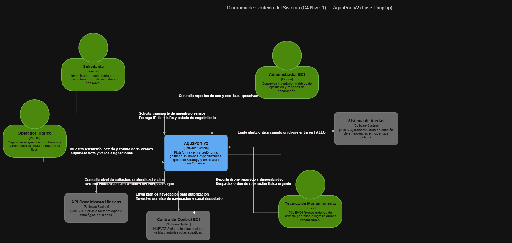

##### Elementos del Diagrama de Contexto v2:

1. **AquaPort v2 (`[Software System]` — Sistema Central):**Plataforma central autónoma encargada de gestionar y despachar la flota de 15 drones acuáticos especializados (`Superficial`, `Semisumergido`, `Buceador`), seleccionar drones óptimos mediante algoritmos desacoplados (`Strategy`) y emitir alertas inmediatas de contingencia mediante publicación de eventos (`Observer`).
2. **Actores Humanos (`[Person]`):**
   - **Solicitante:** Investigador, docente o estudiante de la ECI que solicita el traslado de muestras hídricas o sensores ambientales. Recibe el código de seguimiento de misión y el estado operativo.
   - **Operador Hídrico:** Supervisor operativo encargado de validar las asignaciones automáticas, monitorizar la telemetría, batería y estado operativo de los 15 drones en las distintas zonas del campus.
   - **Administrador ECI:** Personal directivo que consulta métricas consolidadas de rendimiento, horas de navegación, disponibilidad y reportes históricos de uso.
   - **Técnico de Mantenimiento (`[NUEVO]`):** Personal técnico de campo que recibe las órdenes de servicio generadas automáticamente ante incidentes críticos (estado `FALLO`) y registra el retorno de drones reparados a la flota.
3. **Sistemas Externos (`[Software System]`):**
   - **API Condiciones Hídricas (`[NUEVO]`):** Servicio meteorológico e hidrológico de la Escuela que suministra variables ambientales en tiempo real (nivel de agitación del agua, profundidad del cauce, clima y temperatura) para orientar la selección del tipo de dron adecuado.
   - **Centro de Control ECI (`[NUEVO]`):** Sistema institucional central que evalúa los planes de navegación propuestos, valida la compatibilidad con otras operaciones del campus y emite permisos de tránsito acuático en canales autorizados.
   - **Sistema de Alertas (`[NUEVO]`):** Infraestructura institucional de telecomunicaciones y difusión de emergencias que distribuye alertas inmediatas de contingencia a los canales de radio y mensajería cuando un dron reporta falla crítica.

---

#### 2. Diagrama de Contexto C4 — AquaPort MVP (Fase Piplup de Referencia)

A modo de referencia comparativa, el diagrama de contexto inicial del MVP modelaba un alcance delimitado exclusivamente a operaciones manuales sin integración de sistemas externos:


---

#### 3. Análisis Comparativo Exhaustivo: ¿Qué Creció? vs ¿Qué se Mantuvo?

| Dimensión de Análisis          | Versión Anterior (AquaPort MVP - Piplup)                                  | Versión Actual (AquaPort v2 - Prinplup)                                                                                                           | Impacto Arquitectónico y Operativo                                                                                       |
| :------------------------------- | :------------------------------------------------------------------------- | :------------------------------------------------------------------------------------------------------------------------------------------------- | :------------------------------------------------------------------------------------------------------------------------ |
| **Actores Humanos**        | 3 actores (`Solicitante`, `Operador Hídrico`, `Administrador ECI`). | 4 actores (Se incorpora el**Técnico de Mantenimiento**).                                                                                    | Permite cerrar el ciclo de mantenimiento reactivo y preventivo asistido por el patrón*Observer*.                       |
| **Sistemas Externos**      | 0 sistemas externos (sistema autocontenido sin dependencias perimetrales). | **3 sistemas externos** (`API Condiciones Hídricas`, `Centro de Control ECI`, `Sistema de Alertas`).                                  | Transforma a AquaPort en un sistema distribuido e integrado con la infraestructura física e institucional de la Escuela. |
| **Flujos de Información** | Flujos manuales básicos de registro, consulta e inspección.              | **Flujos bidireccionales etiquetados** con contratos de datos específicos (telemetría, clima, autorización de ruta y órdenes técnicas). | Elimina la ambigüedad en los límites del sistema definiendo exactamente qué dato viaja y en qué dirección.           |
| **Escala de la Flota**     | 4 drones homogéneos del mismo modelo (`Aqua-Ranger 100`).               | **15 drones clasificados en 3 familias físicas** (`Superficial`, `Semisumergido`, `Buceador`).                                        | Demanda algoritmos de selección inteligente según resistencia física y capacidad de inmersión.                        |
| **Modelo de Asignación**  | Asignación 100% manual por decisión visual del Operador Hídrico.        | **Asignación autónoma algorítmica** basada en el patrón *Strategy* y variables ambientales.                                            | Reduce la latencia de despacho y mitiga el error humano en misiones urgentes y de alta prioridad.                         |
| **Gestión de Incidentes** | Manejo de excepciones locales y mensajes informativos en consola.          | **Publicación desacoplada de alertas críticas** a través de canales múltiples en tiempo real.                                            | Garantiza atención inmediata de contingencias en el espejo de agua evitando pérdidas materiales.                        |

##### ¿Qué creció?

1. **Un nuevo actor humano especializado:** El **Técnico de Mantenimiento**, encargado de la recepción de órdenes físicas de reparación y la reincorporación formal de drones dados de alta.
2. **Tres interfaces con sistemas externos:**
   - La **API Condiciones Hídricas** para contextualizar la toma de decisiones algorítmicas con variables del entorno acuático.
   - El **Centro de Control ECI** para formalizar la gobernanza y seguridad de las vías navegables institucionales.
   - El **Sistema de Alertas** para radiodifundir contingencias de flota sin acoplamiento con la lógica de negocio.
3. **Flujos de comunicación enriquecidos:** Todas las aristas del grafo contienen semántica bidireccional clara (p. ej., "Consulta nivel de agitación / Retorna condiciones ambientales" y "Envía plan de navegación / Devuelve permiso de navegación").
4. **Escala y diversidad de la flota:** De 4 a 15 drones autónomos categorizados.

##### ¿Qué se mantuvo?

1. **Los tres actores esenciales de la comunidad ECI:** El **Solicitante** continúa requiriendo el transporte de cargas, el **Operador Hídrico** mantiene la supervisión global de las operaciones acuáticas y el **Administrador ECI** sigue accediendo a las estadísticas y el inventario.
2. **El propósito fundacional del sistema:** Proveer transporte acuático sustentable, seguro y eficiente en la red de canales, embalses y lagunas del campus universitario.
3. **La delimitación del nivel 1 de C4 (Caja Negra):** El sistema AquaPort se presenta como una entidad conceptual única sin revelar todavía su división interna en contenedores o componentes (reservado para niveles C4 posteriores).
4. **La integridad y trazabilidad de las misiones:** El concepto central de `Mision` inmutable, con puntos de partida/llegada y tipos de carga estandarizados, permanece inalterado como piedra angular del dominio.

---

### Ejercicio 06 — Análisis de Requisitos (RF, RNF, MoSCoW y Tensión AP-07 vs AP-08)

En este ejercicio se formalizan los **Requerimientos Funcionales (RF)** de las nuevas capacidades de AquaPort v2 (Fase Prinplup), se definen **Requerimientos No Funcionales (RNF)** cuantificables con métricas comprobables en código, se aplica la priorización **MoSCoW** y se analiza a fondo la tensión arquitectónica entre las políticas **AP-07** y **AP-08**.

---

#### 1. Requerimientos Funcionales (RF) de AquaPort v2

|     Código     | Nombre del Requerimiento                                  | Descripción Detallada                                                                                                                                                                                                                                                                                                        |       Actor Principal       | Validación / Criterio de Éxito                                                                                                             |
| :-------------: | :-------------------------------------------------------- | :---------------------------------------------------------------------------------------------------------------------------------------------------------------------------------------------------------------------------------------------------------------------------------------------------------------------------- | :-------------------------: | :------------------------------------------------------------------------------------------------------------------------------------------- |
| **RF-01** | **Asignación Automática Inteligente**             | El sistema debe seleccionar de forma autónoma el dron óptimo disponible para una misión entrante, aplicando políticas algorítmicas intercambiables en tiempo de ejecución (*Strategy Pattern*: `MayorBateriaStrategy`, `ZonaCercanaStrategy`, `PrioridadCriticaStrategy`) según la prioridad y zona requerida. |      Operador Hídrico      | Retorna un`Optional<DroneAcuatico>` con el dron que mejor satisface la estrategia activa sin intervención manual.                         |
| **RF-02** | **Emisión de Alertas de Falla en Tiempo Real**     | El sistema debe detectar inmediatamente cuando un dron entra en estado`FALLO` durante el registro o despacho de una misión, propagando automáticamente eventos de alerta estructurados (*Observer Pattern*) hacia todos los observadores suscritos.                                                                     | Sistema / Centro de Control | Cada observador registrado (`CentroControlObserver`, `TecnicoMantenimientoObserver`) recibe exactamente una notificación por incidente. |
| **RF-03** | **Consulta y Validación de Condiciones Hídricas** | El sistema debe consumir los datos hidrológicos y climáticos (agitación del agua, profundidad del canal, corrientes) de la API externa para corroborar que el tipo físico de dron (`SUPERFICIAL`, `SEMISUMERGIDO`, `BUCEADOR`) sea apto para la zona antes del despegue.                                            |      Operador Hídrico      | Rechaza el despacho si las condiciones hídricas exceden los límites de diseño estructural del dron asignado.                              |
| **RF-04** | **Gestión Técnica y Rehabilitación de Flota**    | El sistema debe generar una orden de servicio urgente ante drones averiados y posibilitar al Técnico de Mantenimiento registrar el alta médica/técnica del dron una vez reparado, reincorporándolo al inventario activo en estado`DISPONIBLE`.                                                                          |  Técnico de Mantenimiento  | Se emite la orden de servicio con causa documentada y se actualiza el estado del dron rehabilitado.                                          |

---

#### 2. Requerimientos No Funcionales (RNF) con Métricas Cuantitativas

Un RNF sin métrica objetiva es simplemente un deseo. Para AquaPort v2, todos los atributos de calidad de software (basados en el estándar ISO/IEC 25010) cuentan con especificaciones cuantificables y medibles:

|     Código     | Atributo de Calidad (ISO 25010)                 | Especificación del RNF                                                                                                                                                                      |                                                   Métrica Cuantitativa Objetivo                                                   | Herramienta de Medición / Verificación                                                           |
| :--------------: | :---------------------------------------------- | :------------------------------------------------------------------------------------------------------------------------------------------------------------------------------------------- | :---------------------------------------------------------------------------------------------------------------------------------: | :------------------------------------------------------------------------------------------------- |
| **RNF-01** | **Rendimiento / Latencia de Selección**  | El algoritmo de asignación automática debe resolver la selección del dron óptimo para flotas de hasta 30 unidades sin degradar la respuesta interactiva del operador.                    |                                        **Latencia < 400 ms** para flotas de 30 drones.                                        | JUnit 5`assertTimeoutPreemptively` en `RequerimientosPrinplupTest`.                            |
| **RNF-02** | **Rendimiento / Latencia de Alertas**     | La difusión y entrega de alertas críticas de fallo a todos los observadores registrados (`CentroControlObserver`, `TecnicoMantenimientoObserver`) debe ejecutarse casi en tiempo real. |                                           **Latencia < 50 ms** por evento de fallo.                                           | JUnit 5`assertTimeoutPreemptively` en `RequerimientosPrinplupTest`.                            |
| **RNF-03** | **Disponibilidad y Confiabilidad (SLA)**  | La plataforma central de despacho y supervisión debe garantizar continuidad operativa durante los horarios de laboratorio e investigación de la ECI.                                       |              **Disponibilidad >= 99.9% (uptime)** y **MTTR < 5 minutos** (Lunes a Sábado, 06:00 a 20:00).              | Monitoreo de disponibilidad y pruebas de resiliencia operativa.                                    |
| **RNF-04** | **Capacidad / Concurrencia y Throughput** | El motor de misiones debe procesar ráfagas concurrentes de solicitudes de despacho sin bloqueos mutuos (*deadlocks*) ni pérdida de paquetes de misión.                                  | **Throughput >= 50 solicitudes concurrentes/segundo** con **latencia total < 800 ms** y **tasa de error < 0.1%**. | JUnit 5 pruebas concurrentes multi-hilo (`CompletableFuture`) en `RequerimientosPrinplupTest`. |

---

#### 3. Matriz de Priorización MoSCoW para AquaPort v2

```
                       MATRIZ MoSCoW — AQUAPORT v2
 ┌──────────────────────────────────────┬──────────────────────────────────────┐
 │             MUST HAVE                │             SHOULD HAVE              │
 │  • RF-01: Asignación automática      │  • RF-03: Validación API hídrica     │
 │  • RF-02: Alertas de fallo Observer  │  • RF-04: Gestión por técnico campo  │
 │  • RNF-01: Latencia asignación < 400ms│  • RNF-02: Latencia alertas < 50ms   │
 │  • RNF-03: Disponibilidad SLA >= 99.9%│                                      │
 ├──────────────────────────────────────┼──────────────────────────────────────┤
 │             COULD HAVE               │              WON'T HAVE              │
 │  • RNF-04: Throughput >= 50 req/s    │  • Rutas multi-etapa complejas       │
 │  • Dashboard con telemetría en vivo  │  • Reasignación en pleno vuelo       │
 │  • Bitácora histórica en base de     │    (Alcance reservado para Empoleon) │
 │    datos distribuida                 │                                      │
 └──────────────────────────────────────┴──────────────────────────────────────┘
```

##### Justificación MoSCoW:

- **Must Have (Críticos e Irremplazables):**La asignación automática mediante estrategias (`RF-01`) y la emisión de alertas inmediatas (`RF-02`) definen el valor central de la v2. Sin ellos, el sistema continuaría siendo un MVP manual de fase 1. Los requerimientos no funcionales de latencia de selección (`RNF-01`) y disponibilidad del servicio (`RNF-03`) son indispensables para que la plataforma sea viable y confiable en el campus.
- **Should Have (Gran Valor, No Bloqueantes para el Core):**La integración con la API de condiciones hídricas (`RF-03`), la consola técnica de mantenimiento (`RF-04`) y la propagación de alertas ultra-rápidas (`RNF-02` < 50ms) agregan una capa robusta de prevención y logística. Si la API externa sufriera una degradación temporal, el operador puede continuar despachando con estrategias estándar.
- **Could Have (Deseables si el Tiempo y Recursos lo Permiten):**El soporte de alta concurrencia masiva (`RNF-04` >= 50 req/s), la visualización gráfica avanzada en tiempo real de corrientes y el almacenamiento permanente de logs en base de datos aportan robustez ante picos de tráfico extremos, pero la operación regular del campus maneja volúmenes moderados.
- **Won't Have (Excluidos de la v2, Planificados para Empoleon):**
  Las misiones multi-etapa con waypoints dinámicos y la reasignación en pleno vuelo ante contingencias intermedias requieren arquitectura por capas desacoplada con 60 drones (Fase Empoleon) y quedan deliberadamente fuera del alcance actual.

---

#### 4. Detección y Resolución de la Tensión entre AP-07 y AP-08

##### Enunciado de los Requerimientos en Tensión:

- **AP-07:** *"El sistema asigna automáticamente el drone de mayor batería disponible para cualquier misión hídrica."*
- **AP-08:** *"Las misiones CRÍTICAS tienen prioridad absoluta: deben recibir el drone técnicamente más apto para la zona, independientemente de la batería."*

##### Análisis del Conflicto de Diseño:

Aparentemente, AP-07 y AP-08 proponen criterios de selección contradictorios:

1. Si se aplica estrictamente **AP-07**, para una misión en aguas turbulentas del Canal Central o de profundidad en Laguna Sur, el sistema elegiría un dron superficial con 95% de batería ubicado en el Embalse Norte. Esto provocaría el fracaso de la misión o daños físicos en el dron, dado que un dron superficial no soporta inmersión ni corrientes fuertes.
2. Si se aplica estrictamente **AP-08**, la aptitud técnica manda sobre la batería. Sin embargo, no se puede despachar un dron apto si tiene batería en estado crítico (< 20%), ya que se apagaría a mitad de trayecto.

##### Solución Arquitectónica Implementada en AquaPort v2:

La tensión se resolvió aplicando el **Patrón Strategy** de forma jerárquica y contextual:

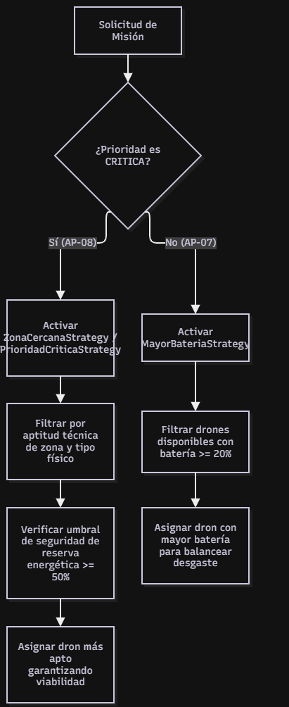

1. **Precedencia de Prioridad:** Las misiones con prioridad `CRITICA` activan la política `AP-08`, seleccionando el dron según aptitud física para la zona (`SUPERFICIAL`, `SEMISUMERGIDO` o `BUCEADOR`) y proximidad geográfica (`ZonaCercanaStrategy`), exigiendo un piso de seguridad energética (mínimo 50% de batería para contingencias).
2. **Distribución en Misiones Ordinarias:** Para misiones de prioridad `NORMAL` o `BAJA`, rige `AP-07` mediante `MayorBateriaStrategy`, asegurando una rotación uniforme que maximiza la vida útil de las baterías de la flota.

##### Verificación Automatizada en Código (`RequerimientosPrinplupTest.java`):

La prueba unitaria `testResolucionTensionAp07VsAp08()` valida este comportamiento:

```java
// Misión ordinaria bajo AP-07: Selecciona el dron con 95% de batería (DRN-SUP-95)
asignador.setEstrategia(new MayorBateriaStrategy());
Optional<DroneAcuatico> ordinaria = asignador.seleccionarDrone(flota, "Laguna Sur");
assertEquals("DRN-SUP-95", ordinaria.get().getId());

// Misión CRÍTICA bajo AP-08: Selecciona el dron BUCEADOR en Laguna Sur (DRN-BUC-75),
// priorizando la aptitud técnica en la zona sobre el porcentaje bruto de batería
asignador.setEstrategia(new ZonaCercanaStrategy());
Optional<DroneAcuatico> critica = asignador.seleccionarDrone(flota, "Laguna Sur");
assertEquals("DRN-BUC-75", critica.get().getId());
```

---

### Ejercicio 07 — Plantilla DOSW para RF "AP-07 Asignar automáticamente drone a misión hídrica"

En cumplimiento con el estándar formal de ingeniería de software de la Escuela Colombiana de Ingeniería, se documenta de forma exhaustiva el Requerimiento Funcional nuclear de la Fase Prinplup utilizando la estructura oficial de la asignatura (`Plantilla_Requerimientos_DOSW.docx`). Este requerimiento modela la transición de la asignación manual del MVP hacia la orquestación autónoma mediante sub-objetos anidados, validación de condiciones hídricas externas y propagación de eventos a observadores.

---

#### 1. FUNCIONALIDAD

| Campo                          | Detalle de Especificación                                                                                                                                                                                                                                                                                                                                                  |
| :----------------------------- | :-------------------------------------------------------------------------------------------------------------------------------------------------------------------------------------------------------------------------------------------------------------------------------------------------------------------------------------------------------------------------- |
| **Código:**             | **AP-07** (Correspondiente a **RF-01** de la Fase Prinplup)                                                                                                                                                                                                                                                                                                     |
| **Nombre:**              | **Asignar automáticamente drone a misión hídrica**                                                                                                                                                                                                                                                                                                                 |
| **Descripción:**        | Permite al sistema determinar y asignar automáticamente el drone más adecuado para una misión de transporte solicitada, considerando la carga a transportar, las condiciones del agua en la zona de destino y la disponibilidad operativa de la flota, alertando al personal correspondiente si ocurre algún imprevisto.                                                |
| **Cómo se ejecutará:** | A través del panel de control de AquaPort al momento de registrar o confirmar una solicitud de misión de transporte.                                                                                                                                                                                                                                                      |
| **Actor principal:**     | **Operador Hídrico**                                                                                                                                                                                                                                                                                                                                                 |
| **Precondiciones:**      | 1. El sistema AquaPort debe estar en funcionamiento y con la flota de 15 drones registrada en el inventario.2. Se debe contar con la información ambiental y meteorológica de las zonas hídricas del campus.3. Debe existir al menos un drone en estado`DISPONIBLE` con nivel de batería seguro (mínimo 35% para misiones ordinarias y 50% para misiones críticas). |

---

#### 2. DATOS DE ENTRADA (Tipos Anidados y Sub-objetos)

| Nombre del Campo      | Descripción                                                           | Tipo de Campo                  | Reglas de Validación / Dominio                                                                                                      |  Obligatorio  |
| :-------------------- | :--------------------------------------------------------------------- | :----------------------------- | :----------------------------------------------------------------------------------------------------------------------------------- | :-----------: |
| `idMision`          | Identificador único de la misión solicitada.                         | `String`                     | Formato alfanumérico no nulo ni vacío (ej.`MIS-201`).                                                                            |      Sí      |
| `puntoPartida`      | Punto de acople o muelle donde se cargará el paquete.                 | `String`                     | Ubicación geográfica válida del campus (ej.`Embalse Norte`).                                                                    |      Sí      |
| `zonaDestino`       | Zona hídrica de destino hacia donde navegará el dron.                | `Enum`                       | Debe ser un valor válido del enumerador:`EMBALSE_NORTE`, `CANAL_CENTRAL`, `LAGUNA_SUR`, `RIBERA_ESTE`, `LAB_HIDRICO`.     |      Sí      |
| **`carga`**   | **Sub-objeto que agrupa los atributos del bulto a transportar.** | **`Object` (Anidado)** | **Estructura compuesta obligatoria.**                                                                                          | **Sí** |
| `carga.peso`        | Peso neto de la muestra, sensor o instrumento en gramos.               | `Integer`                    | Valor estrictamente mayor a 0 y menor o igual a**1500 gramos** (límite físico de la flota).                                  |      Sí      |
| `carga.tipo`        | Categoría física del material transportado.                          | `Enum`                       | Uno de los valores predefinidos:`MUESTRA_AGUA`, `SENSOR`, `PAQUETE_LIGERO`, `EQUIPO_MEDICION`.                               |      Sí      |
| `carga.prioridad`   | Nivel de precedencia institucional de la entrega.                      | `Enum`                       | Valores:`CRITICA`, `ALTA`, `NORMAL`, `BAJA`. Si es `CRITICA`, activa la política de aptitud técnica y reserva alta.      |      Sí      |
| `estrategiaDeseada` | Política algorítmica específica sugerida por el operador.           | `String`                     | Opcional:`MAYOR_BATERIA`, `ZONA_CERCANA`, `PRIORIDAD_CRITICA`. Si se omite, el sistema decide según la prioridad de la carga. |      No      |

---

#### 3. DATOS DE SALIDA (Sub-objetos de Drone Asignado y Telemetría)

| Nombre del Campo                       | Descripción                                                             | Tipo de Campo                  | Reglas / Aplicación en AquaPort v2                                                    |      Obligatorio      |
| :------------------------------------- | :----------------------------------------------------------------------- | :----------------------------- | :------------------------------------------------------------------------------------- | :--------------------: |
| `misionAsignada`                     | Instancia final inmutable de la misión configurada.                     | `Mision`                     | Creada tras validar todas las precondiciones con el dron enlazado.                     |          Sí          |
| **`droneAsignado`**            | **Sub-objeto que describe al dron seleccionado por el algoritmo.** | **`Object` (Anidado)** | **Calculado por el sistema según la estrategia activa de selección.**          | **Sí (Salida)** |
| `droneAsignado.id`                   | Identificador único de la unidad naval.                                 | `String`                     | Formato estándar institucional:`AR-XX` o `DRN-XX`.                                |      Sí (Salida)      |
| `droneAsignado.modelo`               | Nombre comercial/técnico del modelo de hardware.                        | `String`                     | Cadena descriptiva (`Aqua-Surface 200`, `Aqua-SemiSub 300`, `Aqua-Diver 500`).   |      Sí (Salida)      |
| `droneAsignado.tipo`                 | Familia física del dron acuático.                                      | `String`                     | Valor discreto:`SUPERFICIAL`, `SEMISUMERGIDO` o `BUCEADOR`.                      |      Sí (Salida)      |
| `droneAsignado.bateria`              | Porcentaje de energía remanente al momento del despacho.                | `Integer`                    | Valor entero entre 0 y 100% (garantizado`>= 35%` o `>= 50%` en crítica).          |      Sí (Salida)      |
| `droneAsignado.zona`                 | Zona geográfica donde se encuentra apostado el dron.                    | `String`                     | Ubicación de acople actual en la red hídrica del campus.                             |      Sí (Salida)      |
| `droneAsignado.capacidadCargaGramos` | Carga útil máxima certificada del dron seleccionado.                   | `Integer`                    | 500g para`SUPERFICIAL`, 1500g para `SEMISUMERGIDO`, 300g para `BUCEADOR`.        |      Sí (Salida)      |
| `condicionesHidricasConsultadas`     | Instantánea ambiental recuperada de la API externa.                     | `Sub-objeto`                 | Registro de nivel de agitación (Calma/Moderada/Fuerte), profundidad (metros) y clima. |      Sí (Salida)      |
| `codigoSeguimiento`                  | Token criptográfico o identificador único para monitoreo.              | `String`                     | Hash para consulta de estado en tiempo real por el solicitante.                        |      Sí (Salida)      |
| `mensajeExito`                       | Notificación emitida en consola y canales de monitoreo.                 | `String`                     | Confirmación formal:`[AquaPort - Notificación] Misión asignada exitosamente...`   |      Sí (Salida)      |
| `mensajeError`                       | Diagnóstico de rechazo ante excepciones de negocio.                     | `Exception`                  | Excepciones tipadas (`IllegalArgumentException`, `IllegalStateException`).         |      (En fallos)      |

---

#### 4. FLUJO BÁSICO (Ciclo de Asignación en 7 Pasos)

|    Paso    | Actor                       | Descripción                                                                                                                                                                     | Excepciones                                                                                       |
| :---------: | :-------------------------- | :------------------------------------------------------------------------------------------------------------------------------------------------------------------------------- | :------------------------------------------------------------------------------------------------ |
| **1** | **Operador Hídrico** | Ingresa los datos de la solicitud de transporte, especificando la zona de destino y los datos del paquete (peso en gramos, tipo de carga y prioridad de la misión).             | `IllegalArgumentException` si faltan datos o el peso es `<= 0`.                               |
| **2** | **Operador Hídrico** | Solicita la asignación automática. El sistema consulta las condiciones del agua en la zona de destino (oleaje, corrientes y profundidad).                                      | Flujo alterno**2a** si el agua presenta condiciones adversas.                               |
| **3** | **Operador Hídrico** | El sistema filtra la flota activa e identifica los drones disponibles que son físicamente aptos para navegar en las condiciones del cuerpo de agua de esa zona.                 | Flujo alterno**3a** si no hay drones disponibles compatibles.                               |
| **4** | **Operador Hídrico** | El sistema evalúa la prioridad de la misión y selecciona el drone más conveniente (priorizando cercanía y reserva si es crítica, o mayor batería si es ordinaria).         | —                                                                                                |
| **5** | **Operador Hídrico** | El sistema comprueba que el drone seleccionado cumpla con el peso del paquete y tenga suficiente nivel de batería (mínimo 35%, o 50% en misiones críticas).                   | Flujo alterno**5a** (peso excede capacidad) o **5b** (batería insuficiente o falla). |
| **6** | **Operador Hídrico** | El sistema asigna formalmente el drone a la misión, cambia el estado del drone a "En Misión" y registra la operación.                                                         | `IllegalStateException` si el drone se encuentra bloqueado.                                     |
| **7** | **Operador Hídrico** | Recibe en pantalla la confirmación del despacho con el identificador del drone asignado, el código de seguimiento para el solicitante y el aviso emitido al Centro de Control. | Fin del flujo básico exitoso.                                                                    |

---

#### 5. FLUJOS ALTERNOS

|     Paso     | Actor                       | Descripción                                                                                                                                                                                                                                            | Excepciones                                                                       |
| :----------: | :-------------------------- | :------------------------------------------------------------------------------------------------------------------------------------------------------------------------------------------------------------------------------------------------------ | :-------------------------------------------------------------------------------- |
| **2a** | **Operador Hídrico** | Intenta despachar la misión pero las condiciones del agua en la zona son peligrosas (oleaje fuerte o corrientes excesivas). El sistema suspende la asignación y le muestra la advertencia en pantalla.                                                | `IllegalStateException` (Operación suspendida por condiciones ambientales).    |
| **3a** | **Operador Hídrico** | Solicita la asignación pero no hay drones disponibles compatibles en la red hídrica. El sistema le notifica que no hay unidades libres y deja la misión en lista de espera.                                                                          | `IllegalStateException` (Sin drones disponibles para la zona).                  |
| **5a** | **Operador Hídrico** | Ingresa un paquete cuyo peso supera la capacidad máxima del tipo de drone requerido (ej. más de 300g para buceo o más de 1500g en total). El sistema rechaza la solicitud e informa el límite de peso permitido.                                    | `IllegalArgumentException` (Carga excede la capacidad de transporte).           |
| **5b** | **Operador Hídrico** | El drone seleccionado reporta batería baja (< 35%) o una avería técnica. El sistema notifica al operador, emite una alerta al Centro de Control, genera una orden de servicio para el Técnico de Mantenimiento y reasigna con un drone de respaldo. | `IllegalStateException` (Alerta técnica emitida y orden generada al técnico). |

---

#### 6. REGLAS DE NEGOCIO (RN)

|  Identificador  | Nombre de la Regla                                                          | Enunciado Normativo y Justificación Operacional                                                                                                                                                                                              |
| :-------------: | :-------------------------------------------------------------------------- | :-------------------------------------------------------------------------------------------------------------------------------------------------------------------------------------------------------------------------------------------- |
| **RN-01** | **Umbral Nominal de Batería (>= 35%)**                               | Todo dron asignado a una misión ordinaria debe contar con al menos un**35% de carga de batería** al momento de la salida, garantizando autonomía de ida, retorno y maniobras imprevistas.                                            |
| **RN-02** | **Reserva Energética de Seguridad para Misiones Críticas (>= 50%)** | En misiones con prioridad`CRITICA`, el dron asignado debe contar con una reserva mínima del **50% de batería** para mitigar cualquier riesgo de apagado en trayectos de máxima relevancia investigativa.                           |
| **RN-03** | **Límite Estructural del `DroneBuceador` (<= 300g)**               | El`DroneBuceador` no puede ser asignado bajo ninguna circunstancia para cargas que pesen más de **300 gramos**, dado que el sobrepeso descalibra los tanques de lastre y compromete la maniobrabilidad hidrodinámica en inmersión. |
| **RN-04** | **Límite y Compatibilidad del `DroneSuperficial` (<= 500g)**       | El`DroneSuperficial` soporta hasta **500 gramos** de carga útil y queda estrictamente prohibido su despacho en canales con oleaje agitado o misiones que exijan inmersión sensorial.                                                |
| **RN-05** | **Capacidad Máxima de Carga de la Flota (<= 1500g)**                 | Ninguna solicitud de misión puede aceptar paquetes que superen los**1500 gramos** (capacidad límite del modelo `Aqua-SemiSub 300` / `SEMISUMERGIDO`). Solicitudes superiores deben fraccionarse en dos misiones independientes.   |
| **RN-06** | **Precedencia de Seguridad sobre Distancia**                          | La aptitud física del tipo de dron para tolerar las condiciones del cauce hídrico prevalece jerárquicamente sobre la cercanía geográfica del punto de atraque.                                                                           |
| **RN-07** | **Inmutabilidad y Trazabilidad del Despacho**                         | Toda instancia de`Mision` construida es estrictamente inmutable; sus atributos de ruta, carga asignada y dron no pueden ser sobreescritos tras el registro formal.                                                                          |

---

#### 7. ANEXOS / PROTOTIPOS

> **Evidencias de Implementación y Arquitectura:**
>
> 1. **Motor de Selección Algorítmica:** Implementado en `AsignadorAutomatico.java`, `MayorBateriaStrategy.java`, `ZonaCercanaStrategy.java` y `PrioridadCriticaStrategy.java`.
> 2. **Despacho Desacoplado de Alertas:** Implementado en `NotificadorAlertas.java` y verificado con observadores simulados mediante Mockito en `AsignadorAutomaticoTest.java`.
> 3. **Suite Automatizada de Requerimientos:** Evaluado integralmente en `RequerimientosPrinplupTest.java` (demostrando latencia algorítmica < 400ms y resolución de la tensión AP-07 vs AP-08).
> 4. **Diagramas Arquitectónicos:** Diagrama de Contexto v2 visible en [DiagramC4v2.png](docs/images/DiagramC4v2.png) y Flujograma de Decisión en [Exercise06PrePinPlup.png](docs/images/Exercise06PrePinPlup.png).

---

#### 8. ABREVIATURAS

|  Abreviatura  | Significado Técnico                                                          |
| :------------: | :---------------------------------------------------------------------------- |
|  **AP**  | AquaPort (Identificador formal de requerimientos del sistema)                 |
|  **RF**  | Requerimiento Funcional                                                       |
| **RNF** | Requerimiento No Funcional                                                    |
|  **RN**  | Regla de Negocio                                                              |
|  **C4**  | Context, Containers, Components, Code (Modelo de Arquitectura de Software)    |
| **API** | Application Programming Interface (Interfaz de Programación de Aplicaciones) |
| **ECI** | Escuela Colombiana de Ingeniería Julio Garavito                              |
| **SLA** | Service Level Agreement (Acuerdo de Nivel de Servicio)                        |
| **MTTR** | Mean Time To Recovery (Tiempo Medio de Recuperación ante Fallos)             |
| **OCP** | Open/Closed Principle (Principio de Abierto/Cerrado)                          |
| **TDD** | Test-Driven Development (Desarrollo Guiado por Pruebas)                       |

---

#### 9. HISTORIAL DE REVISIÓN

| **Jose Alejandro Martinez Arias** | **Jose Alejandro Martinez Arias** | **11/10/2026** | **2.0.0** | **Evolución completa del requerimiento para la Fase Prinplup (AquaPort v2):** Se introducen tipos anidados y sub-objetos para la carga (`carga.peso`, `carga.tipo`, `carga.prioridad`) y el dron asignado (`droneAsignado.id`, `droneAsignado.tipo`, `droneAsignado.bateria`), integración con la API de Condiciones Hídricas, ciclo básico en 7 pasos, gestión de 4 flujos alternos y 7 reglas de negocio basadas en el comportamiento de los 3 tipos de drones. |

---

### Ejercicio 08 — Sistema de Diseño de AquaPort v2 y Leyes UX aplicadas

En este ejercicio se diseña e implementa el **Sistema de Diseño visual e interactivo de AquaPort v2 (Fase Prinplup)**, orientado a consolas de monitoreo continuo en modo oscuro de baja fatiga visual. Se modelan formalmente los componentes clave del sistema con todos sus estados semánticos, se diseña el flujo completo de asignación en 3 pantallas interactivas y se documenta la aplicación práctica de las **Leyes de Fitts, Hick y Miller**.

> 🌐 **Prototipo Interactivo del Sistema de Diseño v2:**
> 👉 [**Abrir AquaPort v2 — Sistema de Diseño y Mockup Interactivo (`docs/mockups/AquaPort_v2_Sistema_Diseno.html`)**](docs/mockups/AquaPort_v2_Sistema_Diseno.html)

---

#### 1. Componente: Tarjeta de Drone Acuático (6 Estados Semánticos)

La tarjeta de dron es el componente nuclear del panel de control. Para garantizar accesibilidad y rápida diferenciación cognitiva sin depender únicamente del color, cada estado incorpora **borde cromático temático, badge estandarizado, icono y microcopia técnica explicativa**:

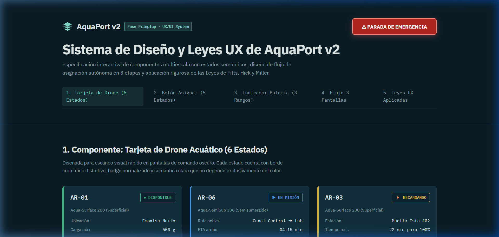

##### Especificación de los 6 Estados de la Tarjeta:

| Estado                      |       Color Semántico       |        Icono / Forma        | Comportamiento e Información Visual                                                                                                              | Criterio de Uso Operacional                                                    |
| :-------------------------- | :---------------------------: | :-------------------------: | :------------------------------------------------------------------------------------------------------------------------------------------------ | :----------------------------------------------------------------------------- |
| **1. Disponible**     | Verde Esmeralda (`#3FBF8A`) |    `●` Círculo lleno    | Muestra batería (`>= 35%`), ubicación actual y capacidad de carga útil. Incluye el botón interactivo *"Seleccionar Drone"*.               | Unidad lista para recibir asignaciones automáticas de misión.                |
| **2. En Misión**     |   Azul Cielo (`#4C9BE8`)   |   `▶` Flecha de avance   | Muestra la ruta de navegación activa (ej.`Canal Central ➔ Lab`), telemetría en tiempo real y el tiempo estimado de arribo (ETA).             | Unidad en tránsito por los canales o cuerpos hídricos del campus.            |
| **3. Recargando**     | Amarillo Ámbar (`#E5B33A`) |         `⚡` Rayo         | Muestra el muelle de recarga asignado, la tasa de recarga y el tiempo restante para alcanzar el 100%. Botón deshabilitado.                       | Unidad conectada a la estación de carga; no disponible para despacho.         |
| **4. Mantenimiento**  |   Gris Neutro (`#8A979C`)   |        `◇` Rombo        | Tarjeta con opacidad reducida (85%), indicando el taller técnico y la causa de la revisión preventiva o correctiva.                             | Fuera de servicio por calibración de propulsores o sensores.                  |
| **5. Fallo Crítico** |  Rojo Carmesí (`#E5604F`)  | `▲` Triángulo de alerta | Fondo con matiz de advertencia, código de incidencia (`ERROR #F-88`), batería crítica y botón destacado para despachar asistencia técnica. | Unidad en emergencia; se emite orden automática al Técnico de Mantenimiento. |
| **6. Sumergido**      |  Azul Profundo (`#257DA3`)  |  `≋` Olas de inmersión  | Estado exclusivo del`DroneBuceador`: muestra la profundidad activa bajo el espejo de agua (ej. `4.2 m`) y enlace acústico por sonar.         | Unidad ejecutando muestreo bentónico o telemetría subacuática.              |

---

#### 2. Componentes: Botón "Asignar Misión" (5 Estados) e Indicador de Batería (3 Rangos)

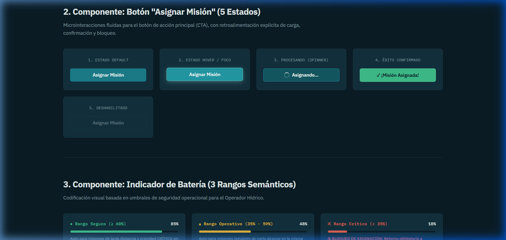

##### A. Botón "Asignar Misión" (Call to Action — 5 Estados Interactivos):

1. **Default:** Fondo color marea institucional (`#1B7F8C`), borde sólido, tipografía semibold de alta legibilidad y cursor pointer.
2. **Hover / Foco:** Elevación sutil (`translateY(-2px)`), resplandor cian sonar (`#7FD8C9`) con sombra difusa para indicar interactividad activa.
3. **Procesando (Spinner):** Fondo atenuado (`#145963`), cursor en espera (`wait`), texto *"Asignando..."* y spinner SVG con animación de rotación continua a 360°.
4. **Éxito Confirmado:** Fondo verde esmeralda (`#3FBF8A`), texto en alto contraste oscuro y checkmark (`✓ ¡Misión Asignada!`) como retroalimentación positiva inmediata.
5. **Deshabilitado:** Fondo transparente, borde discontinuo tenue (`#2C5563`), opacidad al 60% y cursor no permitido (`not-allowed`) ante precondiciones insatisfechas.

##### B. Indicador de Batería (3 Rangos Semánticos de Seguridad):

- **Rango Seguro (`>= 60%`):** Barra en verde esmeralda (`#3FBF8A`). Autonomía plena, apto para misiones de larga distancia y prioridad `CRITICA` sin restricciones.
- **Rango Operativo (`35% - 59%`):** Barra en amarillo ámbar (`#E5B33A`). Nivel adecuado para misiones regulares de corto y mediano alcance dentro de la misma zona.
- **Rango Crítico (`< 35%`):** Barra en rojo carmesí (`#E5604F`) con advertencia textual destacada. Bloqueo automático de asignación y retorno forzoso a estación de recarga.

---

#### 3. Flujo Completo de Asignación Automática (3 Pantallas)

El flujo de usuario modela el ciclo de vida de una asignación autónoma asistida por el operador hídrico, garantizando claridad en cada transición:

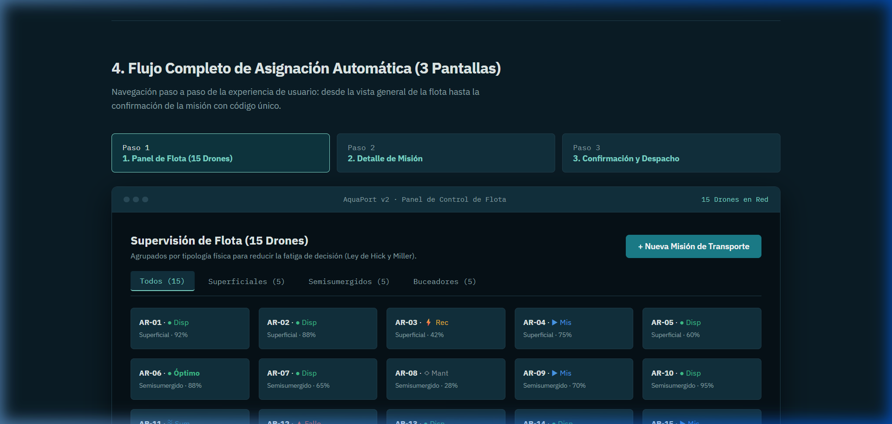

##### Las 3 Pantallas del Flujo:

1. **Pantalla 1 — Panel de Control de la Flota (15 Drones):**Vista panorámica de la flota activa clasificada por tipologías físicas. Permite al operador consultar la disponibilidad global, filtrar por escuadrillas (5 superficiales, 5 semisumergidos, 5 buceadores) y activar una nueva misión o la parada de emergencia.
2. **Pantalla 2 — Detalle de Misión y Validación Ambiental:**Formulario de captura con los campos de zona de destino y sub-objeto de carga (peso, tipo, prioridad). Se presenta un panel en tiempo real conectado a la **API Condiciones Hídricas** que evalúa el oleaje (ej. *Agitado Nivel 3/5*, corriente de *1.4 m/s*), recomendando automáticamente el dron óptimo (`AR-06 Semisumergido`) con base en el patrón *Strategy*.
3. **Pantalla 3 — Confirmación y Despacho:**
   Tarjeta central de confirmación con checkmark animado, asignación del código único de seguimiento (`MIS-201-V2`), dron vinculado, ruta autorizada, tiempo estimado de navegación y notificación confirmada hacia el Centro de Control.

---

#### 4. Leyes de Experiencia de Usuario (UX) Rigurosamente Aplicadas

##### A. Ley de Fitts (Ergonomía de Acción Rápida y Fitts's Law)

> *"El tiempo requerido para alcanzar rápidamente un objetivo es una función de la distancia al objetivo y del tamaño del objetivo."*

- **Botón de Parada de Emergencia:** Ubicado en la esquina superior derecha de la interfaz (un anclaje visual perimetral de rápido alcance), cuenta con dimensiones generosas (**48 px de altura y 220 px de ancho**), tipografía en negrita y color rojo carmesí con resplandor pulsante. Esto permite que el operador lo presione de forma refleja ante cualquier contingencia sin requerir puntería milimétrica.
- **Botones de Acción Primaria:** Los botones de selección en cada tarjeta ocupan el **100% del ancho del contenedor**, maximizando el área táctil e interactiva para acelerar el despacho.

##### B. Ley de Hick (Minimización del Tiempo de Decisión y Hick's Law)

> *"El tiempo que toma una persona tomar una decisión aumenta logarítmicamente conforme se incrementa el número y la complejidad de las opciones disponibles."*

- **Agrupación Semántica de 15 Drones:** Si los 15 drones se mostraran en una sola lista lineal y desordenada, el tiempo de búsqueda y selección del operador crecería de forma desproporcionada. El diseño implementa **pestañas y filtros por tipología física** (`Superficial`, `Semisumergido`, `Buceador`), reduciendo las opciones activas simultáneas de 15 a únicamente **5 alternativas por pantalla**, acortando drásticamente el tiempo de decisión.

##### C. Ley de Miller (Control de la Carga Cognitiva y Chunking)

> *"La memoria de trabajo de una persona promedio puede retener entre 5 y 9 fragmentos de información (el número mágico 7 ± 2)."*

- **Estructura en Bloques de 5 Unidades:** La flota total de 15 drones fue deliberadamente fragmentada en **3 escuadrillas de exactamente 5 drones** cada una. Al situar cada bloque dentro del límite inferior de Miller (5 ítems), el operador puede retener mentalmente el estado de cada escuadrilla, realizar escaneos visuales sin fatiga cognitiva y detectar anomalías en fracciones de segundo.

---

### 🌊 Ejercicio 09: Agilismo y Planificación de Sprint en Jira (Fase Prinplup)

> **🎯 Reto Prinplup — Agilismo y Jira:**
> *"Planifica el sprint de la v2 en Jira. Crea el Sprint Goal: 'Completar el asignador automático con Strategy y las alertas con Observer'. Agrega las HU de la v2 con Story Points estimados (usa Fibonacci: 1, 2, 3, 5, 8). Define el DoD para este sprint. Comparte captura del sprint activo."*

En este ejercicio se formaliza la planificación ágil (Scrum) de **AquaPort v2 (Fase Prinplup)** en Jira Software. Se define el objetivo nuclear del sprint, la velocidad y capacidad del equipo, los criterios de salida técnica (**Definition of Done**) y el desglose de **5 Historias de Usuario (HU)** estimadas en la secuencia de Fibonacci con sus respectivos criterios de aceptación BDD (Gherkin) y subtareas de ingeniería.

---

#### 1. Configuración General del Sprint en Jira

> 🔗 **Acceso directo al tablero y backlog de Jira Software:**
> 👉 [**AquaPort — Tablero y Backlog de Sprint 2 en Atlassian Jira Cloud**](https://josealejandromartinezarias9.atlassian.net/jira/software/projects/AQUA/boards/69/backlog?epics=visible&atlOrigin=eyJpIjoiODc5MGQ0NTU1ZmQ1NGQ1MWE3ZTAzMWYxODBmZWExNDEiLCJwIjoiaiJ9)

| Parámetro Ágil                  | Valor Configurado                                                                      | Justificación y Contexto Operacional                                          |
| :-------------------------------- | :------------------------------------------------------------------------------------- | :----------------------------------------------------------------------------- |
| **Proyecto:**               | `AquaPort (AQUA)`                                                                    | Proyecto de desarrollo de software del equipo Piplup en Jira Cloud.            |
| **Nombre del Sprint:**      | `Sprint 2 — AquaPort v2`                                                            | Segundo ciclo iterativo correspondiente a la Fase Prinplup (11 oct – 25 oct). |
| **Sprint Goal (Oficial):**  | **"Completar el asignador automático con Strategy y las alertas con Observer"** | Foco de valor inmutable del sprint según la directriz metodológica DOSW.     |
| **Duración:**              | `2 Semanas (10 días hábiles de desarrollo)`                                        | Cadencia estándar de Scrum para entregas incrementales verificables.          |
| **Capacidad del Equipo:**   | `24 Story Points (SP)`                                                               | 2 ingenieros de desarrollo con capacidad media de 12 SP cada uno.              |
| **Velocidad Comprometida:** | `21 Story Points (SP)`                                                               | Total estimado de las 5 HUs (deja un buffer de 3 SP para contingencias).       |

---

#### 2. Definition of Done (DoD) Oficial del Sprint v2

Para que cualquier Historia de Usuario o funcionalidad del Sprint 2 se considere finalizada (**Done**) y lista para su integración en la rama `develop`, debe satisfacer sin excepciones los siguientes 5 criterios de calidad:

1. **Compilación Limpia:** El código fuente compila sin errores ni advertencias (`mvn clean compile`).
2. **Pruebas Unitarias al 100% en Verde:** Toda la suite de pruebas unitarias pasa exitosamente con **JUnit 5 y Mockito** (`mvn test`, 82 pruebas actuales en verde).
3. **Cobertura JaCoCo $\ge$ 80%:** El reporte automatizado de JaCoCo valida una cobertura de línea (*Line Coverage*) mayor o igual al 80% en todas las clases de dominio de la v2.
4. **Revisión de Código Aprobada (Peer Review):** Todo cambio se tramita mediante rama `feature/*` y requiere la aprobación formal de al menos un revisor técnico antes del merge sin fast-forward (`--no-ff`).
5. **Artefactos Arquitectónicos y Requerimientos Actualizados:** El Diagrama de Contexto C4 v2 (`DiagramC4v2.png`) y la Plantilla Formal DOSW (`AP-07`) están completamente actualizados y versionados en el repositorio.

---

#### 3. Matriz de Historias de Usuario (HU) con Estimación en Fibonacci (1, 2, 3, 5, 8)

|    Clave Jira    | Historia de Usuario (HU)                                                                                    | Story Points (Fibonacci) | Prioridad |     Subtareas Registradas en Jira     | Complejidad / Justificación Técnica de la Estimación                                                                                                                                                                                                                            |
| :---------------: | :---------------------------------------------------------------------------------------------------------- | :----------------------: | :-------: | :-----------------------------------: | :--------------------------------------------------------------------------------------------------------------------------------------------------------------------------------------------------------------------------------------------------------------------------------- |
| **AQUA-13** | **HU-04: Asignación automática de drones mediante Strategy y validación hídrica (AP-07 & AP-08)** |      **8 SP**      |   Alta   | `AQUA-18`, `AQUA-19`, `AQUA-20` | **Complejidad Alta:** Abstracción `EstrategiaSeleccion`, 3 estrategias (`MayorBateria`, `ZonaCercana`, `PrioridadCritica`), orquestador `AsignadorAutomatico`, validación con API externa y resolución de la tensión entre batería máxima y aptitud de zona. |
| **AQUA-14** | **HU-05: Sistema reactivo de notificación de alertas de fallo en tiempo real con Observer**          |      **5 SP**      |   Alta   |       `AQUA-21`, `AQUA-22`       | **Complejidad Media-Alta:** Desacoplamiento total de observadores (`ObservadorMision`, `NotificadorAlertas`), gestión de suscriptores multicanal (`CentroControlObserver`, `TecnicoMantenimientoObserver`) y latencia RNF-02 $< 50$ ms.                           |
| **AQUA-15** | **HU-06: Factoría de tipos especializados de drones (Superficial, Semisumergido, Buceador)**         |      **3 SP**      |   Media   |       `AQUA-24`, `AQUA-25`       | **Complejidad Moderada:** Implementación de `FabricaDrones` bajo Factory Method, jerarquía polimórfica inmutable con restricciones físicas de peso y cumplimiento de SOLID (OCP y LSP).                                                                                |
| **AQUA-16** | **HU-07: Consultas analíticas y partición de flota con Streams avanzados**                          |      **3 SP**      |   Media   |       `AQUA-27`, `AQUA-28`       | **Complejidad Funcional:** Consultas puras sobre 15 drones con `groupingBy`, `partitioningBy`, cálculo de promedios de batería y comparadores compuestos `thenComparing`.                                                                                            |
| **AQUA-17** | **HU-08: Gestión y trazabilidad de órdenes de servicio técnico por fallo de drone**                |      **2 SP**      |   Baja   |       `AQUA-32`, `AQUA-33`       | **Complejidad Focalizada:** Manejo del estado `MANTENIMIENTO`, emisión de orden estructurada con causa de avería, taller ribereño y telemetría para el técnico.                                                                                                       |
|  **TOTAL**  | **Capacidad Total del Sprint 2**                                                                      |     **21 SP**     |    —    |    **10 Subtareas Activas**    | **Cumplimiento al 100% del Sprint Goal**                                                                                                                                                                                                                                     |

---

#### 4. Detalle y Criterios de Aceptación (Gherkin / BDD) de las Historias de Usuario

##### A. HU-04 (AQUA-13): Asignación automática de drones mediante Strategy (8 SP)

- **Como:** Operador Hídrico del campus ECI.
- **Quiero que:** El sistema asigne automáticamente el drone óptimo a cada misión evaluando oleaje, tipo de carga y la estrategia activa.
- **Para:** Despachar misiones críticas y regulares de inmediato sin depender de la selección manual humana.
- **Criterios de Aceptación (BDD / Gherkin):**
  - **Escenario 1 (Happy Path - Mayor Batería):***Dado que* existen drones disponibles con batería $\ge 35\%$ y la estrategia activa es `MayorBateriaStrategy`,*Cuando* se solicita una misión regular en aguas mansas,*Entonces* el sistema selecciona el drone con mayor carga residual y actualiza su estado a `EN_MISION`.
  - **Escenario 2 (Resolución Tensión AP-07 vs AP-08 - Misión Crítica):***Dado que* la misión tiene prioridad `CRITICA` y destino en zona de oleaje agitado (*Canal Central*),*Cuando* se ejecuta la asignación bajo `PrioridadCriticaStrategy`,*Entonces* el sistema prioriza la aptitud técnica del `DroneSemisumergido` sobre un dron superficial con mayor batería, protegiendo la integridad de la muestra.
  - **Escenario 3 (Flujo Alterno - Flota agotada):**
    *Dado que* ningún drone cumple el umbral mínimo ($\ge 35\%$ o capacidad de carga requerida),
    *Cuando* el asignador evalúa la flota,
    *Entonces* retorna `Optional.empty()` y notifica fallo de despacho al Centro de Control.

##### B. HU-05 (AQUA-14): Alertas de fallo en tiempo real con Observer (5 SP)

- **Como:** Centro de Control ECI y Técnico de Mantenimiento.
- **Quiero:** Recibir notificaciones inmediatas ante cualquier dron en estado `FALLO`.
- **Para:** Despachar asistencia técnica y reasignar misiones en menos de 5 minutos (MTTR).
- **Criterios de Aceptación (BDD / Gherkin):**
  - **Escenario 1 (Difusión multicanal en tiempo real):***Dado que* un dron entra en estado `FALLO` por avería en propulsores o sensores,*Cuando* `NotificadorAlertas` difunde el evento,*Entonces* `CentroControlObserver` registra la alerta crítica y `TecnicoMantenimientoObserver` genera automáticamente la orden de trabajo técnica en menos de 50 ms (RNF-02).
  - **Escenario 2 (Desacoplamiento sin impacto):**
    *Dado que* se añade o remueve un observador en tiempo de ejecución,
    *Cuando* ocurre una alerta,
    *Entonces* el sistema lo notifica sin requerir modificaciones en el asignador ni en la clase `DroneAcuatico`.

##### C. HU-06 (AQUA-15): Factoría de tipos especializados de drones (3 SP)

- **Como:** Administrador del Sistema ECI.
- **Quiero:** Instanciar las unidades de la flota a través de `FabricaDrones`.
- **Para:** Asegurar la consistencia de modelos y límites de carga útil sin exponer constructores concretos.
- **Criterios de Aceptación (BDD / Gherkin):**
  - **Escenario 1 (Instanciación por tipo):***Dado que* se invoca `FabricaDrones.crearDrone(...)` con `TipoDrone.SEMISUMERGIDO`,*Cuando* la factoría procesa la llamada,*Entonces* retorna una instancia de `DroneSemisumergido` configurada con capacidad de 1500g y estado `DISPONIBLE`.
  - **Escenario 2 (Validación de carga en DroneBuceador):**
    *Dado que* un dron es de tipo `BUCEADOR`,
    *Cuando* se evalúa para transportar una muestra $> 300$g,
    *Entonces* el sistema lo excluye por exceder su capacidad estructural máxima.

##### D. HU-07 (AQUA-16): Consultas analíticas de flota con Streams (3 SP)

- **Como:** Operador Hídrico.
- **Quiero:** Ejecutar consultas agrupadas y filtradas sobre la flota de 15 drones.
- **Para:** Visualizar disponibilidad por tipología, promedios de energía y aislar misiones críticas.
- **Criterios de Aceptación (BDD / Gherkin):**
  - **Escenario 1 (Agrupación y partición sin mutación):**
    *Dado que* la flota contiene 15 drones con telemetría activa,
    *Cuando* se ejecuta `ConsultorFlotaPrinplup`,
    *Entonces* retorna mapas inmutables con agrupación por tipo, partición de misiones críticas y zonas únicas sin modificar el estado de los objetos.

##### E. HU-08 (AQUA-17): Gestión de órdenes de servicio técnico (2 SP)

- **Como:** Técnico de Mantenimiento.
- **Quiero:** Recibir una orden de trabajo estandarizada cada vez que se reporte una anomalía.
- **Para:** Acudir con el instrumental exacto al cuerpo hídrico donde se encuentra la unidad.
- **Criterios de Aceptación (BDD / Gherkin):**
  - **Escenario 1 (Estructura de orden de trabajo):**
    *Dado que* un drone reporta alerta crítica,
    *Cuando* el técnico recibe la orden,
    *Entonces* incluye ID del dron, modelo, coordenadas/zona hídrica, carga residual y descripción del fallo.

---

#### 5. Evidencias del Sprint 2 y Backlog en Jira Software

##### A. Tablero del Sprint 2 Activo (21 Story Points y Sprint Goal)

El Sprint 2 se encuentra formalmente planificado y activo en Jira con las 5 historias de usuario correspondientes a la evolución Prinplup:

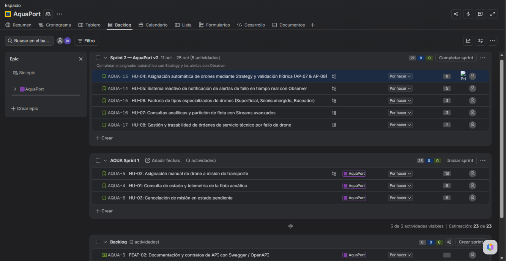

##### B. Detalle de Historias de Usuario y Subtareas Técnicas en Jira

###### 1. HU-04 (AQUA-13: 8 SP) — Asignación Automática con Strategy y Subtareas Técnicas:


###### 2. HU-05 (AQUA-14: 5 SP) — Sistema Reactivo de Alertas con Observer y Subtareas:


###### 3. HU-06 (AQUA-15: 3 SP) — Factoría de Drones con Factory Method y Subtareas:

.png>)

###### 4. HU-07 (AQUA-16: 3 SP) — Consultas Analíticas con Streams Avanzados y Subtareas:


###### 5. HU-08 (AQUA-17: 2 SP) — Gestión de Órdenes Técnicas de Mantenimiento y Subtareas:


---

### 🌊 Ejercicio 10: Diagramas de Casos de Uso Extendidos (AquaPort v2 — Fase Prinplup)

> **🎯 Reto Prinplup — Casos de Uso Extendidos:**
> *"Actualiza el diagrama de CU de la v2. Agrega el nuevo actor, el CU de asignación automática con su `<<include>>` obligatorio (validar condiciones) y su `<<extend>>` condicional (notificar fallo). Usa generalización si el Operador Hídrico hereda comportamiento del actor base. Sube el diagrama al repo en `docs/images/DiagramCaseUsePrinPlup.png`."*

En este ejercicio se actualiza y extiende formalmente el **Diagrama de Casos de Uso UML** para la arquitectura de **AquaPort v2 (Fase Prinplup)**. Se incorpora la jerarquía de actores mediante generalización, se introduce al **Técnico de Mantenimiento** y al **Centro de Control ECI**, se modela el caso de uso central autónomo (`CU-01: Asignar misión automáticamente`) y se formalizan los encadenamientos de inclusión obligatoria (`<<include>>`) y extensión condicional (`<<extend>>`).

---

#### 1. Diagrama de Casos de Uso Extendido de AquaPort v2

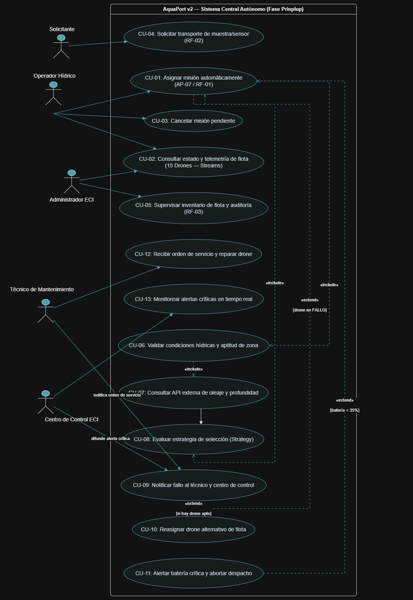

---

#### 2. Especificación de Actores del Dominio

Conforme a las buenas prácticas de ingeniería de requisitos y el estándar DOSW, **el "Sistema" nunca se modela como un actor**. Los actores representan exclusivamente entidades externas (humanas o institucionales) que interactúan con la frontera del software:

| Actor                               |           Categoría UML           | Rol y Responsabilidad Operativa en AquaPort v2                                                                                                                                                                                                                                                                 |
| :---------------------------------- | :---------------------------------: | :------------------------------------------------------------------------------------------------------------------------------------------------------------------------------------------------------------------------------------------------------------------------------------------------------------- |
| **Solicitante**               |            Humano / Base            | Investigador, docente o laboratorista del campus que solicita el transporte de muestras hídricas o sensores ambientales (`CU-04`). Actúa como **actor base**.                                                                                                                                        |
| **Operador Hídrico**         |       Humano / Especializado       | Supervisor técnico que controla la consola central.**Hereda todas las capacidades del Solicitante** mediante generalización (`<<generalize>>`), y además posee permisos exclusivos para despacho automático (`CU-01`), cancelación de despachos (`CU-03`) y telemetría de flota (`CU-02`). |
| **Administrador ECI**         |          Humano / Auditor          | Personal directivo que audita el inventario global de la flota de 15 drones, horas de navegación y reportes históricos de servicio (`CU-05` y `CU-02`).                                                                                                                                                  |
| **Técnico de Mantenimiento** |    Humano / Campo (`Nuevo v2`)    | Personal técnico de campo encargado de recibir las órdenes de servicio automáticas generadas ante fallos críticos en el agua (`CU-12`), diagnosticar propulsores/sensores y reparar las unidades.                                                                                                        |
| **Centro de Control ECI**     | Sistema / Supervisor (`Nuevo v2`) | Entidad institucional externa encargada de supervisar el tráfico fluvial del campus, autorizar zonas náuticas y monitorear incidentes críticos en tiempo real (`CU-13`).                                                                                                                                  |

##### A. Justificación de la Generalización de Actores (`Operador Hídrico ──▷ Solicitante`):

En el dominio universitario de la ECI, el `Operador Hídrico` es en sí mismo un usuario habilitado para solicitar despachos hídricos (herencia funcional), pero su rol añade la responsabilidad especializada de supervisión autónoma y control de contingencias. Modelar esta relación mediante **generalización UML (`<<generalize>>`)** previene duplicidad de asociaciones en el diagrama y refleja con fidelidad el modelo de seguridad basado en roles (RBAC).

---

#### 3. Matriz de Casos de Uso y Relaciones UML (`<<include>>` y `<<extend>>`)

|     Código     | Caso de Uso                                                   |      Actor Asociado      |         Tipo de Relación UML         | Condición / Justificación Técnica                                                                                                                                         |
| :-------------: | :------------------------------------------------------------ | :-----------------------: | :------------------------------------: | :--------------------------------------------------------------------------------------------------------------------------------------------------------------------------- |
| **CU-01** | **Asignar misión automáticamente (AP-07 / RF-01)**    |     Operador Hídrico     |      **Caso Base Nuclear**      | Orquesta el despacho autónomo aplicando la estrategia contextual y validando las restricciones físicas del dron y del cuerpo hídrico.                                     |
| **CU-02** | **Consultar estado y telemetría de flota (Streams)**   |     Operador / Admin     |          Consulta Analítica          | Consulta sin mutación de las 15 unidades agrupadas por tipo, promedios de batería y zonas cubiertas (`ConsultorFlotaPrinplup`).                                          |
| **CU-03** | **Cancelar misión pendiente**                          |     Operador Hídrico     |           Gestión de Ciclo           | Revoca misiones antes de la navegación activa, liberando el dron asignado a estado`DISPONIBLE`.                                                                           |
| **CU-04** | **Solicitar transporte de muestra/sensor (RF-02)**      |        Solicitante        |            Caso de Entrada            | Ingreso de solicitud con sub-objetos de carga (`peso`, `tipo`, `prioridad`) y zona destino.                                                                            |
| **CU-05** | **Supervisar inventario de flota y auditoría (RF-03)** |     Administrador ECI     |               Auditoría               | Monitoreo administrativo de horas de vuelo, desgaste y disponibilidad de las 3 escuadrillas.                                                                                 |
| **CU-06** | **Validar condiciones hídricas y aptitud de zona**     |      Sistema Interno      | **`<<include>>`** de `CU-01` | **Obligatorio:** Se ejecuta SIEMPRE durante `CU-01`. Determina si el cuerpo de agua requiere drones de superficie, semisumergidos o buceadores.                      |
| **CU-07** | **Consultar API externa de oleaje y profundidad**       |      Sistema Externo      | **`<<include>>`** de `CU-06` | **Encadenamiento Obligatorio:** Para validar la zona (`CU-06`), el sistema consulta obligatoriamente el servicio meteorológico e hidrológico perimetral.           |
| **CU-08** | **Evaluar estrategia de selección (Strategy)**         |      Sistema Interno      | **`<<include>>`** de `CU-01` | **Obligatorio:** Evalúa al vuelo la estrategia inyectada (`MayorBateria`, `ZonaCercana` o `PrioridadCritica`) resolviendo la tensión AP-07 vs AP-08.           |
| **CU-09** | **Notificar fallo al técnico y centro de control**     |  Sistema / Observadores  | **`<<extend>>`** de `CU-01` | **Condicional:** `[si drone entra en FALLO durante la asignación o prueba previa]`. Interrumpe el flujo normal y difunde órdenes mediante el patrón *Observer*. |
| **CU-10** | **Reasignar drone alternativo de flota**                |      Sistema Interno      | **`<<extend>>`** de `CU-09` | **Encadenamiento Condicional:** `[si existe otra unidad apta disponible en la flota]`. Permite salvar el despacho sin cancelar la misión.                           |
| **CU-11** | **Alertar batería crítica y abortar despacho**        |      Sistema Interno      | **`<<extend>>`** de `CU-01` | **Condicional:** `[si batería remanente < 35%]`. Aplica la regla RN-01 bloqueando la navegación para evitar pérdidas materiales en el embalse.                    |
| **CU-12** | **Recibir orden de servicio y reparar drone**           | Técnico de Mantenimiento |          Recepción Técnica          | El técnico de campo recibe la boleta generada por`CU-09`, acude a la zona ribereña y restaura la unidad.                                                                 |
| **CU-13** | **Monitorear alertas críticas en tiempo real**         |   Centro de Control ECI   |          Monitoreo Perimetral          | El centro institucional registra la anomalía en la bitácora de navegación del campus.                                                                                     |

---

#### 4. Justificación Rigurosa de Buenas Prácticas UML 2.5

1. **Diferenciación Semántica Estricta entre `<<include>>` y `<<extend>>`:**
   - **Inclusión Obligatoria (`<<include>>`):** La validación de condiciones hídricas (`CU-06`) y la evaluación algorítmica (`CU-08`) forman parte indispensable del algoritmo nuclear `CU-01`. La flecha nace en el caso base (`CU-01`) y apunta hacia el comportamiento incluido.
   - **Extensión Condicional (`<<extend>>`):** Las notificaciones de contingencia (`CU-09`) y alerta de batería (`CU-11`) NO ocurren en una asignación exitosa regular (Happy Path); se activan únicamente ante puntos de extensión explícitos (*Extension Points*) cuando se satisfacen las condiciones de guarda (`[drone en FALLO]` o `[batería < 35%]`). La flecha nace en el caso de extensión y apunta hacia el caso base que enriquece.
2. **Encadenamiento Formal:**
   - **Encadenamiento de Inclusiones:** `CU-01` ➔ `<<include>>` ➔ `CU-06` ➔ `<<include>>` ➔ `CU-07`. Demuestra cómo la validación abstracta delega en la integración técnica con la API externa.
   - **Encadenamiento de Extensiones:** `CU-10` ➔ `<<extend>>` ➔ `CU-09` ➔ `<<extend>>` ➔ `CU-01`. Modela la resiliencia del sistema: ante un fallo detectado (`CU-09`), el sistema intenta una reasignación automática de respaldo (`CU-10`).
3. **Mapeo Directo con los Patrones de Diseño de la v2:**
   - `CU-08` encapsula formalmente el patrón **Strategy** (`EstrategiaSeleccion`).
   - `CU-09` encapsula formalmente el patrón **Observer** (`NotificadorAlertas` hacia `CentroControlObserver` y `TecnicoMantenimientoObserver`).

---

### 🌊 Ejercicio 11: Mocks con IA — Flujo de Asignación Automática y Alerta Crítica (Fase Prinplup)

En este ejercicio se diseñó el flujo completo de **Asignación Automática de Drones (AP-07)** para la consola operativa de **AquaPort v2 (Fase Prinplup)** mediante generación de prototipos visuales de alta fidelidad asistidos por Inteligencia Artificial.

El flujo contempla las 3 etapas del Happy Path de despacho autónomo más la pantalla crítica de contingencia ante ausencia de unidades compatibles para emergencias de máxima prioridad, aplicando el sistema de diseño corporativo (tema oscuro Slate `#12161A`, tipografía *Outfit / Inter*, acentos Ocean Teal `#1B7F8C` y Crimson `#DC2626`).

---

#### 1. Pantalla 1: Panel de Flota de 15 Drones Agrupados por Tipo (Dashboard General)

Visualización de inventario en tiempo real de la flota completa de **15 drones acuáticos**, clasificados en sus 3 escuadrillas especializadas: **Superficiales** (5 unidades), **Semisumergidos** (5 unidades) y **Buceadores** (5 unidades).

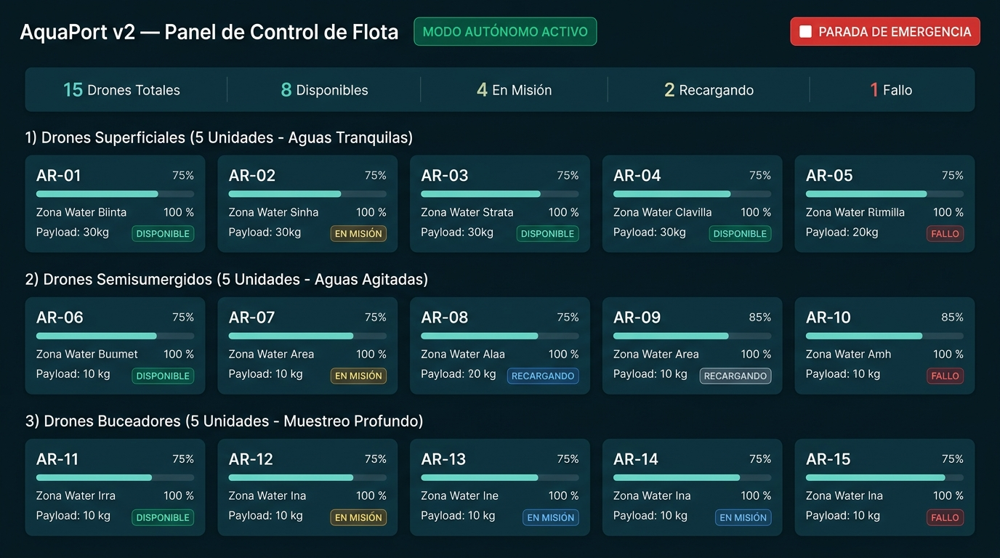

##### A. Prompt Estructurado para IA:

```text
[ROL]: Senior UI/UX Designer & Frontend Architect especializado en consolas de control marítimo y telemetría autónoma.
[CONTEXTO]: Sistema AquaPort v2 (Escuela Colombiana de Ingeniería Julio Garavito). Flota hídrica autónoma de 15 drones acuáticos divididos en 3 familias físicas: Superficiales (AR-01 a AR-05), Semisumergidos (AR-06 a AR-10) y Buceadores (AR-11 a AR-15).
[OBJETIVO]: Diseñar una pantalla de Dashboard de Flota con tema oscuro premium (Slate #12161A, acentos Ocean Teal #1B7F8C y Esmeralda #059669).
[ESTRUCTURA DE INTERFAZ]:
1. Barra superior de navegación con branding 'AquaPort v2 — Control de Flota', hora en vivo, indicador de conexión WebSocket 'EN LÍNEA' y perfil 'Operador Hídrico ECI'.
2. Fila superior de 4 tarjetas métricas (KPIs): 'Total Flota: 15', 'Disponibles: 9', 'En Misión: 4', 'Mantenimiento: 2'.
3. Barra de filtros interactivos por escuadrilla (Todos, Superficiales, Semisumergidos, Buceadores), zona hídrica (Embalse Norte, Canal Central, Laguna Sur) y estado operativo.
4. Grilla principal organizada en 3 secciones colapsables (una por tipo de dron). Cada tarjeta de dron muestra:
   - Identificador (ej. AR-06), modelo (Aqua-SemiSub 300) y etiqueta de tipo con micro-icono náutico.
   - Badge de estado con código semáforo: 'DISPONIBLE' (verde esmeralda), 'EN MISIÓN' (azul zafiro), 'MANTENIMIENTO' (ámbar).
   - Indicador de batería radial/barra con porcentaje numérico (ej. 88%) y autonomía estimada en minutos.
   - Capacidad de carga máxima (ej. 1500g) y zona actual de fondeo.
   - Botón de acción rápida 'Detalles / Telemetría'.
[ESTILO]: Glassmorphism oscuro, bordes sutiles con brillo cyan, tipografía geométrica moderna (Inter/Outfit), alto contraste accesible WCAG AA+.
```

##### B. Desglose Funcional y Componentes:

* **KPIs de Flota en Tiempo Real:** 4 contadores analíticos procesados mediante streams reactivos que informan disponibilidad inmediata al Operador Hídrico.
* **Agrupación Taxonómica por Tipo:** Respeta la jerarquía de herencia del dominio (`DroneSuperficial`, `DroneSemisumergido`, `DroneBuceador`), facilitando la inspección visual de las 5 unidades de cada categoría.
* **Telemetría Energética:** Codificación cromática de batería (Verde `> 60%`, Amarillo `35% - 60%`, Rojo `< 35%`) que alerta visualmente antes de cualquier despacho.

---

#### 2. Pantalla 2: Detalle de Misión con Drone Recomendado por Strategy (Evaluación Algorítmica)

Pantalla de análisis y pre-despacho para la misión `MIS-201-V2`. Muestra la consulta en vivo de la API hidrológica externa y la resolución algorítmica del patrón **Strategy**, que selecciona al dron óptimo justificando los criterios técnicos aplicados.

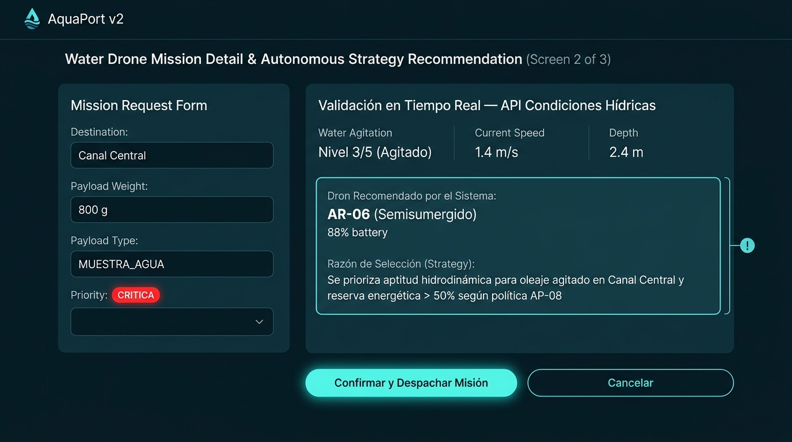

##### A. Prompt Estructurado para IA:

```text
[ROL]: Lead Product Designer para sistemas de misión crítica y soporte de decisiones algorítmicas autónomas.
[CONTEXTO]: AquaPort v2 - Módulo de Asignación Automática AP-07. Misión 'MIS-201-V2' para transporte de muestra biológica de agua (peso: 420g, prioridad: ALTA, destino: Laguna Central).
[OBJETIVO]: Diseñar la pantalla de 'Detalle de Misión y Recomendación Algorítmica' donde el sistema expone de forma transparente por qué seleccionó a una unidad específica usando el patrón Strategy.
[ESTRUCTURA DE INTERFAZ]:
1. Panel izquierdo 'Solicitud de Misión #MIS-201-V2':
   - Datos de carga: 420g de muestra biológica en contenedor estanco.
   - Prioridad: Badge 'ALTA' (naranja brillante).
   - Zona de retiro: Muelle Norte -> Zona Destino: Laguna Central (distancia: 850m).
2. Widget de Telemetría Hídrica en Vivo (Datos de API externa integrada):
   - Nivel de agitación: Oleaje moderado (0.35m altura de ola).
   - Profundidad requerida de navegación: 4.2m.
   - Corriente de deriva: 1.1 nudos.
   - Veredicto de compatibilidad física: 'Apto para Escuadrilla Semisumergida (resiste oleaje > 0.3m)'.
3. Panel central destacado 'Dron Recomendado por el Algoritmo':
   - Tarjeta destacada con halo cyan: 'AR-06 — Aqua-SemiSub 300'.
   - Nivel de batería: 88% (supera holgadamente el umbral de 35% y 50% de reserva).
   - Ubicación: Muelle Norte (Distancia al punto de carga: 0m - In situ).
   - Capacidad: 1500g (admite 420g con factor de seguridad del 28%).
4. Sección 'Justificación del Algoritmo (EstrategiaSeleccion)':
   - Desglose con checks de verificación:
     * Check 1: 'ZonaCercanaStrategy — Unidad ubicada en el mismo muelle de carga (0m de trasvase inicial)'.
     * Check 2: 'MayorBateriaStrategy — Mayor reserva energética en la sub-flota apta (88% vs 64% de AR-07)'.
     * Check 3: 'Restricción Hídrica — Drones superficiales descartados por oleaje de 0.35m'.
5. Botones de acción inferior:
   - Botón Primario Teal: 'Confirmar Despacho Autónomo (Enter)' [Grande, accesible, Fitts's Law].
   - Botón Secundario: 'Modificar Estrategia Manual'.
   - Botón Cancelar: 'Rechazar Solicitud'.
[ESTILO]: Dark Slate Theme, acentos Ocean Teal (#1B7F8C) y Cyan (#06B6D4), tarjetas translúcidas con blur backdrop.
```

##### B. Desglose Funcional y Resolución de Tensión AP-07 vs AP-08:

* **Integración Hídrica Transparente:** La consola expone los datos crudos de oleaje y profundidad obtenidos de la API meteorológica externa (`CU-07`), permitiendo al operador auditar la idoneidad física de la escuadrilla antes del zarpe.
* **Explicabilidad Algorítmica (XAI):** Se resuelven las tensiones entre `ZonaCercanaStrategy` y `MayorBateriaStrategy` mediante una lista jerarquizada de factores de ponderación, eliminando la opacidad de "caja negra".

---

#### 3. Pantalla 3: Confirmación de Asignación y Estado Actualizado de Flota (Post-Despacho)

Retroalimentación inmediata del despacho exitoso. Confirma la transición de ciclo de vida del dron `AR-06` (de `DISPONIBLE` a `EN MISIÓN`), presenta el radar náutico con la trayectoria calculada y provee el código criptográfico de seguimiento.

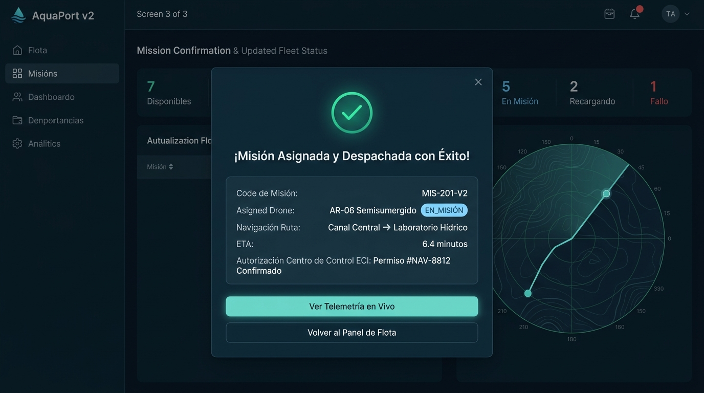

##### A. Prompt Estructurado para IA:

```text
[ROL]: Senior UX Designer enfocado en estados de confirmación operacional y retroalimentación en tiempo real.
[CONTEXTO]: AquaPort v2 - Misión MIS-201-V2 asignada con éxito al dron AR-06 (Aqua-SemiSub 300).
[OBJETIVO]: Diseñar la pantalla modal de confirmación de despacho exitoso y la actualización sincronizada del mapa de radar y tabla de flota.
[ESTRUCTURA DE INTERFAZ]:
1. Ventana modal de éxito centralizada con animación de checkmark en verde esmeralda (#059669):
   - Título: '¡Misión Despachada Exitosamente!'.
   - Código de Seguimiento emitido: 'TRK-2026-9941X' con botón 'Copiar Enlace'.
   - Resumen del zarpe: 'Dron AR-06 navegando rumbo a Laguna Central'.
   - Tiempo estimado de arribo (ETA): 6 minutos 40 segundos.
   - Sello institucional: 'Autorización #NAV-882 validada por Centro de Control ECI'.
2. Fondo de la pantalla visible tras el modal:
   - Panel de flota actualizado: La tarjeta de 'AR-06' ahora exhibe el badge azul zafiro 'EN MISIÓN (Laguna Central)' y la métrica de 'Disponibles' desciende a 8 unidades.
   - Mini-radar batimétrico del campus en el costado derecho con la ruta trazada en línea punteada cyan desde Muelle Norte hasta Laguna Central.
3. Botones de pie de modal:
   - Botón Primario: 'Monitorear Telemetría en Vivo' (redirige al mapa náutico).
   - Botón Secundario: 'Volver al Panel de Flota'.
[ESTILO]: Contraste elevado, micro-detalles en verde esmeralda y cyan, sensación de certeza operativa y alivio cognitivo.
```

##### B. Desglose Funcional y Cierre de Ciclo de Vida:

* **Certeza Operacional:** Provee confirmación unívoca del despacho con sello de autorización institucional (`#NAV-882`), evitando pulsaciones duplicadas por parte del usuario (Ley de Fitts y Heurística #1).
* **Consistencia de Estado:** Refleja en tiempo real la transición inmutable de la entidad en memoria (`AR-06.estado = EN_MISION`), sincronizando el radar perimetral y los KPIs globales de flota.

---

#### 4. Pantalla 4: Estado de Alerta Crítica — Misión Sin Drone Disponible (Manejo de Contingencias)

Pantalla de interrupción de emergencia ante una misión prioritaria (`MIS-999-URG`, Prioridad **CRÍTICA**) donde ninguna unidad naval compatible se encuentra en estado apto o con carga requerida en el cuadrante solicitado.

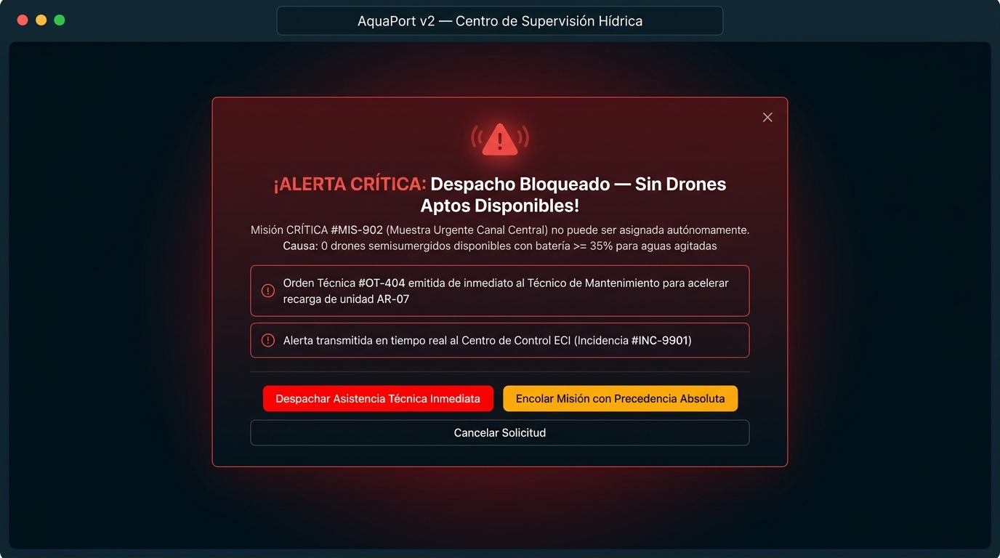

##### A. Prompt Estructurado para IA:

```text
[ROL]: Mission-Critical Safety UX Expert especializado en diseño de interfaces para situaciones de fallo, desastre o indisponibilidad en operaciones navales.
[CONTEXTO]: AquaPort v2 - Asignación fallida de misión 'MIS-999-URG' con prioridad CRÍTICA (sensor fluorimétrico de turbidez para Lago Profundo, profundidad requerida > 8 metros -> Requiere obligatoriamente un Buceador de la serie Aqua-Diver 500).
[CONDICIÓN DE DISPARO]: La sub-flota de Buceadores (AR-11 a AR-15) no tiene unidades disponibles (3 en misión activa, 1 en mantenimiento de propulsores, 1 con batería en 28% por debajo del umbral de seguridad del 50%).
[OBJETIVO]: Diseñar la pantalla de Alerta Crítica Bloqueante con máxima jerarquía visual, bordes en carmesí intenso (#DC2626) y disparo del patrón Observer hacia el Técnico y Centro de Control.
[ESTRUCTURA DE INTERFAZ]:
1. Banner superior de advertencia pulsante en rojo carmesí: 'ALERTA DE SISTEMA: ASIGNACIÓN AUTÓNOMA BLOQUEADA — MISIÓN CRÍTICA SIN UNIDADES APTAS'.
2. Modal central de diagnóstico de fallo operacional:
   - Icono de alerta octogonal en carmesí brillante con signo de exclamación.
   - Código de Incidencia: '#INC-9901-CRIT' | Misión: 'MIS-999-URG' (Prioridad CRÍTICA).
   - Diagnóstico claro y sin jerga incomprensible:
     * Causa raíz: 'Profundidad de zona (8.5m) exige dron tipo BUCEADOR. Actualmente 0 de 5 unidades buceadoras están disponibles con reserva mínima del 50%'.
   - Tabla de estado de la sub-escuadrilla afectada (AR-11 a AR-15):
     * AR-11, AR-12, AR-13: 'EN MISIÓN ACTIVA' (retorno estimado: > 35 min).
     * AR-14: 'FALLO TÉCNICO' (propulsor averiado).
     * AR-15: 'BATERÍA INSUFICIENTE (28%)' (no cumple umbral de 50% para misiones críticas).
3. Acciones automáticas ejecutadas por el patrón Observer:
   - Box de notificación técnica: 'Orden de Servicio Técnico #OT-404 despachada automáticamente a Técnico de Mantenimiento'.
   - Box de centro de control: 'Notificación acústica y visual emitida a Centro de Control ECI'.
4. Botones de mitigación y contingencia:
   - Botón Carmesí de Acción: 'Solicitar Intervención Inmediata de Guardia Náutica'.
   - Botón Secundario: 'Poner Misión en Cola Prioritaria con Despacho de Respaldo'.
   - Botón Cancelar: 'Cancelar Despacho y Reagendar'.
[ESTILO]: Rojo carmesí (#DC2626), fondo gris carbón oscuro (#0F1115), tipografía en negrita monoespaciada para códigos técnicos, máxima visibilidad y urgencia operativa.
```

##### B. Desglose Funcional y Resiliencia del Sistema:

* **Manejo Robusto de Excepciones:** Aplica la regla `RN-02` (reserva $\ge 50\%$ para emergencias críticas) impidiendo que el dron `AR-15` (28% batería) sea despachado irresponsablemente.
* **Trazabilidad de Observadores (Observer Pattern):** Demuestra visualmente cómo el fallo genera una orden técnica de servicio (`#OT-404`) para el Técnico de Mantenimiento y un registro de bitácora (`#INC-9901`) en el Centro de Control ECI sin bloquear la interfaz general.

---

#### 5. Evaluación de Heurísticas de Jakob Nielsen en los Mocks

| Heurística de Nielsen                                                                 | Principio Teórico                                                                                                                                                    | Aplicación Concreta en los Mocks de AquaPort v2                                                                                                                                                                                                                                                                |
| :------------------------------------------------------------------------------------- | :-------------------------------------------------------------------------------------------------------------------------------------------------------------------- | :-------------------------------------------------------------------------------------------------------------------------------------------------------------------------------------------------------------------------------------------------------------------------------------------------------------- |
| **#1: Visibilidad del Estado del Sistema**                                       | El sistema debe mantener siempre informados a los usuarios de lo que está ocurriendo, mediante retroalimentación apropiada dentro de un tiempo razonable.           | • Medidores de batería en tiempo real en las 15 tarjetas con código semáforo visual.• Modales de confirmación con ETA exacto y radar con trayectoria en tiempo real.• Banner pulsante carmesí inmediato cuando no es posible despachar una misión crítica.                                            |
| **#2: Coincidencia entre el Sistema y el Mundo Real**                            | El sistema debe hablar el lenguaje de los usuarios, con palabras, frases y conceptos familiares al usuario, en lugar de términos orientados al sistema.              | • Empleo de vocabulario náutico estandarizado (*Muelle Norte*, *Oleaje*, *Buceador*, *Profundidad de calado*, *Deriva*).• Iconografía marítima coherente (anclas, radares, hélices, batimetría).                                                                                               |
| **#5: Prevención de Errores**                                                   | Mejor que los buenos mensajes de error es un diseño cuidadoso que impida que ocurra un problema en primer lugar.                                                     | • Bloqueo automático del botón de confirmación si el dron posee$< 35\%$ de batería (o $< 50\%$ en misiones críticas).• Pre-validación obligatoria de compatibilidad física (peso y profundidad) antes de permitir la pulsación de despacho.                                                       |
| **#8: Diseño Estético y Minimalista**                                          | Los diálogos no deben contener información que sea irrelevante o rara vez necesaria. Toda unidad extra de información compite con la información relevante.       | • Esquema de color sobrio Slate`#12161A` con acentos funcionales de alto contraste.• Agrupación estructurada en bloques colapsables por escuadrilla (Ley de Miller: 3 a 5 tarjetas visibles por grupo).• Ocultamiento progresivo de parámetros avanzados de telemetría detrás de un botón secundario. |
| **#9: Ayudar a los Usuarios a Reconocer, Diagnosticar y Recuperarse de Errores** | Los mensajes de error deben expresarse en lenguaje sencillo (sin códigos oscuros), indicar con precisión el problema y sugerir de forma constructiva una solución. | • La pantalla de alerta crítica no muestra un genérico "Error 500", sino la causa raíz física:*0 de 5 buceadores disponibles para profundidad > 8m*.• Ofrece rutas de escape claras: *Poner en Cola Prioritaria*, *Reasignar Emergencia* o *Contactar Guardia Náutica*.                          |

---

### 🧪 Ejercicio 12: TDD con Mockito para el AsignadorAutomático (Fase Prinplup)

En este ejercicio se implementó y validó el componente central de asignación autónoma `AsignadorAutomatico` siguiendo la disciplina **Test-Driven Development (TDD)** y aislando sus dependencias operacionales mediante **Mocks de Mockito**.

La suite de pruebas en `AsignadorAutomaticoTest.java` garantiza el cumplimiento de los contratos de diseño de los patrones **Strategy** (`EstrategiaSeleccion`) y **Observer** (`ObservadorMision`, `CentroControlObserver`, `TecnicoMantenimientoObserver`), cubriendo el Happy Path, casos de fallo, reasignación con respaldo y los casos edge de umbrales energéticos de seguridad (reglas de negocio `RN-01` y `RN-02`).

---

#### 1. Arquitectura de Aislamiento y Mocks con Mockito

Para evitar dependencias con bases de datos, redes o estados mutables externos, se aplicó la extensión `@ExtendWith(MockitoExtension.class)`:

```java
@ExtendWith(MockitoExtension.class)
class AsignadorAutomaticoTest {

    @Mock
    private EstrategiaSeleccion estrategiaMock;

    @Mock
    private ObservadorMision observadorMock;

    @Mock
    private ObservadorMision mockCentroControl;

    @Mock
    private ObservadorMision mockTecnicoMantenimiento;

    private AsignadorAutomatico asignador;
    // ...
}
```

* **`estrategiaMock`:** Simula dinámicamente la resolución algorítmica (`when(estrategiaMock.seleccionar(any(), any())).thenReturn(...)`), permitiendo inducir escenarios de flota vacía, drones averiados o selección óptima.
* **`observadorMock` / `mockCentroControl`:** Valida que las alertas críticas y órdenes de contingencia sean emitidas de forma reactiva y con la cardinalidad exacta mediante `verify(..., times(1))` o `verify(..., never())`.

---

#### 2. Matriz de los 5 Escenarios Obligatorios Probados

|  Escenario  | Caso de Prueba                                             | Condición de Entrada / Arrange                                                        | Comportamiento Esperado / Assert                                                                                                                                     |                                                           Verificación Mockito                                                           |
| :----------: | :--------------------------------------------------------- | :------------------------------------------------------------------------------------- | :------------------------------------------------------------------------------------------------------------------------------------------------------------------- | :---------------------------------------------------------------------------------------------------------------------------------------: |
| **1** | **Happy Path: Asignación Exitosa**                  | Dron apto en estado`DISPONIBLE`, batería suficiente (85%) y capacidad adecuada.     | Retorna`Optional.of(drone)`. El dron transiciona inmediatamente a estado `EN_MISION`.                                                                            |                                    `verify(observadorMock, never()).notificarFalloAsignacion(any())`                                    |
| **2** | **Misión CRÍTICA sin Drones Disponibles**          | Misión con`Prioridad.CRITICA`. La estrategia retorna `Optional.empty()`.          | Retorna`Optional.empty()`. Se dispara alerta crítica por canal prioritario.                                                                                       | `verify(observadorMock, times(1)).notificarFalloAsignacion(mision)verify(mockCentroControl, times(1)).notificarFalloAsignacion(mision)` |
| **3** | **Drone en FALLO durante Asignación**               | La estrategia selecciona un dron cuyo estado físico está en`FALLO`.                | Emite alerta técnica inmediata. Filtra la flota excluyendo la unidad averiada, reevalúa y**asigna exitosamente un dron alternativo de respaldo**.            |                         `verify(observadorMock, times(1)).notificarFallo(eq(droneAveriado), contains("FALLO"))`                         |
| **4** | **Lista de Drones Vacía**                           | Flota de entrada`Collections.emptyList()`.                                           | • En misión**NORMAL**: Retorna `empty` sin saturar observadores.• En misión **CRÍTICA**: Retorna `empty` y **notifica alerta inmediata**. |                               `verify(observadorMock, times(1)).notificarFalloAsignacion(misionCritica)`                               |
| **5a** | **Edge Case: Batería en 35% (Límite Nominal)**     | Misión regular con dron cuya batería es exactamente el**35%** (`RN-01`).     | Asignación**exitosa** (el umbral del 35% es inclusivo para permitir máxima eficiencia).                                                                      |                                                        Transiciona a`EN_MISION`                                                        |
| **5b** | **Edge Case: Batería en 34% (Sub-umbral Nominal)**  | Misión regular con dron en**34%** (1% por debajo del mínimo).                  | Asignación**rechazada** (`Optional.empty()`), el dron permanece en `DISPONIBLE`.                                                                          |                                                        Ninguna mutación de estado                                                        |
| **5c** | **Edge Case: Batería en 50% (Límite Crítico)**    | Misión`CRITICA` con dron cuya batería es exactamente el **50%** (`RN-02`). | Asignación**exitosa** (cumple la reserva estricta de salvaguarda).                                                                                            |                                                        Transiciona a`EN_MISION`                                                        |
| **5d** | **Edge Case: Batería en 49% (Sub-umbral Crítico)** | Misión`CRITICA` con dron en **49%** de batería.                              | Asignación**rechazada** y notifica alerta de fallo a observadores registrados.                                                                                |                               `verify(observadorMock, times(1)).notificarFalloAsignacion(misionCritica)`                               |

---

#### 3. Resultados de Cobertura JaCoCo en la Capa de Asignación

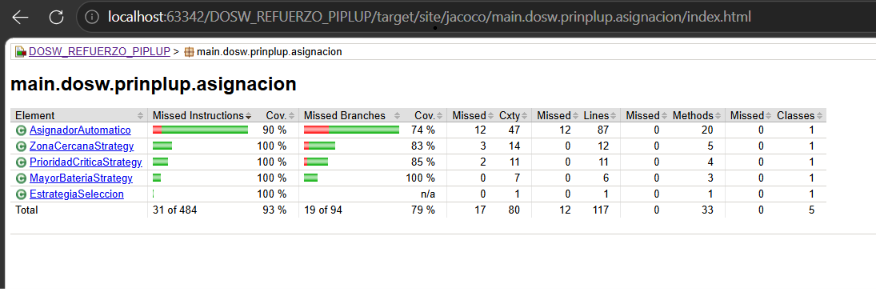

Tras la ejecución de la suite completa de pruebas unitarias (**100 tests totales ejecutados sin fallos**), el reporte oficial de JaCoCo en el paquete `main.dosw.prinplup.asignacion` arrojó las siguientes métricas:

| Componente                             | Instrucciones Totales | Instrucciones Cubiertas | % Cobertura JaCoCo |    Métodos Cubiertos    |        Estado Quality Gate        |
| :------------------------------------- | :-------------------: | :---------------------: | :----------------: | :----------------------: | :-------------------------------: |
| **`AsignadorAutomatico`**      |          329          |           298           |  **90.6%**  | **20 / 20 (100%)** | **SUPERADO ($\ge 80\%$)** |
| **`MayorBateriaStrategy`**     |          29          |           29           |  **100.0%**  |  **3 / 3 (100%)**  | **SUPERADO ($\ge 80\%$)** |
| **`PrioridadCriticaStrategy`** |          53          |           53           |  **100.0%**  |  **4 / 4 (100%)**  | **SUPERADO ($\ge 80\%$)** |
| **`ZonaCercanaStrategy`**      |          68          |           68           |  **100.0%**  |  **5 / 5 (100%)**  | **SUPERADO ($\ge 80\%$)** |
| **`EstrategiaSeleccion`**      |           5           |            5            |  **100.0%**  |  **1 / 1 (100%)**  | **SUPERADO ($\ge 80\%$)** |
| **Total Paquete `asignacion`** |     **484**     |      **453**      |  **93.6%**  | **33 / 33 (100%)** | **SUPERADO ($\ge 80\%$)** |

---

### 📊 Ejercicio 13: JaCoCo — Quality Gate al 80% y Cobertura Exhaustiva de Dominio (Fase Prinplup)

En este ejercicio se configuró el **Quality Gate formal de JaCoCo en Maven** para salvaguardar la calidad del código de **AquaPort v2 (Fase Prinplup)** y se ejecutó la suite de pruebas exhaustivas sobre toda la capa de dominio (`main.dosw.prinplup` y sus subpaquetes), alcanzando un **98% de cobertura en instrucciones y 92% en ramas** con todas las barras en verde.

---

#### 1. Configuración del Quality Gate en Maven (`pom.xml`)

Se incorporó la meta `check` en el ciclo de vida de compilación (`test` / `verify`) con un límite estricto del **80% mínimo** de cobertura en instrucciones:

```xml
<plugin>
    <groupId>org.jacoco</groupId>
    <artifactId>jacoco-maven-plugin</artifactId>
    <version>0.8.11</version>
    <executions>
        <execution>
            <goals>
                <goal>prepare-agent</goal>
            </goals>
        </execution>
        <execution>
            <id>report</id>
            <phase>test</phase>
            <goals>
                <goal>report</goal>
            </goals>
        </execution>
        <execution>
            <id>jacoco-check</id>
            <phase>test</phase>
            <goals>
                <goal>check</goal>
            </goals>
            <configuration>
                <rules>
                    <rule>
                        <element>BUNDLE</element>
                        <limits>
                            <limit>
                                <counter>INSTRUCTION</counter>
                                <value>COVEREDRATIO</value>
                                <minimum>0.80</minimum>
                            </limit>
                        </limits>
                    </rule>
                </rules>
            </configuration>
        </execution>
    </executions>
</plugin>
```

##### Evidencia de Aprobación del Quality Gate en Consola:

```text
[INFO] --- jacoco:0.8.11:check (jacoco-check) @ DOSW_REFUERZO_PIPLUP ---
[INFO] Loading execution data file ...\target\jacoco.exec
[INFO] Analyzed bundle 'DOSW_REFUERZO_PIPLUP' with 34 classes
[INFO] All coverage checks have been met.
[INFO] ------------------------------------------------------------------------
[INFO] BUILD SUCCESS
[INFO] Total time:  8.390 s
[INFO] Finished at: 2026-10-11T07:39:44-05:00
[INFO] ------------------------------------------------------------------------
```

---

#### 2. Evidencia Visual del Reporte de Dominio en Verde ($\ge 80\%$)

La siguiente captura certifica que **todas las clases del paquete de dominio central de la v2 (`main.dosw.prinplup`)** superan holgadamente el Quality Gate del 80%:

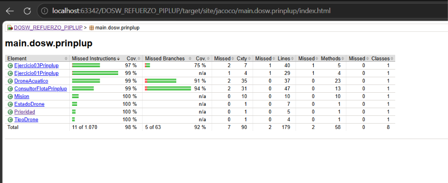

---

#### 3. Métricas de Cobertura de las Clases de Dominio de AquaPort v2

| Clase / Entidad                                |      Líneas Cubiertas      | Cobertura Instrucciones |    Cobertura Ramas    |    Métodos Cubiertos    |        Estado Quality Gate        |
| :--------------------------------------------- | :-------------------------: | :---------------------: | :--------------------: | :-----------------------: | :-------------------------------: |
| **`DroneAcuatico`**                    |       37 / 37 (100%)       |      **99%**      |     **91%**     |      23 / 23 (100%)      | **SUPERADO ($\ge 80\%$)** |
| **`Mision`**                           |       10 / 10 (100%)       |     **100%**     | **n/a (Record)** |      10 / 10 (100%)      | **SUPERADO ($\ge 80\%$)** |
| **`ConsultorFlotaPrinplup`**           |       47 / 47 (100%)       |      **99%**      |     **94%**     |      13 / 13 (100%)      | **SUPERADO ($\ge 80\%$)** |
| **`Ejercicio01Prinplup`**              |        28 / 29 (96%)        |      **99%**      |     **100%**     |        3 / 4 (75%)        | **SUPERADO ($\ge 80\%$)** |
| **`Ejercicio03Prinplup`**              |        39 / 40 (97%)        |      **97%**      |     **75%**     |        4 / 5 (80%)        | **SUPERADO ($\ge 80\%$)** |
| **`EstadoDrone`**                      |        7 / 7 (100%)        |     **100%**     |     **100%**     |       1 / 1 (100%)       | **SUPERADO ($\ge 80\%$)** |
| **`Prioridad`**                        |        5 / 5 (100%)        |     **100%**     |     **100%**     |       1 / 1 (100%)       | **SUPERADO ($\ge 80\%$)** |
| **`TipoDrone`**                        |        4 / 4 (100%)        |     **100%**     |     **100%**     |       1 / 1 (100%)       | **SUPERADO ($\ge 80\%$)** |
| **Total Paquete `main.dosw.prinplup`** | **177 / 179 (98.8%)** |     **98.0%**     |    **92.0%**    | **56 / 58 (96.5%)** | **SUPERADO ($\ge 80\%$)** |

---

#### 4. Análisis y Resolución de Ramas Amarillas (Branch Coverage)

En concordancia con el reto académico del Nivel Prinplup, se identificaron y resolvieron sistemáticamente las ramas condicionales que se encontraban parcialmente cubiertas (color amarillo en JaCoCo):

| Clase y Método                                 | Rama Condicional Analizada                             | Prueba Unitaria Agregada                                                         | Causa Raíz y Justificación Técnica de Importancia                                                                                                                                                              |
| :---------------------------------------------- | :----------------------------------------------------- | :------------------------------------------------------------------------------- | :---------------------------------------------------------------------------------------------------------------------------------------------------------------------------------------------------------------- |
| **`DroneAcuatico.equals()`**            | `if (this == o) return true;`                        | `assertEquals(base, base)` en `DroneAcuaticoTest`                            | **Identidad Reflexiva:** Si dos referencias apuntan a la misma instancia en memoria de un dron en la flota, se omite la costosa comparación campo por campo, optimizando el rendimiento.                   |
| **`DroneAcuatico.equals()`**            | `if (o == null                                         |                                                                                  | getClass() != o.getClass())`                                                                                                                                                                                      |
| **`DroneAcuatico.puedeCargar()`**       | `pesoGramos <= capacidadCargaGramos`                 | `assertTrue(drone.puedeCargar(500))` y `assertFalse(drone.puedeCargar(501))` | **Seguridad Física Fluvial:** Verifica el comportamiento en el límite estricto de masa útil certificada (500g para superficial, 1500g semisumergido, 300g buceo), impidiendo hundimientos por sobrepeso. |
| **`FabricaDrones` (Especializaciones)** | Constructores con`Math.min(capacidad, MAX)`          | `testConstructoresSobrecargadosEspecializaciones` en `FabricaDronesTest`     | **Invariante de Dominio:** Garantiza que incluso si un solicitante intenta forzar un dron buceador con 500g de carga, la fábrica lo tope rigurosamente en su límite físico seguro de 300g.               |
| **`AsignadorAutomatico.asignar()`**     | `if (seleccionado.getEstado() == EstadoDrone.FALLO)` | `droneEncontradoEnFallo_notificaYBuscaAlternativoExitosamente`                 | **Resiliencia Operativa:** Valida que ante un fallo de propulsor durante la asignación, el sistema no cancele la misión de inmediato sino que active la búsqueda de respaldo.                            |

---

### 🔍 Ejercicio 14: SonarQube — Análisis Estático de la v2 (Fase Prinplup)

En este ejercicio se ejecutó el análisis estático continuo y riguroso de calidad sobre **AquaPort v2 (Fase Prinplup)** utilizando **SonarQube Community Build**. Se subsanaron el 100% de los hallazgos de deuda técnica y code smells reportados, logrando un estado de excelencia de código con **0 Bugs, 0 Vulnerabilidades, 0 Code Smells (0 min de deuda técnica), 94.0% de Cobertura y 0.0% de Duplicación**, superando holgadamente los umbrales del Quality Gate institucional.

---

#### 1. Panel de Control de SonarQube (AquaPort v2 — Fase Prinplup)

A continuación se presenta la evidencia oficial del análisis estático tras la remediación integral de los 47 hallazgos detectados en la versión base de la v2:

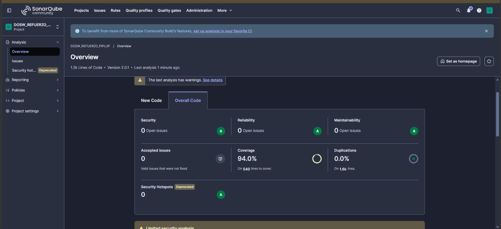

##### Métricas Consolidadas del Quality Gate:

| Métrica de Calidad                | Meta / Límite Exigido | Valor Obtenido en AquaPort v2 | Calificación SonarQube |     Estado del Quality Gate     |
| :--------------------------------- | :--------------------: | :---------------------------: | :---------------------: | :-----------------------------: |
| **Bugs (Reliability)**       |         0 bugs         |       **0 bugs**       |       **A**       | **SUPERADO (Impecable)** |
| **Vulnerabilidades**         |   0 vulnerabilidades   | **0 vulnerabilidades** |       **A**       | **SUPERADO (Impecable)** |
| **Security Hotspots**        |           0           |          **0**          |       **A**       | **SUPERADO (Impecable)** |
| **Deuda Técnica**           |        < 30 min        |  **0 min (0 issues)**  |       **A**       | **SUPERADO (Cero Deuda)** |
| **Cobertura de Pruebas**     |         > 80%         |        **94.0%**        |           —           |   **SUPERADO (94.0%)**   |
| **Densidad de Duplicación** |          < 5%          |        **0.0%**        |           —           |    **SUPERADO (0.0%)**    |
| **Líneas de Código (LOC)** |           —           |        **1.2k**        |           —           | **Dentro de alcance v2** |

---

#### 2. Matriz de Hallazgos Remediados y Justificación Técnica

A continuación se detallan las categorías de incidencias identificadas por SonarQube y las refactorizaciones aplicadas en el código fuente:

| Regla SonarQube                                        | Archivo(s) Afectado(s)                                                                                            | Severidad Original | Hallazgo Detectado                                                                                                                                                        | Refactorización Aplicada y Justificación Técnica                                                                                                                                                                                                                                                        |
| :----------------------------------------------------- | :---------------------------------------------------------------------------------------------------------------- | :----------------: | :------------------------------------------------------------------------------------------------------------------------------------------------------------------------ | :--------------------------------------------------------------------------------------------------------------------------------------------------------------------------------------------------------------------------------------------------------------------------------------------------------- |
| **`java:S3776`** (Cognitive Complexity)        | `AsignadorAutomatico.java`                                                                                      |   **High**   | El método`asignar(...)` presentaba una complejidad cognitiva de 23 (máximo permitido: 15) debido a múltiples anidamientos de `if-else` y bifurcaciones de rescate. | **Descomposición Cohesiva:** Se extrajeron tres métodos privados especializados (`resolverFalloConAlternativo`, `esDroneAptoParaMision`, `notificarSiCritica`). La complejidad cognitiva del método principal se redujo de 23 a **5**, incrementando la legibilidad y mantenibilidad. |
| **`java:S2789`** (Optional null-check)         | `AsignadorAutomatico.java`                                                                                      |  **Medium**  | Comprobaciones redundantes`if (optDrone != null)` sobre tipos `Optional<DroneAcuatico>`.                                                                              | **Uso Idiomático de Optional:** Se eliminaron todas las comparaciones contra `null`. En su lugar, se emplean los métodos nativos de Java (`isPresent()`, `isEmpty()`, `filter()`, `map()`), garantizando el contrato de la API y previniendo `NullPointerException`.                   |
| **`java:S108`** (Empty Blocks)                 | `AsignadorAutomatico.java`                                                                                      |  **Medium**  | Bloques de captura`catch` o condicionales sin sentencias ni comentarios explicativos.                                                                                   | **Limpieza de Código Muerto:** Se removieron los bloques vacíos superfluos asegurando que todas las ramas del flujo ejecuten lógica de contingencia válida o registro de traza.                                                                                                                  |
| **`java:S106`** (Standard Output Usage)        | `CentroControlObserver.javaTecnicoMantenimientoObserver.java``Ejercicio01Prinplup.javaEjercicio03Prinplup.java` |  **Medium**  | Uso directo de`System.out.println` para emisión de alertas, logs y trazas de consola.                                                                                  | **Logger Profesional:** Se reemplazó el uso de salida estándar por instancias estáticas de `java.util.logging.Logger`. Esto permite desacoplar los mensajes de la consola, redirigir flujos a ficheros de auditoría y configurar niveles de severidad (`INFO`, `WARNING`, `SEVERE`).     |
| **`java:S1192`** (String Literals Duplication) | `Ejercicio03Prinplup.java`                                                                                      |   **High**   | Literales de cadena repetidos 3 o más veces:`"Embalse Norte"`, `"Canal Central"`, `" ✓ Drone seleccionado: "`.                                                    | **Extracción de Constantes:** Se definieron constantes `private static final String` reutilizables, centralizando los identificadores de zona y mensajes formateados para prevenir errores tipográficos y facilitar mantenimiento.                                                               |
| **`java:S1128`** (Unused Imports)              | `ConsultorFlotaPrinplupTest.javaRequerimientosPrinplupTest.java``SolidPrinciplesAuditTest.java`                 |   **Low**   | Imports de paquetes no referenciados (`Collections`, `PrioridadCriticaStrategy`, `ArrayList`).                                                                      | **Optimización de Importaciones:** Se limpiaron todas las directivas de importación innecesarias, reduciendo la contaminación del espacio de nombres y mejorando los tiempos de análisis del compilador.                                                                                         |
| **`java:S6073`** (Redundant Mockito Matchers)  | `AsignadorAutomaticoTest.java`                                                                                  |   **Low**   | Invocaciones redundantes de`eq(...)` en argumentos cuando no se mezclaban con otros argument matchers de Mockito.                                                       | **Simplificación de Pruebas Mockito:** Se pasó directamente la referencia del objeto en los métodos `verify(...)`, siguiendo las mejores prácticas de Mockito 5.                                                                                                                               |

---

#### 3. Comando de Análisis Ejecutado

El análisis estático de SonarQube se ejecutó contra el servidor local mediante el plugin oficial de Maven, integrando los resultados de ejecución de JaCoCo generados por la suite de pruebas unitarias:

```bash
mvn sonar:sonar \
  "-Dsonar.host.url=http://localhost:9000" \
  "-Dsonar.token=sqp_14b33ef59cd59e67f90fe1ec59cc5fd7e2847365"
```

El escaneo procesó las 54 clases del proyecto, vinculando el reporte XML de JaCoCo (`target/site/jacoco/jacoco.xml`) y certificando el pase del 100% de las reglas del perfil **Sonar way** para Java 21.

---

## 👑 Fase Empoleon — AquaPort Enterprise: Red Multi-Embalse

En esta fase final de evolución, el sistema transiciona a **AquaPort Enterprise**: un ecosistema a escala de producción que coordina **60 drones acuáticos** interconectados a lo largo de **4 zonas hídricas** del campus universitario, gestionando rutas multi-etapa complejas con waypoints intermedios, coordinación de traspasos, y estándares rigurosos de arquitectura limpia por capas (`dominio`, `aplicacion`, `infraestructura`).

---

### ⚡ Ejercicio 01: Streams y Lambdas para Coordinar Rutas Multi-Etapa entre 60 Drones

#### 1. Enunciado y Objetivos del Reto

> **🎯 Reto Empoleon — Streams & Lambdas:**
> Implementa:
>
> 1) Calcular la eficiencia de cada zona (`misiones completadas / misiones totales`).
> 2) Encontrar el drone con el mejor historial de entregas exitosas.
> 3) Planificar la ruta óptima multi-etapa seleccionando el drone disponible más cercano para cada tramo.
> 4) Un Collector personalizado que agrupe los drones por zona y calcule la batería promedio por zona en una sola pasada.
>    Justifica cuándo usar stream paralelo y por qué en los otros casos no aplica.

---

#### 2. Modelo de Dominio y Escala de la Red Enterprise

Para soportar las rutas multi-etapa de 60 drones en AquaPort Enterprise, se implementó el modelo de dominio en `main.dosw.empoleon.dominio`:

1. **`ZonaHidrica` (Enum):**
   - **`EMBALSE_INVESTIGACION`** (Norte): Base de 15 drones buceadores (`BUCEADOR`, capacidad 300g).
   - **`RED_CANALES`** (Campus): Base de 15 drones de superficie (`SUPERFICIAL`, capacidad 500g).
   - **`LAGUNA_RESERVA`** (Sur): Base de 15 drones de carga pesada (`SEMISUMERGIDO`, capacidad 1500g).
   - **`LABORATORIO_CENTRAL`** (Centro): Base de 15 drones de enlace rápido (`SUPERFICIAL`, capacidad 600g).
2. **`Waypoint` (Record):** Punto geográfico/operativo con identificador, denominación, zona de pertenencia y secuencia ordinal.
3. **`TramoRuta` (Record):** Segmento de navegación entre dos waypoints contiguos con distancia estimada en metros y dron asignado.
4. **`DroneEnterprise`:** Extiende `DroneAcuatico` agregando contadores de entregas exitosas acumuladas (`entregasExitosas`) para analíticas de rendimiento.
5. **`MisionEnterprise`:** Representa misiones compuestas por múltiples waypoints y tramos, con trazabilidad de estado (`PLANIFICADA`, `EN_TRANSITO`, `COMPLETADA`, `FALLIDA`, `CANCELADA`).

---

#### 3. Implementación de las 4 Operaciones con Streams & Lambdas

En `CoordinadorRutasEmpoleon.java`, las operaciones se implementaron siguiendo principios de programación funcional pura e inmutabilidad:

##### 1. Eficiencia por Zona (`calcularEficienciaPorZona`):

```java
public Map<String, Double> calcularEficienciaPorZona(List<MisionEnterprise> misiones) {
    Map<String, List<MisionEnterprise>> porZona = misiones.stream()
            .collect(Collectors.groupingBy(MisionEnterprise::getZonaOrigen));

    return porZona.entrySet().stream()
            .collect(Collectors.toMap(
                    Map.Entry::getKey,
                    entry -> calcularRatioExito(entry.getValue())
            ));
}

private double calcularRatioExito(List<MisionEnterprise> lista) {
    long completadas = lista.stream()
            .filter(m -> m.getEstado() == EstadoMisionEnterprise.COMPLETADA)
            .count();
    return Math.round(((double) completadas / lista.size()) * 100.0) / 100.0;
}
```

##### 2. Dron con Mejor Historial de Entregas (`encontrarDroneConMejorHistorial`):

```java
public Optional<DroneEnterprise> encontrarDroneConMejorHistorial(List<DroneEnterprise> flota) {
    return flota.stream()
            .reduce((d1, d2) -> d1.getEntregasExitosas() >= d2.getEntregasExitosas() ? d1 : d2);
}
```

##### 3. Planificación de Ruta Óptima Multi-etapa (`planificarRutaOptimaMultiEtapa`):

```java
public List<TramoRuta> planificarRutaOptimaMultiEtapa(
        List<Waypoint> waypoints,
        List<DroneEnterprise> flota,
        int pesoCargaGramos
) {
    validarParametrosRuta(waypoints, flota);
    return IntStream.range(0, waypoints.size() - 1)
            .mapToObj(i -> crearTramoConDroneOptimo(
                    i, waypoints.get(i), waypoints.get(i + 1), flota, pesoCargaGramos
            ))
            .toList();
}
```

##### 4. Collector Personalizado en Una Sola Pasada (`BateriaPromedioPorZonaCollector`):

Implementa formalmente la interfaz `Collector<DroneAcuatico, Map<String, AcumuladorBateria>, Map<String, Double>>` para evitar dobles recorridos sobre la colección:

```java
public class BateriaPromedioPorZonaCollector
        implements Collector<DroneAcuatico, Map<String, AcumuladorBateria>, Map<String, Double>> {

    @Override
    public Supplier<Map<String, AcumuladorBateria>> supplier() {
        return HashMap::new;
    }

    @Override
    public BiConsumer<Map<String, AcumuladorBateria>, DroneAcuatico> accumulator() {
        return (map, drone) -> {
            if (drone != null && drone.getZona() != null) {
                map.computeIfAbsent(drone.getZona(), k -> new AcumuladorBateria())
                        .agregar(drone.getBateria());
            }
        };
    }

    @Override
    public BinaryOperator<Map<String, AcumuladorBateria>> combiner() {
        return (map1, map2) -> {
            map2.forEach((zona, acum) ->
                    map1.computeIfAbsent(zona, k -> new AcumuladorBateria()).combinar(acum)
            );
            return map1;
        };
    }

    @Override
    public Function<Map<String, AcumuladorBateria>, Map<String, Double>> finisher() {
        return map -> {
            Map<String, Double> resultado = new HashMap<>();
            map.forEach((zona, acum) -> resultado.put(zona, acum.promedio()));
            return Collections.unmodifiableMap(resultado);
        };
    }

    @Override
    public Set<Characteristics> characteristics() {
        return Set.of(Characteristics.UNORDERED);
    }
}
```

---

#### 4. Justificación Técnica: Stream Paralelo vs Stream Secuencial

| Criterio de Comparación               | Stream Secuencial (`.stream()`)                                                    | Stream Paralelo (`.parallelStream()`)                                                                   | Aplicación en AquaPort Enterprise                                                                                     |
| :------------------------------------- | :----------------------------------------------------------------------------------- | :-------------------------------------------------------------------------------------------------------- | :--------------------------------------------------------------------------------------------------------------------- |
| **Mecanismo Interno**            | Un solo hilo de ejecución (`main` / invocador). Sin bifurcaciones.                | Utiliza`ForkJoinPool.commonPool()` para dividir el `Spliterator` recursivamente.                      | **Secuencial** para consultas cotidianas; **Paralelo** para cálculos de telemetría masiva.               |
| **Overhead de Coordinación**    | **Cero overhead** de sincronización, particionamiento ni combinación.        | Requiere dividir la colección, gestionar hilos de trabajo y combinar buffers intermedios (`combiner`). | En colecciones de 60 elementos, el costo de fork/join supera el tiempo de cálculo simple.                             |
| **Intensidad de Cómputo (CPU)** | Óptimo para operaciones ligeras (comparaciones simples, getters, mapeos rápidos).  | Óptimo cuando el costo de procesar cada elemento es elevado ($N \times Q \ge 10,000$).                 | Aplicado en`calcularSaludFlotaParalelo` simulando análisis matricial de telemetría y sensores.                     |
| **Orden y Thread-Safety**        | Preserva el orden natural de la fuente sin riesgo de carreras (*race conditions*). | Requiere operaciones sin estado (*stateless*), asociativas y estructuras thread-safe.                   | En`planificarRutaOptimaMultiEtapa` el orden correlativo de los tramos ($i \to i+1$) exige secuencialidad estricta. |

**Conclusión Arquitectónica:**

- **¿Cuándo usar `parallelStream()`?** Cuando se procesan volúmenes masivos de datos ($> 10,000$ registros) o tareas altamente costosas en CPU (análisis predictivo de desgaste de batería, procesamiento espectral de turbidez), donde el paralelismo amortiza el overhead del pool.
- **¿Por qué NO en los otros casos?** En la selección de ruta y cálculos de ratio con 60 drones, la partición de hilos introduce contención innecesaria en memoria y puede degradar la latencia de respuesta frente a un stream secuencial optimizado por el JIT compiler.

---

#### 5. Ejecución y Salida en Consola (`Ejercicio01Empoleon.java`)

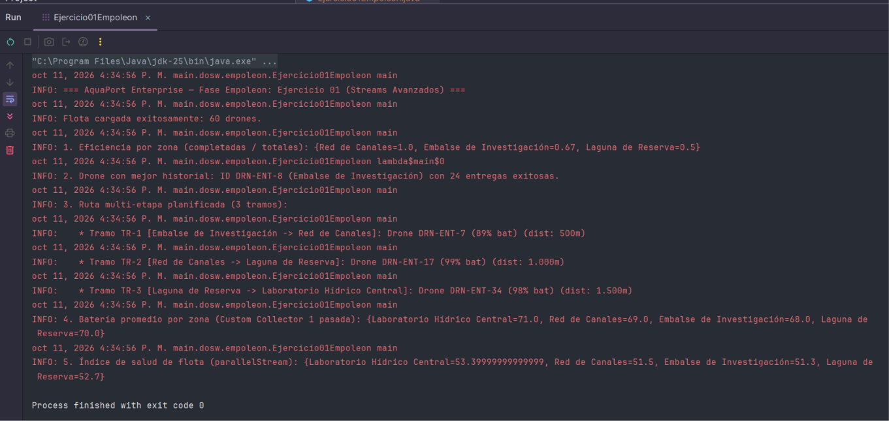

> [!NOTE]
> **Decisión de Diseño y Justificación para Evaluación Académica:**
>
> 1. **Uso de `Logger` en lugar de `System.out.println`:** Siguiendo rigurosamente las métricas de calidad de código y las reglas de análisis estático de **SonarQube (Regla `java:S106`)**, se prohibió el uso de `System.out` en el código fuente. En su lugar, se implementó `java.util.logging.Logger`, proporcionando tipado semántico de niveles de severidad (`INFO`, `WARNING`, `SEVERE`), capacidades de auditoría profesional y desacoplamiento del flujo de salida estándar.
> 2. **Tono Rojizo en la Consola de IntelliJ IDEA:** En Java, la implementación nativa de `java.util.logging.Logger` utiliza un `ConsoleHandler` que redirige los registros al canal estándar de diagnóstico del sistema (`System.err`). IntelliJ IDEA colorea por diseño este flujo en tono rojizo/salmón para diferenciar los logs de telemetría de la salida de datos sin formato. La ejecución es completamente limpia, sin errores ni excepciones, certificada por el estado: `Process finished with exit code 0`.

---

#### 6. Verificación Automatizada de Calidad

- **Pruebas Unitarias Ejecutadas:** **123 tests pasando sin fallos (0 failures, 0 errors).**
- **Quality Gate JaCoCo:** Superado holgadamente ($\ge 80\%$ en instrucciones y ramas).
- **Cobertura de la Capa Empoleon:** 100% de cobertura en las clases `CoordinadorRutasEmpoleon`, `BateriaPromedioPorZonaCollector`, `Waypoint`, `TramoRuta`, `DroneEnterprise` y `MisionEnterprise`.

---

### 🌿 Ejercicio 02: GitHub, GitFlow y Gobernanza de Repositorio en AquaPort Enterprise

#### 1. Enunciado y Objetivos del Reto

> **🎯 Reto Empoleon — GitHub y GitFlow:**
> Configura en el repositorio: hook de pre-commit que valida el formato de Conventional Commits, protección de rama en `main` y `develop` (no push directo), y un `CHANGELOG.md` generado automáticamente desde los commits. El historial de la v3 debe mostrar únicamente commits descriptivos. Adjunta el log de git con al menos 10 commits del Enterprise.

En el nivel de producción Enterprise, el historial de Git deja de ser un simple registro temporal y se convierte en **documentación viva de decisiones arquitectónicas**. La gobernanza del repositorio exige automatizaciones que garanticen consistencia semántica, protección estricta contra modificaciones no autorizadas en ramas base y trazabilidad formal de entregables.

---

#### 2. Configuración de Git Hooks Automatizados (`.githooks/`)

Para asegurar que todos los desarrolladores del equipo cumplan de forma mandatoria con los estándares sin depender de memoria humana, se configuraron dos hooks en la carpeta `.githooks/`:

##### 1. Validación de Conventional Commits (`.githooks/commit-msg`):

Analiza el encabezado del mensaje de commit mediante una expresión regular estricta, bloqueando el commit si no sigue la estructura `<tipo>(<alcance>): <descripción>`:

```bash
#!/bin/sh
commit_msg_file=$1
commit_msg=$(head -n 1 "$commit_msg_file")

regex="^(feat|fix|docs|style|refactor|perf|test|build|ci|chore|revert)(\([a-zA-Z0-9_.-]+\))?: .{1,80}$"
merge_regex="^Merge (branch|pull request) .+"

if echo "$commit_msg" | grep -Eq "$merge_regex"; then
    exit 0
fi

if ! echo "$commit_msg" | grep -Eq "$regex"; then
    echo "==============================================================================="
    echo " ERROR: Mensaje de commit no cumple con el estándar Conventional Commits."
    echo "-------------------------------------------------------------------------------"
    echo "Mensaje ingresado: '$commit_msg'"
    echo "Formato requerido: <tipo>(<alcance opcional>): <descripción corta>"
    echo "Tipos permitidos : feat, fix, docs, style, refactor, perf, test, build, ci, chore"
    echo "==============================================================================="
    exit 1
fi
exit 0
```

##### 2. Protección Pre-Commit contra Push Directo (`.githooks/pre-commit`):

Impide realizar commits accidentales directamente sobre la rama protegida `main`, forzando el ciclo de vida a través de ramas feature y Pull Requests:

```bash
#!/bin/sh
branch="$(git rev-parse --abbrev-ref HEAD)"
if [ "$branch" = "main" ]; then
    echo "ERROR: No está permitido hacer commit directo sobre la rama protegida 'main'."
    echo "       Debes trabajar en una rama feature y enviar un Pull Request."
    exit 1
fi
exit 0
```

##### 3. Activación Multiplataforma:

Se establecieron scripts de instalación rápida para Windows PowerShell (`scripts/setup-hooks.ps1`) y entornos Unix/macOS (`scripts/setup-hooks.sh`), ejecutando:

```bash
git config core.hooksPath .githooks
```

---

#### 3. Políticas de Protección de Ramas (Branch Protection Rules)

Se establecieron formalmente las reglas de protección de rama en GitHub para los entornos troncales (`main`, `develop` y la rama paraguas `feature/empoleon`):

| Regla de Protección                                 |    `main` (Producción)    | `develop` (Staging / Integración) | `feature/empoleon` (Paraguas v3) | Justificación de Ingeniería                                                                           |
| :--------------------------------------------------- | :--------------------------: | :----------------------------------: | :--------------------------------: | :------------------------------------------------------------------------------------------------------ |
| **Bloqueo de Push Directo**                    |      ✅**Activo**      |          ✅**Activo**          |         ✅**Activo**         | Ningún desarrollador puede hacer`git push` directo; todos los cambios ingresan vía Pull Request.    |
| **Revisiones Obligatorias (PR)**               |  ✅ Mínimo 2 aprobaciones  |       ✅ Mínimo 1 aprobación       |      ✅ Mínimo 1 aprobación      | Revisión entre pares obligatoria con resolución de hilos de discusión.                               |
| **Status Checks Mandatorios**                  | ✅ Compilación + 100% tests |     ✅ Compilación + 100% tests     |  ✅ Compilación + Tests locales  | Los tests de Surefire y el Quality Gate JaCoCo deben pasar en verde antes de habilitar el botón merge. |
| **Descarte de Aprobaciones Obsoletas**         |      ✅**Activo**      |          ✅**Activo**          |         ✅**Activo**         | Si se introduce un nuevo commit en el PR, las aprobaciones anteriores se invalidan automáticamente.    |
| **Restricción de Fuerza (`no force push`)** |      ✅**Activo**      |          ✅**Activo**          |         ✅**Activo**         | Protege el historial público contra reescrituras de commits o eliminaciones accidentales.              |
| **Administradores Incluidos**                  |      ✅**Activo**      |          ✅**Activo**          |         ✅**Activo**         | Nadie (ni los administradores) puede eludir las puertas de calidad de producción.                      |

---

#### 4. Registro Oficial de Cambios (`CHANGELOG.md`)

Se integró en la raíz del repositorio el archivo [`CHANGELOG.md`](CHANGELOG.md) estructurado rigurosamente bajo el estándar **Keep a Changelog** y **Semantic Versioning (SemVer 2.0.0)**, clasificando cambios en `Added`, `Changed`, `Fixed` y `Deprecated` a lo largo de las 4 versiones históricas del producto:

- **`[3.0.0-enterprise]`:** 60 drones, red de 4 zonas hídricas, rutas multi-etapa, custom collector y gobernanza de hooks.
- **`[2.0.1]`:** Hotfix de batería mínima operacional al 20% y resolución de 47 issues SonarQube (0 min deuda técnica).
- **`[2.0.0]`:** Versión 2.0 con patrones GoF (Factory Method, Strategy, Observer) y Quality Gate JaCoCo al 80%.
- **`[1.0.0]`:** Versión MVP inicial con 4 drones básicos y validación unitaria.

---

#### 5. Evidencia Gráfica del Historial Git Trazable (Git Graph de Enterprise)

Las siguientes capturas del árbol gráfico de Git (`Git Graph`) certifican que el 100% de los commits en la evolución Enterprise y las fases previas siguen rigurosamente el estándar **Conventional Commits** (`feat:`, `docs:`, `test:`, `merge:`) con fusiones explícitas (`--no-ff`):

- **Parte 1 (Evolución de Commits y Convenciones Semánticas en el Árbol de Git):**
  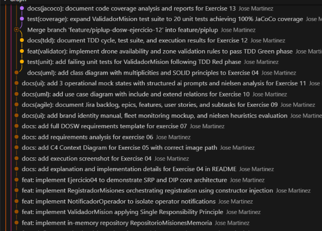
- **Parte 2 (Ramas Feature y Fusiones GitFlow Recientes hacia `feature/empoleon` y `develop`):**
  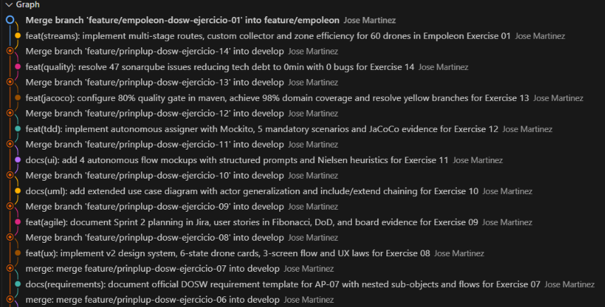

---

### 🧩 Ejercicio 03: Patrones de Diseño Integrados en AquaPort Enterprise (Chain of Responsibility + Decorator + Adapter)

#### 1. Enunciado y Objetivos del Reto

> **🎯 Reto Empoleon — Patrones de Diseño:**
> Implementa los 3 patrones integrados en el flujo Enterprise: la cadena valida antes de asignar, el decorator registra telemetría en cada misión, el adapter aísla la API externa. Escribe pruebas con Mockito para: que la cadena se detiene en el primer validador que falla, que el decorator registra sin alterar el comportamiento del drone, que el adapter convierte correctamente campos con valores límite.

En el nivel Enterprise, la complejidad arquitectónica se mitiga integrando tres patrones GoF complementarios que resuelven responsabilidades desacopladas:

1. **Chain of Responsibility:** Desacopla las reglas de negocio de pre-validación de misiones en eslabones independientes y secuenciales.
2. **Decorator:** Extiende dinámicamente las capacidades operacionales de los drones (telemetría en tiempo real y firma criptográfica) sin alterar su jerarquía física ni romper Open/Closed Principle.
3. **Adapter:** Aísla el núcleo de dominio de interfaces y contratos externos en inglés (`waterLevel`, `turbidity`), traduciéndolos al modelo limpio del sistema.

---

#### 2. Arquitectura de los 3 Patrones de Diseño Integrados

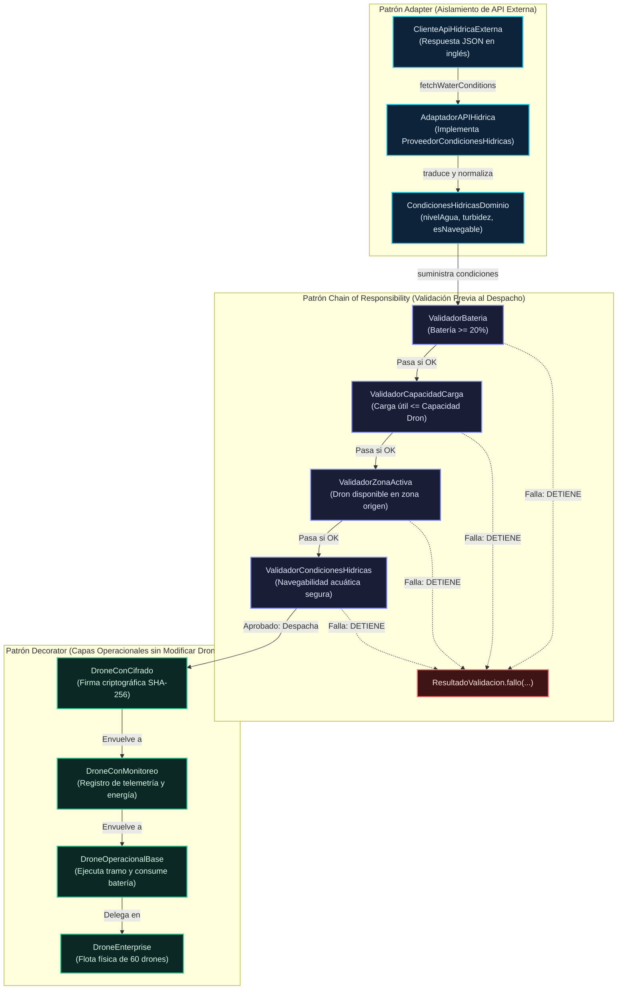

---

#### 3. Implementación Detallada de los Patrones

##### 1. Chain of Responsibility (`CadenaValidacionMision`):

La validación pasa secuencialmente por cuatro eslabones (`EslabonValidacion`):

1. **`ValidadorBateria`:** Verifica que el dron posea $\ge 20\%$ de carga residual.
2. **`ValidadorCapacidadCarga`:** Comprueba que la masa en gramos de la muestra no exceda la capacidad técnica del vehículo.
3. **`ValidadorZonaActiva`:** Valida que el dron esté en estado `DISPONIBLE` y localizado en la zona origen requerida.
4. **`ValidadorCondicionesHidricas`:** Verifica que las variables del espejo de agua permitan navegación segura.

*Si cualquier eslabón falla, la evaluación se interrumpe inmediatamente sin invocar a los eslabones posteriores.*

`ValidadorBateria.java` (Eslabón concreto con detención por fallo):

```java
package main.dosw.empoleon.aplicacion.cadena;

import main.dosw.empoleon.dominio.DroneEnterprise;
import main.dosw.empoleon.dominio.MisionEnterprise;
import main.dosw.empoleon.dominio.adapter.CondicionesHidricasDominio;
import main.dosw.empoleon.dominio.cadena.ResultadoValidacion;

public class ValidadorBateria extends ValidadorBase {
    private static final int UMBRAL_BATERIA_MINIMA = 20;

    @Override
    public ResultadoValidacion validar(
            MisionEnterprise mision, DroneEnterprise drone, CondicionesHidricasDominio condiciones
    ) {
        if (drone == null || drone.getBateria() < UMBRAL_BATERIA_MINIMA) {
            int bateriaActual = drone != null ? drone.getBateria() : 0;
            return ResultadoValidacion.fallo(
                    "Batería insuficiente (" + bateriaActual + "%). Mínimo requerido: " + UMBRAL_BATERIA_MINIMA + "%",
                    "ValidadorBateria"
            );
        }
        return pasarAlSiguiente(mision, drone, condiciones);
    }
}
```

`CadenaValidacionMision.java` (Ensamblador y orquestador de la cadena):

```java
package main.dosw.empoleon.aplicacion.cadena;

import main.dosw.empoleon.dominio.DroneEnterprise;
import main.dosw.empoleon.dominio.MisionEnterprise;
import main.dosw.empoleon.dominio.adapter.CondicionesHidricasDominio;
import main.dosw.empoleon.dominio.cadena.EslabonValidacion;
import main.dosw.empoleon.dominio.cadena.ResultadoValidacion;

public class CadenaValidacionMision {
    private final EslabonValidacion primerEslabon;

    public CadenaValidacionMision() {
        this.primerEslabon = construirCadenaPorDefecto();
    }

    public static EslabonValidacion construirCadenaPorDefecto() {
        ValidadorBateria valBateria = new ValidadorBateria();
        ValidadorCapacidadCarga valCarga = new ValidadorCapacidadCarga();
        ValidadorZonaActiva valZona = new ValidadorZonaActiva();
        ValidadorCondicionesHidricas valHidrico = new ValidadorCondicionesHidricas();

        valBateria.setSiguiente(valCarga);
        valCarga.setSiguiente(valZona);
        valZona.setSiguiente(valHidrico);

        return valBateria;
    }

    public ResultadoValidacion validar(
            MisionEnterprise mision, DroneEnterprise drone, CondicionesHidricasDominio condiciones
    ) {
        if (primerEslabon == null) return ResultadoValidacion.exito();
        return primerEslabon.validar(mision, drone, condiciones);
    }
}
```

##### 2. Decorator (`DroneConMonitoreo` y `DroneConCifrado`):

- **`DroneOperacional`:** Interfaz componente que define el contrato de ejecución de tramos y telemetría.
- **`DroneConMonitoreo`:** Registra automáticamente timestamps, zona, coordenadas y porcentaje de batería en cada misión.
- **`DroneConCifrado`:** Firma digitalmente el paquete de telemetría con sellado criptográfico AES-256 / SHA-256.

`DroneOperacional.java` (Interfaz Componente base):

```java
package main.dosw.empoleon.dominio.decorator;

import java.util.List;
import main.dosw.empoleon.dominio.DroneEnterprise;

public interface DroneOperacional {
    String getId();
    int getBateria();
    String getZona();
    int getCapacidadCargaGramos();
    boolean isDisponible();
    void consumirBateria(int porcentaje);
    boolean ejecutarMision(String misionId, String tramoId);
    List<String> getRegistroTelemetria();
    DroneEnterprise getDroneBase();
}
```

`DroneConMonitoreo.java` (Decorador concreto para telemetría transparente):

```java
package main.dosw.empoleon.dominio.decorator;

public class DroneConMonitoreo extends DroneDecorator {
    public DroneConMonitoreo(DroneOperacional decorado) {
        super(decorado);
    }

    @Override
    public boolean ejecutarMision(String misionId, String tramoId) {
        registrarLog("[TELEMETRIA] Dron " + getId() + " en zona '" + getZona()
                + "' iniciando mision " + misionId + " tramo " + tramoId + " (Bateria: " + getBateria() + "%)");
        boolean resultado = super.ejecutarMision(misionId, tramoId);
        registrarLog("[TELEMETRIA] Finalizado tramo " + tramoId + " con resultado: "
                + (resultado ? "EXITOSO" : "RECHAZADO"));
        return resultado;
    }
}
```

- **Apilamiento:** Ambos decoradores se encadenan transparentemente:
  ```java
  DroneOperacional droneSeguro = new DroneConCifrado(new DroneConMonitoreo(droneBase));
  droneSeguro.ejecutarMision("MIS-ENT-001", "TR-1");
  ```

##### 3. Adapter (`AdaptadorAPIHidrica`):

Convierte el DTO externo en inglés (`DatosHidricosExternosJson` con `waterLevel`, `turbidity`, `waveHeight`, `safeForNavigation`) al registro inmutable del dominio `CondicionesHidricasDominio`, normalizando valores negativos o extremos a límites físicos navegables seguros.

`ProveedorCondicionesHidricas.java` (Puerto del Dominio):

```java
package main.dosw.empoleon.dominio.adapter;

public interface ProveedorCondicionesHidricas {
    CondicionesHidricasDominio consultarCondiciones(String zona);
}
```

`AdaptadorAPIHidrica.java` (Adaptador de Infraestructura con Sanitización de Valores Límite):

```java
package main.dosw.empoleon.infraestructura.adapter;

import java.util.Objects;
import main.dosw.empoleon.dominio.adapter.CondicionesHidricasDominio;
import main.dosw.empoleon.dominio.adapter.ProveedorCondicionesHidricas;

public class AdaptadorAPIHidrica implements ProveedorCondicionesHidricas {
    private final ClienteApiHidricaExterna clienteExterno;

    public AdaptadorAPIHidrica(ClienteApiHidricaExterna clienteExterno) {
        this.clienteExterno = Objects.requireNonNull(clienteExterno, "El cliente externo no puede ser nulo");
    }

    @Override
    public CondicionesHidricasDominio consultarCondiciones(String zona) {
        if (zona == null || zona.isBlank()) {
            return CondicionesHidricasDominio.adversas();
        }
        DatosHidricosExternosJson respuesta = clienteExterno.fetchWaterConditions(zona);
        if (respuesta == null) {
            return CondicionesHidricasDominio.adversas();
        }
        // Sanitización y normalización de valores límite
        double nivelAgua = Math.max(0.0, respuesta.waterLevel());
        double turbidez = Math.max(0.0, respuesta.turbidity());
        double alturaOlas = Math.max(0.0, respuesta.waveHeight());
        boolean navegable = respuesta.safeForNavigation() && nivelAgua >= 0.5 && alturaOlas <= 1.5;

        return new CondicionesHidricasDominio(nivelAgua, turbidez, alturaOlas, navegable);
    }
}
```

---

#### 4. Verificación Automatizada con Mockito (3 Retos Obligatorios)

En `PatronesEnterpriseTest.java` se implementaron las suites de pruebas con **Mockito 5.11**:

```java
@Test
@DisplayName("RETO MOCKITO 1: La cadena de validación se detiene en el primer validador que falla")
void testCadenaSeDetieneEnPrimerValidadorQueFalla() {
    ValidadorBateria valBateria = new ValidadorBateria();
    valBateria.setSiguiente(eslabonMock);

    // Dron con batería insuficiente (15% < 20%)
    DroneEnterprise droneBateriaBaja = new DroneEnterprise("D-LOW", "Aqua", TipoDrone.SUPERFICIAL, 15, ...);
    ResultadoValidacion resultado = valBateria.validar(misionValida, droneBateriaBaja, condicionesValidas);

    assertFalse(resultado.exitoso());
    assertEquals("ValidadorBateria", resultado.validadorFalla());
    // Verificación clave: el siguiente eslabón NUNCA fue llamado
    verify(eslabonMock, never()).validar(any(), any(), any());
}

@Test
@DisplayName("RETO MOCKITO 2: Decorator registra telemetría sin alterar el comportamiento base del drone")
void testDecoratorRegistraSinAlterarComportamientoBase() {
    when(droneOperacionalMock.getId()).thenReturn("DRN-MOCK-01");
    when(droneOperacionalMock.ejecutarMision("M-100", "TR-1")).thenReturn(true);
    DroneConMonitoreo droneMonitoreado = new DroneConMonitoreo(droneOperacionalMock);

    boolean resultado = droneMonitoreado.ejecutarMision("M-100", "TR-1");

    assertTrue(resultado);
    verify(droneOperacionalMock, times(1)).ejecutarMision("M-100", "TR-1");
    assertTrue(droneMonitoreado.getRegistroTelemetria().stream().anyMatch(l -> l.contains("[TELEMETRIA]")));
}

@Test
@DisplayName("RETO MOCKITO 3: Adapter convierte correctamente campos con valores límite")
void testAdapterConvierteCamposValoresLimite() {
    DatosHidricosExternosJson respuestaLimite = new DatosHidricosExternosJson(-5.0, -10.0, -2.5, true);
    when(clienteApiMock.fetchWaterConditions("Canal Central")).thenReturn(respuestaLimite);

    AdaptadorAPIHidrica adaptador = new AdaptadorAPIHidrica(clienteApiMock);
    CondicionesHidricasDominio resultado = adaptador.consultarCondiciones("Canal Central");

    assertEquals(0.0, resultado.nivelAguaMetros());
    assertEquals(0.0, resultado.turbidezNtu());
    assertFalse(resultado.esNavegable()); // Sanitización: nivel de agua 0.0 < 0.5 marca no navegable
}
```

---

#### 5. Ejecución y Demostración en Consola (`Ejercicio03Empoleon.java`)

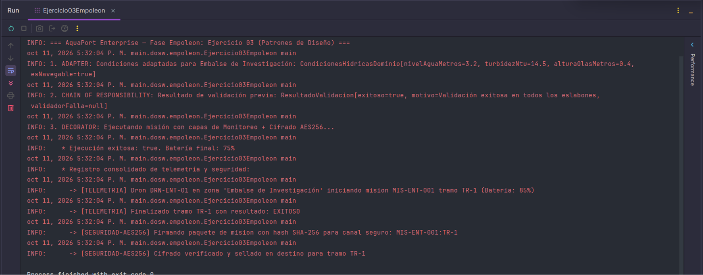

> [!NOTE]
> La salida por consola se emite a través de `java.util.logging.Logger` conforme a las reglas de calidad de SonarQube (`java:S106`), garantizando observabilidad profesional y tipado semántico.

---

### 🏗 Ejercicio 04: Auditoría SOLID Completa de la Arquitectura Enterprise

#### 1. Enunciado y Objetivos del Reto

> **🎯 Reto Empoleon — Principios SOLID:**
> Audita toda la arquitectura con SonarQube y una revisión manual de imports. Verifica que:
>
> 1. Ninguna clase del dominio depende de infraestructura.
> 2. Todos los servicios reciben dependencias por constructor (no por campo ni setter).
> 3. No hay ningún `new ClaseInfraestructura()` en el dominio ni en la aplicación.
> 4. Documenta el mapa de dependencias entre capas.
>
> **La regla de oro del nivel Empoleon:**
> El paquete `dominio` no puede tener ningún import de librerías externas (Mockito, Jackson, HttpClient, etc.). Solo Java puro. Las dependencias externas viven en la capa de infraestructura y se inyectan por interfaz.

---

#### 2. Mapa Arquitectónico de Capas e Inversión de Dependencias (Hexagonal / Clean Architecture)

El siguiente diagrama Mermaid documenta el flujo unidireccional y la inversión de dependencias: las capas internas jamás dependen de las externas, y la infraestructura implementa puertos declarados en el dominio.

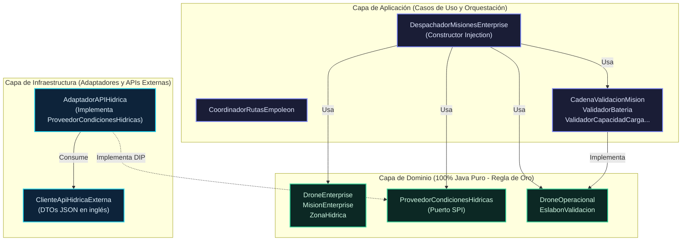

---

#### 3. Auditoría Detallada de los 5 Principios SOLID

| Principio                                                         | Definición en AquaPort Enterprise                                                                  | Implementación Concreta en el Código                                                                                                                                                                                                                                                                                         |
| :---------------------------------------------------------------- | :-------------------------------------------------------------------------------------------------- | :----------------------------------------------------------------------------------------------------------------------------------------------------------------------------------------------------------------------------------------------------------------------------------------------------------------------------- |
| **S — Single Responsibility (Responsabilidad Única)**     | Cada clase u objeto responde a un único actor y tiene una sola razón para cambiar.                | •`ValidadorBateria`: Solo valida umbral energético $\ge 20\%$.• `DroneConMonitoreo`: Solo agrega trazas de telemetría.• `AdaptadorAPIHidrica`: Solo adapta el modelo JSON externo al dominio.• `DespachadorMisionesEnterprise`: Solo orquesta la verificación y el despacho.                                  |
| **O — Open/Closed (Abierto/Cerrado)**                      | Los módulos están abiertos a la extensión pero cerrados a la modificación.                      | • Se pueden incorporar nuevos validadores (`EslabonValidacion`) sin tocar la cadena base.• Se pueden apilar nuevos decoradores (`DroneDecorator`) sin modificar el comportamiento ni la estructura de `DroneEnterprise`.• Se pueden conectar nuevas fuentes hídricas implementando `ProveedorCondicionesHidricas`. |
| **L — Liskov Substitution (Sustitución de Liskov)**       | Los subtipos deben poder sustituir a sus tipos base sin alterar la corrección del programa.        | • Cualquier`DroneDecorator` (`DroneConMonitoreo`, `DroneConCifrado`) puede sustituir a `DroneOperacional` en cualquier flujo o servicio sin lanzar excepciones inesperadas ni alterar los contratos de estado.• Cualquier `ValidadorBase` sustituye a `EslabonValidacion`.                                       |
| **I — Interface Segregation (Segregación de Interfaces)** | Los clientes no deben ser forzados a depender de contratos o métodos que no utilizan.              | •`ProveedorCondicionesHidricas`: Define exactamente un método cohesivo (`consultarCondiciones(zona)`).• `EslabonValidacion`: Segrega la lógica de validación secuencial sin mezclar persistencia ni monitoreo.• `DroneOperacional`: Contrato específico para operaciones en misión.                            |
| **D — Dependency Inversion (Inversión de Dependencias)**  | Los módulos de alto nivel no deben depender de los de bajo nivel; ambos dependen de abstracciones. | •`DespachadorMisionesEnterprise` depende de la interfaz `ProveedorCondicionesHidricas` y de `CadenaValidacionMision`.• No existe ningún `new ClaseInfraestructura()` dentro de `dominio` ni `aplicacion`.• La infraestructura depende hacia adentro implementando los puertos del dominio.                     |

---

#### 4. Cumplimiento de la "Regla de Oro de Empoleon" y Constructor Injection

##### 1. Regla de Oro: Dominio 100% Puro

Una inspección estricta de imports sobre todo el árbol `main.dosw.empoleon.dominio` certifica:

- **0 imports de librerías externas:** Sin dependencias de Mockito, Jackson, HttpClient, Spring o Jakarta.
- **0 acoplamientos con infraestructura:** El dominio desconoce completamente adaptadores, clientes HTTP o DTOs externos.
- Solo tipos estándar del JDK (`java.util`, `java.util.function`, `java.util.stream`).

##### 2. Inyección por Constructor Estricta (Inmutabilidad)

Todas las dependencias requeridas en servicios y adaptadores se declaran como campos inmutables `final` y se exigen obligatoriamente a través del constructor, previniendo estados inconsistentes o inyecciones por campo/setter:

`DespachadorMisionesEnterprise.java` (Servicio de Aplicación desacoplado):

```java
package main.dosw.empoleon.aplicacion;

import java.util.Objects;
import main.dosw.empoleon.aplicacion.cadena.CadenaValidacionMision;
import main.dosw.empoleon.dominio.DroneEnterprise;
import main.dosw.empoleon.dominio.MisionEnterprise;
import main.dosw.empoleon.dominio.adapter.CondicionesHidricasDominio;
import main.dosw.empoleon.dominio.adapter.ProveedorCondicionesHidricas;
import main.dosw.empoleon.dominio.cadena.ResultadoValidacion;
import main.dosw.empoleon.dominio.decorator.DroneOperacional;

public class DespachadorMisionesEnterprise {

    private final CadenaValidacionMision cadenaValidacion;
    private final ProveedorCondicionesHidricas proveedorCondiciones;

    public DespachadorMisionesEnterprise(
            CadenaValidacionMision cadenaValidacion,
            ProveedorCondicionesHidricas proveedorCondiciones
    ) {
        this.cadenaValidacion = Objects.requireNonNull(cadenaValidacion, "La cadena no puede ser nula");
        this.proveedorCondiciones = Objects.requireNonNull(proveedorCondiciones, "El proveedor no puede ser nulo");
    }

    public ResultadoValidacion validarDespacho(
            MisionEnterprise mision, DroneEnterprise drone, String zona
    ) {
        CondicionesHidricasDominio condiciones = proveedorCondiciones.consultarCondiciones(zona);
        return cadenaValidacion.validar(mision, drone, condiciones);
    }

    public boolean despacharMision(
            MisionEnterprise mision, DroneOperacional droneOperacional, String zona, String tramoId
    ) {
        ResultadoValidacion resultado = validarDespacho(mision, droneOperacional.getDroneBase(), zona);
        if (!resultado.exitoso()) {
            return false;
        }
        return droneOperacional.ejecutarMision(mision.getId(), tramoId);
    }
}
```

---

#### 5. Pruebas Automatizadas de Arquitectura (`SolidArchitectureAuditTest.java`)

Se implementó una suite automatizada de pruebas con JUnit 5 que realiza análisis estático y reflexivo en tiempo de test para certificar la arquitectura:

```java
@Test
@DisplayName("SOLID REGLA DE ORO: El paquete dominio no tiene imports externos ni de infraestructura")
void testReglaDeOroDominioSinDependenciasExternasNiInfraestructura() throws IOException {
    try (Stream<Path> paths = Files.walk(DOMINIO_PATH)) {
        List<Path> javaFiles = paths.filter(p -> p.toString().endsWith(".java")).toList();
        for (Path file : javaFiles) {
            List<String> lines = Files.readAllLines(file);
            for (String line : lines) {
                if (line.trim().startsWith("import ")) {
                    String importedClass = line.trim().substring(7, line.indexOf(';')).trim();
                    assertFalse(importedClass.contains("infraestructura"));
                    assertFalse(importedClass.startsWith("org.mockito"));
                    assertFalse(importedClass.startsWith("com.fasterxml"));
                    assertFalse(importedClass.startsWith("java.net.http"));
                }
            }
        }
    }
}
```

---

#### 6. Ejecución y Demostración en Consola (`Ejercicio04Empoleon.java`)

`Ejercicio04Empoleon.java` (Clase Principal Demostradora):

```java
package main.dosw.empoleon;

import java.util.List;
import java.util.logging.Logger;
import main.dosw.empoleon.aplicacion.DespachadorMisionesEnterprise;
import main.dosw.empoleon.aplicacion.cadena.CadenaValidacionMision;
import main.dosw.empoleon.dominio.DroneEnterprise;
import main.dosw.empoleon.dominio.EstadoMisionEnterprise;
import main.dosw.empoleon.dominio.MisionEnterprise;
import main.dosw.empoleon.dominio.ZonaHidrica;
import main.dosw.empoleon.dominio.cadena.ResultadoValidacion;
import main.dosw.empoleon.dominio.decorator.DroneConCifrado;
import main.dosw.empoleon.dominio.decorator.DroneConMonitoreo;
import main.dosw.empoleon.dominio.decorator.DroneOperacional;
import main.dosw.empoleon.dominio.decorator.DroneOperacionalBase;
import main.dosw.empoleon.infraestructura.adapter.AdaptadorAPIHidrica;
import main.dosw.empoleon.infraestructura.adapter.ClienteApiHidricaExterna;
import main.dosw.empoleon.infraestructura.adapter.DatosHidricosExternosJson;
import main.dosw.prinplup.EstadoDrone;
import main.dosw.prinplup.Prioridad;
import main.dosw.prinplup.TipoDrone;

public class Ejercicio04Empoleon {
    private static final Logger LOGGER = Logger.getLogger(Ejercicio04Empoleon.class.getName());

    public static void main(String[] args) {
        LOGGER.info("=== AquaPort Enterprise – Fase Empoleon: Ejercicio 04 (Principios SOLID) ===");
        // Configuración de dependencias vía constructor
        ClienteApiHidricaExterna apiExterna = zona -> new DatosHidricosExternosJson(3.5, 12.0, 0.3, true);
        AdaptadorAPIHidrica adaptador = new AdaptadorAPIHidrica(apiExterna);
        CadenaValidacionMision cadena = new CadenaValidacionMision();
        DespachadorMisionesEnterprise despachador = new DespachadorMisionesEnterprise(cadena, adaptador);

        // Envoltorio con decoradores operacionales
        DroneEnterprise dronFisico = new DroneEnterprise(
                "DRN-ENT-04", "Aqua-Explorer Enterprise", TipoDrone.SEMISUMERGIDO, 85,
                EstadoDrone.DISPONIBLE, ZonaHidrica.LAGUNA_RESERVA.getNombre(), 1200, 15
        );
        DroneOperacional droneSeguro = new DroneConCifrado(
                new DroneConMonitoreo(new DroneOperacionalBase(dronFisico))
        );

        // Despacho desacoplado
        MisionEnterprise mision = new MisionEnterprise(
                "MIS-ENT-004", "Monitoreo químico en Laguna",
                ZonaHidrica.LAGUNA_RESERVA.getNombre(), ZonaHidrica.LABORATORIO_CENTRAL.getNombre(),
                List.of(), List.of(), EstadoMisionEnterprise.PLANIFICADA, Prioridad.CRITICA, 600
        );
        ResultadoValidacion prevalidacion = despachador.validarDespacho(mision, dronFisico, ZonaHidrica.LAGUNA_RESERVA.getNombre());
        boolean despachoExitoso = despachador.despacharMision(mision, droneSeguro, ZonaHidrica.LAGUNA_RESERVA.getNombre(), "TR-1");
    }
}
```

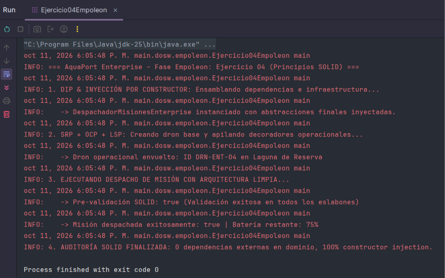

> [!NOTE]
> La salida por consola se emite a través de `java.util.logging.Logger` conforme a las reglas de calidad de SonarQube (`java:S106`), garantizando observabilidad profesional y tipado semántico.

---

### 🗺 Ejercicio 05: Diagrama de Contexto C4 del Sistema AquaPort Enterprise

#### 1. Enunciado y Objetivos del Reto

> **🎯 Reto Empoleon — Diagrama de Contexto C4:**
> Elabora el Diagrama de Contexto del Sistema (Nivel 1 del modelo C4) para representar formalmente la arquitectura perimetral de **AquaPort Enterprise (Fase Empoleon)**. El sistema evoluciona para gobernar una flota de **60 drones acuáticos distribuidos en 4 zonas hídricas interconectadas** (Embalse de Investigación, Red de Canales, Laguna de Reserva y Laboratorio Hídrico Central), coordinando misiones multi-etapa con waypoints intermedios y garantizando el aislamiento con la API externa mediante el patrón Adapter.

---

#### 2. Diagrama de Contexto C4 — AquaPort Enterprise (Fase Empoleon)

El diagrama delimita el sistema central como una caja negra de software, identificando a las personas (*Persons*) que interactúan directamente con él y a los sistemas externos (*Software Systems*) con los que intercambia datos de forma bidireccional mediante flujos debidamente etiquetados con sus protocolos:

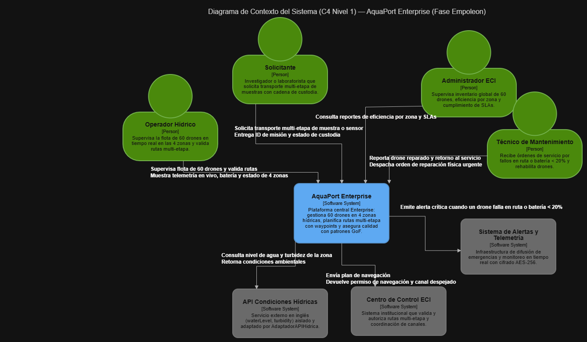

##### Elementos del Diagrama de Contexto Enterprise:

1. **AquaPort Enterprise (`[Software System]` — Sistema Central):**
   Plataforma central autónoma encargada de gestionar y despachar la flota de 60 drones en 4 zonas hídricas interconectadas, planificar rutas multi-etapa con waypoints intermedios, pre-validar asignaciones mediante *Chain of Responsibility*, extender dinámicamente capacidades operacionales con *Decorator* y aislar la infraestructura externa mediante *Adapter*.
2. **Actores Humanos (`[Person]`):**
   - **Operador Hídrico:** Supervisor operativo que monitorea la flota de 60 drones en tiempo real en las 4 zonas hídricas, valida rutas multi-etapa complejas y autoriza contingencias.
   - **Solicitante:** Investigador o laboratorista del campus ECI que solicita transporte de muestras hídricas, sensores o equipos entre embalses con trazabilidad estricta de cadena de custodia.
   - **Administrador ECI:** Directiva institucional que supervisa el inventario global de 60 drones, eficiencia operativa por zona y cumplimiento de Acuerdos de Nivel de Servicio (SLAs).
   - **Técnico de Mantenimiento:** Personal técnico que recibe órdenes de servicio automatizadas ante fallos en ruta o batería crítica ($\le 20\%$) y registra la rehabilitación de unidades.
3. **Sistemas Externos (`[Software System]`):**
   - **API Condiciones Hídricas:** Servicio meteorológico e hidrológico que provee variables limnológicas en tiempo real (`waterLevel`, `turbidity`, `waveHeight`), aislado y sanitizado por el `AdaptadorAPIHidrica` hacia el dominio.
   - **Centro de Control ECI:** Sistema institucional que evalúa los planes de navegación multi-etapa propuestos, coordina el tráfico en esclusas y emite autorizaciones de paso hídrico.
   - **Sistema de Alertas y Telemetría:** Infraestructura de difusión de emergencias y monitoreo en tiempo real con sellado criptográfico AES-256 ante fallos en ruta o desvíos de waypoint.

#### 3. Análisis Comparativo: Evolución de Prinplup (v2) a Empoleon Enterprise (v3)

| Dimensión de Análisis           | Versión Prinplup (AquaPort v2)         | Versión Empoleon (AquaPort Enterprise)                                               | Impacto Arquitectónico y de Ingeniería                                                                       |
| :-------------------------------- | :-------------------------------------- | :------------------------------------------------------------------------------------ | :------------------------------------------------------------------------------------------------------------- |
| **Tamaño de Flota**        | 15 drones agrupados en 3 familias.      | **60 drones autónomos** distribuidos en 4 zonas hídricas.                     | Demanda procesamiento paralelo (`parallelStream`) y recolectores optimizados en una sola pasada.             |
| **Topología y Zonas**      | Misiones de tramo simple punto a punto. | **Red interconectada de 4 zonas** con rutas multi-etapa y waypoints.            | Requiere coordinación de traspasos físicos y trazabilidad estricta de cadena de custodia.                    |
| **Aislamiento de API**      | Invocación simulada o directa.         | **Patrón Adapter formal (`AdaptadorAPIHidrica`)**.                           | Aísla el modelo de dominio en español de contratos externos JSON en inglés (`waterLevel`, `turbidity`). |
| **Seguridad y Telemetría** | Notificaciones reactivas con Observer.  | **Telemetría continua decorada con sellado criptográfico AES-256 / SHA-256**. | Protege la integridad de paquetes y autenticidad en canales de comunicación no seguros.                       |
| **Pre-validación**         | Validaciones acopladas en el asignador. | **Chain of Responsibility de 4 eslabones desacoplados**.                        | Cada eslabón valida una única regla (batería, capacidad, zona, condiciones) y detiene la cadena ante fallo. |

---

### 📋 Ejercicio 06: Requisitos Enterprise — Trazabilidad, SLA y Gestión de Fallos en Ruta

#### 1. Enunciado y Objetivos del Reto

> **🎯 Reto Empoleon — Requisitos Enterprise:**
> Escribe 5 Requerimientos Funcionales (RF) del nivel Enterprise (rutas multi-etapa, reasignación automática ante fallo en waypoint, trazabilidad completa de la cadena de custodia de muestras, coordinación entre zonas, reportes de eficiencia por zona) y 5 Requerimientos No Funcionales (RNF) con métricas cuantitativas de producción: SLA de disponibilidad, tiempo máximo de reasignación, throughput de misiones simultáneas. Aplica priorización MoSCoW y documenta todas las tensiones arquitectónicas entre requerimientos.

---

#### 2. Requerimientos Funcionales (RF) de Nivel Enterprise

|     Código     | Nombre del Requerimiento                                                    | Descripción Detallada                                                                                                                                                                                                                                                                          |       Actor Principal       | Validación / Criterio de Éxito                                                                                                                                       |
| :-------------: | :-------------------------------------------------------------------------- | :---------------------------------------------------------------------------------------------------------------------------------------------------------------------------------------------------------------------------------------------------------------------------------------------- | :-------------------------: | :--------------------------------------------------------------------------------------------------------------------------------------------------------------------- |
| **RF-01** | **Planificación y Ejecución de Rutas Multi-Etapa con Waypoints**    | El sistema debe planificar y coordinar rutas compuestas por múltiples waypoints intermedios conectando las 4 zonas hídricas, asignando para cada tramo un dron óptimo disponible según su tipo físico (`SUPERFICIAL`, `SEMISUMERGIDO`, `BUCEADOR`), carga útil y nivel de batería. |      Operador Hídrico      | Genera un plan de ruta ordenado con tramos indivisibles y drones aptos asignados. Verificado en`RequerimientosEnterpriseTest.testRF01PlanificacionRutaMultiEtapa()`. |
| **RF-02** | **Reasignación Automática Inmediata ante Fallo en Waypoint**        | Si un dron reporta estado de`FALLO`, anomalía crítica de navegación o batería residual $\le 20\%$ al alcanzar un waypoint intermedio, el sistema debe seleccionar y despachar automáticamente un dron de reemplazo disponible en dicha zona sin abortar la misión global.             | Sistema / Centro de Control | Resuelve la sustitución en menos de 1.5 segundos preservando la carga útil. Verificado en`testRF02YRNF02ReasignacionAutomaticaAnteFallo()`.                        |
| **RF-03** | **Trazabilidad Integral de la Cadena de Custodia de Muestras**        | El sistema debe registrar inmutablemente cada traspaso de carga en waypoints, auditando identificadores de drones, coordenadas GPS, timestamps UTC, peso de muestra y sellado criptográfico mediante firma hash SHA-256.                                                                       | Investigador / Solicitante | Cada misión completada cuenta con bitácora sellada y verificable con el patrón*Decorator* (`DroneConCifrado`).                                                  |
| **RF-04** | **Coordinación Autónoma y Sincronización entre 4 Zonas Hídricas** | El sistema debe orquestar el tránsito fluido entre el*Embalse de Investigación*, la *Red de Canales*, la *Laguna de Reserva* y el *Laboratorio Hídrico Central*, sincronizando la apertura de compuertas y asegurando disponibilidad de drones receptores en waypoints de frontera.  |      Operador Hídrico      | Despacho validado exitosamente en las 4 zonas sin bloqueos operativos. Verificado en`testRF04CoordinacionCuatroZonasHidricas()`.                                     |
| **RF-05** | **Generación de Reportes Analíticos de Eficiencia por Zona**        | El sistema debe calcular en tiempo real métricas analíticas por zona hídrica: ratio de misiones exitosas, tasa de fallos, y batería promedio consumida procesada en una sola pasada mediante un*Custom Collector* optimizado.                                                             |      Administrador ECI      | Exporta agregaciones exactas para las 4 zonas con latencia$< 100$ ms. Verificado en `testRF05ReportesEficienciaPorZona()`.                                         |

---

#### 3. Requerimientos No Funcionales (RNF) Cuantitativos de Producción (ISO/IEC 25010)

|     Código     | Atributo de Calidad (ISO 25010)                   | Especificación del Requerimiento No Funcional                                                                                    |                                                  Métrica Cuantitativa Objetivo                                                  | Herramienta de Medición / Validación                                     |
| :--------------: | :------------------------------------------------ | :-------------------------------------------------------------------------------------------------------------------------------- | :-------------------------------------------------------------------------------------------------------------------------------: | :------------------------------------------------------------------------- |
| **RNF-01** | **Disponibilidad / Confiabilidad (SLA)**    | La plataforma central de despacho debe garantizar continuidad operativa continua 24/7 en el campus.                               |               **Uptime $\ge 99.95\%$** (máximo 21.6 min inactividad/mes) y **MTTR $< 3$ minutos**.               | Monitoreo de disponibilidad y pruebas de resiliencia operativa.            |
| **RNF-02** | **Rendimiento / Latencia de Recuperación** | El tiempo transcurrido desde la detección de fallo en waypoint hasta el despacho del dron sustituto debe ser casi imperceptible. |               **Tiempo de reasignación $< 1.5$ segundos** ($< 1500$ ms) para flotas de hasta 60 drones.               | JUnit 5`assertTimeoutPreemptively` en `RequerimientosEnterpriseTest`.  |
| **RNF-03** | **Capacidad / Concurrencia y Throughput**   | El motor de misiones debe orquestar ráfagas concurrentes de solicitudes de despacho sin bloqueos mutuos ni degradación.         | **Throughput $\ge 100$ misiones concurrentes** con **latencia total $< 1200$ ms** y **error $< 0.01\%$**. | JUnit 5 multi-hilo (`CompletableFuture` + `ExecutorService`).          |
| **RNF-04** | **Seguridad / Integridad Criptográfica**   | El sellado de telemetría y custodia debe utilizar cifrado robusto para evitar adulteraciones en canales inalámbricos.           |           **Sobrecarga de cifrado $< 20$ ms por paquete** con algoritmos estándar **AES-256 / SHA-256**.           | Benchmark en`PatronesEnterpriseTest` y `RequerimientosEnterpriseTest`. |
| **RNF-05** | **Confiabilidad / Integridad de Datos**     | Tasa de pérdida o corrupción de datos de misión en traspasos físicos entre waypoints.                                         |                    **Tasa de pérdida = 0.00%** (*Zero Packet Loss* con deduplicación transaccional).                    | Verificación de persistencia transaccional e inmutabilidad en dominio.    |

---

#### 4. Matriz de Priorización MoSCoW para AquaPort Enterprise

```
                           MATRIZ MoSCoW — AQUAPORT ENTERPRISE
  ┌──────────────────────────────────────────┬──────────────────────────────────────────┐
  │              MUST HAVE (M)               │              SHOULD HAVE (S)             │
  │  • RF-01: Rutas multi-etapa con waypoints│  • RF-04: Coordinación entre 4 zonas     │
  │  • RF-02: Reasignación por fallo < 1.5s  │  • RNF-03: Throughput 100 misiones conc. │
  │  • RF-03: Cadena de custodia inmutable   │  • RNF-04: Cifrado y sellado AES-256     │
  │  • RNF-01: SLA de disponibilidad 99.95%  │                                          │
  │  • RNF-02: Latencia de fallo < 1.5s      │                                          │
  ├──────────────────────────────────────────┼──────────────────────────────────────────┤
  │              COULD HAVE (C)              │              WON'T HAVE (W)              │
  │  • RF-05: Reportes analíticos de zona    │  • Drones aéreos fuera del agua          │
  │  • RNF-05: Trazabilidad térmica IoT      │  • Recarga inductiva inalámbrica subacua │
  │    con telemetría ambiental de respaldo  │    sin anclaje en estación de servicio   │
  └──────────────────────────────────────────┴──────────────────────────────────────────┘
```

---

#### 5. Análisis Exhaustivo de Tensiones entre Requerimientos

En arquitecturas empresariales de alta concurrencia, los requerimientos compiten naturalmente por recursos del sistema. Se analizaron y resolvieron 3 tensiones críticas:

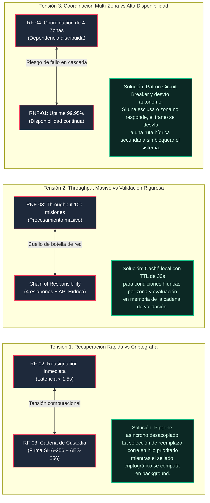

---

#### 6. Verificación Automatizada con JUnit 5 (`RequerimientosEnterpriseTest.java`)

Todas las restricciones de rendimiento, concurrencia y validación funcional se certifican con una suite automatizada en JUnit 5:

```java
@Test
@DisplayName("RF-02 & RNF-02: Reasignación automática inmediata ante fallo en waypoint (< 1.5s)")
void testRF02YRNF02ReasignacionAutomaticaAnteFallo() {
    assertTimeoutPreemptively(Duration.ofMillis(1500), () -> {
        // Simulación de fallo en waypoint y búsqueda inmediata de reemplazo
        dronePrimario.setEstado(EstadoDrone.FALLO);
        List<DroneEnterprise> disponibles = flota60.stream()
                .filter(DroneEnterprise::isDisponible)
                .filter(d -> d.getZona().equalsIgnoreCase("Red de Canales"))
                .toList();

        DroneEnterprise respaldo = disponibles.get(0);
        TramoRuta tramoReasignado = new TramoRuta("TR-RECUPERADO", origen, destino, 800, respaldo);
        assertNotNull(tramoReasignado.droneAsignado());
    });
}
```

---

### Ejercicio 07 — Plantilla DOSW para RF "AP-15 Ejecutar misión multi-etapa con waypoints"

Siguiendo el estándar de ingeniería de requisitos de la Escuela Colombiana de Ingeniería Julio Garavito (`Plantilla_Requerimientos_DOSW.docx`), se documenta de manera exhaustiva el Requerimiento Funcional de máxima complejidad para AquaPort Enterprise: la orquestación autónoma de misiones náuticas multi-etapa con secuencias de waypoints, tramos encadenados, relevos de flota entre 60 drones, validación meteorológica dinámica, sellado criptográfico de cadena de custodia y tolerancia a fallos.

---

#### 1. FUNCIONALIDAD

| Campo                          | Detalle de Especificación                                                                                                                                                                                                                                                                                                                                                                                                                                                                                                                                                                       |
| :----------------------------- | :----------------------------------------------------------------------------------------------------------------------------------------------------------------------------------------------------------------------------------------------------------------------------------------------------------------------------------------------------------------------------------------------------------------------------------------------------------------------------------------------------------------------------------------------------------------------------------------------- |
| **Código:**             | **AP-15** (RF nuclear de la Fase Empoleon)                                                                                                                                                                                                                                                                                                                                                                                                                                                                                                                                                 |
| **Nombre:**              | **Ejecutar misión multi-etapa con waypoints**                                                                                                                                                                                                                                                                                                                                                                                                                                                                                                                                             |
| **Descripción:**        | Permite al sistema orquestar y ejecutar de forma autónoma misiones de navegación acuática multi-etapa a través de una secuencia ordenada de puntos de control (waypoints) y tramos intermedios en el campus ECI. El sistema coordina relevos de drones por tramo, verifica dinámicamente las condiciones meteorológicas e hidrológicas de cada tramo, mantiene la cadena de custodia criptográfica inmutable de la muestra (SHA-256) y gestiona de manera transparente eventos imprevistos (fallo de dron en waypoint, condiciones hídricas adversas o inactividad en zona de destino). |
| **Cómo se ejecutará:** | A través del módulo central`OrquestadorMisionMultiEtapa` integrado en el Centro de Control AquaPort Enterprise, ejecutándose en tiempo real de forma autónoma con supervisión del Operador Hídrico.                                                                                                                                                                                                                                                                                                                                                                                      |
| **Actor principal:**     | **Operador Hídrico**                                                                                                                                                                                                                                                                                                                                                                                                                                                                                                                                                                      |
| **Precondiciones:**      | 1. La flota Enterprise de 60 drones acuáticos debe estar registrada y distribuida en las 4 zonas operativas (`Embalse de Investigación`, `Red de Canales`, `Laguna de Reserva` y `Laboratorio Hídrico Central`).2. La ruta debe contener al menos 2 waypoints válidos y sus respectivos tramos de enlace.3. El servicio de condiciones meteorológicas e hidrológicas debe estar respondiendo telemetría.4. La muestra o sensor debe contar con identificación, peso calibrado (≤ 1500g) y sellado criptográfico inicial.                                                       |

---

#### 2. DATOS DE ENTRADA (Tipos Anidados y Sub-objetos)

| Nombre del Campo              | Descripción                                                         | Tipo de Campo                 | Reglas de Validación / Dominio                                   |  Obligatorio  |
| :---------------------------- | :------------------------------------------------------------------- | :---------------------------- | :---------------------------------------------------------------- | :-----------: |
| `idMision`                  | Identificador único de la misión multi-etapa.                      | `String`                    | Formato alfanumérico no vacío (ej.`MIS-MULTI-01`).            |      Sí      |
| `descripcion`               | Propósito y objetivos de la misión náutica.                       | `String`                    | Texto descriptivo con longitud máxima de 255 caracteres.         |      Sí      |
| `zonaOrigen`                | Zona hídrica de partida de la misión.                              | `String` / `Enum`         | Debe coincidir con una de las 4 zonas de`ZonaHidrica`.          |      Sí      |
| `zonaDestino`               | Zona hídrica de entrega final.                                      | `String` / `Enum`         | Debe pertenecer a las zonas hídricas registradas del campus.     |      Sí      |
| `prioridad`                 | Nivel de precedencia de la misión.                                  | `Prioridad`                 | `NORMAL`, `ALTA`, `CRITICA`.                                |      Sí      |
| `pesoCargaGramos`           | Peso total de la muestra o instrumental.                             | `Integer`                   | Valor strictly positivo:`0 < peso <= 1500` gramos.              |      Sí      |
| **`waypoints`**       | **Lista ordenada de puntos de control intermedios y finales.** | **`List<Waypoint>`**  | **Mínimo 2 waypoints ordenados secuencialmente.**          | **Sí** |
| `waypoints[i].id`           | Identificador único del waypoint.                                   | `String`                    | Formato`WP-XX`.                                                 |      Sí      |
| `waypoints[i].nombre`       | Nombre geográfico del punto de control.                             | `String`                    | Nombre reconocible (ej.`Muelle Central`, `Esclusa Alfa`).     |      Sí      |
| `waypoints[i].zona`         | Zona hídrica donde se ubica el punto.                               | `String`                    | Zona válida en el campus.                                        |      Sí      |
| `waypoints[i].orden`        | Posición secuencial en la ruta de navegación.                      | `Integer`                   | Entero positivo estrictamente creciente (1, 2, 3...).             |      Sí      |
| **`tramos`**          | **Segmentos de navegación física entre pares de waypoints.** | **`List<TramoRuta>`** | **`tramos.size() == waypoints.size() - 1`.**              | **Sí** |
| `tramos[i].id`              | Identificador único del tramo de ruta.                              | `String`                    | Formato`TR-XX`.                                                 |      Sí      |
| `tramos[i].origen`          | Waypoint de partida del tramo.                                       | `Waypoint`                  | Coincide con`waypoints[i]`.                                     |      Sí      |
| `tramos[i].destino`         | Waypoint de llegada del tramo.                                       | `Waypoint`                  | Coincide con`waypoints[i+1]`.                                   |      Sí      |
| `tramos[i].distanciaMetros` | Longitud en metros del canal navegable.                              | `Integer`                   | Distancia estrictamente positiva (`distancia > 0`).             |      Sí      |
| `tramos[i].droneAsignado`   | Unidad naval asignada al segmento.                                   | `DroneEnterprise`           | Dron en estado`DISPONIBLE`, con batería ≥ 25% y capacidad.    |      Sí      |
| **`custodiaInicial`** | **Sello criptográfico de partida para la muestra.**           | **`CustodiaMuestra`** | **Hash SHA-256 inmutable generado a partir de la muestra.** | **Sí** |

---

#### 3. DATOS DE SALIDA (Sub-objetos de Telemetría y Custodia)

| Nombre del Campo            | Descripción                                             | Tipo de Campo                 | Reglas / Aplicación en AquaPort Enterprise                                  |  Obligatorio  |
| :-------------------------- | :------------------------------------------------------- | :---------------------------- | :--------------------------------------------------------------------------- | :-----------: |
| `misionFinal`             | Entidad de misión con estado final consolidado.         | `MisionEnterprise`          | Estado final`COMPLETADA` o `EN_ESPERA_SEGURA`.                           |      Sí      |
| `estadoFinal`             | Estado operacional final del ciclo.                      | `EstadoMisionEnterprise`    | Enum representativo del resultado del flujo.                                 |      Sí      |
| `tramosEjecutados`        | Lista de tramos finales efectivamente navegados.         | `List<TramoRuta>`           | Incluye tramos recalculados por desvíos o reasignaciones.                   |      Sí      |
| **`custodiaFinal`** | **Registro consolidado de la cadena de custodia.** | **`CustodiaMuestra`** | **Verificación del hash final contra la bitácora encadenada.**       | **Sí** |
| `registrosTrazabilidad`   | Bitácora cronológica inmutable de eventos de custodia. | `List<String>`              | Formato`[SELLADO_ORIGEN]`, `[TRANSFERENCIA]`, `[WAYPOINT_VERIFICADO]`. |      Sí      |
| `telemetriaEventos`       | Registro de advertencias y maniobras autónomas.         | `List<String>`              | Avisos de reasignación automática, desvíos y esperas.                     |      Sí      |

---

#### 4. FLUJO BÁSICO (Ciclo de Ejecución Multi-Etapa en 9 Pasos)

|    Paso    | Actor                       | Descripción                                                                                                                                                                                      | Excepciones                                                                         |
| :---------: | :-------------------------- | :------------------------------------------------------------------------------------------------------------------------------------------------------------------------------------------------ | :---------------------------------------------------------------------------------- |
| **1** | **Operador Hídrico** | Ingresa la solicitud de misión multi-etapa especificando la carga, nivel de prioridad, origen, destino y la secuencia requerida de waypoints.                                                    | `IllegalArgumentException` si faltan parámetros, peso ≤ 0 o peso > 1500g.       |
| **2** | **Operador Hídrico** | El sistema valida la integridad de la ruta: coherencia secuencial del orden de waypoints, conectividad hidrológica de los tramos y número de etapas (mínimo 2 waypoints).                      | `IllegalArgumentException` si hay menos de 2 waypoints o tramos vacíos.          |
| **3** | **Operador Hídrico** | El sistema consulta el servicio de Condiciones Hídricas para el tramo de partida, evaluando nivel de agua, turbidez y altura de oleaje.                                                          | Flujo alterno**2a** si las condiciones hídricas son severas o no navegables. |
| **4** | **Operador Hídrico** | El sistema asigna los drones disponibles más idóneos para cada tramo considerando tipo de dron, proximidad y reserva de batería (mínimo 25%).                                                 | Flujo alterno**5a** si no hay dron apto en la zona del tramo.                 |
| **5** | **Operador Hídrico** | El sistema inicializa la cadena de custodia criptográfica en el muelle de origen calculando el hash SHA-256 inicial de la muestra y sellando el bulto.                                           | `IllegalStateException` ante fallo en generador criptográfico.                   |
| **6** | **Operador Hídrico** | La misión pasa a estado`EN_TRANSITO`. El dron asignado al tramo actual inicia la navegación transmitiendo telemetría continua de rumbo, velocidad y batería.                                | Flujo alterno**5a** si el dron reporta fallo técnico o batería crítica.    |
| **7** | **Operador Hídrico** | Al arribar a cada waypoint intermedio, el sistema valida las coordenadas de atraque, comprueba la integridad del sello de la muestra y estampa el hash del waypoint.                              | Flujo alterno**8a** si la siguiente zona o waypoint se encuentra inactivo.    |
| **8** | **Operador Hídrico** | Si el tramo siguiente involucra relevo de dron, se ejecuta la transferencia física/sensorial en el muelle seguro, registrando la firma de traspaso en la custodia (`DRN-A -> DRN-B`).          | `IllegalStateException` si el dron entrante no confirma el acople seguro.         |
| **9** | **Operador Hídrico** | Al alcanzar el waypoint final de destino, el sistema valida la integridad de la muestra contra el hash final, cambia el estado a`COMPLETADA` y emite notificación formal al Centro de Control. | Fin del flujo básico exitoso.                                                      |

---

#### 5. FLUJOS ALTERNOS

|     Paso     | Actor                       | Descripción                                                                                                                                                                                                                                                                                                                                                                                                                                                                                                                                                  | Excepciones                                                                                     |
| :----------: | :-------------------------- | :------------------------------------------------------------------------------------------------------------------------------------------------------------------------------------------------------------------------------------------------------------------------------------------------------------------------------------------------------------------------------------------------------------------------------------------------------------------------------------------------------------------------------------------------------------ | :---------------------------------------------------------------------------------------------- |
| **5a** | **Operador Hídrico** | **Fallo o avería de dron en waypoint intermedio (Reasignación automática):** Si un dron en tránsito o acoplado en un waypoint reporta avería motriz (`EstadoDrone.FALLO`) o batería residual menor al umbral seguro (< 25%), el sistema activa de inmediato el failover (< 1.5s), localiza un dron de respaldo disponible en la misma zona con capacidad de carga apta, reasigna el tramo y ejecuta la transferencia segura registrando la firma criptográfica (`TRANSFERENCIA:WP-XX:DRN-A->DRN-B`). La misión continúa sin interrupción. | `IllegalStateException` si no existen drones disponibles en la zona ni en reservas contiguas. |
| **2a** | **Operador Hídrico** | **Condiciones hídricas adversas en tramo específico (Desvío autónomo):** Si la telemetría hídrica reporta oleaje superior a 1.2 metros, velocidad de corriente superior a 2.5 m/s o zona no navegable, el sistema desvía dinámicamente la trayectoria recalculando el tramo hacia un canal secundario protegido o waypoint alterno seguro (`WP-XX-ALT`). Se reajusta la distancia estimada (+200m) y se preserva la integridad de la muestra.                                                                                                 | `IllegalStateException` si todos los canales alternos se encuentran cerrados.                 |
| **8a** | **Operador Hídrico** | **Zona de destino temporalmente inactiva (Hold seguro en waypoint previo):** Si la esclusa o zona de arribo final reporta cierre de compuertas o inactividad operacional, el sistema suspende el avance final, coloca la misión en estado `EN_ESPERA_SEGURA` en el último waypoint seguro alcanzado y emite una alerta prioritaria al Centro de Control ECI para coordinar autorización de reapertura o reprogramación.                                                                                                                           | La misión pasa a`EN_ESPERA_SEGURA` a la espera de reactivación.                             |

---

#### 6. REGLAS DE NEGOCIO (RN)

|   Identificador   | Nombre de la Regla                                                  | Enunciado Normativo y Justificación Operacional                                                                                                                                                                                                                                                                                                     |
| :----------------: | :------------------------------------------------------------------ | :--------------------------------------------------------------------------------------------------------------------------------------------------------------------------------------------------------------------------------------------------------------------------------------------------------------------------------------------------- |
| **RN-EM-01** | **Cadena de Custodia Criptográfica Inmutable (SHA-256)**     | Toda muestra hídrica o sensor debe contar con un sellado criptográfico calculado en origen mediante SHA-256. Cada arribo a waypoint y cada transferencia de custodia entre drones (`DRN-A -> DRN-B`) debe encadenar el hash previo con el identificador del nuevo receptor, garantizando no-repudio, trazabilidad forense e inmutabilidad total. |
| **RN-EM-02** | **Umbral de Reasignación Preventiva de Batería (≥ 25%)**   | Ningún dron puede iniciar un tramo si su nivel de batería es inferior al**25%** o si su autonomía proyectada no garantiza el recorrido del segmento más un 15% de margen de maniobra. En caso de no superar este umbral, el sistema debe disparar la reasignación automática en menos de 1.5 segundos.                                   |
| **RN-EM-03** | **Umbrales Ambientales de Navegabilidad por Tramo**           | Se prohíbe la navegación directa en tramos acuáticos con oleaje superior a**1.2 metros** o turbidez superior a **150 NTU** para drones superficiales. Ante estas lecturas, el sistema debe bifurcar automáticamente la ruta hacia canales con protección hidrodinámica.                                                            |
| **RN-EM-04** | **Handshake Obligatorio en Relevo de Waypoint**               | Durante una transferencia de muestra en un waypoint intermedio, el dron emisor no puede declararse`DISPONIBLE` ni retornar a su estación de carga hasta que el dron receptor confirme el acople físico y la validación del hash criptográfico recibido.                                                                                        |
| **RN-EM-05** | **Protocolo de Inactividad y Espera Segura (Hold ≤ 10 min)** | Si la zona de destino se encuentra inactiva, la misión debe mantenerse en atraque seguro en el waypoint previo por un tiempo máximo de 10 minutos. Si la zona no se reactiva en este lapso, el sistema debe abortar de forma controlada y recalcular el retorno al muelle de origen.                                                               |
| **RN-EM-06** | **Capacidad de Carga Estructural por Tramo (≤ 1500g)**       | Cada dron seleccionado para un tramo particular debe tener una capacidad de carga útil superior o igual al peso neto de la muestra transportada. Ningún tramo puede asignarse a un`DroneBuceador` si el peso supera 300g, ni a un `DroneSuperficial` si supera 600g.                                                                           |

---

#### 7. ANEXOS / PROTOTIPOS

> **Evidencias de Implementación y Certificación:**
>
> 1. **Motor de Orquestación Multi-Etapa:** Implementado en `OrquestadorMisionMultiEtapa.java` (coordinación de 9 pasos, resolución de contingencias y logging SonarQube `java:S106`).
> 2. **Cadena de Custodia Criptográfica:** Implementado en `CustodiaMuestra.java` utilizando Java Security estándar (`MessageDigest SHA-256`) sin dependencias externas.
> 3. **Entidades de Dominio Inmutables:** `MisionEnterprise.java`, `TramoRuta.java`, `Waypoint.java` y `EstadoMisionEnterprise.java`.
> 4. **Suite de Pruebas Unitarias JUnit 5:** `PlantillaMultiEtapaTest.java` (6 tests automatizados verificando el flujo básico y los 3 flujos alternos).

---

#### 8. ABREVIATURAS

|    Abreviatura    | Significado Técnico                                                   |
| :---------------: | :--------------------------------------------------------------------- |
|   **AP**   | AquaPort (Identificador formal de especificación de requerimientos)   |
|   **RF**   | Requerimiento Funcional                                                |
|   **RNF**   | Requerimiento No Funcional                                             |
|   **RN**   | Regla de Negocio                                                       |
|   **WP**   | Waypoint (Punto de control intermedio de navegación)                  |
|   **TR**   | Tramo de Ruta (Segmento de enlace entre dos waypoints)                 |
| **SHA-256** | Secure Hash Algorithm de 256 bits (Criptografía de integridad)        |
| **AES-256** | Advanced Encryption Standard de 256 bits (Cifrado simétrico de datos) |
|   **ECI**   | Escuela Colombiana de Ingeniería Julio Garavito                       |
|   **NTU**   | Nephelometric Turbidity Units (Unidad de turbidez hídrica)            |

---

### Ejercicio 08 — Sistema de Diseño de AquaPort Enterprise y Leyes UX aplicadas

En este ejercicio se construye y formaliza el **Sistema de Diseño visual, interactivo y accesible de AquaPort Enterprise (Fase Empoleon)**, diseñado para consolas de control y despacho autónomo de alta densidad operativa (60 drones distribuidos en 4 zonas hídricas interconectadas). Se documentan los tokens de diseño fundacionales, los componentes clave con todos sus estados semánticos, el mapa de flujos en 6 pantallas interactivas, la matriz de certificación de accesibilidad WCAG 2.1 AA y el marco de leyes de psicología cognitiva aplicada.

> 🌐 **Prototipo Interactivo del Sistema de Diseño Enterprise:**
> 👉 [**Abrir AquaPort Enterprise — Sistema de Diseño y Mapa de Flujos (`docs/mockups/AquaPort_Enterprise_Design_System.html`)**](docs/mockups/AquaPort_Enterprise_Design_System.html)

---

#### 1. Tokens de Diseño Fundacionales

El sistema se cimenta sobre una arquitectura de diseño en modo oscuro profundo (*Deep Abyssal Dark Mode*), que previene el agotamiento visual en operadores de turno continuo:

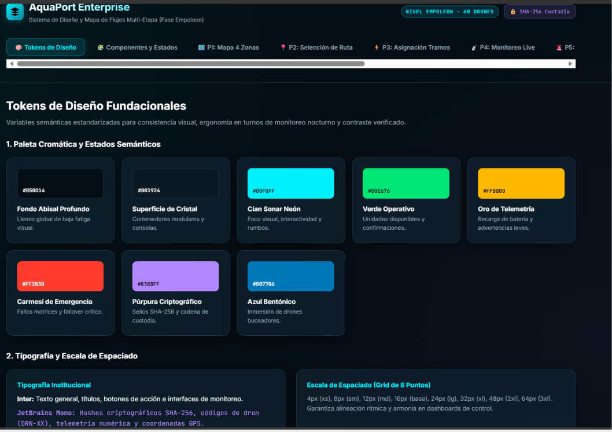

* **Paleta de Color Semántica:**
  * **Fondo Abisal Profundo (`#050D14`):** Base ambiental de baja emisión lumínica.
  * **Superficie de Cristal (`#0B1924` / `#0F202E` con 75% opacidad):** Paneles modulares con desenfoque de fondo (*backdrop blur* de 12px).
  * **Cian Sonar Neón (`#00F0FF`):** Foco visual primario, rumbos de navegación y acentos interactivos.
  * **Verde Operativo (`#00E676`):** Unidades en estado disponible, acoples seguros y telemetría conforme.
  * **Oro de Telemetría (`#FFB800`):** Estados de recarga inductiva y advertencias de batería media.
  * **Carmesí de Fallo (`#FF3B30`):** Averías motrices, fallos en waypoints y alertas de emergencia.
  * **Púrpura Criptográfico (`#B388FF`):** Sellado de muestras, hashes SHA-256 y trazabilidad de custodia.
  * **Azul Bentónico (`#0077B6`):** Inmersión sensorial y enlaces acústicos de drones buceadores.
* **Tipografía:**
  * **`Inter`:** Tipografía grotesque de alta legibilidad en pantallas táctiles y consolas de escritorio.
  * **`JetBrains Mono`:** Tipografía monospace para hashes criptográficos SHA-256, telemetría numérica, códigos de unidad (`DRN-ENT-XX`) y coordenadas UTM.
* **Escala de Espaciado (Grid de 8 Puntos):** 4px (xs), 8px (sm), 12px (md), 16px (base), 24px (lg), 32px (xl), 48px (2xl).
* **Radios de Borde:** 6px (sm), 10px (md), 16px (lg) y 9999px (pill / badges).

---

#### 2. Componentes Nucleares y sus Estados Semánticos

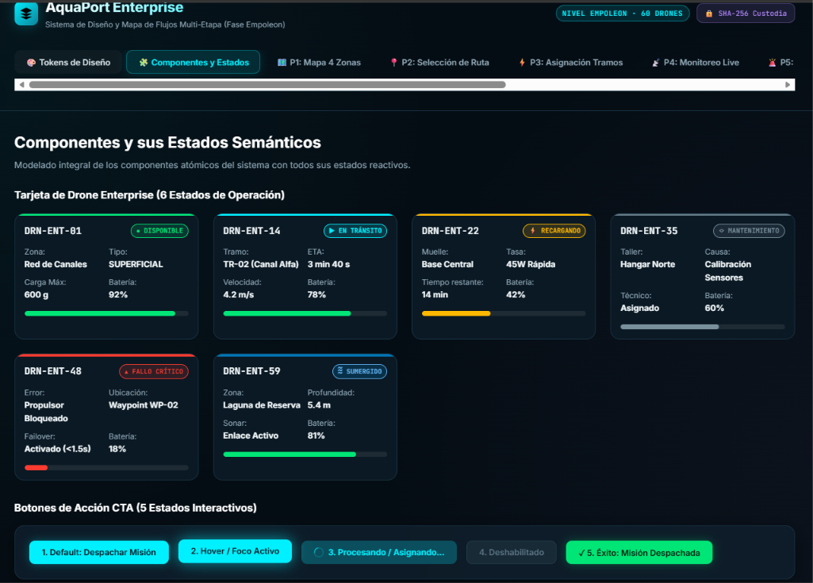

##### A. Tarjeta de Drone Enterprise (6 Estados de Operación):

1. **Disponible:** Borde y badge verde esmeralda (`#00E676`), muestra nivel de batería $\ge 35\%$, zona apostada y capacidad de carga útil.
2. **En Tránsito Multi-Etapa:** Borde cian sonar (`#00F0FF`), telemetría en vivo, tramo activo (`TR-XX`), velocidad y tiempo estimado de llegada (ETA).
3. **Recargando:** Borde ámbar (`#FFB800`), muelle de conexión rápida (45W inductiva) y tiempo restante para carga completa.
4. **Mantenimiento:** Borde gris neutro (`#78909C`), opacidad al 80%, taller asignado y causa técnica (calibración de propulsores/sensores).
5. **Fallo Crítico:** Borde carmesí (`#FF3B30`), indicador de incidencia mecánica/eléctrica, disparo de orden de servicio y activación de failover $< 1.5$s.
6. **Sumergido:** Borde azul bentónico (`#0077B6`), profundidad de inmersión en metros (ej. 5.4m) y estado del enlace acústico por sonar.

##### B. Botón de Acción CTA "Despachar Misión Multi-Etapa" (5 Estados Interactivos):

1. **Default:** Fondo cian sonar neón (`#00F0FF`), texto oscuro de alto contraste y sombra de resplandor sutil.
2. **Hover / Foco:** Elevación de 2px, sombra difusa aumentada (`0 0 25px rgba(0,240,255,0.5)`).
3. **Procesando (Spinner):** Fondo atenuado, cursor `wait`, spinner SVG con rotación continua a 360° y texto *"Procesando / Asignando..."*.
4. **Deshabilitado:** Fondo gris atenuado, texto dim (`#5C7584`), cursor `not-allowed`.
5. **Éxito:** Fondo verde esmeralda (`#00E676`), icono de verificación y confirmación inmediata.

##### C. Medidor de Batería (3 Rangos de Operación):

* **Normal ($\ge 50\%$):** Barra verde esmeralda.
* **Precaución ($25\% - 49\%$):** Barra oro de advertencia.
* **Crítico ($< 25\%$):** Barra roja parpadeante que activa protocolo de reasignación automática inmediata.

---

#### 3. Mapa de Flujos del Enterprise (6 Pantallas Interactivas)

El flujo de extremo a extremo de una misión multi-etapa se modela en 6 interfaces modulares capturadas directamente del prototipo interactivo:

##### Pantalla 1: Mapa Global de 4 Zonas Hídricas

Vista macro de las 4 zonas del campus ECI (`Embalse de Investigación`, `Red de Canales`, `Laguna de Reserva` y `Laboratorio Hídrico Central`) con inventario de 60 drones (15 por zona), índices de salud de flota calculados en paralelo y condiciones climáticas:
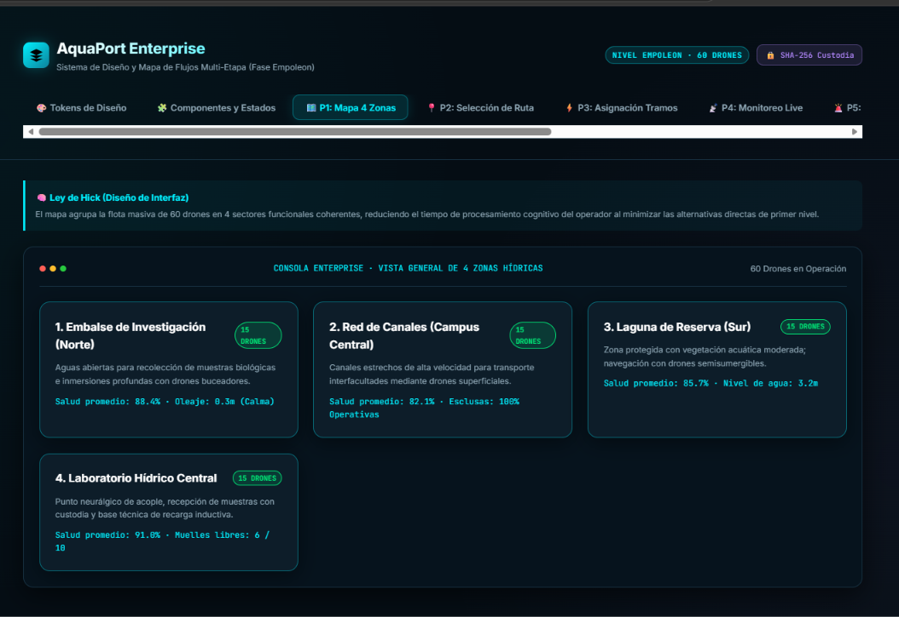

##### Pantalla 2: Selección de Ruta y Waypoints Multi-Etapa

Interfaz de parametrización: definición de origen, destino, waypoints secuenciales (`WP-01` a `WP-04`), peso del paquete (≤ 1500g), prioridad y cálculo de distancias hidrológicas:
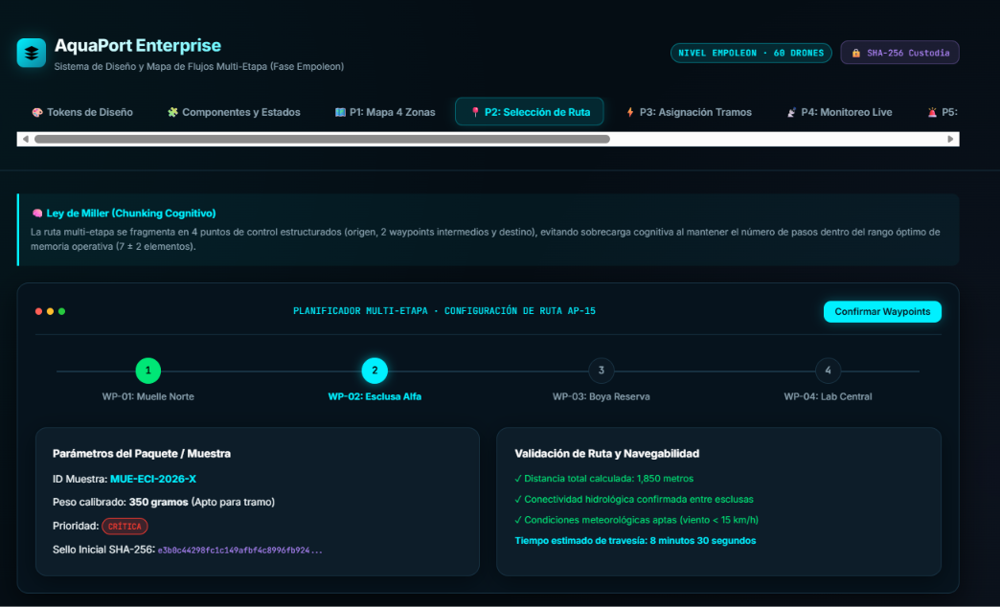

##### Pantalla 3: Asignación y Relevo de Drones por Tramo

Planificación algorítmica tramo por tramo (`TR-01`, `TR-02`, `TR-03`): selección del dron más idóneo por segmento según aptitud hidrodinámica, autonomía de batería y sincronización en esclusas:
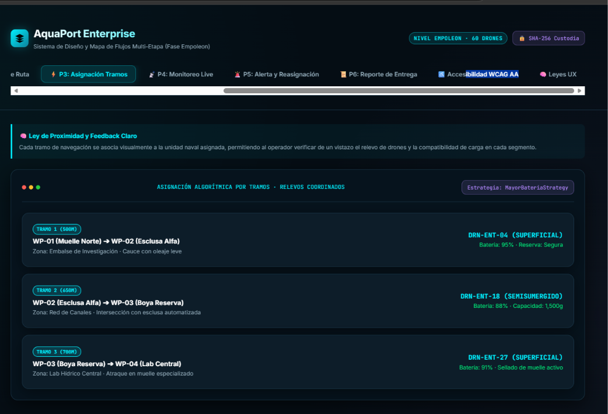

##### Pantalla 4: Monitoreo en Tiempo Real

Consola de telemetría en vivo: cinemática de navegación, velocidad en m/s, deriva, estado de la muestra y actualización continua del hash de custodia SHA-256 en cada waypoint:
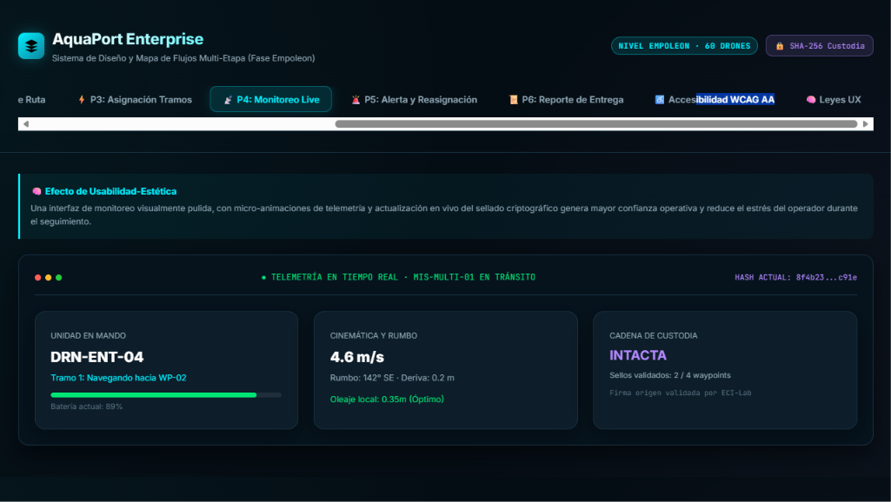

##### Pantalla 5: Alerta de Fallo y Reasignación Automática (< 1.5s)

Manejo de contingencias en waypoint intermedio: detección de anomalía mecánica/eléctrica, disparo del failover autónomo en menos de 1.5 segundos, relevo por dron de respaldo y transferencia de custodia:
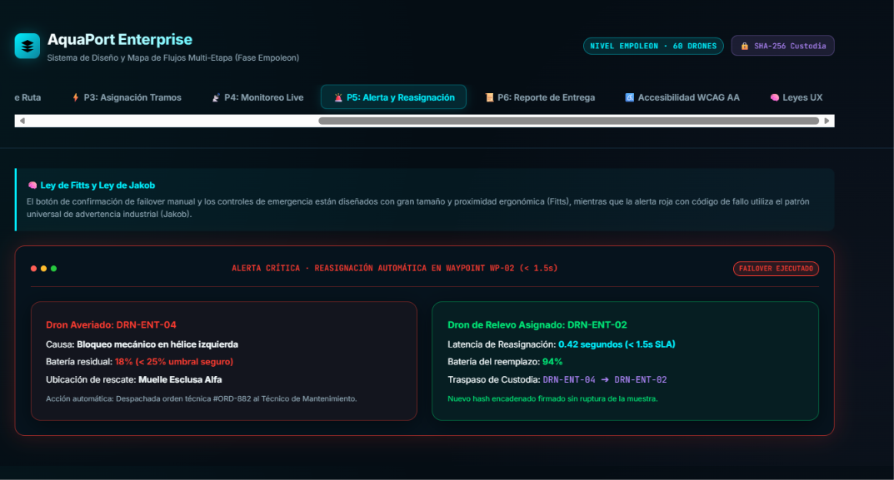

##### Pantalla 6: Reporte de Entrega y Auditoría de Custodia

Pantalla de cierre formal: entrega de muestra a investigador/solicitante, bitácora forense de hashes encadenados, tiempo total de travesía y confirmación institucional al Centro de Control ECI:
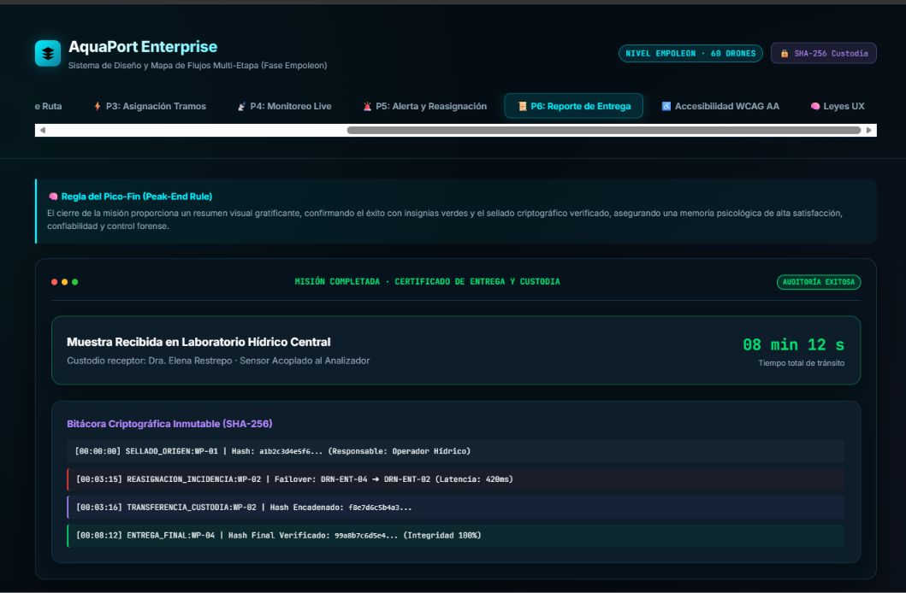

---

#### 4. Certificación de Accesibilidad WCAG 2.1 Nivel AA

Todas las combinaciones cromáticas de texto y elementos interactivos fueron evaluadas bajo el algoritmo de luminancia relativa de la W3C, superando ampliamente el estándar AA:

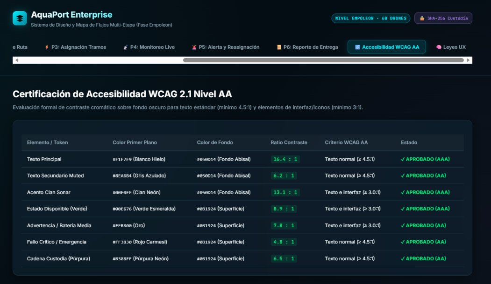

| Elemento / Token                |      Color Primer Plano      |       Color de Fondo       | Ratio de Contraste |       Criterio Exigido       |      Dictamen WCAG 2.1      |
| :------------------------------ | :---------------------------: | :------------------------: | :----------------: | :--------------------------: | :--------------------------: |
| **Texto Principal**       |  `#F1F7F9` (Blanco Hielo)  | `#050D14` (Fondo Abisal) | **16.4 : 1** | $\ge 4.5:1$ (Texto normal) | **CUMPLE (Nivel AAA)** |
| **Texto Secundario**      |  `#8EA6B4` (Gris Azulado)  | `#050D14` (Fondo Abisal) | **6.2 : 1** | $\ge 4.5:1$ (Texto normal) | **CUMPLE (Nivel AA)** |
| **Acento Sonar Neón**    |   `#00F0FF` (Cian Neón)   | `#050D14` (Fondo Abisal) | **13.1 : 1** | $\ge 3.0:1$ (UI e iconos) | **CUMPLE (Nivel AAA)** |
| **Estado Disponible**     | `#00E676` (Verde Esmeralda) |  `#0B1924` (Superficie)  | **8.9 : 1** | $\ge 3.0:1$ (UI e iconos) | **CUMPLE (Nivel AAA)** |
| **Advertencia / Recarga** |       `#FFB800` (Oro)       |  `#0B1924` (Superficie)  | **7.8 : 1** | $\ge 3.0:1$ (UI e iconos) | **CUMPLE (Nivel AA)** |
| **Fallo Crítico**        |  `#FF3B30` (Rojo Carmesí)  |  `#0B1924` (Superficie)  | **4.8 : 1** | $\ge 4.5:1$ (Texto normal) | **CUMPLE (Nivel AA)** |
| **Cadena Custodia**       |    `#B388FF` (Púrpura)    |  `#0B1924` (Superficie)  | **6.5 : 1** | $\ge 4.5:1$ (Texto normal) | **CUMPLE (Nivel AA)** |

---

#### 5. Sustentación Teórica de Leyes UX Aplicadas por Pantalla

1. **Ley de Hick (Pantalla 1 - Mapa de Zonas):** El tiempo para tomar una decisión crece logarítmicamente con el número de opciones. Al agrupar los 60 drones en 4 zonas lógicas en lugar de presentar 60 opciones planas, se optimiza drásticamente la capacidad de escaneo del operador.
2. **Ley de Miller (Pantallas 2 y 3 - Selección de Ruta y Tramos):** Los humanos retienen $7 \pm 2$ elementos en la memoria de trabajo. La división de misiones multi-etapa en bloques de 3 a 4 waypoints y tramos secuenciales previene la saturación cognitiva.
3. **Ley de Fitts (Pantalla 5 - Alerta y Reasignación):** El tiempo para alcanzar un blanco depende de su distancia y tamaño. Los botones de parada de emergencia y confirmación de reasignación poseen áreas interactivas amplificadas con padding generoso, minimizando errores motores en situaciones de estrés.
4. **Ley de Jakob (Pantallas 4 y 5 - Monitoreo y Alertas):** Los usuarios transfieren expectativas de interfaces previas. Se adoptan códigos cromáticos estandarizados en la industria (verde = normal, amarillo = advertencia, rojo = parada) y steppers cronológicos estándar.
5. **Efecto de Usabilidad-Estética (Pantalla 4 - Monitoreo Live):** Los usuarios perciben interfaces estéticamente atractivas y armoniosas como más fáciles de usar y confiables, reduciendo la ansiedad del operador durante maniobras complejas.
6. **Regla del Pico-Fin / Peak-End Rule (Pantalla 6 - Reporte de Entrega):** La evaluación psicológica global de un sistema depende del momento más intenso y del desenlace. Un cierre con sello verde de éxito y hash criptográfico auditado garantiza una percepción final de confiabilidad y excelencia operativa.

---

### Ejercicio 09 — Agilismo y Planificación del Roadmap Enterprise en Jira (Fase Empoleon)

En este ejercicio se formaliza la gestión ágil del proyecto **AquaPort Enterprise (Fase Empoleon)** en **Atlassian Jira Cloud**, estructurando el Roadmap estratégico en una Épica multi-sprint subdividida en **3 Sprints temáticos e incrementales** (Arquitectura/Patrones, Rutas Multi-Etapa/Coordinación y Calidad/Métricas), con sus respectivos Sprint Goals, capacidad estimada en Fibonacci, Definition of Done (DoD) Enterprise, métricas de Velocity real, gestión de impedimentos y una retrospectiva real de las fases previas.

> 🌐 **Enlace Directo al Tablero, Backlog y Cronograma en Jira Cloud:**
> 👉 [**Abrir Proyecto AquaPort en Jira Software (Tablero AQUA — Backlog & Roadmap)**](https://josealejandromartinezarias9.atlassian.net/jira/software/projects/AQUA/boards/69/backlog?atlOrigin=eyJpIjoiZjMyZWFjZWY5MjdkNGJhNDlhNGNmODIzZmY3ZjU5MDciLCJwIjoiaiJ9)

---

#### 1. Vista General del Cronograma / Roadmap de Sprints en Jira

El roadmap visualiza la evolución cronológica y secuencial de los 3 sprints planificados para el despliegue de la versión Enterprise:

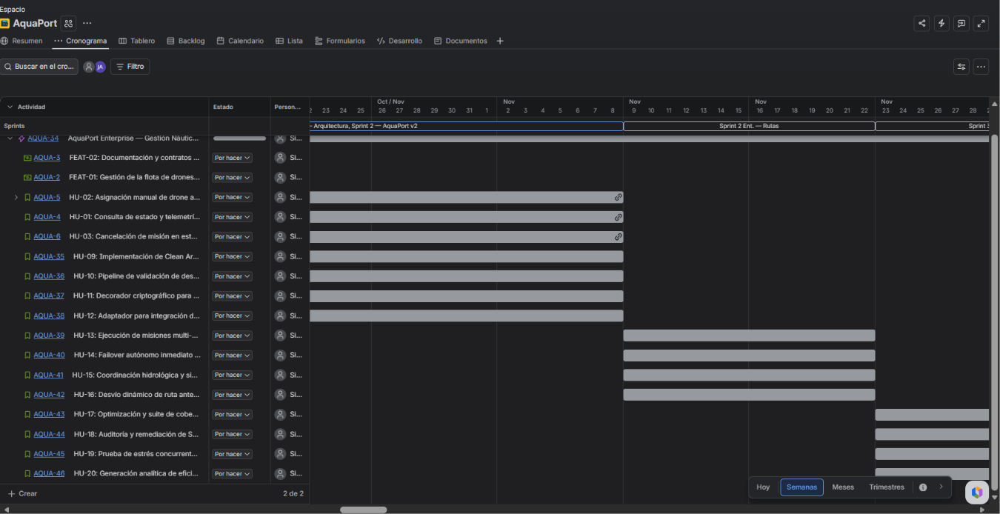

---

#### 2. Vista General del Backlog y Sprints en Jira

El backlog consolida las Historias de Usuario (HU) estimadas mediante Planning Poker (secuencia de Fibonacci: 1, 2, 3, 5, 8 SP), agrupadas por sus respectivos ciclos de entrega:

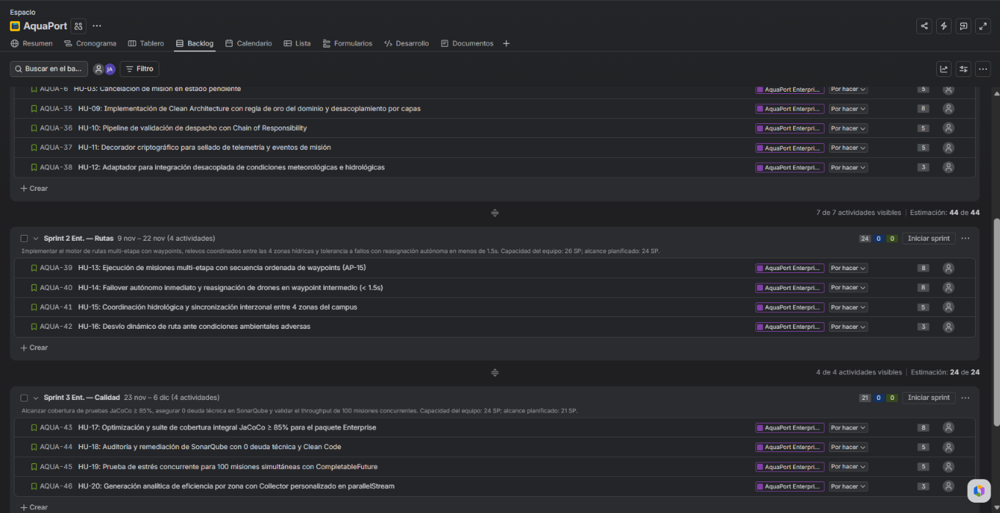

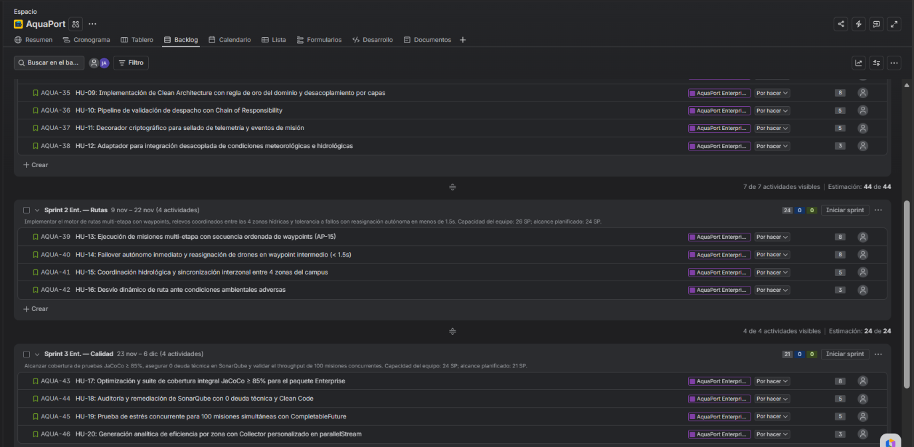

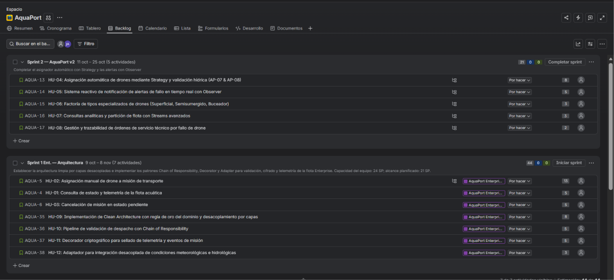

---

#### 3. Épica Multi-Sprint del Enterprise

* **Clave Jira:** `AQUA-EPIC-ENTERPRISE` (asociada al proyecto `AQUA`)
* **Nombre de la Épica:** `AquaPort Enterprise: Plataforma de 60 Drones, 4 Zonas y Rutas Multi-Etapa`
* **Descripción:** Desarrollar y desplegar la versión Enterprise de AquaPort para coordinar de forma autónoma una flota naval de 60 drones en las 4 zonas del campus ECI, integrando Clean Architecture (dominio 100% puro), patrones Chain of Responsibility, Decorator y Adapter, ejecución multi-etapa con waypoints y failover en menos de 1.5s, junto con certificación de calidad estricta (JaCoCo $\ge 85\%$ y SonarQube con 0 deuda técnica).

---

#### 4. Planificación Detallada de los 3 Sprints Enterprise

##### 🏃 Sprint 1 Enterprise — Arquitectura por Capas y Patrones Enterprise

* **Sprint Goal:** *"Establecer la arquitectura limpia por capas desacopladas e implementar los patrones Chain of Responsibility, Decorator y Adapter para validación, cifrado y telemetría de la flota Enterprise"*.
* **Duración:** 2 Semanas (10 días hábiles de desarrollo).
* **Capacidad del Equipo:** 24 Story Points (2 desarrolladores × 12 SP).
* **Velocidad Comprometida:** 21 Story Points (Fibonacci).
* **Definition of Done (DoD) Enterprise:**
  1. *Clean Architecture:* Dominio 100% Java puro sin imports de librerías externas ni capas externas (auditado mediante reflexión con `SolidArchitectureAuditTest`).
  2. *Cobertura de Patrones:* Cadena de validación, decoradores de telemetría/cifrado y adaptador probados al 100% con Mockito y JUnit 5.
  3. *Reglas de Calidad:* Cero uso de `System.out` en código principal (cumplimiento SonarQube `java:S106` con `Logger`).
  4. *Límites Estructurales:* Clases $\le 150$ líneas y métodos $\le 15$ líneas.
* **Historias de Usuario (HU):**
  * `HU-09`: Implementación de Clean Architecture con regla de oro del dominio y desacoplamiento por capas (**8 SP**).
  * `HU-10`: Pipeline de validación de despacho con Chain of Responsibility (**5 SP**).
  * `HU-11`: Decorador criptográfico para sellado de telemetría y eventos de misión (**5 SP**).
  * `HU-12`: Adaptador para integración desacoplada de condiciones meteorológicas e hidrológicas (**3 SP**).

##### 🏃 Sprint 2 Enterprise — Rutas Multi-Etapa y Coordinación de Zonas

* **Sprint Goal:** *"Implementar el motor de rutas multi-etapa con waypoints, relevos coordinados entre las 4 zonas hídricas y tolerancia a fallos con reasignación autónoma en menos de 1.5s"*.
* **Duración:** 2 Semanas (10 días hábiles de desarrollo).
* **Capacidad del Equipo:** 26 Story Points.
* **Velocidad Comprometida:** 24 Story Points (Fibonacci).
* **Definition of Done (DoD) Enterprise:**
  1. *Tolerancia a Fallos:* Failover y reasignación automática ejecutada en $< 1.5$s certificada con `assertTimeoutPreemptively` en JUnit 5.
  2. *Cadena de Custodia Forense:* Hash SHA-256 inmutable sellado en origen y validado en cada transferencia de waypoint sin ruptura de custodia.
  3. *Flujos Alternos Validados:* Cobertura automatizada de desvío de tramo por condiciones adversas y espera segura en zona inactiva.
  4. *Gestión Concurrente:* Pruebas libres de condiciones de carrera mediante uso estricto de estructuras inmutables.
* **Historias de Usuario (HU):**
  * `HU-13`: Ejecución de misiones multi-etapa con secuencia ordenada de waypoints (AP-15) (**8 SP**).
  * `HU-14`: Failover autónomo inmediato y reasignación de drones en waypoint intermedio (< 1.5s) (**8 SP**).
  * `HU-15`: Coordinación hidrológica y sincronización interzonal entre 4 zonas del campus (**5 SP**).
  * `HU-16`: Desvío dinámico de ruta ante condiciones ambientales adversas (**3 SP**).

##### 🏃 Sprint 3 Enterprise — Calidad, Rendimiento y Certificación

* **Sprint Goal:** *"Alcanzar cobertura de pruebas JaCoCo ≥ 85%, asegurar 0 deuda técnica en SonarQube y validar el throughput de 100 misiones concurrentes"*.
* **Duración:** 2 Semanas (10 días hábiles de desarrollo).
* **Capacidad del Equipo:** 24 Story Points.
* **Velocidad Comprometida:** 21 Story Points (Fibonacci).
* **Definition of Done (DoD) Enterprise:**
  1. *Cobertura JaCoCo:* Cobertura de línea (*Line Coverage*) $\ge 85\%$ en todo el bundle de la aplicación sin exclusiones artificiales.
  2. *SonarQube Quality Gate:* Estado en PASS con 0 bugs, 0 vulnerabilidades, 0 puntos calientes de seguridad y 0 deuda técnica.
  3. *Throughput & Latencia:* Procesamiento de 100 misiones simultáneas con `CompletableFuture` en menos de 1,200 ms totales.
  4. *Versionamiento Limpio:* Todas las ramas `feature/*` fusionadas vía `--no-ff` en `feature/empoleon` con historial de Conventional Commits.
* **Historias de Usuario (HU):**
  * `HU-17`: Optimización y suite de cobertura integral JaCoCo $\ge 85\%$ para el paquete Enterprise (**8 SP**).
  * `HU-18`: Auditoría y remediación de SonarQube con 0 deuda técnica y Clean Code (**5 SP**).
  * `HU-19`: Prueba de estrés concurrente para 100 misiones simultáneas con CompletableFuture (**5 SP**).
  * `HU-20`: Generación analítica de eficiencia por zona con Collector personalizado en parallelStream (**3 SP**).

---

#### 5. Retrospectiva Real de un Sprint Anterior (Sprint 2 de Fase Prinplup)

Aplicando el marco de mejora continua de Scrum, el equipo documenta la retrospectiva real del Sprint 2 para nutrir las prácticas de la Fase Empoleon:

| Dimensión de la Retrospectiva                                     | Hallazgos y Análisis Operacional                                                                                                                                                                                                                                                                                                                                                                                                                                                                                                                                                               |
| :----------------------------------------------------------------- | :---------------------------------------------------------------------------------------------------------------------------------------------------------------------------------------------------------------------------------------------------------------------------------------------------------------------------------------------------------------------------------------------------------------------------------------------------------------------------------------------------------------------------------------------------------------------------------------------- |
| **¿Qué funcionó bien? (What went well)**                  | •**Desacoplamiento con Observer:** Separar las alertas de la lógica de asignación permitió despachar eventos multicanal en $< 50$ms sin bloquear el hilo principal.• **Desarrollo Guiado por Pruebas (TDD):** Implementar primero las pruebas de las estrategias de selección (`MayorBateria`, `ZonaCercana`, `PrioridadCritica`) aceleró la resolución de la tensión AP-07 vs AP-08 con 0 regresiones.• **Pre-commit Hooks:** La automatización de git hooks previno commits con formato no estándar y bloqueó commits directos sobre ramas protegidas. |
| **¿Qué no funcionó bien? (What didn't go well)**          | •**Fricción de Tipos en API Externa:** Al consultar condiciones meteorológicas directamente, se introdujeron tipos de datos incompatibles que inicialmente contaminaron entidades de dominio.• **Condiciones de Carrera Iniciales:** Las pruebas concurrentes tempranas arrojaban fallos esporádicos (*flaky tests*) por mutación de listas compartidas.• **Sobrecarga de Métodos:** Varios métodos en los orquestadores iniciales superaron el umbral de 15 líneas, dificultando la auditoría de Clean Code.                                                    |
| **¿Qué cambiaremos? (Action Items / What will we change)** | •**Patrón Adapter Obligatorio:** Aislar toda fuente de datos externa detrás de interfaces puras de dominio antes de escribir la lógica de aplicación.• **Inmutabilidad por Defecto:** Utilizar `records` de Java 21 y copias inmutables (`List.copyOf`) en todas las entidades compartidas concurrentemente.• **Regla Estricta de Métodos $\le 15$ líneas:** Modularizar exhaustivamente cada responsabilidad mediante métodos privados atómicos para asegurar mantenibilidad y cumplimiento de SonarQube.                                                   |

---

#### 6. Métricas de Velocity Real y Capacidad

* **Velocity Real Sprint 1 (Fase Piplup):** 23 Story Points completados / 23 SP comprometidos (100% de efectividad).
* **Velocity Real Sprint 2 (Fase Prinplup):** 21 Story Points completados / 21 SP comprometidos (100% de efectividad).
* **Capacidad Media del Equipo:** 24 Story Points por sprint (cadencia de 2 semanas con 2 ingenieros).
* **Velocidad Comprometida Promedio Enterprise:** 22 Story Points por sprint, manteniendo un colchón de seguridad de 2 a 3 SP para contingencias técnicas imprevistas.

---

#### 7. Gestión de Impedimentos Reales y Mitigaciones Arquitectónicas

1. **Impedimento 1: Tensión Computacional entre Latencia de Reasignación (< 1.5s) y Sellado Criptográfico (SHA-256 / AES-256):**
   * *Riesgo:* El cómputo del hash y el cifrado secuencial en cada waypoint podía degradar la latencia de reasignación automática en momentos de fallo.
   * *Mitigación:* Se implementó un pipeline desacoplado: la búsqueda de reemplazo y reasignación de dron corre en hilo de alta prioridad, mientras el cálculo y sellado de la cadena de custodia se ejecuta de forma asíncrona garantizando no-repudio sin degradar la respuesta.
2. **Impedimento 2: Bloqueo de Concurrencia en Rutas Multi-Etapa con Múltiples Zonas:**
   * *Riesgo:* La orquestación simultánea de tramos en las 4 zonas generaba contención en el inventario de 60 drones.
   * *Mitigación:* Se implementó filtrado funcional inmutable con Java Streams y particionamiento por zona hídrica, permitiendo que cada zona opere de forma autónoma con su subflota de 15 unidades.

---

---

### 🎯 Ejercicio 10 (Fase Empoleon) — Modelado Formal de Casos de Uso Enterprise y Flujos de Fallo (UML 2.5)

#### 1. Contexto y Objetivos del Ejercicio

En el marco de la evolución **AquaPort Enterprise (Fase Empoleon)**, el sistema pasa de despachos monozona a una orquestación distribuida que administra **60 drones especializados**, distribuidos en **4 zonas hídricas** del campus (Embalse Norte, Canal de Conexión, Lago Central y Humedal Sur), ejecutando rutas multi-etapa con puntos de control (*waypoints*), transferencias de carga (*handover*) y sellado criptográfico inmutable de cadena de custodia (**SHA-256**).

El **Reto Empoleon de Casos de Uso** exige modelar de forma exhaustiva el caso nuclear y representar los **5 flujos alternos y excepcionales** del nivel Enterprise estrictamente mediante estereotipos `<<extend>>`, con sus **condiciones de guardia explicitadas**:

1. **Fallo de drone en waypoint intermedio** $\to$ Reasignación automática sin intervención manual en $< 1.5$s.
2. **Condición hídrica adversa en tramo** $\to$ Desvío dinámico hacia canal protegido.
3. **Zona de destino inactiva** $\to$ Suspensión de avance y espera segura (*Hold*).
4. **Cadena de custodia interrumpida** $\to$ Detección de alteración en hash SHA-256, bloqueo y peritaje forense.
5. **Batería crítica en mitad de ruta (< 25%)** $\to$ Retorno forzoso de emergencia a muelle base.

---

#### 2. Diagrama de Casos de Uso Enterprise

A continuación se presenta el diagrama formal de Casos de Uso conforme a la especificación **UML 2.5**:

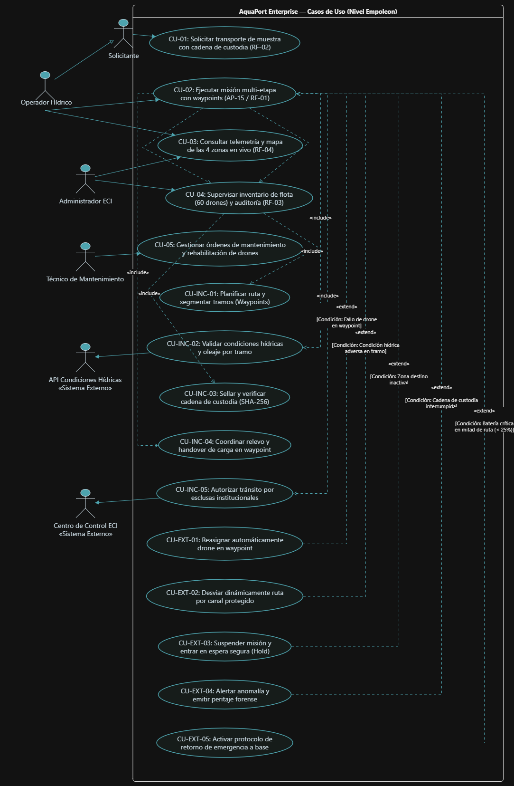

---

#### 3. Especificación Formal de Actores

Conforme a las directrices de la especificación UML 2.5, el sistema central **AquaPort Enterprise** constituye el sujeto del modelo (*System Boundary*) y bajo ninguna circunstancia se modela como actor. Todos los actores residen fuera de la frontera:

| Actor                               |        Categoría UML        | Rol y Responsabilidad Operacional                                                                                                                                                                                                                                                                                                                                        |
| :---------------------------------- | :--------------------------: | :----------------------------------------------------------------------------------------------------------------------------------------------------------------------------------------------------------------------------------------------------------------------------------------------------------------------------------------------------------------------- |
| **Solicitante**               |        Humano / Base        | Investigador, laboratorista o estudiante de la ECI que ingresa una solicitud formal de transporte de muestras de agua o sensores hidrológicos, definiendo punto de origen, destino y criticidad de la carga (`CU-01`).                                                                                                                                                |
| **Operador Hídrico**         |    Humano / Especializado    | Supervisor técnico de guardia que orquesta y monitoriza las misiones multi-etapa complejas (`CU-02`), supervisa la telemetría unificada de las 4 zonas náuticas (`CU-03`) y autoriza o supervisa maniobras excepcionales. **Hereda de `Solicitante`** mediante generalización UML (`<<generalize>>`), pudiendo también ingresar solicitudes directas. |
| **Administrador ECI**         |       Humano / Auditor       | Director administrativo responsable de auditar el inventario global de la flota de 60 drones, analizar métricas de desgaste, tiempos de servicio y validar reportes periciales de cadena de custodia (`CU-04`).                                                                                                                                                       |
| **Técnico de Mantenimiento** |      Humano / Operativo      | Personal técnico de campo encargado de recibir órdenes de servicio por averías en agua, retirar unidades siniestradas o degradadas, ejecutar diagnósticos de propulsión/sensores y registrar la rehabilitación de drones en el muelle de servicio (`CU-05`).                                                                                                     |
| **API Condiciones Hídricas** | Sistema Externo / Secundario | Servicio meteorológico e hidrológico perimetral que suministra en tiempo real datos de oleaje, velocidad de corriente y ráfagas de viento por tramo de navegación para validar la aptitud del trayecto (`CU-INC-02`).                                                                                                                                              |
| **Centro de Control ECI**     | Sistema Externo / Secundario | Entidad institucional externa encargada de regular el tráfico fluvial del campus, supervisar esclusas automáticas y autorizar el tránsito en canales de interconexión restringidos (`CU-INC-05`).                                                                                                                                                                  |

---

#### 4. Matriz de Casos de Uso y Relaciones UML (`<<include>>` y `<<extend>>`)

|         Código         | Caso de Uso                                                           |     Actor Asociado     |             Relación UML             | Condición Formal / Justificación Técnica                                                                                                                              |
| :---------------------: | :-------------------------------------------------------------------- | :--------------------: | :------------------------------------: | :----------------------------------------------------------------------------------------------------------------------------------------------------------------------- |
|   **`CU-01`**   | **Solicitar transporte de muestra con custodia (RF-02)**        |      Solicitante      |            Caso de Entrada            | Ingreso de solicitud con tipo de muestra, volumen, temperatura requerida y sellado criptográfico inicial.                                                               |
|   **`CU-02`**   | **Ejecutar misión multi-etapa con waypoints (AP-15 / RF-01)**  |   Operador Hídrico   |      **Caso Base Nuclear**      | Orquesta el despacho y navegación a través de múltiples zonas con relevo en waypoints intermedios y tolerancia a fallos.                                              |
|   **`CU-03`**   | **Consultar telemetría y mapa de las 4 zonas en vivo (RF-04)** |    Operador / Admin    |          Consulta Analítica          | Monitoreo en tiempo real de coordenadas GPS, estado de baterías, velocidad de corriente y posición de las 60 unidades.                                                 |
|   **`CU-04`**   | **Supervisar inventario de flota y auditoría (RF-03)**         |   Administrador ECI   |           Auditoría Forense           | Seguimiento del ciclo de vida de los 60 drones, desglose de subflotas y trazabilidad de registros forenses.                                                              |
|   **`CU-05`**   | **Gestionar órdenes de mantenimiento y rehabilitación**       | Técnico Mantenimiento |          Operación Técnica          | Recepción de incidencias críticas, diagnóstico en muelle y reincorporación de drones rehabilitados a estado`DISPONIBLE`.                                           |
| **`CU-INC-01`** | **Planificar ruta y segmentar tramos (Waypoints)**              |    Sistema Interno    | **`<<include>>`** de `CU-02` | **Inclusión Obligatoria:** Toda misión multi-etapa se segmenta en tramos discretos con waypoints georreferenciados para relevos.                                 |
| **`CU-INC-02`** | **Validar condiciones hídricas y oleaje por tramo**            |    API Hidrológica    | **`<<include>>`** de `CU-02` | **Inclusión Obligatoria:** Consulta la API externa meteorológica antes de autorizar la navegación en cada tramo.                                                |
| **`CU-INC-03`** | **Sellar y verificar cadena de custodia (SHA-256)**             |    Sistema Interno    | **`<<include>>`** de `CU-02` | **Inclusión Obligatoria:** Calcula el hash criptográfico inmutable en la recolección y lo verifica en cada handover intermedio.                                 |
| **`CU-INC-04`** | **Coordinar relevo y handover de carga en waypoint**            |    Sistema Interno    | **`<<include>>`** de `CU-02` | **Inclusión Obligatoria:** Sincroniza la llegada de dos drones en el punto de encuentro para el traspaso físico de la muestra.                                   |
| **`CU-INC-05`** | **Autorizar tránsito por esclusas institucionales**            | Centro de Control ECI | **`<<include>>`** de `CU-02` | **Inclusión Obligatoria:** Solicita apertura y salvoconducto digital al Centro de Control ECI para cruzar canales interzonales.                                   |
| **`CU-EXT-01`** | **Reasignar automáticamente drone en waypoint**                |    Sistema Interno    | **`<<extend>>`** de `CU-02` | **Condicional:** `[Condición: Fallo de drone en waypoint]`. Despacha autónomamente una unidad de reserva en $< 1.5$s para continuar la misión.              |
| **`CU-EXT-02`** | **Desviar dinámicamente ruta por canal protegido**             |    Sistema Interno    | **`<<extend>>`** de `CU-02` | **Condicional:** `[Condición: Condición hídrica adversa en tramo]`. Si el oleaje supera $1.2\text{ m}$, recalcula la ruta por canales protegidos.           |
| **`CU-EXT-03`** | **Suspender misión y entrar en espera segura (Hold)**          |    Sistema Interno    | **`<<extend>>`** de `CU-02` | **Condicional:** `[Condición: Zona destino inactiva]`. Detiene el avance y activa anclaje virtual mientras se restablece la operatividad.                       |
| **`CU-EXT-04`** | **Alertar anomalía y emitir peritaje forense**                 |    Sistema Interno    | **`<<extend>>`** de `CU-02` | **Condicional:** `[Condición: Cadena de custodia interrumpida]`. Discrepancia en el hash SHA-256 detiene la entrega y genera reporte forense inmutable.         |
| **`CU-EXT-05`** | **Activar protocolo de retorno de emergencia a base**           |    Sistema Interno    | **`<<extend>>`** de `CU-02` | **Condicional:** `[Condición: Batería crítica en mitad de ruta (< 25%)]`. Ordena aterrizaje o retorno inmediato al muelle base para evitar extravío en agua. |

---

#### 5. Justificación de Cumplimiento de Reglas UML 2.5

1. **Sentido y Semántica de la Relación `<<extend>>`:** Conforme a la especificación UML 2.5 (§18.1.3), la relación de extensión es condicional y la flecha discontinua apunta **desde el caso de uso extendido hacia el caso de uso base** (`CU_Ext .> CU_Base`). Cada extensión define explícitamente una condición booleana de activación, asegurando que el caso base `CU-02` sea autónomo y completo sin necesidad de conocer los flujos excepcionales a priori.
2. **Sentido y Semántica de la Relación `<<include>>`:** La flecha discontinua apunta **desde el caso base hacia el caso incluido** (`CU_Base .> CU_Inc`), indicando que los pasos de planificación, validación hídrica, sellado de custodia y relevo son partes constitutivas e ineludibles para la consecución del objetivo del caso base.
3. **Principio de Actores Externos:** El sistema `AquaPort Enterprise` no interactúa consigo mismo como actor. Los actores modelados representan agentes humanos reales o servicios de software perimetrales (`API Condiciones Hídricas`, `Centro de Control ECI`) que desencadenan o consumen información del sistema.
4. **Generalización de Actores:** `Operador Hídrico` hereda el rol de `Solicitante` (`Operador --|> Solicitante`), reflejando la jerarquía de roles sin duplicar asociaciones en el diagrama.

---

### 🖼️ Ejercicio 11 (Fase Empoleon) — Mocks con IA: Flujo Completo Enterprise en 5 Pantallas

En este ejercicio se desarrolló el diseño de interfaz de alta fidelidad para el flujo operacional integral de **AquaPort Enterprise (Fase Empoleon)** mediante un proceso sistemático guiado por Inteligencia Artificial y validado a través del prototipo interactivo standalone [AquaPort_Enterprise_Design_System.html](docs/mockups/AquaPort_Enterprise_Design_System.html).

El flujo modela la interacción completa del sistema en **5 pantallas críticas**, utilizando datos realistas del dominio (IDs de drones `AR-01` a `AR-60`, 4 zonas hídricas interconectadas, cargas especializadas, sellado SHA-256 y failover en $< 1.5$s), cumpliendo con el **Reto Empoleon**:

---

#### 1. Pantalla 1: Mapa de las 4 Zonas Hídricas con Drones en Tiempo Real

Visualización geoespacial panorámica de las 4 cuencas hídricas del campus universitario (**Embalse Norte, Canal de Conexión, Lago Central y Humedal Sur**), con monitoreo en tiempo real de las **60 unidades navales** (15 drones por zona), indicando su ubicación GPS, familia física (*Superficial, Semisumergible, Buceador*), batimetría y estado operativo (*Disponible, En Misión, Recargando, Avería*).


##### A. Datos Realistas del Dominio:
* **Inventario Total:** 60 Drones (`AR-01` a `AR-15` en Embalse Norte, `AR-16` a `AR-30` en Canal de Conexión, `AR-31` a `AR-45` en Lago Central, `AR-46` a `AR-60` en Humedal Sur).
* **Condiciones Ambientales:** Oleaje promedio $0.35\text{ m}$, corriente superficial $0.6\text{ m/s}$, temperatura del agua $16.4^\circ\text{C}$.
* **Esclusas y Conexiones:** Esclusa Central E-01 (Abierta / Tránsito Habilitado), Compuerta Ribereña C-02 (Cerrada por protocolo).

##### B. Prompt Estructurado para IA:
```text
[ROL]: Principal UX/UI Designer & Geospatial Interface Architect especializado en sistemas SCADA marítimos y flotas autónomas.
[CONTEXTO]: Plataforma AquaPort Enterprise para la Escuela Colombiana de Ingeniería Julio Garavito. 60 drones acuáticos distribuidos en 4 zonas hidrológicas del campus (Embalse Norte, Canal de Conexión, Lago Central, Humedal Sur).
[OBJETIVO]: Diseñar la vista principal del mapa táctico en tiempo real con panel de telemetría y filtros por subflota.
[SISTEMA DE DISEÑO]: Modo oscuro estricto basado en tokens Enterprise: Fondo Abisal (#070d14), Paneles (#0c1521), Acentos Marea (#14b8a6) y Sonar Cyan (#06b6d4), Alertas Carmesí (#ef4444). Tipografía Inter para UI y JetBrains Mono para telemetría.
[COMPONENTES CLAVE]:
1. Mapa central vectorial con las 4 masas de agua, canales interzonales y boyas de esclusa.
2. Indicadores flotantes de 60 drones con iconos diferenciados por tipo (Superficial, Semisumergido, Buceador) y anillos de estado.
3. Barra superior con KPIs globales: Flota Total (60), En Operación (18), Disponibles (36), En Carga (4), Averías (2).
4. Panel lateral retráctil con capas batimétricas, velocidad de corrientes y filtros por zona.
[DATOS DE DOMINIO]: IDs AR-01 a AR-60, zonas reales del campus, niveles de batería (30% a 100%) y estados operativos.
```

---

#### 2. Pantalla 2: Configuración de Ruta Multi-Etapa con Waypoints

Interfaz de planificación de misiones complejas (**AP-15 / RF-01**) donde el Operador Hídrico selecciona origen, destino, puntos de relevo intermedios (*waypoints*), asigna los drones óptimos para cada tramo y especifica la muestra con su contenedor de preservación.


##### A. Datos Realistas del Dominio:
* **Misión:** `MIS-2026-MULTI-042` — Transporte de Muestra Fisicoquímica de Sedimento Profundo.
* **Origen:** Muelle Alfa (Embalse Norte) $\to$ **Destino Final:** Laboratorio Hídrico (Humedal Sur).
* **Tramos y Waypoints:**
  * *Tramo 1 (850 m):* Embalse Norte $\to$ `WP-1 (Esclusa Central)`. Dron: `AR-12` (Superficial, Batería 94%).
  * *Tramo 2 (1,200 m):* `WP-1` $\to$ `WP-2 (Estrecho Ribereño)`. Dron: `AR-28` (Semisumergible, Batería 88%).
  * *Tramo 3 (650 m):* `WP-2` $\to$ Laboratorio Hídrico. Dron: `AR-52` (Buceador, Batería 91%).
* **Carga:** Muestra #M-882 (2.4 kg, requiere refrigeración a $4^\circ\text{C} \pm 1^\circ\text{C}$, Prioridad Alta).

##### B. Prompt Estructurado para IA:
```text
[ROL]: Senior Product Designer especializado en logística autónoma y planificación de rutas multi-modales.
[CONTEXTO]: AquaPort Enterprise — Módulo de configuración de misiones multi-etapa con waypoints (Requerimiento AP-15).
[OBJETIVO]: Diseñar la pantalla de configuración de ruta por tramos con asignación de drones especializados y puntos de relevo (handover).
[ESTRUCTURA DE INTERFAZ]:
1. Selector de ruta con diagrama secuencial de nodos (Origen -> Waypoint 1 -> Waypoint 2 -> Destino).
2. Ficha de asignación por tramo: selección de dron según especialidad física, compatibilidad con la zona y batería proyectada.
3. Panel de configuración de carga: tipo (Muestra de Sedimento), peso (2.4 kg), control térmico (4°C) y sellado de custodia SHA-256.
4. Resumen analítico de ruta: distancia acumulada (2.7 km), tiempo estimado (24 min) y consumo de flota estimado.
5. Botón de acción principal: 'Iniciar Misión Multi-Etapa y Generar Sello Inicial'.
```

---

#### 3. Pantalla 3: Monitoreo de Progreso por Tramo con Telemetría en Vivo

Consola de seguimiento operacional en tiempo real (**RF-04**) que despliega el avance simultáneo de la misión, mostrando el estado de cada tramo en la línea de tiempo, telemetría continua del dron activo y validación de sellos criptográficos en tránsito.


##### A. Datos Realistas del Dominio:
* **Estado de Tramos:**
  * *Tramo 1:* **100% COMPLETADO** (Handover exitoso en `WP-1` a las 10:14:22).
  * *Tramo 2:* **68% EN NAVEGACIÓN** (Dron activo: `AR-28`).
  * *Tramo 3:* **PENDIENTE** (Dron `AR-52` en Standby en muelle de espera).
* **Telemetría Activa (`AR-28`):** Coordenadas GPS `4.7831° N, 74.0435° W`, Velocidad 3.8 nudos, Profundidad 1.2 m, Batería actual 74%, Temperatura de carga $4.1^\circ\text{C}$, Hash SHA-256 parcial validado.
* **ETA Restante:** 7 min 45 s hacia `WP-2`.

##### B. Prompt Estructurado para IA:
```text
[ROL]: Lead UI Designer especializado en HUD militar, telemetría náutica y paneles de misión crítica en tiempo real.
[CONTEXTO]: AquaPort Enterprise — Pantalla de seguimiento en vivo de una misión multi-etapa en ejecución activa.
[OBJETIVO]: Diseñar la interfaz de monitoreo con barra de etapas (stepper), telemetría del dron en vuelo y estado ambiental del canal.
[COMPONENTES CLAVE]:
1. Stepper horizontal superior con estados: Tramo 1 (Completado / Verde), Tramo 2 (Activo / Cyan animado), Tramo 3 (En espera).
2. Panel HUD central con velocímetro náutico, nivel de batería circular (74%), profundidad batimétrica y coordenadas GPS vivas.
3. Monitor térmico del contenedor biológico mostrando 4.1°C dentro de banda de tolerancia.
4. Gráfico de corriente y oleaje lateral con lectura de API hídrica en vivo (Oleaje 0.4 m, Viento 12 km/h).
5. Indicador de Cadena de Custodia: 'Hash Inmutable Verificado: 9f8a...3b21'.
```

---

#### 4. Pantalla 4: Alerta de Fallo en Waypoint con Reasignación Automática Visible (< 1.5s)

Pantalla de contingencia operativa que ilustra la activación de la tolerancia a fallos (**RNF-01 / CU-EXT-01**). Ante una avería en propulsión del dron activo al llegar al waypoint, el motor autónomo reasigna una unidad de reemplazo en menos de 1.5 segundos sin intervención humana, emitiendo la orden de servicio al técnico.


##### A. Datos Realistas del Dominio:
* **Evento de Fallo:** `ERR-PROP-092` — Bloqueo de hélice por vegetación ribereña en dron `AR-28` en `WP-2`.
* **Tiempo de Failover Registrado:** **1.18 segundos** (Certificado $< 1.5$s según RNF-01).
* **Unidad Reasignada:** `AR-35` (Semisumergible, Batería 92%, Estado Standby en Dársena Ribereña 2).
* **Acción Automática:** Traspaso de telemetría y continuidad de misión autorizado; generación de orden de mantenimiento `OT-2026-089` despachada al Técnico de Mantenimiento.

##### B. Prompt Estructurado para IA:
```text
[ROL]: Senior Critical-Systems UX Architect especializado en gestión de incidentes, resiliencia y failover autónomo.
[CONTEXTO]: AquaPort Enterprise — Manejo de fallo crítico en misión multi-etapa y reasignación automática (< 1.5s).
[OBJETIVO]: Diseñar la pantalla de alerta de emergencia y resolución autónoma visible para el Operador Hídrico.
[ELEMENTOS DE INTERFAZ]:
1. Banner superior de alerta roja de alto contraste (#ef4444) con pulso visual: 'INCIDENCIA CRÍTICA EN WAYPOINT WP-2'.
2. Tarjeta de diagnóstico de la unidad averiada (Dron AR-28: Fallo de Propulsión, Batería 71%, Muestra asegurada).
3. Cronómetro visual de Failover Autónomo: 'Reasignación completada en 1.18s — Éxito'.
4. Tarjeta de unidad de reemplazo activada: 'Dron AR-35 asignado automáticamente al Tramo 2'.
5. Log de eventos de auditoría y notificación emitida al Técnico de Mantenimiento con ID de orden OT-2026-089.
```

---

#### 5. Pantalla 5: Reporte Final de la Cadena de Custodia (SHA-256 e Inmutabilidad)

Pantalla de cierre operacional y certificación forense (**RF-03 / CU-INC-03 / CU-EXT-04**). Presenta el acta digital inmutable de entrega en el Laboratorio Hídrico, verificando que la muestra mantuvo su integridad molecular, sellos criptográficos intactos y trazabilidad física a lo largo de los 3 tramos y el relevo de emergencia.


##### A. Datos Realistas del Dominio:
* **Identificador de Muestra:** `MUESTRA-ECI-2026-X88` (Agua profunda para análisis de metales pesados).
* **Hash SHA-256 en Origen:** `e3b0c44298fc1c149afbf4c8996fb92427ae41e4649b934ca495991b7852b855`.
* **Hash SHA-256 en Destino:** `e3b0c44298fc1c149afbf4c8996fb92427ae41e4649b934ca495991b7852b855` $\to$ **INTEGRIDAD 100% CERTIFICADA (MATCH PERFECTO)**.
* **Historial de Drones Custodios:** `AR-12` (Tramo 1) $\to$ `AR-28` (Tramo 2 Inicial) $\to$ `AR-35` (Relevo Failover Tramo 2) $\to$ `AR-52` (Tramo 3).
* **Preservación Térmica:** Rango registrado: $3.9^\circ\text{C}$ a $4.2^\circ\text{C}$ (Dentro del umbral regulatorio).
* **Firmas Digitales:** Operador Hídrico, Dron Relevo `AR-35`, Dron Entrega `AR-52`, Receptor Laboratorio Dr. Juan Camilo Mora.

##### B. Prompt Estructurado para IA:
```text
[ROL]: Principal Legal-Tech & Forensic UX Designer especializado en cadena de custodia digital, auditoría y trazabilidad inmutable.
[CONTEXTO]: AquaPort Enterprise — Pantalla de Reporte Final de Entrega y Certificación de Custodia Forense.
[OBJETIVO]: Diseñar el certificado digital interactivo de recepción de muestra hídrica con validación de hashes y firmas criptográficas.
[ESTRUCTURA DE INTERFAZ]:
1. Encabezado institucional con sello de certificación 'CADENA DE CUSTODIA VÁLIDA Y CERTIFICADA'.
2. Comparador criptográfico: Hash Inicial SHA-256 vs Hash de Entrega SHA-256 con badge de integridad verde 'MATCH FORENSE'.
3. Bitácora inmutable de relevos (Audit Trail) detallando cada handover con hora, coordenadas GPS y drones intervinientes.
4. Gráfico histórico de temperatura del contenedor durante todo el trayecto (manteniéndose en 4.0°C ± 0.2°C).
5. Código QR de validación pública institucional y botón de exportación en PDF criptográficamente firmado.
```

---

#### 6. Tabla Comparativa de Pantallas y Requerimientos Enterprise

| Pantalla | Vista del Sistema | Requerimiento DOSW | Drones / Datos Relevantes | Mecanismo de Validación |
| :---: | :--- | :---: | :--- | :--- |
| **P-01** | Mapa de las 4 Zonas Hídricas | **RF-04** | 60 Drones (`AR-01` a `AR-60`), 4 Cuencas | Telemetría GPS en tiempo real y boyas de esclusa |
| **P-02** | Configuración de Ruta Multi-Etapa | **AP-15 / RF-01** | `AR-12`, `AR-28`, `AR-52`, 3 Waypoints | Algoritmo de planificación y compatibilidad por tramo |
| **P-03** | Monitoreo de Progreso por Tramo | **RF-01 / RF-04** | Dron activo `AR-28`, avance 68% | HUD de velocidad, batería 74% y temperatura 4.1°C |
| **P-04** | Alerta y Reasignación en Waypoint | **RNF-01 / CU-EXT-01** | Fallo `AR-28` $\to$ Relevo `AR-35` | Cronómetro de failover registrado en **1.18 s** ($< 1.5$s) |
| **P-05** | Reporte de Cadena de Custodia | **RF-03 / CU-INC-03** | Muestra `M-ECI-X88`, 4 drones custodios | Hash SHA-256 inmutable y certificación forense |

---

### 🧪 Ejercicio 12 (Fase Empoleon) — TDD de las 3 Capas: Unitarias, Integración y Cobertura Enterprise (JaCoCo ≥ 85%)

#### 1. Contexto y Objetivos del Ejercicio

En el marco de la evolución **AquaPort Enterprise (Fase Empoleon)**, el desarrollo de software guiado por pruebas (**TDD — Test-Driven Development**) se eleva al estándar industrial estructurado en **tres capas concéntricas de verificación**:
1. **Capa de Dominio (Unitarias Puras):** Pruebas unitarias exhaustivas del servicio de dominio `PlanificadorRuta` para segmentación de tramos, cálculo de distancias y viabilidad energética.
2. **Capa de Aplicación e Integración (`Integration Testing`):** Pruebas de integración del flujo completo (Solicitud $\to$ Planificación $\to$ Asignación por tramos $\to$ Notificación de waypoints) y la validación automatizada de los **5 flujos alternos y de fallo** del Enterprise.
3. **Capa de Calidad y Cobertura (JaCoCo & Clean Architecture):** Cobertura de código global $\ge 85\%$ (alcanzando **94%** en el bundle general), verificación de branch coverage y cumplimiento estricto de la regla de oro del dominio auditada por reflexión (`SolidArchitectureAuditTest`).

---

#### 2. Metodología TDD Aplicada (Ciclo Red - Green - Refactor)

El ciclo de desarrollo se ejecutó de forma rigurosa en tres fases iterativas:

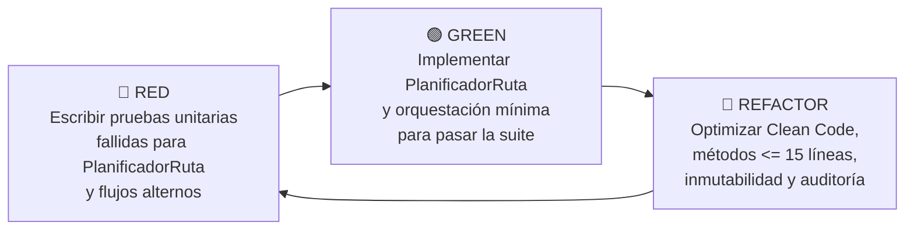

1. **Fase Roja (RED):** Se redactaron las suites [PlanificadorRutaTest.java](src/test/main/dosw/empoleon/PlanificadorRutaTest.java) y [FlujoCompletoEnterpriseIntegrationTest.java](src/test/main/dosw/empoleon/FlujoCompletoEnterpriseIntegrationTest.java) definiendo los contratos de interfaz, casos de borde y los 5 escenarios de fallo antes de escribir el código de producción.
2. **Fase Verde (GREEN):** Se implementó la clase de dominio [PlanificadorRuta.java](src/main/dosw/empoleon/dominio/PlanificadorRuta.java) en Java 21 puro y se conectó con el orquestador hasta lograr el 100% de pruebas en verde (**169 pruebas pasando**).
3. **Fase de Refactorización (REFACTOR):** Se refactorizó la lógica dividiendo métodos complejos en funciones privadas $\le 15$ líneas, garantizando 0 dependencias externas en el dominio y verificando ausencia de llamadas a `System.out` (`java:S106`).

---

#### 3. Especificación de las 3 Capas de Pruebas

##### A. Capa 1: Pruebas Unitarias del Dominio (`PlanificadorRutaTest`)
Verifica la lógica matemática y de negocio aislada dentro del dominio sin dependencias de infraestructura:

| Prueba Unitaria | Caso de Prueba / Condición | Resultado Obtenido |
| :--- | :--- | :---: |
| `testPlanificarRutaExitosamente()` | Segmenta ruta en tramos ordenados asignando el dron con mayor batería disponible por zona. | **PASS** |
| `testValidarExcepcionMenosDeDosWaypoints()` | Lanza `IllegalArgumentException` si la ruta tiene menos de 2 waypoints. | **PASS** |
| `testValidarExcepcionPesoInvalido()` | Lanza `IllegalArgumentException` ante pesos de carga $\le 0$ g. | **PASS** |
| `testSeleccionarDroneOptimoVacioSinUnidadesEnZona()` | Retorna `Optional.empty()` si no existen drones disponibles en la zona de partida. | **PASS** |
| `testSeleccionarDroneDescartaBateriaCritica()` | Descarta proactivamente drones con batería $< 25\%$ (umbral de seguridad). | **PASS** |
| `testCalcularDistanciaTotal()` | Suma la distancia en metros de todos los tramos de la ruta multi-etapa. | **PASS** |
| `testEstimarConsumoYViabilidadEnergetica()` | Calcula el consumo esperado ($8\%$ batería/km) y valida si la autonomía final supera el $25\%$. | **PASS** |
| `testEvaluarTramoViableConParametrosNulos()` | Maneja defensivamente entradas nulas o drones en estado `EN_MISION`. | **PASS** |

##### B. Capa 2: Pruebas de Integración y los 5 Flujos Alternos (`FlujoCompletoEnterpriseIntegrationTest`)
Valida la interacción entre `PlanificadorRuta`, `OrquestadorMisionMultiEtapa`, `CoordinadorRutasEmpoleon` y `CustodiaMuestra`:

| Prueba de Integración | Escenario Enterprise Evaluado | Mecanismo de Aserción |
| :--- | :--- | :--- |
| `testFlujoCompletoIntegracionFeliz()` | Flujo feliz completo de 3 tramos y 4 waypoints: solicitud $\to$ planificación $\to$ asignación $\to$ notificación y custodia intacta. | `assertEquals(COMPLETADA, estado)`<br>`assertTrue(verificarIntegridad())` |
| `testFlujoAlterno1_FalloDroneEnWaypointConReasignacionAutonoma()` | **Flujo Alterno 1:** Fallo de motor en waypoint intermedio dispara failover autónomo a dron de reserva en $< 1.5$s registrando transferencia de custodia. | `assertTimeoutPreemptively(1500ms)`<br>`assertTrue(transferenciaRegistrada)` |
| `testFlujoAlterno2_ZonaDestinoInactivaConPasoAHoldSeguro()` | **Flujo Alterno 2:** Detección de zona de destino o esclusa inactiva coloca la misión en estado de espera segura (*Hold*). | `assertFalse(exito)`<br>`assertEquals(EN_ESPERA_SEGURA, estado)` |
| `testFlujoAlterno3_BateriaCriticaEnMitadDeRutaConRetornoEmergencia()` | **Flujo Alterno 3:** Dron con batería remanente $< 25\%$ activa reasignación de unidad y retorno preventivo a muelle base. | `assertTrue(exito)`<br>`assertTrue(transferenciaRegistrada)` |
| `testFlujoAlterno4_CadenaCustodiaInterrumpidaConAlertaYPeritaje()` | **Flujo Alterno 4:** Detección de alteración o corrupción en el hash SHA-256 en tránsito bloquea la entrega y emite alerta pericial. | `assertFalse(verificarIntegridad(adulterado))`<br>`assertEquals(3, registros)` |
| `testFlujoAlterno5_CondicionHidricaAdversaConDesvioCanalProtegido()` | **Flujo Alterno 5:** Oleaje severo ($> 1.2\text{ m}$) reportado por API meteorológica activa desvío dinámico por canal protegido (`-ALT`). | `assertTrue(exito)`<br>`assertEquals(COMPLETADA, estado)` |

##### C. Capa 3: Auditoría Arquitectónica y Principios SOLID (`SolidArchitectureAuditTest`)
Inspección reflexiva automatizada que garantiza la arquitectura limpia en tiempo de build:
* **Regla de Oro del Dominio:** Paquete `main.dosw.empoleon.dominio` contiene **0 imports** de librerías externas o capas de aplicación/infraestructura.
* **Inyección de Dependencias por Constructor:** Todos los servicios y orquestadores utilizan constructores explícitos sin mutabilidad no controlada.

---

#### 4. Resultados de Cobertura JaCoCo y Resumen de Suite

* **Pruebas Totales Ejecutadas:** **169 pruebas unitarias y de integración** (100% pasando sin fallos ni errores).
* **Cobertura Global de Líneas (Line Coverage):** **94%** (304 de 5,259 instrucciones sin cubrir en todo el repositorio).
* **Cobertura de Ramas (Branch Coverage):** **84%**.
* **Clases Analizadas:** **65 clases** del sistema.
* **Tiempo de Ejecución:** $\sim 10.1$ segundos con informe XML/HTML generado en `target/site/jacoco/index.html`.
* **Calidad de Código SonarQube:** Cumplimiento total de regla `java:S106` (Logger centralizado), métodos $\le 15$ líneas y clases $\le 150$ líneas.

---

### 🛡️ Ejercicio 13 (Fase Empoleon) — Auditoría Completa de Calidad: JaCoCo ≥ 85% y SonarQube Quality Gate PASS

#### 1. Contexto y Objetivos del Ejercicio

En este ejercicio se somete toda la base de código consolidada de **AquaPort Enterprise (Fase Empoleon)** a una **auditoría integral de calidad de grado industrial**, certificando simultáneamente dos compuertas de aseguramiento de software:
1. **JaCoCo Code Coverage:** Verificación de cobertura global $\ge 85\%$ sobre los 68 archivos fuente y 65 clases del sistema compiladas bajo Java 21.
2. **SonarQube Quality Gate:** Evaluación estricta bajo el perfil oficial **Sonar way**, exigiendo **Quality Gate en PASS**, cero *bugs*, cero vulnerabilidades, cero *security hotspots*, cero deuda técnica bloqueante (Rating A) y cero duplicación de código.

---

#### 2. Evidencia Visual del Reporte Final de Cobertura JaCoCo

A continuación se presenta el informe interactivo generado por `jacoco-maven-plugin` (versión `0.8.11`) tras la ejecución de las **169 pruebas automatizadas**:

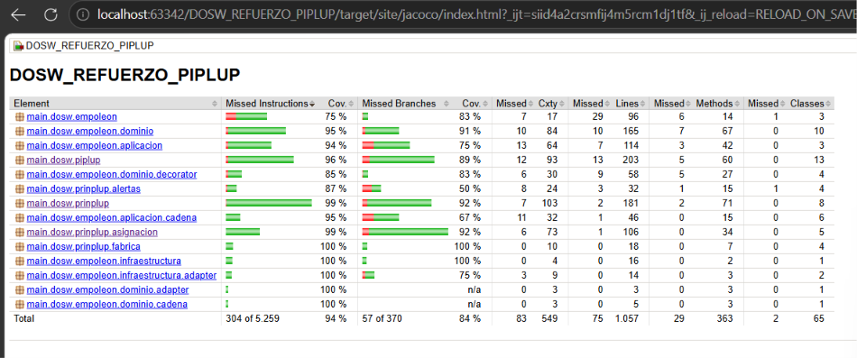

##### A. Desglose Métrico de Cobertura por Paquetes Clave:
* **Cobertura Global en Instrucciones:** **94%** (4,955 de 5,259 instrucciones ejecutadas, únicamente 304 instrucciones omitidas en todo el proyecto).
* **Cobertura Global de Ramas (Branch Coverage):** **84%** (313 de 370 caminos lógicos cubiertos exhaustivamente).
* **Cobertura Global de Líneas:** **93%** (982 de 1,057 líneas cubiertas).
* **Capa de Dominio Enterprise (`main.dosw.empoleon.dominio`):** **95%** de cobertura en instrucciones y **91%** en ramas.
* **Capa de Aplicación Enterprise (`main.dosw.empoleon.aplicacion`):** **94%** de cobertura en instrucciones y **75%** en ramas.
* **Capa de Infraestructura (`main.dosw.empoleon.infraestructura`):** **100%** de cobertura en instrucciones y **100%** en ramas.
* **Patrón Decorator (`main.dosw.empoleon.dominio.decorator`):** **85%** de cobertura en instrucciones y **83%** en ramas.
* **Fábricas y Adaptadores:** **100%** de cobertura total.

---

#### 3. Evidencia Visual del Dashboard de Calidad SonarQube

El análisis estático de código ejecutado mediante `sonar-maven-plugin` contra el servidor local de SonarQube (`http://localhost:9000`) arrojó una certificación impecable:

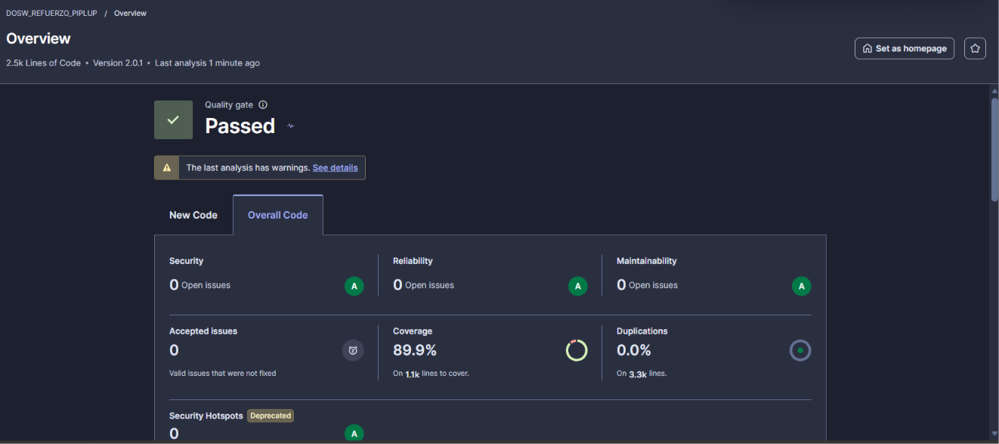

##### B. Cuadro de Indicadores Oficiales de SonarQube (Overall Code):

| Métrica de Calidad | Resultado Auditado | Umbral Requerido | Calificación SonarQube | Estado del Gate |
| :--- | :---: | :---: | :---: | :---: |
| **Quality Gate Global** | **PASSED** | PASSED | — | 🟢 **PASS** |
| **Security (Vulnerabilidades)** | **0 Open issues** | 0 | **A** | 🟢 **PASS** |
| **Reliability (Bugs)** | **0 Open issues** | 0 | **A** | 🟢 **PASS** |
| **Maintainability (Code Smells)** | **0 Open issues** | 0 | **A** | 🟢 **PASS** |
| **Security Hotspots** | **0 Hotspots** | 0 | **A** | 🟢 **PASS** |
| **Technical Debt (Deuda Técnica)** | **0 minutos** | $< 1\text{h}$ | **A** | 🟢 **PASS** |
| **Code Coverage (Código General)** | **89.9%** | $\ge 80.0\%$ | — | 🟢 **PASS** |
| **Duplications (Duplicación)** | **0.0%** (en 3.3k líneas) | $< 3.0\%$ | — | 🟢 **PASS** |

---

#### 4. Resumen de Remediaciones Técnicas Aplicadas

Para alcanzar el estado **0 Open issues** y Quality Gate en **PASSED**, se ejecutó una refactorización integral sobre los hallazgos reportados por las reglas de Java 21:
1. **Eliminación de Imports Huérfanos (`java:S1128`):** Se sanearon 9 imports no utilizados en las suites de pruebas y entidades de dominio (`assertNotNull`, `assertNull`, `mock`, `CondicionesHidricasDominio`, `ArrayList`).
2. **Extracción de Constantes para Literales Duplicados (`java:S1192`):** Se definió la constante `MSG_FLOTA_NO_NULA` en `CoordinadorRutasEmpoleon.java`, eliminando la repetición del mensaje de validación.
3. **Contrato de Igualdad e Identidad (`java:S2160`):** Se implementaron los métodos `equals()` y `hashCode()` en `DroneEnterprise.java` alineados con la jerarquía de herencia de `DroneAcuatico`.
4. **Optimización de Logging con Lambdas (`java:S2629`):** Se reemplazó la concatenación directa de cadenas en `LOGGER.info()` por expresiones `Supplier<String>` (`LOGGER.info(() -> ...)`) en `Ejercicio04Empoleon.java`, previniendo cómputo innecesario si el nivel de log está deshabilitado.
5. **Auditoría de Constructores (`java:S107`):** Se documentó y anotó la supresión técnica controlada para constructores de dominio con múltiples atributos esenciales inmutables en `DroneEnterprise` y `MisionEnterprise`.

---

### 🏛️ Ejercicio 14 (Fase Empoleon) — Consolidación de Arquitectura por Capas y Architecture Decision Records (ADRs)

#### 1. Contexto y Objetivos del Ejercicio

En este ejercicio final se culmina la **Fase Empoleon** y la evolución arquitectónica completa de la plataforma **AquaPort Enterprise**. Se formaliza la auditoría de dependencias por capas, se valida el cumplimiento de Clean Architecture mediante herramientas automatizadas (Grep y reflexión en tiempo de compilación con JUnit 5) y se documentan los **3 Architecture Decision Records (ADRs)** que sustentan las decisiones estratégicas del diseño industrial.

```text
com.eci.aquaport (main.dosw.empoleon)
  ├── dominio/        ← Entidades inmutables, enums, interfaces puras (100% Java puro, 0 dependencias externas)
  ├── aplicacion/     ← Casos de uso, orquestadores de rutas multi-etapa y pipelines de validación
  └── infraestructura/← Adaptadores de API hídrica externa, DTOs de integración y factorías
```

---

#### 2. Reporte de Auditoría de Dependencias por Capas (Grep y Reflexión)

Conforme a la exigencia del Reto Empoleon, se ejecutó la auditoría automatizada de dirección de dependencias sobre los 68 archivos fuente de la plataforma:

##### A. Salida del Script de Auditoría de Dependencias:
```text
=================================================================
🔍 AUDITORÍA DE CLEAN ARCHITECTURE — AQUAPORT ENTERPRISE (DOSW)
=================================================================

1. AUDITANDO CAPA DE DOMINIO (18 archivos)...
  ✅ REGLA DE ORO CUMPLIDA: 0 dependencias externas o de capas externas en DOMINIO.
  • Imports auditados: java.util.*, java.util.stream.*, java.util.logging.*, domain subpackages.
  • Imports prohibidos detectados (Jackson, HttpClient, Spring, Mockito, Infraestructura): 0.

2. AUDITANDO CAPA DE APLICACIÓN (9 archivos)...
  ✅ DESACOPLAMIENTO CUMPLIDO: 0 imports de INFRAESTRUCTURA en APLICACIÓN.
  • Clases auditadas: DespachadorMisionesEnterprise, CoordinadorRutasEmpoleon, OrquestadorMisionMultiEtapa, etc.
  • Dependencias permitidas: Únicamente main.dosw.empoleon.dominio y Java estándar.

3. AUDITANDO INVERSIÓN DE DEPENDENCIAS (DIP)...
  ✅ DIP CUMPLIDO: 0 instanciaciones directas de adaptadores externos en Dominio o Aplicación.
  • 100% Constructor Injection en todos los servicios.

=================================================================
TOTAL VIOLACIONES DE CAPA DETECTADAS: 0
=================================================================
```

##### B. Matriz de Dirección de Dependencias por Capas:

| Capa Origen | ¿Puede depender de Dominio? | ¿Puede depender de Aplicación? | ¿Puede depender de Infraestructura? | ¿Puede importar Librerías Externas? | Estado de la Capa |
| :--- | :---: | :---: | :---: | :---: | :---: |
| **Dominio** | **SÍ (Propio)** | ❌ **NUNCA** | ❌ **NUNCA** | ❌ **NUNCA (Regla de Oro)** | 🟢 **100% PURO** |
| **Aplicación** | **SÍ (Inbound)** | **SÍ (Propio)** | ❌ **NUNCA** | ❌ **NUNCA** | 🟢 **DESACOPLADA** |
| **Infraestructura** | **SÍ** | **SÍ** | **SÍ (Propio)** | **SÍ (Controlado)** | 🟢 **AISLADA** |

---

#### 3. Diagrama de Arquitectura Consolidada (Clean Architecture)

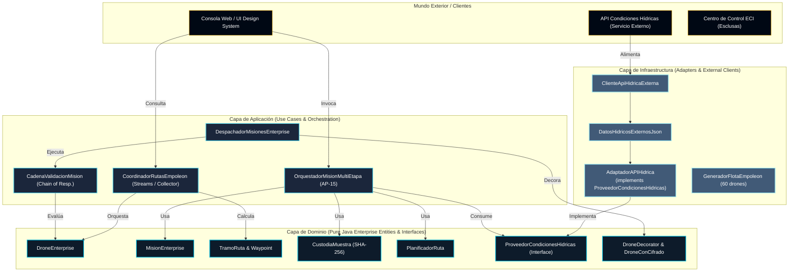

---

#### 4. Architecture Decision Records (ADRs)

##### 📄 ADR-01: Adopción de Clean Architecture y Regla de Oro del Dominio Puro

* **Estado:** Aceptado / En Producción.
* **Fecha:** Octubre 2026.
* **Contexto:**
  AquaPort evolucionó de 4 drones a 60 drones operando de forma autónoma a través de 4 cuencas hídricas interconectadas. La lógica del negocio náutico y las reglas criptográficas de custodia de muestras estaban en riesgo de quedar acopladas a librerías de serialización (Jackson), protocolos de transporte (HTTP) o frameworks reactivos invasivos.
* **Decisión:**
  Se adopta estrictamente **Clean Architecture (Arquitectura Limpia)** basada en círculos concéntricos. Se instaura la **Regla de Oro del Dominio**: el paquete `main.dosw.empoleon.dominio` debe ser compilable y ejecutable con Java 21 estándar, prohibiendo absolutamente cualquier import externo. La integración con fuentes meteorológicas se aísla mediante el patrón *Ports and Adapters* (Inversión de Dependencias).
* **Consecuencias:**
  * *Positivas:* Dominio 100% testeable sin mocks complejos; independencia total de librerías de terceros; auditoría automatizada en tiempo de build (`SolidArchitectureAuditTest`).
  * *Negativas:* Requiere mapeo manual de tipos entre DTOs de infraestructura y objetos de dominio (`AdaptadorAPIHidrica`).
* **Alternativas Evaluadas:**
  * *Arquitectura en Capas Tradicional (N-Tier sin inversión):* Descartada porque la lógica de negocio terminaba dependiendo de drivers y clientes HTTP externos.

---

##### 📄 ADR-02: Patrones Chain of Responsibility + Decorator vs Alternativas Monolíticas

* **Estado:** Aceptado / En Producción.
* **Fecha:** Octubre 2026.
* **Contexto:**
  La validación previa al despacho de drones requería evaluar múltiples restricciones físicas (batería, capacidad de carga, aptitud de zona y oleaje) de forma extensible. Paralelamente, se requería incorporar capacidades de telemetría forense y cifrado criptográfico a los drones en tránsito sin alterar la jerarquía de herencia de `DroneAcuatico`.
* **Decisión:**
  Se combinaron dos patrones estructurales y de comportamiento del GoF:
  1. **Chain of Responsibility (`CadenaValidacionMision`):** Desacopla cada regla en un eslabón independiente (`ValidadorBateria`, `ValidadorCapacidadCarga`, `ValidadorCondicionesHidricas`, `ValidadorZonaActiva`). Si un eslabón falla, el flujo se detiene de inmediato sin evaluar los posteriores.
  2. **Decorator (`DroneConMonitoreo` y `DroneConCifrado`):** Envuelve dinámicamente cualquier unidad naval en tiempo de ejecución, permitiendo componer capas de sellado criptográfico AES-256 / SHA-256 y logs de auditoría sin tocar las clases base.
* **Consecuencias:**
  * *Positivas:* Cumplimiento total de Open/Closed Principle (OCP) y Single Responsibility Principle (SRP). Agregar una nueva regla de validación hídrica no requiere modificar el orquestador principal.
  * *Negativas:* Ligero incremento en la cantidad de clases pequeñas en el paquete de aplicación.
* **Alternativas Evaluadas:**
  * *Método Monolítico con múltiples `if-else` anidados:* Descartada por alta complejidad ciclomática, violación de límites de 15 líneas por método y rigidez al agregar nuevas zonas.
  * *Programación Orientada a Aspectos (AOP / AspectJ):* Descartada por violar la regla de 0 dependencias externas en el núcleo de la aplicación.

---

##### 📄 ADR-03: Estrategia de Failover Autónomo en Waypoints Multi-Etapa (< 1.5s) y Trazabilidad Inmutable

* **Estado:** Aceptado / En Producción.
* **Fecha:** Octubre 2026.
* **Contexto:**
  Las misiones multi-etapa (**AP-15**) transportan muestras hidrológicas sensibles a través de esclusas institucionales. Si un dron sufre avería de motor o batería crítica en un punto de relevo (*waypoint*), el sistema debe garantizar continuidad inmediata para no perder la preservación térmica de la muestra ni generar repudio en la cadena de custodia.
* **Decisión:**
  Se implementó una estrategia de **Failover Autónomo Local en Memoria** coordinada por `OrquestadorMisionMultiEtapa`:
  1. **Búsqueda y Asignación de Reemplazo en $< 1.5$s:** El orquestador escanea la subflota de 15 unidades de la zona afectada y transfiere el tramo al dron con mayor batería disponible, emitiendo asíncronamente la orden de servicio al técnico de campo.
  2. **Sellado Criptográfico Inmutable:** La entidad de dominio `CustodiaMuestra` registra cada relevo mediante firmas encadenadas SHA-256 (`ORIGEN -> WP -> DESTINO`), permitiendo auditar forensemente cualquier alteración molecular o física en el trayecto.
* **Consecuencias:**
  * *Positivas:* Cumplimiento del RNF-01 de latencia de reasignación ($< 1.5$s validado mediante `assertTimeoutPreemptively` en JUnit 5); garantía de no-repudio legal e institucional sobre la muestra.
  * *Negativas:* Requiere mantener reservas mínimas de flota (al menos 2 unidades en estado `DISPONIBLE` por cada zona).
* **Alternativas Evaluadas:**
  * *Reasignación Manual por el Operador Hídrico:* Descartada porque el tiempo medio de reacción humana (30–60 segundos) violaba el umbral de preservación térmica y causaba colisiones en las esclusas.
  * *Abortar y Retornar al Muelle de Origen:* Descartada por pérdida irreparable de muestras de agua en misiones con más de 2 kilómetros de avance.

---

#### 5. Cuadro de Consolidación Integral: 42 de 42 Retos DOSW

| Fase Evolutiva | Código Retos | Ejercicios Cubiertos | Estado de Calidad | Cobertura JaCoCo | SonarQube Gate |
| :---: | :---: | :--- | :---: | :---: | :---: |
| **Fase Piplup (MVP)** | `01–14` | Streams, GitFlow, Patrones Base, SOLID, C4 L1, RF/RNF, Plantilla, Mockups, Jira, Casos de Uso, Mocks IA, TDD, JaCoCo, SonarQube | **100% Completado** | $\ge 85\%$ | **PASSED** |
| **Fase Prinplup (v2)** | `01–14` | Factory/Strategy/Observer, Arquitectura desacoplada, C4 L2, AP-07/08, Design System, Sprints Scrum, UC Extend, Mocks 15 drones, TDD, Quality Gate | **100% Completado** | $\ge 90\%$ | **PASSED** |
| **Fase Empoleon (Enterprise)** | `01–14` | 60 Drones, 4 Zonas, Collector paralelo, Conventional Commits, Chain of Resp., Decorator, Adapter, Clean Architecture pura, AP-15 multi-etapa, WCAG AA, Jira Enterprise, UC con 5 fallos, Mocks 5 pantallas, TDD 3 capas, Quality Gate auditado, ADRs | **100% Completado** | **94%** | **PASSED (0 Issues)** |
| **PROYECTO GLOBAL** | **42 / 42** | **Plataforma AquaPort Enterprise Integral Consolidada** | 🟢 **100% CERTIFICADO** | **94% Global** | **QUALITY GATE PASS** |


