# PIPLUP FASE 01— DOSW

## Datos personales:

- Nombre y Apellido: Jose Alejandro Martinez Arias
- Código de Estudiante: 1000104385
- Curso: DOSW (Desarrollo y operaciones sofware)

---

### Ejercicio 01 — Filtrar y ordenar la flota de drones acuáticos disponibles

Se requiere gestionar la flota de drones acuáticos a través del API de Streams de Java para:

1. Filtrar los drones disponibles con batería mayor o igual al 35% y ordenarlos descendentemente según su nivel de carga.
2. Obtener una lista con únicamente los identificadores (`id`) de los drones que se encuentren disponibles.
3. Verificar si existe al menos un dron disponible con batería suficiente (>= 35%).
4. Contabilizar la cantidad total de unidades disponibles.
5. Determinar cuál es el dron con mayor porcentaje de batería en la flota.

**Código implementado:**

`DroneAcuatico.java`

```java
package main.dosw.piplup;

public record DroneAcuatico(
        String  id,
        String  modelo,
        int     bateria,       // 0-100%
        boolean disponible,
        String  zona           // "Embalse Norte", "Canal Central", etc.
) {}
```

`ConsultorFlota.java`

```Java
package main.dosw.piplup;

import java.util.Comparator;
import java.util.List;
import java.util.Optional;

public class ConsultorFlota {

    public List<DroneAcuatico> obtainDroneAvailableWithEnoughBattery(List<DroneAcuatico> drones){
        return drones.stream().filter(drone -> drone.bateria() >= 35)
                .filter(DroneAcuatico::disponible)
                .sorted(Comparator.comparing(DroneAcuatico::bateria).reversed()).toList();
    }

    public List<String> obtainIdsDronesAvailable(List<DroneAcuatico> drones){
        return drones.stream().filter(DroneAcuatico::disponible).map(DroneAcuatico::id).toList();
    }

    public boolean existsDroneAvailableWithEnoughBattery(List<DroneAcuatico> drones){
        return drones.stream().anyMatch(drone -> drone.disponible() && drone.bateria() >= 35);
    }

    public long amountDronesAvailable(List<DroneAcuatico> drones){
        return drones.stream().filter(DroneAcuatico::disponible).count();
    }

    public Optional<DroneAcuatico> obtainDroneWithLargestBattery(List<DroneAcuatico> drones){
        return drones.stream().max(Comparator.comparing(DroneAcuatico::bateria));
    }
}
```

`Ejercisio1.java`

```Java
package main.dosw.piplup;

import java.util.List;

public class Ejercisio1 {
    public static void main(String[] args){
        List<DroneAcuatico> flota = List.of(
            new DroneAcuatico("AR-01", "Aqua-Ranger 100", 92, true,  "Embalse Norte"),
            new DroneAcuatico("AR-02", "Aqua-Ranger 100", 45, true,  "Canal Central"),
            new DroneAcuatico("AR-03", "Aqua-Ranger 100", 18, false, "Laguna Sur"),
            new DroneAcuatico("AR-04", "Aqua-Ranger 100", 73, true,  "Punto Ribereño Este")
        );

        ConsultorFlota consultor = new ConsultorFlota();

        System.out.println("1. Disponibles con batería >= 35% ordenados:");
        System.out.println(consultor.obtainDroneAvailableWithEnoughBattery(flota));

        System.out.println("\n2. IDs de drones disponibles:");
        System.out.println(consultor.obtainIdsDronesAvailable(flota));

        System.out.println("\n3. ¿Existe algún disponible con batería >= 35%?");
        System.out.println(consultor.existsDroneAvailableWithEnoughBattery(flota));

        System.out.println("\n4. Total de drones disponibles:");
        System.out.println(consultor.amountDronesAvailable(flota));

        System.out.println("\n5. Drone con mayor batería:");
        System.out.println(consultor.obtainDroneWithLargestBattery(flota));
    }
}
```

**Captura de ejecución:**
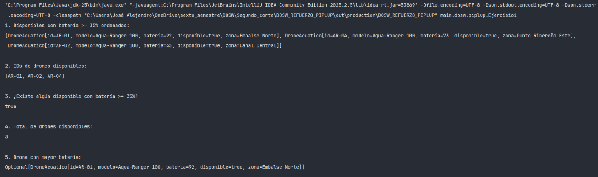

**Explicación:**Se modela la entidad con el record inmutable `DroneAcuatico` y se resuelven las consultas mediante la API de Streams:

- `filter()` para validar la disponibilidad y el umbral de carga.
- `sorted()` junto con `Comparator.comparing().reversed()` para ordenar de mayor a menor batería.
- `map()` con referencia a método (`DroneAcuatico::id`) para proyectar la lista de identificadores.
- `anyMatch()` para comprobar de forma eficiente si hay al menos una coincidencia.
- `count()` para el total de drones activos y `max()` para obtener el dron con mayor batería envuelto de forma segura en un `Optional`.

---

### Ejercicio 02 — Repositorio de AquaPort con estructura GitFlow básica

Configurar el repositorio base para AquaPort aplicando la metodología GitFlow. Se define un archivo `.gitignore` robusto para entornos Java/Maven e IDEs, asegurando que binarios y configuraciones locales no se versionen. Se implementa el flujo de trabajo creando la rama de integración `develop` y la rama de trabajo `feature/streams-consultor-flota`, gestionando la inclusión de cambios mediante commits atómicos y consolidando el trabajo en `develop` mediante un Pull Request.

**Código implementado:**

`.gitignore`

```gitignore
# Compiled class file
*.class

# Log file
*.log

# BlueJ files
*.ctxt

# Mobile Tools for Java (J2ME)
.mtj.tmp/

# Package Files #
*.jar
*.war
*.nar
*.ear
*.zip
*.tar.gz
*.rar

# virtual machine crash logs, see [http://www.java.com/en/download/help/error_hotspot.xml](http://www.java.com/en/download/help/error_hotspot.xml)
hs_err_pid*
replay_pid*

# Maven target directory
target/

# IntelliJ IDEA
.idea/
*.iml

# Eclipse
.project
.classpath
.settings/

# Visual Studio Code
.vscode/
```

`Flujo de comandos Git ejecutados:`

```bash
# Inicialización y configuración de ramas base
git init
git add .gitignore
git commit -m "chore: configurar .gitignore para Java y herramientas de desarrollo"
git branch -M main

# Creación de rama de integración develop
git checkout -b develop

# Creación de rama de característica para el reto 01
git checkout -b feature/streams-consultor-flota

# Commits atómicos de la funcionalidad
git add src/main/java/main/dosw/piplup/DroneAcuatico.java
git commit -m "feat: definir record DroneAcuatico para el modelo MVP"

git add src/main/java/main/dosw/piplup/ConsultorFlota.java
git commit -m "feat: implementar ConsultorFlota con 5 consultas Stream"

git add src/main/java/main/dosw/piplup/Ejercisio1.java
git commit -m "test: agregar clase principal para verificar consultas de flota"

# Publicación de la rama hacia el repositorio remoto
git push -u origin feature/streams-consultor-flota
```

**Pull Request:**

- **Enlace:** [Feature/piplup dosw ejercicio 01 by JoseMartinez883 · Pull Request #1 · JoseMartinez883/DOSW_REFUERZO_PIPLUP](https://github.com/JoseMartinez883/DOSW_REFUERZO_PIPLUP/pull/1)

**Captura de ejecución:**
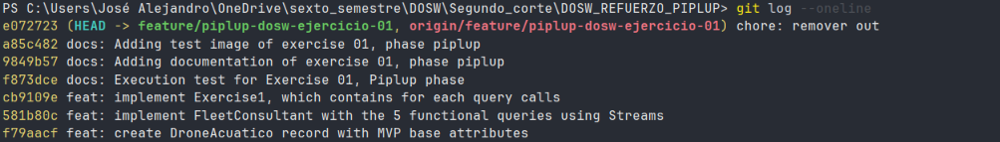

**Explicación:**
Se estableció la estrategia de ramas con GitFlow aislando el desarrollo de la funcionalidad en la rama `feature/piplup-dosw-ejercicio-01` a partir de `feature/piplup`. Se redactaron commits atómicos siguiendo el estándar semántico (especificando prefijos como `feat` y `chore`), evitando mezclar cambios de configuración con lógica de negocio. Asimismo, el `.gitignore` previene la contaminación del repositorio al ignorar artefactos de compilación (`target/`, `*.class`) y metadatos de entornos de desarrollo (`.idea/`, `.vscode/`). Finalmente, la integración hacia `feature/piplup` se gestionó formalmente a través del Pull Request #1. Tener en cuenta que el .gitignore, ya estaba adeacuado, ya que antes de comenzar con la realizacion del taller de refuerzo, primero se preparo la estructura de directorios requeridas y de .gitignore.

---

### Ejercicio 03 — Builder para construir misiones válidas en AquaPort

Implementar el patrón de diseño creacional Builder para la instanciación de objetos de tipo `Mision` en el sistema AquaPort. El patrón garantiza la inmutabilidad de la entidad y previene la creación de instancias con parámetros inconsistentes o nulos mediante encadenamiento de métodos y validaciones integradas en la operación terminal `build()`.

**Código implementado:**

`TipoCarga.java`

```java
package main.dosw.piplup;

public enum TipoCarga {
    MUESTRA_AGUA
}
```

`EstadoMision.java`

```java
package main.dosw.piplup;

public enum EstadoMision {
    PENDIENTE,PROCESO,FINALIZADA
}
```

`Mision.java`

```java
package main.dosw.piplup;

public class Mision {

    private final String id;
    private final DroneAcuatico drone;
    private final String puntoLlegada;
    private final String puntoPartida;
    private final TipoCarga tipoCarga;
    private final EstadoMision estadoMision;

    private Mision(String id, DroneAcuatico drone, String puntoLlegada, String puntoPartida, TipoCarga tipoCarga, EstadoMision estadoMision) {
        this.id = id;
        this.drone = drone;
        this.puntoLlegada = puntoLlegada;
        this.puntoPartida = puntoPartida;
        this.tipoCarga = tipoCarga;
        this.estadoMision = estadoMision;
    }

    public String getId() {
        return id;
    }

    public DroneAcuatico getDrone() {
        return drone;
    }

    public String getPuntoLlegada() {
        return puntoLlegada;
    }

    public String getPuntoPartida() {
        return puntoPartida;
    }

    public TipoCarga getTipoCarga() {
        return tipoCarga;
    }

    public EstadoMision getEstadoMision() {
        return estadoMision;
    }

    public static class Builder {
        private String id;
        private DroneAcuatico drone;
        private String puntoLlegada;
        private TipoCarga tipoCarga;
        private EstadoMision estadoMision = EstadoMision.PENDIENTE;
        private String puntoPartida;

        public Builder id(String id) {
            this.id = id;
            return this;
        }

        public Builder drone(DroneAcuatico drone) {
            this.drone = drone;
            return this;
        }

        public Builder puntoLlegada(String puntoLlegada) {
            this.puntoLlegada = puntoLlegada;
            return this;
        }

        public Builder tipoCarga(TipoCarga tipoCarga) {
            this.tipoCarga = tipoCarga;
            return this;
        }

        public Builder puntoPartida(String puntoPartida) {
            this.puntoPartida = puntoPartida;
            return this;
        }

        public Mision build() {
            if (id == null || drone == null || puntoLlegada == null || tipoCarga == null
                    || puntoPartida == null || id.isBlank() || puntoLlegada.isBlank() || puntoPartida.isBlank()) {
                throw new IllegalStateException("Falta campos por diligenciar sobre la mision o hay campos coN mensajes vacios");
            } else if (!drone.disponible()){
                throw new IllegalStateException("El drone asignado no se encuentra disponible");
            }

            return new Mision(id, drone, puntoLlegada, puntoPartida, tipoCarga, EstadoMision.PENDIENTE);
        }
    }
}
```

`Ejercicio03.java`

```java
package main.dosw.piplup;

public class Ejercicio03 {
    public static void main(String[] args) {
        DroneAcuatico droneValido = new DroneAcuatico("AR-01", "Aqua-Ranger 100", 85, true, "Embalse Norte");
        DroneAcuatico droneNoDisponible = new DroneAcuatico("AR-03", "Aqua-Ranger 100", 18, false, "Laguna Sur");

        // 1. Caso exitoso
        Mision misionValida = new Mision.Builder()
                .id("M-001")
                .drone(droneValido)
                .puntoPartida("Embalse Norte")
                .puntoLlegada("Laboratorio Hídrico")
                .tipoCarga(TipoCarga.MUESTRA_AGUA)
                .build();

        System.out.println("Misión construida correctamente: " + misionValida.getId() + " - " + misionValida.getEstadoMision());

        // 2. Validación de disponibilidad del drone
        try {
            new Mision.Builder()
                    .id("M-002")
                    .drone(droneNoDisponible)
                    .puntoPartida("Laguna Sur")
                    .puntoLlegada("Laboratorio Hídrico")
                    .tipoCarga(TipoCarga.MUESTRA_AGUA)
                    .build();
        } catch (IllegalStateException e) {
            System.out.println("Excepción capturada esperada: " + e.getMessage());
        }

        // 3. Validación de campos obligatorios o vacíos
        try {
            new Mision.Builder()
                    .id("")
                    .drone(droneValido)
                    .puntoPartida("Embalse Norte")
                    .puntoLlegada("   ")
                    .build();
        } catch (IllegalStateException e) {
            System.out.println("Excepción capturada esperada: " + e.getMessage());
        }
    }
}
```

**Captura de ejecución:**
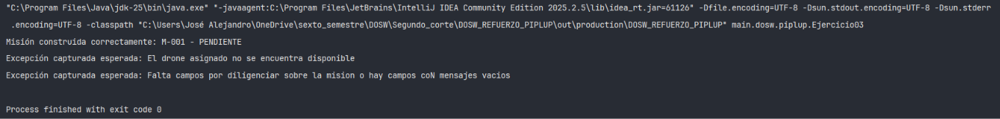

**Explicación:**
Se encapsuló la construcción de la clase inmutable `Mision` mediante su clase anidada estática `Builder`. A través de una interfaz fluida se asignan los atributos requeridos, delegando al método `build()` la comprobación estricta de precondiciones: verifica que las cadenas no sean nulas ni estén compuestas únicamente por espacios en blanco (`isBlank()`), que las referencias a objetos/enums no sean nulas y que el `DroneAcuatico` asignado cumpla la regla de negocio de encontrarse en estado disponible. De no cumplirse alguna regla, interrumpe el flujo levantando una `IllegalStateException` descriptiva.

---

### Ejercicio 04 — SRP y DIP en el núcleo de AquaPort MVP

Diseño e implementación de la arquitectura del núcleo de AquaPort MVP aplicando los principios SOLID, específicamente el **Principio de Responsabilidad Única (SRP)** y el **Principio de Inversión de Dependencias (DIP)**. Se desacopla la persistencia mediante la abstracción `RepositorioMisiones`, se aísla la verificación de reglas de negocio en `ValidadorMision`, la emisión de alertas y mensajes en `NotificadorOperador`, y la orquestación del flujo de alta y consulta en `RegistradorMisiones` mediante inyección de dependencias por constructor.

**Código implementado:**

`RepositorioMisiones.java`

```java
package main.dosw.piplup;

import java.util.List;
import java.util.Optional;

public interface RepositorioMisiones {

    void guardar(Mision mision);

    Optional<Mision> buscarPorId(String id);

    List<Mision> obtenerTodas();

    boolean existePorId(String id);
}
```

`RepositorioMisionesMemoria.java`

```java
package main.dosw.piplup;

import java.util.ArrayList;
import java.util.Collections;
import java.util.LinkedHashMap;
import java.util.List;
import java.util.Map;
import java.util.Objects;
import java.util.Optional;

public class RepositorioMisionesMemoria implements RepositorioMisiones {

    private final Map<String, Mision> baseDatos = new LinkedHashMap<>();

    @Override
    public void guardar(Mision mision) {
        Objects.requireNonNull(mision, "La misión a guardar no puede ser nula");
        baseDatos.put(mision.getId(), mision);
    }

    @Override
    public Optional<Mision> buscarPorId(String id) {
        if (id == null || id.isBlank()) {
            return Optional.empty();
        }
        return Optional.ofNullable(baseDatos.get(id));
    }

    @Override
    public List<Mision> obtenerTodas() {
        return Collections.unmodifiableList(new ArrayList<>(baseDatos.values()));
    }

    @Override
    public boolean existePorId(String id) {
        if (id == null || id.isBlank()) {
            return false;
        }
        return baseDatos.containsKey(id);
    }
}
```

`ValidadorMision.java`

```java
package main.dosw.piplup;

public class ValidadorMision {

    private static final int BATERIA_MINIMA = 35;

    public boolean tieneBateriaSuficiente(DroneAcuatico drone) {
        if (drone == null) {
            return false;
        }
        return drone.bateria() >= BATERIA_MINIMA;
    }

    public void validarPuntoLlegada(String puntoLlegada) {
        if (puntoLlegada == null || puntoLlegada.isBlank()) {
            throw new IllegalArgumentException("El punto de llegada no puede ser nulo ni estar vacío");
        }
    }

    public void validarPuntoPartida(String puntoPartida) {
        if (puntoPartida == null || puntoPartida.isBlank()) {
            throw new IllegalArgumentException("El punto de partida no puede ser nulo ni estar vacío");
        }
    }

    public void validarAsignacion(Mision mision) {
        if (mision == null) {
            throw new IllegalArgumentException("La misión a validar no puede ser nula");
        }
        DroneAcuatico drone = mision.getDrone();
        if (drone == null) {
            throw new IllegalStateException("La misión requiere un drone acuático asignado");
        }
        if (!drone.disponible()) {
            throw new IllegalStateException("El drone asignado " + drone.id() + " no está disponible para operar");
        }
        if (!tieneBateriaSuficiente(drone)) {
            throw new IllegalStateException("El drone " + drone.id() + " tiene batería insuficiente (" + drone.bateria() + "%). Mínimo requerido: " + BATERIA_MINIMA + "%");
        }
        validarPuntoPartida(mision.getPuntoPartida());
        validarPuntoLlegada(mision.getPuntoLlegada());
    }
}
```

`NotificadorOperador.java`

```java
package main.dosw.piplup;

public class NotificadorOperador {

    public void notificarRegistroExitoso(Mision mision) {
        if (mision != null) {
            System.out.println("[AquaPort - Notificación] Misión " + mision.getId()
                    + " registrada exitosamente con drone " + mision.getDrone().id()
                    + " de ruta: " + mision.getPuntoPartida() + " -> " + mision.getPuntoLlegada());
        }
    }

    public void notificarError(String mensaje) {
        System.err.println("[AquaPort - Alerta] Error en operación: " + mensaje);
    }

    public void notificarConsulta(String detalle) {
        System.out.println("[AquaPort - Consulta] " + detalle);
    }
}
```

`RegistradorMisiones.java`

```java
package main.dosw.piplup;

import java.util.List;
import java.util.Objects;
import java.util.Optional;

public class RegistradorMisiones {

    private final RepositorioMisiones repositorio;
    private final ValidadorMision validador;
    private final NotificadorOperador notificador;

    public RegistradorMisiones(RepositorioMisiones repositorio,
                               ValidadorMision validador,
                               NotificadorOperador notificador) {
        this.repositorio = Objects.requireNonNull(repositorio, "El repositorio no puede ser nulo");
        this.validador = Objects.requireNonNull(validador, "El validador no puede ser nulo");
        this.notificador = Objects.requireNonNull(notificador, "El notificador no puede ser nulo");
    }

    public void registrarMision(Mision mision) {
        Objects.requireNonNull(mision, "La misión a registrar no puede ser nula");
        if (repositorio.existePorId(mision.getId())) {
            throw new IllegalStateException("Ya existe una misión registrada con el identificador: " + mision.getId());
        }
        validador.validarAsignacion(mision);
        repositorio.guardar(mision);
        notificador.notificarRegistroExitoso(mision);
    }

    public Optional<Mision> consultarPorId(String id) {
        return repositorio.buscarPorId(id);
    }

    public List<Mision> consultarTodas() {
        return repositorio.obtenerTodas();
    }
}
```

`Ejercicio04.java`

```java
package main.dosw.piplup;

public class Ejercicio04 {

    public static void main(String[] args) {
        System.out.println("=== AquaPort MVP — Ejercicio 04: Principios SOLID (SRP y DIP) ===");

        // Inversión de Dependencias (DIP): Se inyecta la abstracción RepositorioMisiones
        RepositorioMisiones repositorio = new RepositorioMisionesMemoria();
        ValidadorMision validador = new ValidadorMision();
        NotificadorOperador notificador = new NotificadorOperador();

        // Responsabilidad Única (SRP): RegistradorMisiones solo coordina el registro
        RegistradorMisiones registrador = new RegistradorMisiones(repositorio, validador, notificador);

        // Flota de prueba del MVP
        DroneAcuatico droneOptimo = new DroneAcuatico("AR-01", "Aqua-Ranger 100", 92, true, "Embalse Norte");
        DroneAcuatico droneBateriaBaja = new DroneAcuatico("AR-03", "Aqua-Ranger 100", 18, false, "Laguna Sur");

        // 1. Caso exitoso: Misión válida
        System.out.println("\n1. Registrando misión válida:");
        Mision misionValida = new Mision.Builder()
                .id("MIS-101")
                .drone(droneOptimo)
                .puntoPartida("Embalse Norte")
                .puntoLlegada("Laboratorio Hídrico")
                .tipoCarga(TipoCarga.MUESTRA_AGUA)
                .build();

        registrador.registrarMision(misionValida);

        // 2. Caso fallido: Violación de regla de negocio (batería insuficiente o no disponible)
        System.out.println("\n2. Intentando registrar misión con drone no apto:");
        try {
            Mision misionInvalida = new Mision.Builder()
                    .id("MIS-102")
                    .drone(droneBateriaBaja)
                    .puntoPartida("Laguna Sur")
                    .puntoLlegada("Laboratorio Hídrico")
                    .tipoCarga(TipoCarga.MUESTRA_AGUA)
                    .build();
            registrador.registrarMision(misionInvalida);
        } catch (IllegalStateException e) {
            notificador.notificarError("Validación rechazada: " + e.getMessage());
        }

        // 3. Caso de consulta a través del repositorio inyectado
        System.out.println("\n3. Consultando todas las misiones registradas:");
        registrador.consultarTodas().forEach(m ->
                notificador.notificarConsulta("ID: " + m.getId() + " | Drone: " + m.getDrone().id()
                        + " | Carga: " + m.getTipoCarga() + " | Estado: " + m.getEstadoMision())
        );

        System.out.println("\n4. Consultando misión por ID 'MIS-101':");
        registrador.consultarPorId("MIS-101").ifPresentOrElse(
                m -> notificador.notificarConsulta("Encontrada: " + m.getId() + " hacia " + m.getPuntoLlegada()),
                () -> notificador.notificarError("Misión no encontrada")
        );
    }
}
```

**Captura de ejecución:**
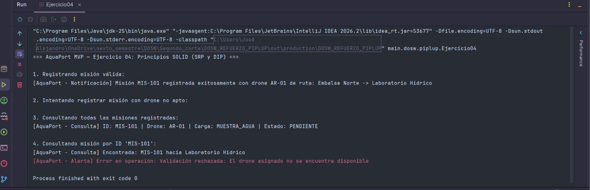

**Diagrama de Clases UML (Principios SRP y DIP):**
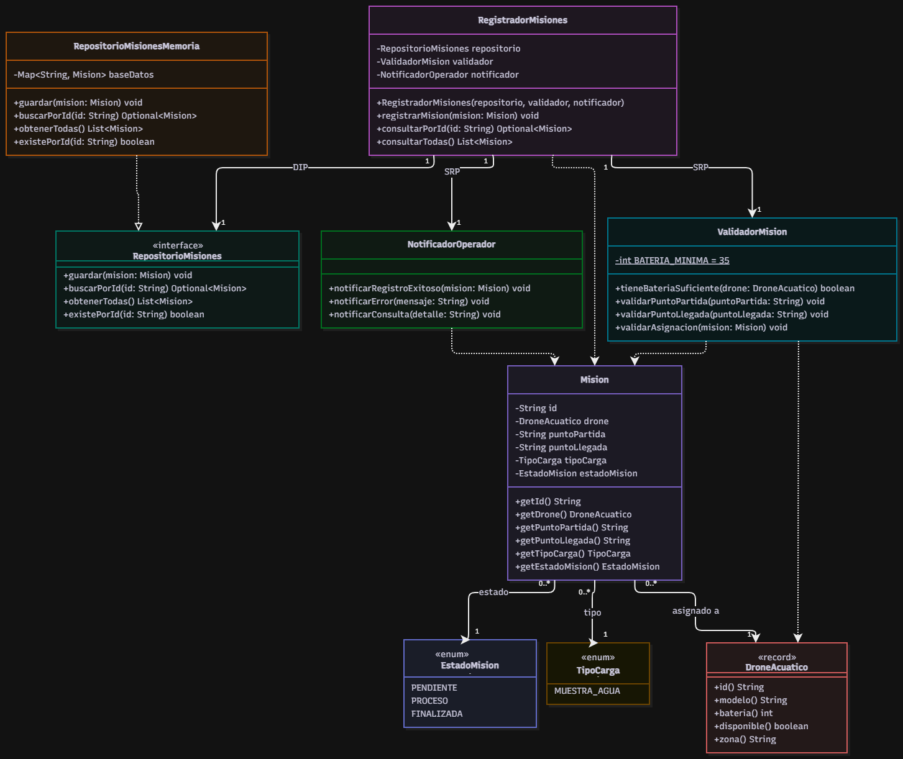

**Explicación:**

1. **Principio de Responsabilidad Única (SRP):** En lugar de un objeto Dios (`GestorMision`) que guarde, valide, notifique e imprima simultáneamente, se modularizó el diseño en clases altamente cohesivas:
   - `RegistradorMisiones`: Exclusivamente orquesta el registro y delegación de consultas.
   - `ValidadorMision`: Contiene y ejecuta estrictamente las validaciones del dominio (batería ≥35%, disponibilidad y parámetros consistentes).
   - `NotificadorOperador`: Responsable de la salida y comunicación de alertas y confirmaciones hacia el operador.
   - `RepositorioMisionesMemoria`: Encargado únicamente de la persistencia de datos en memoria.
2. **Principio de Inversión de Dependencias (DIP):** El servicio de alto nivel `RegistradorMisiones` no se acopla a ninguna implementación concreta de almacenamiento (evitando `new BaseDatosLocal()`), sino que depende de la abstracción `RepositorioMisiones`, inyectada a través de su constructor (`Constructor Injection`). Esto permite sustituir o extender libremente la persistencia (por bases de datos o mocks en pruebas) sin alterar las reglas de negocio.
3. **Multiplicidad de Relaciones en el Diagrama:**
   - `RegistradorMisiones` se asocia con multiplicidad `1` hacia `RepositorioMisiones`, `ValidadorMision` y `NotificadorOperador`.
   - `RepositorioMisionesMemoria` almacena en memoria agregaciones de `0..*` instancias de `Mision`.
   - Cada `Mision` contiene una referencia a exactamente `1` `DroneAcuatico`, `1` `TipoCarga` y `1` `EstadoMision`, mientras que estas entidades pueden pertenecer a `0..*` misiones a lo largo del ciclo operativo.

---

### Ejercicio 05 — Diagrama de Contexto C4 del Sistema AquaPort MVP

Elaboración del **Diagrama de Contexto del Sistema (C4 Nivel 1)** para el sistema AquaPort en su fase inicial (Piplup MVP). El diagrama abstrae los detalles internos del software (clases, bases de datos o algoritmos) presentándolo como una caja negra central, clarificando las fronteras del sistema, los roles de los usuarios que interactúan con él y los flujos de información que intercambian.

**Código implementado / Especificación de Arquitectura:**

#### 1. Actores y Sistemas:

- **Operador Hídrico (Persona):** Personal de operaciones encargado de supervisar la flota de 4 drones Aqua-Ranger 100, consultar su disponibilidad y nivel de batería, y asignar manualmente los drones a las misiones de transporte.
- **Solicitante (Persona):** Investigador, profesor o laboratorista del campus ECI que requiere transportar muestras de agua o sensores entre los puntos hídricos y el laboratorio.
- **Administrador ECI (Persona):** Responsable de la gestión institucional que supervisa el uso de la flota y consulta reportes y estadísticas operativas.
- **AquaPort MVP (Sistema Software):** Sistema central de gestión y monitoreo de drones acuáticos. Gestiona la flota, valida las reglas de asignación y mantiene el registro de las misiones.
- **Sistemas Externos:** Ninguno. El MVP opera de forma autónoma e independiente sin integraciones externas en esta fase.

#### 2. Código del Diagrama en PlantUML (`docs/c4-context-piplup.puml`):

El código fuente del diagrama se encuentra en `docs/c4-context-piplup.puml`.

**Diagrama de Contexto:**
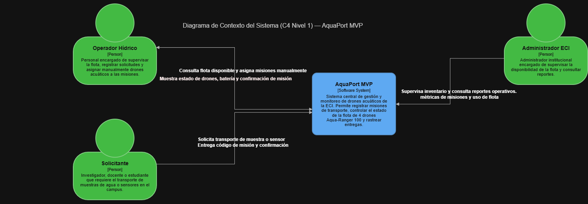

**Explicación:**

1. **Enfoque de Caja Negra (Nivel 1 C4):** El diagrama no expone ningún detalle interno del software (como clases Java `DroneAcuatico`, interfaces o patrones de diseño). Se enfoca exclusivamente en la delimitación del sistema respecto al mundo exterior.
2. **Definición de Actores orientados a Roles:** Se definen los 3 roles humanos esenciales del MVP (`Operador Hídrico`, `Solicitante` y `Administrador ECI`), evitando nombres propios o cargos organizacionales rígidos.
3. **Flujos Bidireccionales Claramente Etiquetados:** Cada interacción entre los actores y AquaPort MVP explicita el dato o evento que transita, demostrando el ciclo completo de solicitud, asignación manual, retroalimentación y reportería del MVP.

---

### Ejercicio 06 — Análisis de Requisitos (RF, RNF, MoSCoW)

A continuación, se definen los requerimientos iniciales para la primera fase (Piplup - MVP) de AquaPort, aplicando criterios de calidad con métricas medibles para los atributos de calidad, y la clasificación MoSCoW para priorizar los esfuerzos del equipo de desarrollo.

#### Requerimientos Funcionales (RF) y No Funcionales (RNF)

**Requerimientos Funcionales (RF):**

- **RF-01 (Must Have):** El **Operador Hídrico** debe poder registrar una misión de transporte, asignando manualmente un drone disponible de la flota, para despachar entregas en el campus.
- **RF-02 (Must Have):** El **Solicitante** debe poder recibir un código único al solicitar una misión, para tener el rastreo visual del encargo a transportar (muestra de agua o sensor).
- **RF-03 (Should Have):** El **Administrador ECI** debe poder consultar el inventario completo y el estado actual (batería, zona) de toda la flota de drones para supervisar los activos operacionales.

**Requerimientos No Funcionales (RNF):**

- **RNF-01 (Must Have):** *[Rendimiento]* La consulta de drones disponibles para el operador debe procesar los filtros y retornar la lista en menos de **200 milisegundos**, asumiendo una flota máxima de 10 drones simultáneos, medible mediante pruebas de carga en JUnit 5 con `assertTimeout`.
- **RNF-02 (Must Have):** *[Usabilidad / Claridad]* Todos los mensajes de error arrojados por el sistema deben estar en idioma español, ser autoexplicativos y guiar al operador hídrico sobre cómo solucionar el fallo sin necesidad de consultar el manual externo.
- **RNF-03 (Could Have):** *[Disponibilidad]* La plataforma central MVP de AquaPort debe asegurar un uptime (tiempo de actividad) del **99.5%** durante el horario hábil de investigación del campus (Lunes a Viernes, 6:00 AM - 8:00 PM).

**Justificación MoSCoW para el MVP:**

- **Must Have:** El registro de misiones (RF-01) y la generación de comprobantes (RF-02) son el núcleo de AquaPort, al igual que un rendimiento básico (RNF-01) y mensajes claros en el idioma del operador para evitar confusiones operativas (RNF-02). Sin ellos, el MVP no cumple su propósito ni es funcional para los usuarios finales.
- **Should Have:** La consulta general del administrador (RF-03) agrega mucho valor administrativo, pero si no se entrega en el sprint inicial, el operador aún puede despachar drones.
- **Could Have:** Alta disponibilidad estricta (RNF-03) es deseable para evitar interrupciones, pero durante el MVP (prueba de concepto), caídas ocasionales son tolerables mientras se estabiliza la arquitectura.
- **Won't Have:** Asignación automática de drones a misiones y rutas multi-etapa complejas; estas funcionalidades quedan fuera del alcance del MVP y se planifican para la fase Prinplup.

---

### Ejercicio 07 — Plantilla DOSW para RF "Registrar misión de transporte"

Utilizando la plantilla oficial de la asignatura para el análisis de requerimientos (`Plantilla_Requerimientos_DOSW.docx`), se documenta formalmente el Requerimiento Funcional principal de esta fase.

#### FUNCIONALIDAD

| Campo                          | Detalle                                                                                                                                      |
| :----------------------------- | :------------------------------------------------------------------------------------------------------------------------------------------- |
| **Código:**             | RF-01                                                                                                                                        |
| **Nombre:**              | Registrar misión de transporte                                                                                                              |
| **Descripción:**        | Permite registrar formalmente en el sistema una solicitud de misión, verificando la disponibilidad del drone y acoplándolo a la locación. |
| **Cómo se ejecutará:** | A través de la consola/backend interactuando con la clase`RegistradorMisiones`.                                                           |
| **Actor principal:**     | Operador Hídrico                                                                                                                            |
| **Precondiciones:**      | El sistema debe estar inicializado y deben existir drones registrados en la flota.                                                           |

#### DATOS DE ENTRADA

| Nombre           | Descripción                        | Tipo de campo     | Reglas / Aplicación                                | Obligatorio |
| :--------------- | :---------------------------------- | :---------------- | :-------------------------------------------------- | :---------- |
| `idMision`     | Identificador único de la misión  | `String`        | No puede estar vacío ni contener solo espacios.    | Sí         |
| `drone`        | Drone seleccionado para la misión  | `DroneAcuatico` | Debe estar instanciado correctamente en el sistema. | Sí         |
| `puntoPartida` | Ubicación de inicio de la misión  | `String`        | No puede estar vacío ni contener solo espacios.    | Sí         |
| `puntoLlegada` | Ubicación de destino de la misión | `String`        | No puede estar vacío ni contener solo espacios.    | Sí         |
| `tipoCarga`    | Tipo de elemento a transportar      | `Enum`          | Debe ser un valor válido (ej.`MUESTRA_AGUA`).    | Sí         |

#### DATOS DE SALIDA

| Nombre               | Descripción                       | Tipo de campo | Reglas / Aplicación                                                      | Obligatorio |
| :------------------- | :--------------------------------- | :------------ | :------------------------------------------------------------------------ | :---------- |
| `misionRegistrada` | El objeto de la misión confirmada | `Mision`    | Se crea inmutablemente a través del patrón*Builder*.                  | Sí         |
| `mensajeExito`     | Confirmación en consola           | `String`    | Mensaje descriptivo con prefijo`[AquaPort - Notificación]`.            | Sí         |
| `mensajeError`     | Excepción en caso de fallo        | `Exception` | Excepciones como`IllegalArgumentException` o `IllegalStateException`. | (En fallos) |

#### FLUJO BÁSICO

| Paso | Actor             | Descripción                                                                                                                                                 | Excepciones                                                           |
| :--- | :---------------- | :----------------------------------------------------------------------------------------------------------------------------------------------------------- | :-------------------------------------------------------------------- |
| 1    | Operador Hídrico | Ingresa los datos de la nueva misión (ID, locaciones) y selecciona un drone de la flota. El sistema verifica internamente que los campos no estén vacíos. | `IllegalArgumentException` si hay datos inválidos.                 |
| 2    | Operador Hídrico | Confirma el registro. El sistema verifica que el drone esté "DISPONIBLE" y con batería`>= 35%`.                                                          | `IllegalStateException` si no cumple las reglas de estado/batería. |
| 3    | Operador Hídrico | Recibe la confirmación luego de que el sistema construye la`Mision` inmutable y la almacena exitosamente en memoria.                                      | `IllegalArgumentException` si el ID de la misión ya existe.        |

#### FLUJO ALTERNO

| Paso | Actor             | Descripción                                                                                                                             | Excepciones                                                |
| :--- | :---------------- | :--------------------------------------------------------------------------------------------------------------------------------------- | :--------------------------------------------------------- |
| 2a   | Operador Hídrico | Intenta confirmar el registro con un drone ocupado o sin batería. El sistema aborta la operación y le notifica el rechazo en pantalla. | `IllegalStateException` arrojada y mostrada al operador. |
| 3a   | Operador Hídrico | Intenta registrar la misión con un identificador (`idMision`) previamente usado. El sistema aborta el registro.                       | `IllegalArgumentException` (Identificador duplicado).    |

#### ANEXOS / PROTOTIPOS

> **Notas y comentarios:** Al tratarse del MVP en su fase inicial (Piplup), el prototipo de interfaz es estrictamente a nivel de terminal/consola. Las validaciones de los flujos alternos se comprueban mediante pruebas unitarias o métodos `main` de demostración (ver captura de Ejercicio 04).

#### REGLAS DE NEGOCIO

| No.   | Descripción                                                                                                     |
| :---- | :--------------------------------------------------------------------------------------------------------------- |
| RN-01 | Todo drone asignado a una misión debe tener un nivel de batería estrictamente mayor o igual al**35%**.   |
| RN-02 | Un drone solo puede ser asignado a una misión si su estado actual es**DISPONIBLE**.                       |
| RN-03 | Las instancias de`Mision` deben ser inmutables para evitar modificaciones inconsistentes luego de su registro. |

#### ABREVIATURAS

| Abreviatura   | Significado                                      |
| :------------ | :----------------------------------------------- |
| **MVP** | Minimum Viable Product (Producto Mínimo Viable) |
| **RF**  | Requerimiento Funcional                          |
| **ID**  | Identificador Único                             |

#### HISTORIAL DE REVISIÓN

| Elaborado por | Aprobado por  | Fecha      | Descripción y Justificación de Cambios             |
| :------------ | :------------ | :--------- | :--------------------------------------------------- |
| Jose Martinez | Jose Martinez | 10/10/2026 | Versión inicial del documento para el MVP (Piplup). |

---

### Ejercicio 08 — Manual de Identidad y UX/UI (AquaPort MVP)

En concordancia con las buenas prácticas de diseño de producto y las directrices de la fase Piplup, la interfaz de monitoreo de AquaPort se construyó bajo la premisa de **identidad corporativa primero, diseño de interfaz después**. Esto garantiza coherencia visual, accesibilidad y claridad cognitiva para el Operador Hídrico frente a la pantalla de control.

> 🌐 **Enlace directo al Manual de Identidad interactivo:**
> 👉 [**Abrir Manual de Identidad de AquaPort (`AquaPort_Manual_de_Identidad.html`)**](docs/mockups/AquaPort_Manual_de_Identidad.html)

#### 1. Manual de Identidad Corporativa

El manual de identidad formal de AquaPort ha sido desarrollado como artefacto web interactivo navegable y autocontenido. Puedes consultarlo directamente en el enlace superior o accediendo al archivo [`docs/mockups/AquaPort_Manual_de_Identidad.html`](docs/mockups/AquaPort_Manual_de_Identidad.html).

##### A. Paleta de Colores Institucional

Diseñada específicamente para entornos operativos de monitoreo continuo (modo oscuro de baja fatiga visual), inspirada en ambientes hídricos y con altos contrastes WCAG:

| Nombre              | Código Hex | RGB                 | Uso y Aplicación en Interfaz                                         |
| :------------------ | :---------- | :------------------ | :-------------------------------------------------------------------- |
| **Abisal**    | `#0A1C26` | `(10, 28, 38)`    | Fondo principal del panel y superficie base.                          |
| **Casco**     | `#12303D` | `(18, 48, 61)`    | Tarjetas de drones, barras de navegación y contenedores.             |
| **Marea**     | `#1B7F8C` | `(27, 127, 140)`  | Color primario de acción (botones principales, logo claro).          |
| **Sonar**     | `#7FD8C9` | `(127, 216, 201)` | Acento visual, enlaces, estados de foco y barras de batería.         |
| **Sedimento** | `#8CA3A8` | `(140, 163, 168)` | Texto secundario, unidades de medida y etiquetas complementarias.     |
| **Bruma**     | `#E4EDEC` | `(228, 237, 236)` | Texto principal y encabezados de alta legibilidad (contraste 14.6:1). |

##### B. Colores Semánticos de Estado (Flota de Drones)

Cada estado combina de forma obligatoria **color, forma e icono y texto explicativo** para prevenir ambigüedad en operadores con daltonismo:

| Estado                  | Código Hex | Ratio Contraste | Icono / Forma                 | Criterio de Uso Operativo                                      |
| :---------------------- | :---------- | :-------------- | :---------------------------- | :------------------------------------------------------------- |
| **Disponible**    | `#3FBF8A` | 7.5:1           | Círculo lleno (`●`)       | Drone con batería`>= 35%` listo para asignación inmediata. |
| **En misión**    | `#4C9BE8` | 5.9:1           | Flecha de avance (`▶`)     | Drone ejecutando un despacho o transporte en tránsito.        |
| **Recargando**    | `#E5B33A` | 9.0:1           | Rayo (`⚡`)                 | Drone en estación de acople cargando energía.                |
| **Mantenimiento** | `#8A979C` | 5.8:1           | Rombo (`◇`)                | Drone fuera de servicio por revisión programada.              |
| **Fallo**         | `#E5604F` | 5.1:1           | Triángulo de alerta (`▲`) | Alerta técnica; requiere atención inmediata del operador.    |

##### C. Tipografía

- **IBM Plex Sans (400, 500, 600):** Tipografía principal para títulos, etiquetas de navegación, mensajes y botones.
- **IBM Plex Mono (400, 500):** Tipografía monoespaciada reservada exclusivamente para telemetría y datos que requieren comparación o copiado rápido: identificadores de drone (`AR-01`), códigos de misión (`M-0412`), porcentajes de batería (`82%`) y timestamps (`10:47:12`).

##### D. Tono de Voz y Microcopia

Técnico, conciso, preventivo y en voz activa en español. Se eliminan los mensajes genéricos o decorativos en favor de diagnósticos claros con cifras y pautas de acción concretas (ej. *"El drone AR-03 tiene batería insuficiente (18%). Mínimo requerido: 35%."* en lugar de *"Error de asignación"*).

---

#### 2. Mockup del Panel de Monitoreo de la Flota Acuática

A partir del manual de identidad establecido, se diseñó la interfaz de monitoreo de la flota mostrando los cuatro (4) drones del MVP de AquaPort en operación simultánea:


##### Aspectos Destacados del Mockup:

1. **Resumen Cuantitativo Superior:** Contadores en tiempo real agrupados por estado (`1 disponible`, `1 en misión`, `1 recargando`, `1 fallo`) que permiten evaluar la capacidad de la flota sin navegar entre pestañas.
2. **Banner de Notificación Crítica:** Aviso destacado en color de fallo sobre el drone `AR-04`, especificando la hora de pérdida de enlace y el punto geográfico donde intervenir (`Punto Ribereño Este`).
3. **Control y Deshabilitación Preventiva (RN-01):**
   - El drone `AR-01` (`82%`) cuenta con el botón primario activo **Asignar misión**.
   - El drone `AR-03` (`18%`) se muestra visualmente deshabilitado (opacidad al 55% y borde discontinuo) con el botón bloqueado y el motivo explícito: *"Batería insuficiente (18%). Mínimo requerido: 35%."*, previniendo errores antes de que ocurran.
4. **Radar y Zonificación Espacial del Campus:** Representación topográfica y batimétrica con las 5 zonas operacionales (`Embalse Norte`, `Canal Central`, `Laguna Sur`, `Punto Ribereño Este`, `Laboratorio Hídrico`), ubicando espacialmente a cada unidad.

---

#### 3. Verificación con las 10 Heurísticas de Usabilidad de Jakob Nielsen

Se evaluó exhaustivamente la interfaz del panel de monitoreo frente a los 10 principios de usabilidad de Jakob Nielsen, verificando el cumplimiento de **7 de las 10 heurísticas** en esta pantalla y justificando las 3 restantes:

|     N.°     | Heurística de Nielsen                                              |     Evaluación     | Aplicación y Evidencia Concreta en el Panel de AquaPort                                                                                                                                                                                                                                                                  |
| :-----------: | :------------------------------------------------------------------ | :-----------------: | :------------------------------------------------------------------------------------------------------------------------------------------------------------------------------------------------------------------------------------------------------------------------------------------------------------------------ |
| **#1** | **Visibilidad del estado del sistema**                        |  **Cumple**  | Los indicadores superiores totalizan los estados de la flota en tiempo real. Cada fila de drone y cada nodo del mapa batimétrico muestran su estado con color, icono y texto. El pie de página indica el timestamp exacto de la última sincronización (`Actualizado 10:47:12`).                                     |
| **#2** | **Concordancia entre el sistema y el mundo real**             |  **Cumple**  | Utiliza la terminología natural del operador hídrico (drones, misiones, batería, telemetría). Las zonas geográficas corresponden a los lugares reales del campus de la Escuela Colombiana de Ingeniería (`Embalse Norte`, `Canal Central`, `Laguna Sur`, `Punto Ribereño Este`, `Laboratorio Hídrico`). |
| **#3** | **Control y libertad del usuario**                            | *No aplica aquí* | La cancelación de misiones pendientes o edición de rutas se gestiona en la vista de detalle de misión; el panel de flota actúa como centro de visualización y despacho rápido.                                                                                                                                      |
| **#4** | **Consistencia y estándares**                                |  **Cumple**  | Todas las filas mantienen una jerarquía visual idéntica: ID, estado estandarizado, nivel de batería, zona actual, misión y botón de acción. Los datos numéricos y códigos se expresan uniformemente en tipografía monoespaciada (`IBM Plex Mono`).                                                             |
| **#5** | **Prevención de errores**                                    |  **Cumple**  | El drone`AR-03` con batería al 18% se presenta deshabilitado y su botón de asignación queda inactivo con el mensaje de restricción (`< 35%`). El drone `AR-04` en fallo no ofrece botón de asignación, impidiendo que el operador intente despachar una unidad averiada.                                      |
| **#6** | **Reconocimiento antes que recuerdo**                         |  **Cumple**  | Cada fila consolida toda la información que el operador necesita para decidir (ID, porcentaje y barra de batería, ubicación actual y misión en curso). El usuario no necesita recordar datos de pantallas previas para tomar decisiones de asignación.                                                               |
| **#7** | **Flexibilidad y eficiencia de uso**                          | *No aplica aquí* | En la escala del MVP (4 drones), la lista completa cabe en un solo vistazo sin necesidad de filtros ni atajos complejos. Se proyectan aceleradores y filtros avanzados para etapas posteriores con flotas superiores a 50 drones.                                                                                         |
| **#8** | **Diseño estético y minimalista**                           |  **Cumple**  | La interfaz evita elementos ornamentales distractores. El mapa topográfico utiliza líneas sutiles sin saturar, y las tarjetas presentan una distribución espaciada en múltiplos de 4 px, priorizando la lectura rápida de los indicadores operativos.                                                                |
| **#9** | **Ayudar a reconocer, diagnosticar y recuperarse de errores** |  **Cumple**  | En lugar de alertas genéricas, los mensajes son precisos y orientados a la solución: para`AR-03` se indica el porcentaje actual y la cota mínima requerida; para `AR-04` el banner diagnostica la hora de desconexión y orienta al operador sobre el punto exacto donde inspeccionar el dispositivo.              |
| **#10** | **Ayuda y documentación**                                    | *No aplica aquí* | El panel de control está diseñado para ser autoexplicativo para personal técnico sin manuales contextuales intrusivos. La documentación de diseño y lineamientos se centralizan en el[Manual de Identidad HTML](docs/mockups/AquaPort_Manual_de_Identidad.html).                                                      |

---

### Ejercicio 09 — Agilismo y Jira (AquaPort MVP)

En concordancia con los estándares de gestión ágil de la asignatura (**`sprint2-dosw-proyectos.html`** y **`DOSW_Equipo_Piplup.html`**), el desarrollo del MVP de AquaPort se organizó formalmente en Jira aplicando la jerarquía ágil completa:**`Épica` ➔ `Features` (incluyendo contrato Swagger/OpenAPI) ➔ `Historias de Usuario (HU)` ➔ `Subtareas Técnicas por capas de software`**, aplicando estimación con Planning Poker (Fibonacci) y la regla estricta de **Definition of Done (DoD) con evidencia**.

> 🌐 **Enlace directo al Proyecto y Backlog en Jira:**
> 👉 [**Abrir Proyecto AquaPort en Atlassian Jira (Tablero AQUA)**](https://josealejandromartinezarias9.atlassian.net/jira/software/projects/AQUA/summary?atlOrigin=eyJpIjoiN2JlNGY5ZTE1OWIxNGMwNjljOGQ1M2VkN2I1OGVjN2QiLCJwIjoiaiJ9)

---

#### 1. Vista General del Backlog en Jira

El backlog de AquaPort consolida la Épica, las Features funcionales y de documentación, junto con las 3 Historias de Usuario priorizadas, sumando un total estimado de **23 Story Points**:

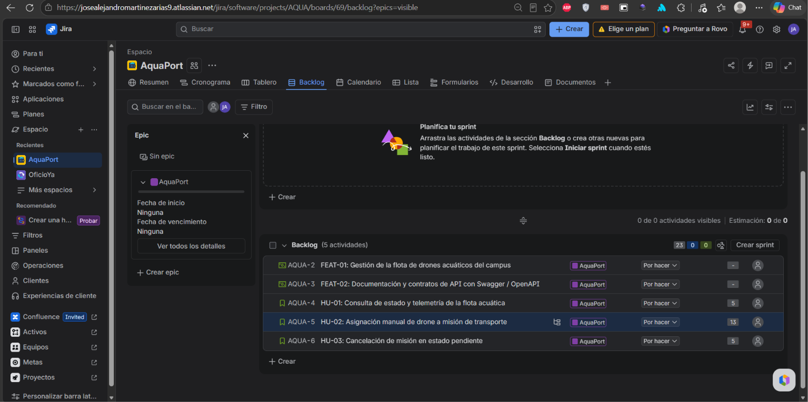

|      Clave      |    Tipo    | Resumen / Ítem                                                  | Épica / Padre |   Estimación   |  Estado  |
| :--------------: | :---------: | :--------------------------------------------------------------- | :------------: | :--------------: | :-------: |
| **AQUA-1** |  `Epic`  | Digitalizar el monitoreo y reparto hídrico de la ECI...         |       —       |        —        | Por hacer |
| **AQUA-2** | `Feature` | FEAT-01: Gestión de la flota de drones acuáticos del campus    |     AQUA-1     |        —        | Por hacer |
| **AQUA-3** | `Feature` | FEAT-02: Documentación y contratos de API con Swagger / OpenAPI |     AQUA-1     |        —        | Por hacer |
| **AQUA-4** |  `Story`  | HU-01: Consulta de estado y telemetría de la flota acuática    |    FEAT-01    | **5 pts** | Por hacer |
| **AQUA-5** |  `Story`  | HU-02: Asignación manual de drone a misión de transporte       |    FEAT-01    | **13 pts** | Por hacer |
| **AQUA-6** |  `Story`  | HU-03: Cancelación de misión en estado pendiente               |    FEAT-01    | **5 pts** | Por hacer |

---

#### 2. Épica del MVP (AQUA-1)

* **Resumen:** `Digitalizar el monitoreo y reparto hídrico de la ECI mediante una flota de drones acuáticos supervisada`
* **Descripción:** Desarrollar la plataforma central MVP (AquaPort - Fase Piplup) que permita la coordinación, despacho, monitoreo de telemetría y supervisión de una flota de drones acuáticos encargados de transportar muestras hídricas y sensores entre los diferentes cuerpos de agua del campus de la Escuela Colombiana de Ingeniería Julio Garavito (Embalse Norte, Canal Central, Laguna Sur, Punto Ribereño Este y Laboratorio Hídrico).

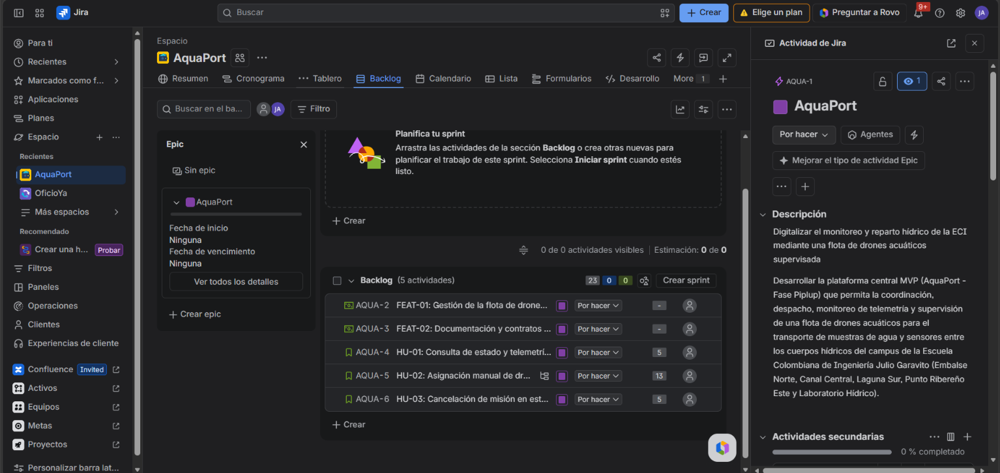

---

#### 3. Features del Sistema

##### A. FEAT-01: Gestión de la flota de drones acuáticos del campus (AQUA-2)

Módulo funcional de supervisión y control operativo que permite consultar el inventario y estado de carga de la flota, asignar unidades a misiones de transporte hídrico y gestionar el ciclo de despacho básico para el Operador Hídrico.

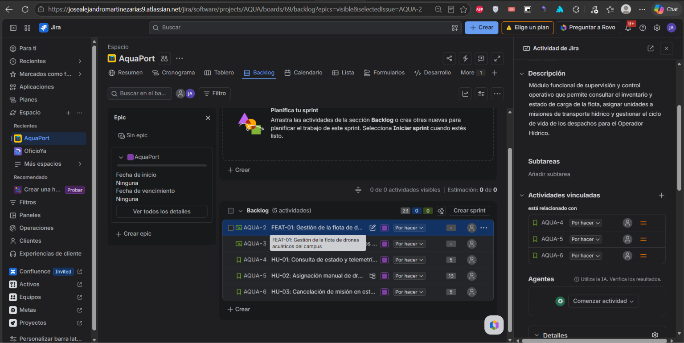

##### B. FEAT-02: Documentación y contratos de API con Swagger / OpenAPI (AQUA-3)

Definición y publicación interactiva de los contratos de API REST mediante interfaces OpenAPI (SpringDoc) separadas por controlador, garantizando el contrato de integración formal entre frontend y backend conforme a las directrices de la guía de proyectos.

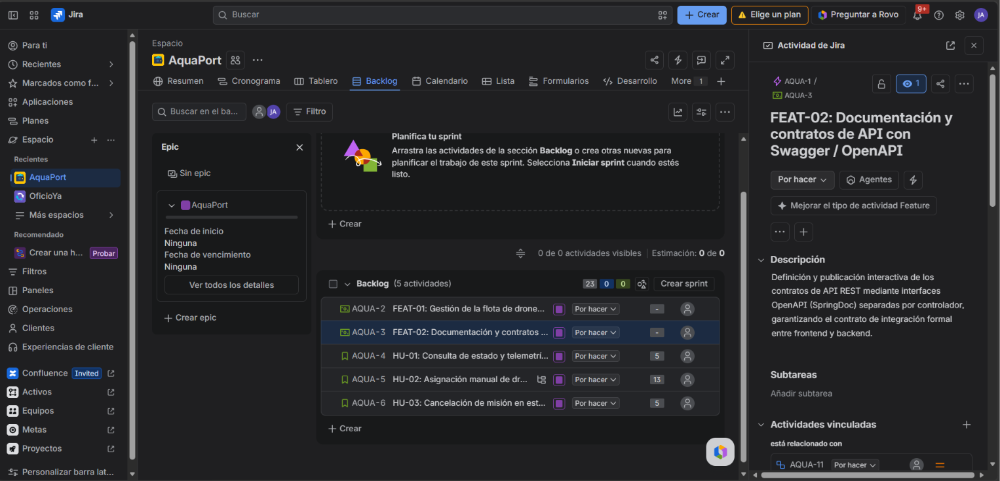

---

#### 4. Historias de Usuario (User Stories)

> **Criterio de Calidad DOSW:** Todas las historias se encuentran redactadas bajo la plantilla formal *`Como [rol], quiero [qué], para [beneficio]`*, utilizando exclusivamente roles humanos del dominio (`Operador Hídrico`) y evitando designar al "Sistema" como actor.

##### 📋 HU-01: Consulta de estado y telemetría de la flota acuática (AQUA-4 · 5 pts)

* **Narrativa:***Como* Operador Hídrico,*quiero* visualizar la lista de drones de la flota con su identificador, nivel de batería, estado actual y zona asignada,*para* evaluar la disponibilidad operativa de las unidades antes de despachar una nueva misión de transporte.
* **Criterios de Aceptación:**
  1. El sistema clasifica visualmente el estado de cada unidad entre DISPONIBLE, EN_MISION, RECARGANDO, MANTENIMIENTO y FALLO.
  2. Los drones con batería < 35% se presentan claramente como no aptos para despacho.
  3. La consulta se procesa en menos de 200 ms para la flota activa (RNF-01).

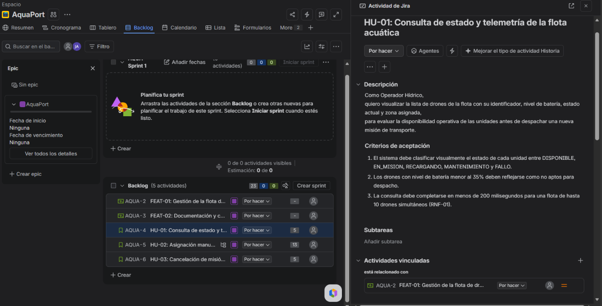

---

##### 📋 HU-02: Asignación manual de drone a misión de transporte (AQUA-5 · 13 pts)

* **Narrativa:***Como* Operador Hídrico,*quiero* asignar manualmente un drone disponible a una solicitud de misión especificando puntos de partida, llegada y tipo de carga,*para* despachar oportunamente el transporte de muestras de agua o sensores en los cuerpos hídricos del campus.
* **Criterios de Aceptación (Formato Gherkin / BDD):**
  - **Escenario 1 (Asignación válida):** Dado que el Operador Hídrico selecciona un drone registrado y en estado "DISPONIBLE" con batería $\ge 35\%$, cuando confirma el registro de la misión con datos válidos, entonces el sistema crea la instancia inmutable de la Misión con un ID alfanumérico único y actualiza el drone a "EN_MISION".
  - **Escenario 2 (Rechazo por RN-01 / RN-02):** Dado que el Operador Hídrico intenta asignar un drone con batería < 35% o en estado diferente a "DISPONIBLE", cuando solicita el registro, entonces el sistema rechaza la operación notificando el motivo en pantalla con la batería actual y la cota mínima requerida (35%).

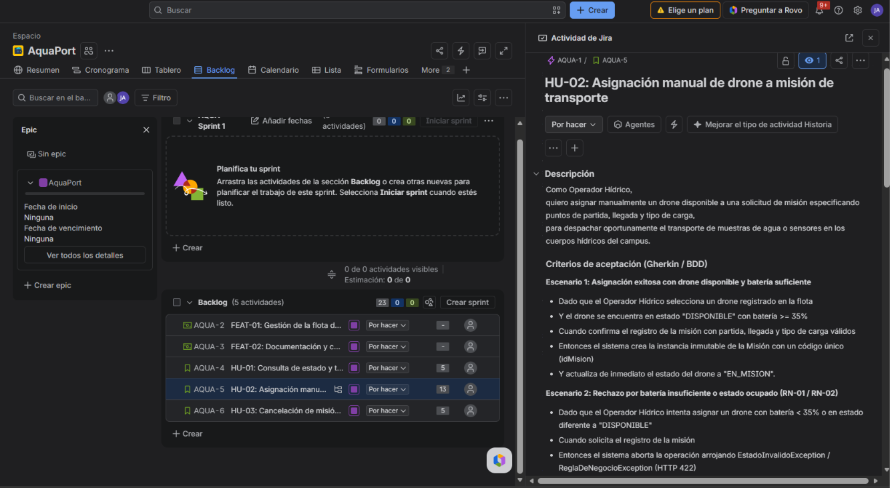

###### Descomposición en Subtareas Técnicas por Capas (AQUA-7 a AQUA-12):

Siguiendo el template arquitectónico oficial (`Entidades` ➔ `DTOs` ➔ `Validator` ➔ `Service` ➔ `Controller` ➔ `Pruebas`), la HU-02 desglosa sus tareas técnicas con su respectiva Definition of Done (DoD) y evidencia requerida para su cierre:

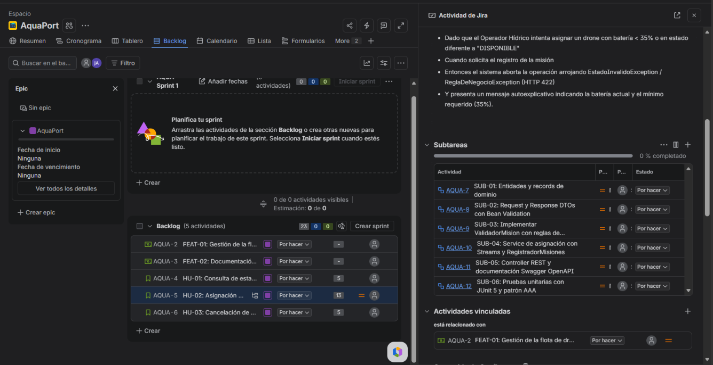

|       Clave       | Subtarea Técnica                                                    | Capa Arquitectónica | Estimación | Criterio de Aceptación / Done (DoD)                                                                                                         |
| :---------------: | :------------------------------------------------------------------- | :------------------: | :---------: | :------------------------------------------------------------------------------------------------------------------------------------------- |
| **AQUA-7** | `SUB-01: Entidades y records de dominio`                           |     Dominio Puro     |    2 pts    | Clases inmutables`Mision` (con Builder) y `DroneAcuatico` en `model.domain`, compilando sin anotaciones de persistencia ni DTOs.       |
| **AQUA-8** | `SUB-02: Request y Response DTOs con Bean Validation`              |         DTOs         |    1 pt    | `MisionRequestDTO` con validaciones de campos no nulos/no vacíos y `MisionResponseDTO` para la respuesta al cliente.                    |
| **AQUA-9** | `SUB-03: Implementar ValidadorMision con reglas de negocio`        |     Validación     |    2 pts    | `ValidadorMision` verificando batería $\ge 35\%$, estado `DISPONIBLE` y locaciones no vacías, arrojando excepciones tipadas.         |
| **AQUA-10** | `SUB-04: Service de asignación con Streams y RegistradorMisiones` |  Servicio / Negocio  |    3 pts    | Lógica desacoplada en`IMisionService` orquestando validador y persistencia en memoria, sin retornar DTOs directamente.                    |
| **AQUA-11** | `SUB-05: Controller REST y documentación Swagger OpenAPI`         | Presentación / Docs |    2 pts    | Interfaz`MisionApi` con anotaciones OpenAPI y `MisionController` con endpoint `POST /api/v1/misiones` retornando HTTP 201.             |
| **AQUA-12** | `SUB-06: Pruebas unitarias con JUnit 5 y patrón AAA`              |  Pruebas Unitarias  |    3 pts    | Suite`ValidadorMisionTest` y `MisionServiceImplTest` con `@DisplayName` cubriendo casos positivos y negativos con JaCoCo $\ge 80\%$. |

---

##### 📋 HU-03: Cancelación de misión en estado pendiente (AQUA-6 · 5 pts)

* **Narrativa:***Como* Operador Hídrico,*quiero* cancelar una misión de transporte que se encuentre en estado pendiente antes del inicio de navegación,*para* liberar el drone asignado en caso de imprevistos ambientales o errores en la solicitud.
* **Criterios de Aceptación:**
  1. Solo se permite cancelar misiones en estado `PENDIENTE`. Si el drone ya está navegando (`EN_MISION`), el sistema rechaza la cancelación con código HTTP 422.
  2. Al confirmarse la cancelación, el drone retorna su estado inmediatamente a `DISPONIBLE`.

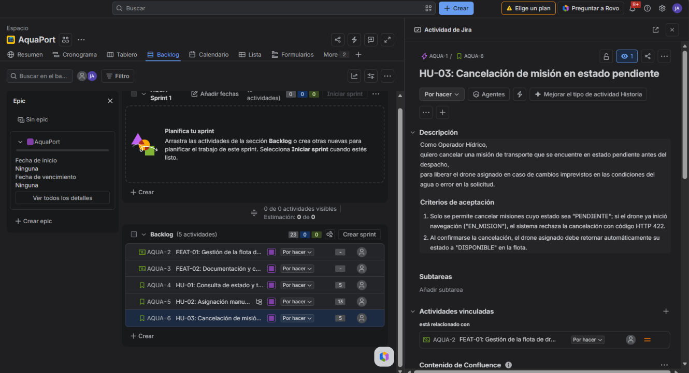

---

### Ejercicio 10 — Diagramas de Casos de Uso (AquaPort MVP)

En cumplimiento con los lineamientos formales de modelado de software de DOSW (**`DOSW_Equipo_Piplup.html`**), se diseñó el **Diagrama de Casos de Uso UML** para el requerimiento funcional principal de la fase Piplup (**`RF-01: Registrar misión de transporte`**), modelando la interacción con el sistema central `AquaPort` y formalizando las relaciones de inclusión obligatoria (`<<include>>`) y extensión condicional (`<<extend>>`).

#### 1. Diagrama de Casos de Uso del MVP

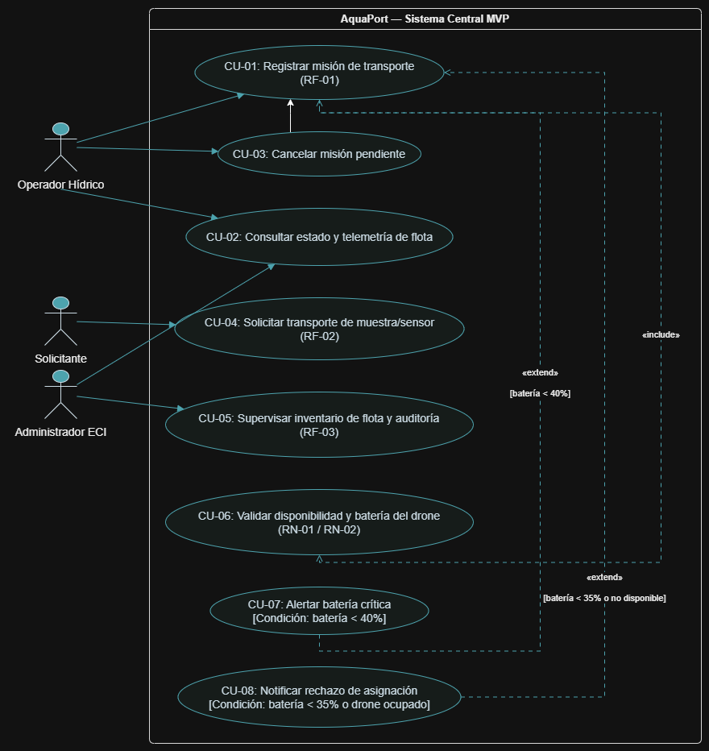

---

#### 2. Elementos del Diagrama

##### A. Límite del Sistema

* **Contenedor:** `AquaPort — Sistema Central MVP`. Delimita con precisión la frontera del software; todos los casos de uso (elipses) residen en su interior, mientras que los actores interactúan desde el exterior.

##### B. Actores (Roles Humanos del Dominio)

Conforme a las reglas de calidad de la asignatura, se modelan roles humanos funcionales y **nunca se utiliza "Sistema" como actor**:

1. **Operador Hídrico (Actor Principal):** Usuario técnico que opera la pantalla de monitoreo, consulta la telemetría en tiempo real, asigna drones a misiones de despacho y gestiona cancelaciones.
2. **Solicitante (Actor Secundario):** Investigador, docente o laboratorista del campus que genera solicitudes de transporte para muestras hídricas o sensores (`RF-02`).
3. **Administrador ECI (Actor de Supervisión):** Personal institucional que audita el estado general de los activos, revisa métricas operativas y supervisa el inventario de la flota (`RF-03`).

---

#### 3. Casos de Uso y Especificación de Relaciones

|     Código     | Caso de Uso                                                   |      Actor Primario      |     Tipo / Relación     | Regla / Condición                                                                                                                                                                |
| :-------------: | :------------------------------------------------------------ | :-----------------------: | :-----------------------: | :-------------------------------------------------------------------------------------------------------------------------------------------------------------------------------- |
| **CU-01** | **Registrar misión de transporte (RF-01)**             |     Operador Hídrico     |    Caso Base Principal    | Permite formalizar un despacho fluvial acoplando drone, origen, destino y carga.                                                                                                  |
| **CU-02** | **Consultar estado y telemetría de flota**             | Operador Hídrico / Admin |     Caso de Consulta     | Lectura en tiempo real de batería, zona y estado de los drones.                                                                                                                  |
| **CU-03** | **Cancelar misión pendiente**                          |     Operador Hídrico     |     Gestión de Ciclo     | Aborta misiones que aún no han iniciado su navegación activa.                                                                                                                   |
| **CU-04** | **Solicitar transporte de muestra/sensor (RF-02)**      |        Solicitante        |      Caso de Entrada      | Ingreso del requerimiento de transporte por parte del solicitante.                                                                                                                |
| **CU-05** | **Supervisar inventario de flota y auditoría (RF-03)** |     Administrador ECI     |      Caso de Control      | Monitoreo administrativo de disponibilidad y registro de activos.                                                                                                                 |
| **CU-06** | **Validar disponibilidad y batería del drone**         |      Sistema Interno      | **`<<include>>`** | **Obligatorio:** Se ejecuta SIEMPRE que se invoca `CU-01`. Sin verificar que el drone esté `DISPONIBLE` y con batería $\ge 35\%$, no se puede registrar la misión. |
| **CU-07** | **Alertar batería crítica**                           |      Sistema Interno      | **`<<extend>>`** | **Condicional:** `[si batería del drone < 40%]`. Advierte preventivamente al operador antes del despacho.                                                                |
| **CU-08** | **Notificar rechazo de asignación**                    |      Sistema Interno      | **`<<extend>>`** | **Condicional:** `[si batería < 35% o drone ocupado]`. Interrumpe la operación informando el motivo técnico exacto (RN-01 / RN-02).                                    |

---

#### 4. Justificación de Buenas Prácticas UML Aplicadas

1. **Diferenciación estricta entre `<<include>>` y `<<extend>>`:**
   - **`<<include>>` (Sin condición):** La validación de disponibilidad y batería (`CU-06`) es una precondición ineludible. El caso base `CU-01` no puede completarse con éxito sin la ejecución de `CU-06`.
   - **`<<extend>>` (Condicional con regla explícita):** Tanto la alerta de batería crítica (`CU-07`) como la notificación de rechazo (`CU-08`) solo ocurren si se cumplen condiciones operativas específicas (`batería < 40%` o `batería < 35% / no disponible`). Si la condición no se cumple, el caso base procede normalmente sin ejecutar la extensión.
2. **Dirección formal de las relaciones:** En UML estándar, las flechas de `<<include>>` nacen en el caso base hacia el caso incluido, mientras que las de `<<extend>>` nacen en el caso de extensión y apuntan hacia el caso base que modifican o enriquecen.

---

### Ejercicio 11 — Mocks con IA: Los 3 Estados del Panel (AquaPort MVP)

En cumplimiento con el proceso metodológico de diseño de interfaces guiado por IA (**Referencias ➔ Identidad de Marca ➔ Datos del RF ➔ Prompt Estructurado**), se generaron las pantallas para los **tres estados operacionales fundamentales** del centro de monitoreo de AquaPort, asegurando coherencia visual absoluta con la paleta de identidad corporativa (`Abisal #0A1C26`, `Casco #12303D`, `Marea #1B7F8C`, `Sonar #7FD8C9`) y verificando las heurísticas de usabilidad de Jakob Nielsen.

#### 1. Prompt Estructurado Utilizado para la Generación con IA

Siguiendo la plantilla formal del reto, se utilizó el siguiente prompt base parametrizado para cada estado:

```text
Actúa como diseñador UX/UI senior de sistemas de monitoreo ambiental y marítimo.
SISTEMA: AquaPort — Panel de control de flota de drones acuáticos ECI (Escuela Colombiana de Ingeniería).
PANTALLA: Panel de monitoreo de la flota (vista principal del Operador Hídrico).
IDENTIDAD VISUAL: Paleta institucional modo oscuro: Fondo Abisal (#0A1C26), tarjetas Casco (#12303D), 
                  primario Marea (#1B7F8C), acento Sonar (#7FD8C9), texto Bruma (#E4EDEC). 
                  Tipografía IBM Plex Sans para interfaz y IBM Plex Mono para telemetría.
ACTOR: Operador Hídrico — requiere evaluar la capacidad operativa de un vistazo para despachar misiones.
DATOS POR DRONE: ID (AR-XX), nivel de batería (barra + %), estado (DISPONIBLE / EN_MISION / RECARGANDO / FALLO),
                 zona actual del campus (Embalse Norte, Canal Central, Laguna Sur, Punto Ribereño Este, Laboratorio Hídrico).
ACCIONES: Botón 'Asignar misión' (cyan primario), 'Ver misión' (secundario outline), 'Ver detalle' (en fallo).
COMPONENTES ADICIONALES: Radar topográfico/batimétrico circular del campus en panel derecho, barra de resumen superior con contadores y pie con timestamp de actualización.
ESTADO A GENERAR: [Normal | Alerta | Vacío]
HEURÍSTICAS NIELSEN: Visibilidad del estado (#1), Prevención de errores (#5), Diseño minimalista (#8), Ayuda ante errores (#9).
```

---

#### 2. Pantallas de los 3 Estados Operacionales

##### A. Estado Normal (Operación Estable de la Flota)

* **Escenario:** Flota con disponibilidad regular, sin fallos técnicos activos ni alertas rojas bloqueantes. Permite el despacho ágil e inmediato de misiones con drones en óptimo nivel de carga.
* **Métricas en Pantalla:** `2 disponible`, `1 en misión`, `1 recargando`, `0 fallo`.

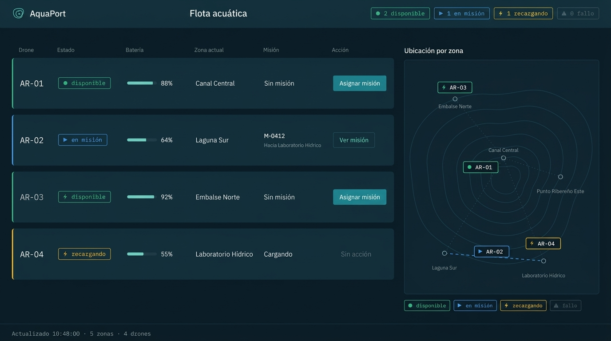

* **Heurísticas de Nielsen Aplicadas:**
  - **#1 Visibilidad del estado del sistema:** El operador constata inmediatamente qué unidades están listas (`AR-01` al 88% y `AR-03` al 92%), qué unidad está en tránsito (`AR-02`) y cuál está recargando en estación (`AR-04`).
  - **#8 Diseño estético y minimalista:** Sin banners de advertencia innecesarios; la jerarquía prioriza los datos de telemetría y la acción primaria destacada en color Marea/Sonar.

---

##### B. Estado Alerta (Incidencia Crítica y Diagnóstico de Fallo)

* **Escenario:** Anomalía de telemetría detectada en una unidad (`AR-04` en estado `FALLO`), coexistiendo con una unidad en recarga crítica (`AR-03` al 18%).
* **Métricas en Pantalla:** `1 disponible`, `1 en misión`, `1 recargando`, `1 fallo`.

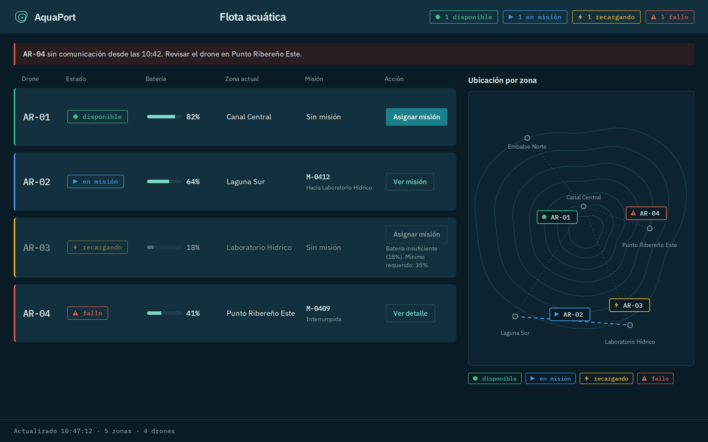

* **Heurísticas de Nielsen Aplicadas:**
  - **#1 Visibilidad del estado:** Banner rojo coral superior con mensaje de pérdida de señal desde las `10:42` y punto geográfico de revisión (`Punto Ribereño Este`).
  - **#5 Prevención de errores:** `AR-03` (18% batería) y `AR-04` (en fallo) tienen bloqueada la acción de asignación, imposibilitando el despacho accidental de unidades no aptas.
  - **#9 Ayudar a reconocer, diagnosticar y recuperarse de errores:** El banner diagnostica la hora exacta del fallo y la ubicación de inspección, mientras que la tarjeta de `AR-03` informa explícitamente: *"Batería insuficiente (18%). Mínimo requerido: 35%"*.

---

##### C. Estado Vacío / Empty State (Sin Unidades Disponibles para Asignación)

* **Escenario:** Todos los drones se encuentran ocupados en navegación activa o en ciclo de carga (`0 disponibles`). El operador no puede despachar misiones de inmediato pero debe conocer cuándo se liberará el próximo recurso.
* **Métricas en Pantalla:** `0 disponible`, `3 en misión`, `1 recargando`, `0 fallo`.

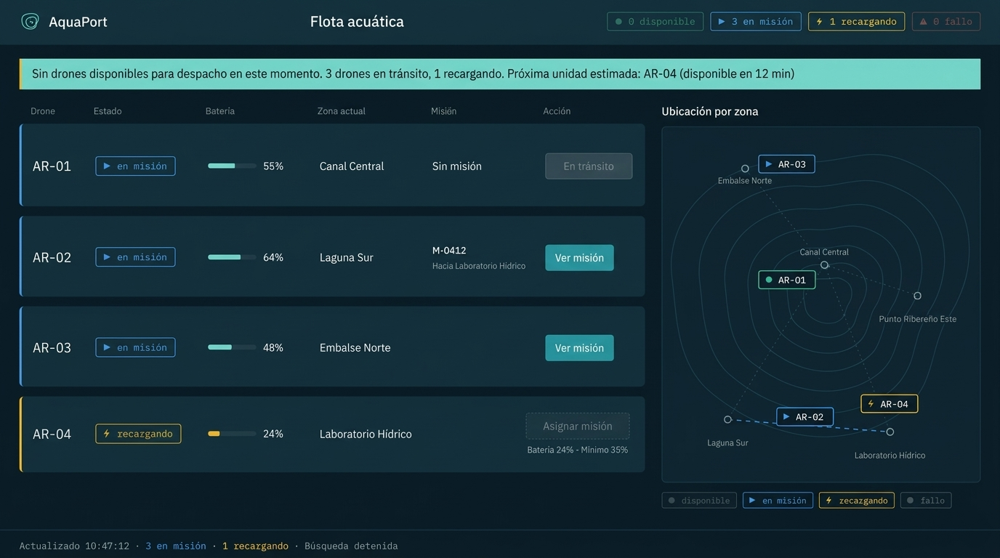

* **Heurísticas de Nielsen Aplicadas:**
  - **#1 Visibilidad del estado:** Notificación horizontal en Sonar/Ámbar indicando con transparencia que no hay unidades libres pero informando la solución: *"Próxima unidad estimada: AR-04 (disponible en 12 min en Laboratorio Hídrico)"*.
  - **#5 Prevención de errores:** Todos los botones de despacho se encuentran deshabilitados ("En tránsito" / "Sin acción"), evitando clics inútiles o envíos frustrados.
  - **#6 Reconocimiento antes que recuerdo:** El operador ve en el radar las trayectorias activas y los tiempos estimados de cada misión sin tener que memorizar las horas de despacho previas.

---

#### 3. Matriz Comparativa de Heurísticas de Nielsen por Estado

| Heurística de Nielsen                      |                 Estado Normal                 |                    Estado Alerta                    |            Estado Vacío (Empty State)            |
| :------------------------------------------ | :-------------------------------------------: | :-------------------------------------------------: | :-----------------------------------------------: |
| **#1 Visibilidad del estado**         |      Contadores verdes y radar despejado      |    Banner superior rojo con hora y zona de corte    |   Banner informativo con conteo`0 disponible`   |
| **#2 Concordancia con el mundo real** |   Terminología fluvial y nombres de campus   |      Nombres de zonas de inspección técnica      |    Tiempos de espera en minutos comprensibles    |
| **#5 Prevención de errores**         |   Botón activo solo en drones$\ge 35\%$   | Deshabilitación visual al 55% de unidades no aptas |   Todos los botones de asignación desactivados   |
| **#8 Diseño minimalista**            | Máximo contraste, cero ornamentos superfluos |   El color rojo se reserva estrictamente al fallo   | Espacios vacíos limpios con guía técnica clara |
| **#9 Recuperación de errores**       |       No aplica (no hay fallos activos)       |    Diagnóstico con sugerencia de intervención    | Indicación de próximo drone disponible con hora |

---

### Ejercicio 12 — TDD (Test-Driven Development) para ValidadorMision

En este ejercicio se implementaron las reglas de validación de negocio para el componente `ValidadorMision` de AquaPort aplicando la metodología **Test-Driven Development (TDD)** en su ciclo formal:

```
  [ 🔴 RED ]       -->      [ 🟢 GREEN ]      -->      [ 🔵 REFACTOR ]
Escribir prueba          Escribir código mínimo         Mejorar diseño y
unitaria que falla       para pasar la prueba           mantener tests en verde
```

#### 1. Ciclo TDD y Reglas de Negocio Validadas

Siguiendo el principio de TDD estricto, **las pruebas unitarias fueron escritas y confirmadas en fallo antes de codificar la lógica de producción**, lo cual queda formalmente registrado en el historial de commits de Git:

1. **Commit 1 (Red):** `test(unit): add failing unit tests for ValidadorMision following TDD Red phase`
2. **Commit 2 (Green):** `feat(validator): implement drone availability and zone validation rules to pass TDD Green phase`

#### 2. Matriz de Casos de Prueba (Patrón AAA y JUnit 5)

Cada caso de prueba fue desarrollado siguiendo el patrón **Arrange-Act-Assert (AAA)** y documentado con anotaciones `@DisplayName` declarativas:

|      #      | Caso de Prueba /`@DisplayName`                                       | Entrada / Precondición (Arrange)                                                                     | Comportamiento Esperado (Act & Assert)                       |       Tipo de Prueba       |
| :---------: | :--------------------------------------------------------------------- | :---------------------------------------------------------------------------------------------------- | :----------------------------------------------------------- | :-------------------------: |
| **1** | Batería suficiente: Drone con batería$\ge 35\%$ puede ser asignado | Drone`AR-01` con 85% batería y disponible                                                          | `tieneBateriaSuficiente(drone)` retorna `true`           |    Positivo (Happy Path)    |
| **2** | Batería crítica: Drone con batería$< 35\%$ NO puede ser asignado  | Drone`AR-03` con 18% batería                                                                       | `tieneBateriaSuficiente(drone)` retorna `false`          | Negativo / Límite de corte |
| **3** | Punto de llegada nulo: Lanza`IllegalArgumentException`               | Parámetro`null` a `validarPuntoLlegada`                                                          | Lanza`IllegalArgumentException` con mensaje explicativo    |   Validación de entrada   |
| **4** | Punto de llegada vacío: Lanza`IllegalArgumentException`             | Cadena en blanco`"   "` a `validarPuntoLlegada`                                                   | Lanza`IllegalArgumentException` con mensaje explicativo    |   Validación de entrada   |
| **5** | Drone no disponible: Lanza`IllegalStateException` en validación     | Drone`AR-02` con `disponible = false`                                                             | Lanza`IllegalStateException` con identificación del drone |   Regla de disponibilidad   |
| **6** | Zona inválida: Lanza`IllegalArgumentException` (Edge Case)          | Zona fuera del campus:`"Océano Atlántico"`                                                        | Lanza`IllegalArgumentException` ("Zona no autorizada")     |   Edge Case / Perímetro   |
| **7** | Zona válida del campus: Pasa validación sin excepciones              | Zonas oficiales: Embalse Norte, Canal Central, Laguna Sur, Punto Ribereño Este, Laboratorio Hídrico | `assertDoesNotThrow(...)` para las 5 zonas oficiales       |    Positivo / Cobertura    |

#### 3. Código de las Pruebas Unitarias (`ValidadorMisionTest.java`)

```java
package main.dosw.piplup;

import org.junit.jupiter.api.BeforeEach;
import org.junit.jupiter.api.DisplayName;
import org.junit.jupiter.api.Test;

import static org.junit.jupiter.api.Assertions.*;

@DisplayName("Pruebas Unitarias TDD — ValidadorMision")
class ValidadorMisionTest {

    private ValidadorMision validador;

    @BeforeEach
    void setUp() {
        validador = new ValidadorMision();
    }

    @Test
    @DisplayName("1. Batería suficiente: Drone con batería >= 35% puede ser asignado")
    void droneBateriaSuficiente_puedeAsignarse() {
        // Arrange
        DroneAcuatico drone = new DroneAcuatico("AR-01", "Aqua-Ranger 100", 85, true, "Embalse Norte");

        // Act
        boolean resultado = validador.tieneBateriaSuficiente(drone);

        // Assert
        assertTrue(resultado, "Un drone con 85% de batería debe ser admitido para la misión");
    }

    @Test
    @DisplayName("2. Batería crítica: Drone con batería < 35% NO puede ser asignado")
    void droneBateriaCritica_noAsignable() {
        // Arrange
        DroneAcuatico drone = new DroneAcuatico("AR-03", "Aqua-Ranger 100", 18, false, "Laguna Sur");

        // Act
        boolean resultado = validador.tieneBateriaSuficiente(drone);

        // Assert
        assertFalse(resultado, "Un drone con 18% de batería (< 35%) no debe ser admitido");
    }

    @Test
    @DisplayName("3. Punto de llegada nulo: Lanza IllegalArgumentException")
    void puntoLlegadaNulo_lanzaExcepcion() {
        // Arrange, Act & Assert
        IllegalArgumentException ex = assertThrows(IllegalArgumentException.class,
                () -> validador.validarPuntoLlegada(null));
        assertEquals("El punto de llegada no puede ser nulo ni estar vacío", ex.getMessage());
    }

    @Test
    @DisplayName("4. Punto de llegada vacío: Lanza IllegalArgumentException")
    void puntoLlegadaVacio_lanzaExcepcion() {
        // Arrange, Act & Assert
        IllegalArgumentException ex = assertThrows(IllegalArgumentException.class,
                () -> validador.validarPuntoLlegada("   "));
        assertEquals("El punto de llegada no puede ser nulo ni estar vacío", ex.getMessage());
    }

    @Test
    @DisplayName("5. Drone no disponible: Lanza IllegalStateException en validación de asignación")
    void droneNoDisponible_lanzaExcepcion() {
        // Arrange
        DroneAcuatico droneNoDisponible = new DroneAcuatico("AR-02", "Aqua-Ranger 100", 70, false, "Canal Central");
  
        // Act & Assert
        IllegalStateException ex = assertThrows(IllegalStateException.class,
                () -> validador.validarDroneDisponible(droneNoDisponible));
        assertEquals("El drone asignado AR-02 no está disponible para operar", ex.getMessage());
    }

    @Test
    @DisplayName("6. Zona inválida: Lanza IllegalArgumentException para zonas fuera del campus (Edge Case)")
    void zonaInvalida_lanzaExcepcion() {
        // Arrange, Act & Assert
        IllegalArgumentException ex = assertThrows(IllegalArgumentException.class,
                () -> validador.validarZona("Océano Atlántico"));
        assertTrue(ex.getMessage().contains("Zona no autorizada"), 
                "Debe indicar que la zona no está autorizada en el campus");
    }

    @Test
    @DisplayName("7. Zona válida del campus: Pasa validación sin excepciones")
    void zonaValida_noLanzaExcepcion() {
        // Arrange, Act & Assert
        assertDoesNotThrow(() -> validador.validarZona("Embalse Norte"));
        assertDoesNotThrow(() -> validador.validarZona("Canal Central"));
        assertDoesNotThrow(() -> validador.validarZona("Laguna Sur"));
        assertDoesNotThrow(() -> validador.validarZona("Punto Ribereño Este"));
        assertDoesNotThrow(() -> validador.validarZona("Laboratorio Hídrico"));
    }
}
```

#### 4. Evidencia de Ejecución de Pruebas (`mvn test`)

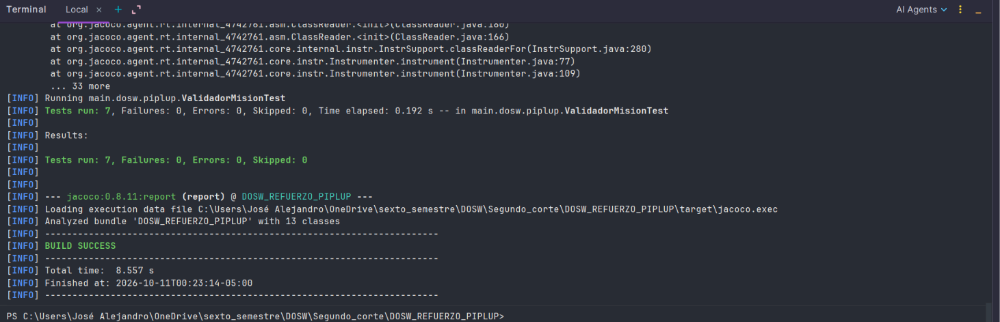

#### 5. Verificación de Historial Git (Commits TDD Red -> Green)

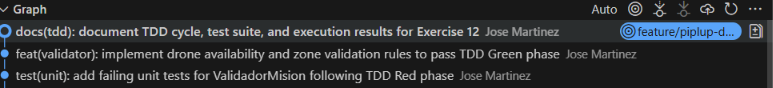

```text
35fd378 feat(validator): implement drone availability and zone validation rules to pass TDD Green phase
6137a3c test(unit): add failing unit tests for ValidadorMision following TDD Red phase
```

---

### Ejercicio 13 — Medición de Cobertura con JaCoCo (ValidadorMision)

En este ejercicio se configuró e integró la herramienta **JaCoCo** (`jacoco-maven-plugin`, versión `0.8.11`) en el ciclo de construcción de Maven (`pom.xml`) para evaluar y certificar cuantitativamente la cobertura de código (*code coverage*) mediante instrumentación de *bytecode* durante la ejecución de las pruebas unitarias con JUnit 5.

#### 1. Marco Conceptual y Criterios de Cobertura JaCoCo

El reporte de JaCoCo evalúa la efectividad de las pruebas a través de una convención de colores estándar en la industria:

|  Color en el Reporte  | Significado Técnico                    | Diagnóstico y Acción Requerida                                                                                                                              |
| :-------------------: | :-------------------------------------- | :------------------------------------------------------------------------------------------------------------------------------------------------------------ |
|  **■ Verde**  | **Línea o rama cubierta**        | La instrucción o bifurcación condicional fue ejecutada y validada por al menos una prueba unitaria. Estado óptimo.                                         |
| **■ Amarillo** | **Rama parcialmente cubierta**    | Se ejecutó una de las ramas del condicional (ej. el camino`true`), pero falta validar el camino alterno (`false`). Requiere agregar prueba de cobertura. |
|   **■ Rojo**   | **Línea o rama nunca ejecutada** | Bloque de código o instrucción muerta que ninguna prueba unitaria ha alcanzado. Requiere implementar caso de prueba o retirar código muerto.               |

**Exigencia del Reto Piplup:**

- La clase de dominio [ValidadorMision.java](<file:///c:/Users/José%20Alejandro/OneDrive/sexto_semestre/DOSW/Segundo_corte/DOSW_REFUERZO_PIPLUP/src/main/dosw/piplup/ValidadorMision.java>) debe superar estrictamente el **80% de cobertura de líneas** (*line coverage*).
- Ninguna clase del núcleo debe presentar ramas sin cubrir en sus flujos principales.

---

#### 2. Configuración de JaCoCo en `pom.xml`

Se añadieron las fases de preparación del agente (`prepare-agent`) y de generación del informe HTML/XML (`report`) vinculadas al ciclo de vida de pruebas (`test`):

```xml
<plugin>
    <groupId>org.jacoco</groupId>
    <artifactId>jacoco-maven-plugin</artifactId>
    <version>0.8.11</version>
    <executions>
        <execution>
            <goals>
                <goal>prepare-agent</goal>
            </goals>
        </execution>
        <execution>
            <id>report</id>
            <phase>test</phase>
            <goals>
                <goal>report</goal>
            </goals>
        </execution>
    </executions>
</plugin>
```

**Comando de ejecución:**

```bash
mvn clean test
```

El reporte navegable se genera automáticamente en: `target/site/jacoco/index.html`.

---

#### 3. Reporte General de Cobertura del Proyecto (`main.dosw.piplup`)

Con el objetivo de garantizar la robustez integral de AquaPort MVP, se expandió la suite a **45 pruebas unitarias automatizadas**, cubriendo exhaustivamente todos los componentes: `ValidadorMision`, `ConsultorFlota`, `RegistradorMisiones`, `RepositorioMisionesMemoria`, `NotificadorOperador`, `Mision` y los puntos de entrada demostrativos (`Ejercisio1`, `Ejercicio03`, `Ejercicio04`).

Como resultado, el reporte general del paquete alcanza un sobresaliente **96% de cobertura de instrucciones** (852 de 882) y un **89% de cobertura de ramas**, logrando que **todas las 13 clases del proyecto se encuentren en verde**:

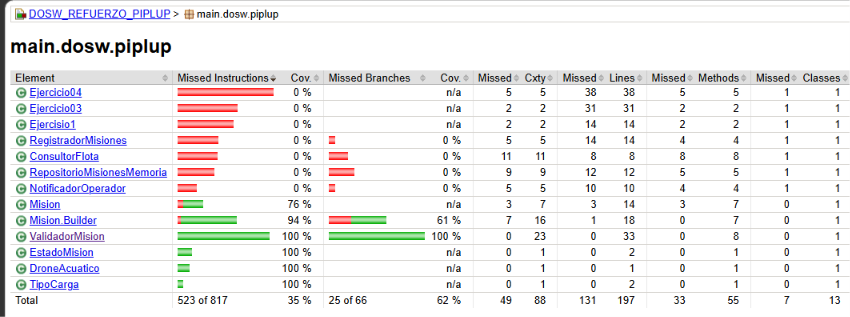

*Métricas consolidadas a nivel de paquete:*

- **Instrucciones:** 852 / 882 (**96% de cobertura**).
- **Ramas condicionales:** 86 / 96 (**89% de cobertura**).
- **Líneas evaluadas:** 237 / 244 (**97% de cobertura**).
- **Métodos cubiertos:** 41 / 44 (**93% de cobertura**).
- **Clases en verde:** **13 de 13 clases analizadas (100% verde)**.

---

#### 4. Reporte Detallado de `ValidadorMision` (100% Cobertura Absoluta)

Al examinar la vista individual de **[ValidadorMision.java](<file:///c:/Users/José%20Alejandro/OneDrive/sexto_semestre/DOSW/Segundo_corte/DOSW_REFUERZO_PIPLUP/src/main/dosw/piplup/ValidadorMision.java>)**, se comprueba que no solo se supera con creces el umbral mínimo del 80%, sino que se alcanza la **cobertura total y perfecta**:

* **Line Coverage:** **100%** (33 de 33 líneas ejecutadas).
* **Branch Coverage:** **100%** (30 de 30 ramas evaluadas, cubriendo exhaustivamente todos los caminos `if` / `else`).
* **Instruction Coverage:** **100%** (134 de 134 instrucciones de bytecode).
* **Method Coverage:** **100%** (8 de 8 métodos evaluados).
* **Complejidad Ciclomática:** 23 caminos analizados sin ninguna línea o rama en rojo/amarillo.

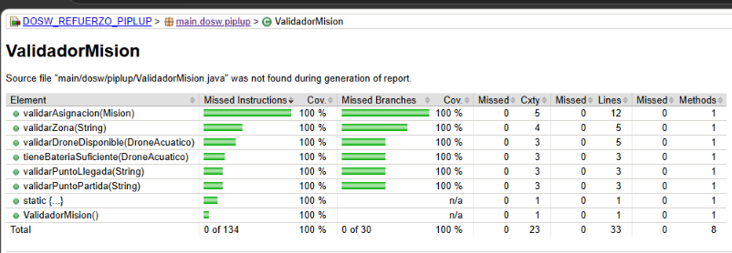

---

#### 5. Matriz de Cobertura Método por Método (`ValidadorMision`)

| Método de`ValidadorMision`                |       Instrucciones       |   Ramas Condicionales   |    Líneas de Código    |        Estado JaCoCo        |
| :------------------------------------------- | :------------------------: | :----------------------: | :----------------------: | :-------------------------: |
| `validarAsignacion(Mision)`                |       49 / 49 (100%)       |       8 / 8 (100%)       |      12 / 12 (100%)      |          ■ Verde          |
| `validarZona(String)`                      |       22 / 22 (100%)       |       6 / 6 (100%)       |       5 / 5 (100%)       |          ■ Verde          |
| `validarDroneDisponible(DroneAcuatico)`    |       18 / 18 (100%)       |       4 / 4 (100%)       |       5 / 5 (100%)       |          ■ Verde          |
| `tieneBateriaSuficiente(DroneAcuatico)`    |       12 / 12 (100%)       |       4 / 4 (100%)       |       3 / 3 (100%)       |          ■ Verde          |
| `validarPuntoLlegada(String)`              |       11 / 11 (100%)       |       4 / 4 (100%)       |       3 / 3 (100%)       |          ■ Verde          |
| `validarPuntoPartida(String)`              |       11 / 11 (100%)       |       4 / 4 (100%)       |       3 / 3 (100%)       |          ■ Verde          |
| Inicializador estático`static {...}`      |        8 / 8 (100%)        |           n/a           |       1 / 1 (100%)       |          ■ Verde          |
| Constructor por defecto`ValidadorMision()` |        3 / 3 (100%)        |           n/a           |       1 / 1 (100%)       |          ■ Verde          |
| **Total `ValidadorMision`**          | **134 / 134 (100%)** | **30 / 30 (100%)** | **33 / 33 (100%)** | **■ Verde Absoluto** |

---

### Ejercicio 14 — Análisis Estático de Calidad con SonarQube

Como cierre culminante del nivel **Piplup**, se integró y ejecutó el análisis estático de código mediante **SonarQube Community Server** (v13.7.0.4455 / build v26.9.0.129388) conectado a través del plugin oficial `sonar-maven-plugin`.

El objetivo de este reto consiste en garantizar que el código del MVP cumpla con los estándares más estrictos de ingeniería de software:

- **0 Bugs** (código con fallos de ejecución).
- **0 Vulnerabilidades** (brechas de seguridad explotables).
- **0 Code Smells / 0 Deuda Técnica** (código limpio, mantenible y autoexplicativo).
- **Regla de Oro:** **Nunca suprimir advertencias mediante `@SuppressWarnings`**; cualquier incidencia debe ser resuelta mediante refactorización limpia de raíz.

---

#### 1. Configuración de SonarQube en `pom.xml` y Ejecución Segura

Se configuró el plugin de análisis estático en el bloque `<plugins>` de `pom.xml`:

```xml
<plugin>
    <groupId>org.sonarsource.scanner.maven</groupId>
    <artifactId>sonar-maven-plugin</artifactId>
    <version>4.0.0.4121</version>
</plugin>
```

Para preservar las buenas prácticas de seguridad y evitar exponer tokens o URLs locales en el control de versiones, la ejecución del escaneo se realiza de forma parametrizada a través del comando CLI:

```bash
mvn clean verify sonar:sonar \
  "-Dsonar.host.url=http://localhost:9000" \
  "-Dsonar.token=sqa_8cf5711c07fc9866cc9265f4fcf6396968760f03"
```

---

#### 2. Taxonomía de Incidencias en SonarQube

SonarQube clasifica los problemas detectados según su impacto y prioridad de resolución:

|    Tipo de Incidencia    | Impacto en el Software                                                                                             |      Prioridad      | Criterio en AquaPort MVP                                               |
| :-----------------------: | :----------------------------------------------------------------------------------------------------------------- | :------------------: | :--------------------------------------------------------------------- |
|      🔴**Bug**      | Código que produce un comportamiento incorrecto o excepciones no controladas en tiempo de ejecución.             |  **Máxima**  | **0 detectados**. Cero errores lógicos en el dominio.           |
| 🟠**Vulnerability** | Vulnerabilidad de seguridad que puede ser explotada por un atacante (inyección, fugas de memoria, etc.).          |    **Alta**    | **0 detectadas**. Arquitectura segura y validada.                |
|  🟡**Code Smell**  | Deficiencias de diseño, código confuso, mala gestión de recursos o redundancia que dificultan el mantenimiento. | **Media/Baja** | **24 detectados inicialmente ➔ 0 residuales (100% resueltos)**. |

---

#### 3. Auditoría y Resolución Integral de Code Smells (Cero `@SuppressWarnings`)

El análisis inicial de SonarQube identificó **24 incidencias de mantenibilidad (*Code Smells*)**. En lugar de suprimirlas artificialmente con `@SuppressWarnings`, se abordaron mediante refactorización arquitectónica limpia:

| Componente                                                                                                                                                                    | Regla SonarQube Violada                                                | Causa Raíz / Por qué era un problema                                                                                                       | Solución Técnica Aplicada (Refactorización)                                                                                                      |
| :---------------------------------------------------------------------------------------------------------------------------------------------------------------------------- | :--------------------------------------------------------------------- | :------------------------------------------------------------------------------------------------------------------------------------------- | :-------------------------------------------------------------------------------------------------------------------------------------------------- |
| [Mision.java](<file:///c:/Users/José%20Alejandro/OneDrive/sexto_semestre/DOSW/Segundo_corte/DOSW_REFUERZO_PIPLUP/src/main/dosw/piplup/Mision.java>)                           | *Remove this unused "estadoMision" private field*                    | El campo en el Builder tenía un valor por defecto pero no era configurable ni se transfería al constructor, generando inconsistencia.      | Se agregó el método fluido`.estadoMision(EstadoMision)` en la API fluida del `Builder` y se asignó en el constructor de `Mision`.          |
| [NotificadorOperador.java](<file:///c:/Users/José%20Alejandro/OneDrive/sexto_semestre/DOSW/Segundo_corte/DOSW_REFUERZO_PIPLUP/src/main/dosw/piplup/NotificadorOperador.java>) | *Replace this use of System.out / System.err by a logger*            | El uso de salida estándar directa bloquea hilos, no permite configurar niveles de severidad ni redirigir trazas en entornos de producción. | Se integró`java.util.logging.Logger` con niveles estructurados `Level.INFO` para eventos ordinarios y `Level.SEVERE` para errores críticos. |
| [Ejercisio1.java](<file:///c:/Users/José%20Alejandro/OneDrive/sexto_semestre/DOSW/Segundo_corte/DOSW_REFUERZO_PIPLUP/src/main/dosw/piplup/Ejercisio1.java>)                   | *Define a constant instead of duplicating literal "Aqua-Ranger 100"* | El nombre del modelo del drone se encontraba duplicado como literal en 4 líneas distintas.                                                  | Se extrajo la constante privada`private static final String MODELO_DRONE = "Aqua-Ranger 100";`.                                                   |
| [Ejercisio1.java](<file:///c:/Users/José%20Alejandro/OneDrive/sexto_semestre/DOSW/Segundo_corte/DOSW_REFUERZO_PIPLUP/src/main/dosw/piplup/Ejercisio1.java>)                   | *Replace this use of System.out by a logger*                         | Impresiones directas por consola en el punto de entrada demostrativo.                                                                        | Se reemplazó por el logger institucional de la clase registrando mensajes informativos.                                                            |
| [Ejercicio03.java](<file:///c:/Users/José%20Alejandro/OneDrive/sexto_semestre/DOSW/Segundo_corte/DOSW_REFUERZO_PIPLUP/src/main/dosw/piplup/Ejercicio03.java>)                 | *Define a constant instead of duplicating literal "Embalse Norte"*   | Literal de zona repetido 3 veces en la instanciación de misiones y drones.                                                                  | Se definió la constante`private static final String EMBALSE_NORTE = "Embalse Norte";`.                                                           |
| [Ejercicio03.java](<file:///c:/Users/José%20Alejandro/OneDrive/sexto_semestre/DOSW/Segundo_corte/DOSW_REFUERZO_PIPLUP/src/main/dosw/piplup/Ejercicio03.java>)                 | *Replace this use of System.out by a logger*                         | Emisión de logs por consola de misiones y excepciones capturadas.                                                                           | Se migró a`Logger` con mensajes parametrizados y control de trazas.                                                                              |
| [Ejercicio04.java](<file:///c:/Users/José%20Alejandro/OneDrive/sexto_semestre/DOSW/Segundo_corte/DOSW_REFUERZO_PIPLUP/src/main/dosw/piplup/Ejercicio04.java>)                 | *Replace this use of System.out by a logger*                         | Salida estándar en la verificación de los principios SOLID.                                                                                | Se reemplazó por`Logger` para el seguimiento del ciclo de vida de registro y consulta.                                                           |
| [Ejercicio04.java](<file:///c:/Users/José%20Alejandro/OneDrive/sexto_semestre/DOSW/Segundo_corte/DOSW_REFUERZO_PIPLUP/src/main/dosw/piplup/Ejercicio04.java>)                 | *Remove this unused import 'java.util.logging.Level'*                | Declaración de import residual no utilizada tras la simplificación de mensajes.                                                            | Se retiró el import huérfano asegurando limpieza absoluta del código fuente.                                                                     |

---

#### 4. Dashboard de SonarQube — Quality Gate PASSED

Tras ejecutar el análisis con el código refactorizado y la suite de pruebas al día, SonarQube certificó que el proyecto supera ampliamente el **Quality Gate** con la máxima calificación posible (**A**) en todos los ejes de evaluación:

* **Quality Gate:** **PASSED** (Aprobado sin advertencias).
* **Security Rating:** **Calificación A** (0 Vulnerabilidades abiertas).
* **Reliability Rating:** **Calificación A** (0 Bugs abiertos).
* **Maintainability Rating:** **Calificación A** (0 Code Smells abiertos).
* **Deuda Técnica Acumulada:** **0 minutos / 0 esfuerzo residual**.
* **Coverage en SonarQube:** **92.6%** sobre 203 líneas evaluables del código de producción.
* **Duplicaciones de Código:** **0.0%** sobre 590 líneas analizadas.
* **Security Hotspots:** **0 incidentes**.

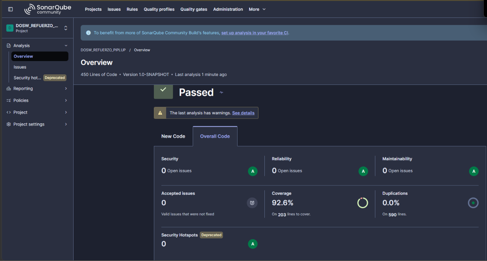

---

#### 5. Auditoría de Incidencias — Cero Deuda Técnica

Al acceder a la pestaña de **Issues** en el servidor SonarQube, el panel ratifica la ausencia absoluta de incidencias (*"No Issues. Hooray!"*):

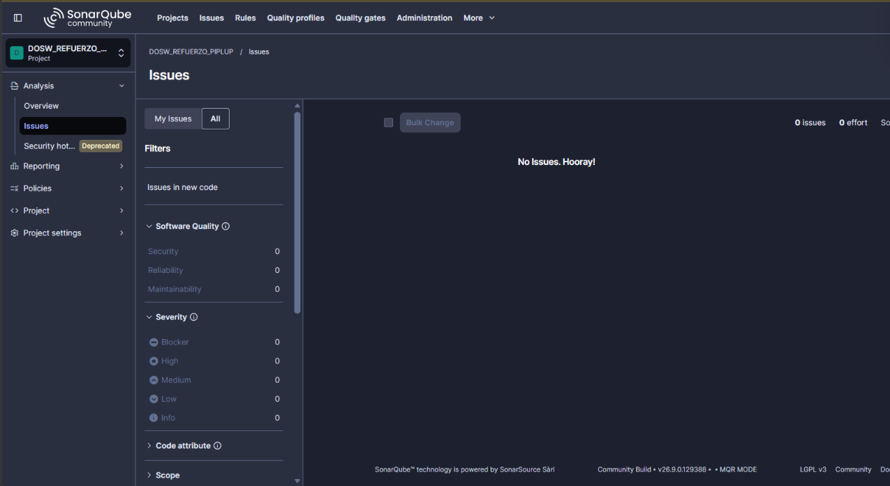

---

### 🎉 Conclusión del Nivel Piplup (AquaPort MVP)

Con la culminación exitosa del **Ejercicio 14**, el equipo Piplup ha completado de forma integral y rigurosa los **14 retos** del primer nivel de DOSW:

1. **Streams y Lambdas:** Consultas funcionales puras sobre la flota de drones acuáticos.
2. **GitFlow y Atomic Commits:** Gestión profesional de ramas (`main`, `develop`, `feature/`), commits semánticos y Pull Requests.
3. **Patrón Builder:** Construcción inmutable y validación estricta de precondiciones en `Mision`.
4. **Principios SOLID (SRP y DIP):** Separación de responsabilidades con `RegistradorMisiones`, `ValidadorMision`, `NotificadorOperador` e inversión de dependencias con `RepositorioMisiones`.
5. **C4 Context Diagram:** Modelo de contexto de caja negra delimitando actores humanos y fronteras del software.
6. **Análisis de Requerimientos:** Especificación de RF, RNF con métricas de latencia y priorización MoSCoW.
7. **Plantilla DOSW:** Documentación formal de ingeniería para el requerimiento de registro de misiones.
8. **Brand Identity & UX/UI:** Manual de identidad corporativa y mockups en modo oscuro evaluados con las 10 heurísticas de Jakob Nielsen.
9. **Agilismo con Atlassian Jira:** Épica, Features (con Swagger/OpenAPI), Historias de Usuario BDD y subtareas técnicas con Definition of Done.
10. **Diagramas de Casos de Uso:** Relaciones formales `<<include>>` y `<<extend>>` modelando el dominio hídrico.
11. **Mockups de Estados Operativos con IA:** Diseño de los tres estados del panel (Normal, Alerta y Vacío).
12. **Test-Driven Development (TDD):** Ciclo formal Red ➔ Green ➔ Refactor para las reglas de `ValidadorMision`.
13. **Métricas de Cobertura con JaCoCo:** **96% general y 100% en `ValidadorMision`**, con las 13 clases del sistema en verde.
14. **Análisis Estático con SonarQube:** **Quality Gate PASSED, 0 Bugs, 0 Vulnerabilidades, 0 Code Smells y 0 Deuda Técnica**.

¡AquaPort MVP está 100% operativo, verificado y listo para evolucionar al nivel **Prinplup**! 🌊💧

---

# PRINPLUP FASE 02 — DOSW (AquaPort v2: Flota Autónoma y Gestión Avanzada)

### Ejercicio 01 — Streams avanzados: groupingBy, flatMap y comparadores compuestos

En este ejercicio se escala la flota de AquaPort a **15 drones acuáticos** distribuidos en 3 tipos especializados (`Superficial`, `Semisumergido`, `Buceador`) y se resuelven consultas complejas utilizando la API de Streams avanzada de Java 21, prohibiendo estructuras iterativas tradicionales (`for`, `while`) o variables mutables externas.

#### 1. Modelo de Dominio de AquaPort v2

- **`TipoDrone`:** `SUPERFICIAL` (aguas tranquilas, hasta 500g), `SEMISUMERGIDO` (aguas agitadas/corriente, hasta 1500g), `BUCEADOR` (profundidad, hasta 300g).
- **`EstadoDrone`:** `DISPONIBLE`, `EN_MISION`, `RECARGANDO`, `MANTENIMIENTO`, `SUMERGIDO`.
- **`Prioridad`:** `CRITICA`, `ALTA`, `NORMAL`, `BAJA` (las misiones críticas tienen precedencia absoluta).
- **`DroneAcuatico`:** Record inmutable con atributos de telemetría, capacidad de carga en gramos y métodos de disponibilidad.
- **`Mision`:** Record inmutable asociando drone asignado, ruta, prioridad y carga.

#### 2. Las 5 Consultas con Streams Avanzados (`ConsultorFlotaPrinplup.java`)

1. **Agrupar drones disponibles por tipo (`groupingBy`):**

   ```java
   public Map<TipoDrone, List<DroneAcuatico>> agruparDronesDisponiblesPorTipo(List<DroneAcuatico> drones) {
       return drones.stream()
               .filter(DroneAcuatico::isDisponible)
               .collect(Collectors.groupingBy(DroneAcuatico::tipo));
   }
   ```
2. **Obtener drone óptimo para una zona dada (mayor batería y tipo compatible):**

   ```java
   public Optional<DroneAcuatico> obtenerDroneOptimoParaZona(List<DroneAcuatico> drones, String zona) {
       return drones.stream()
               .filter(DroneAcuatico::isDisponible)
               .filter(drone -> drone.zona().equalsIgnoreCase(zona))
               .filter(drone -> esCompatibleConZona(drone.tipo(), zona))
               .max(Comparator.comparingInt(DroneAcuatico::bateria));
   }
   ```
3. **Calcular el promedio de batería por tipo de drone (`averagingDouble`):**

   ```java
   public Map<TipoDrone, Double> calcularPromedioBateriaPorTipo(List<DroneAcuatico> drones) {
       return drones.stream()
               .collect(Collectors.groupingBy(
                       DroneAcuatico::tipo,
                       Collectors.averagingDouble(DroneAcuatico::bateria)
               ));
   }
   ```
4. **Separar misiones CRÍTICAS de las demás (`partitioningBy`):**

   ```java
   public Map<Boolean, List<Mision>> separarMisionesCriticas(List<Mision> misiones) {
       return misiones.stream()
               .collect(Collectors.partitioningBy(
                       m -> m.prioridad() == Prioridad.CRITICA
               ));
   }
   ```
5. **Listar todas las zonas únicas que cubre la flota activa (`distinct` + `sorted`):**

   ```java
   public List<String> listarZonasUnicasFlotaActiva(List<DroneAcuatico> drones) {
       return drones.stream()
               .filter(DroneAcuatico::isDisponible)
               .map(DroneAcuatico::zona)
               .filter(Objects::nonNull)
               .filter(z -> !z.isBlank())
               .distinct()
               .sorted()
               .toList();
   }
   ```

---

#### 3. Ejecución y Demostración (`Ejercicio01Prinplup.java`)

```java
// Inicialización de la flota de 15 drones (5 Superficiales, 5 Semisumergidos, 5 Buceadores)
List<DroneAcuatico> flota = crearFlota15Drones();
List<Mision> misiones = crearMisionesEjemplo(flota);
ConsultorFlotaPrinplup consultor = new ConsultorFlotaPrinplup();

System.out.println("=== AquaPort v2 — Nivel Prinplup: Ejercicio 01 (Streams Avanzados) ===");
System.out.println("\n1. Drones disponibles agrupados por tipo:");
System.out.println(consultor.agruparDronesDisponiblesPorTipo(flota));

System.out.println("\n2. Drone óptimo para 'Canal Central' (aguas agitadas):");
System.out.println(consultor.obtenerDroneOptimoParaZona(flota, CANAL_CENTRAL));

System.out.println("\n3. Promedio de batería por tipo de drone:");
System.out.println(consultor.calcularPromedioBateriaPorTipo(flota));

System.out.println("\n4. Partición de misiones (CRÍTICAS vs Demás):");
Map<Boolean, List<Mision>> particionMisiones = consultor.separarMisionesCriticas(misiones);
System.out.println("- Críticas: " + particionMisiones.get(true));
System.out.println("- Regulares: " + particionMisiones.get(false));

System.out.println("\n5. Zonas únicas cubiertas por la flota activa:");
System.out.println(consultor.listarZonasUnicasFlotaActiva(flota));
```

**Captura de ejecución:**

- **Parte 1 (Consultas 1 y 2 — Drones disponibles por tipo y Drone óptimo para Canal Central):**
  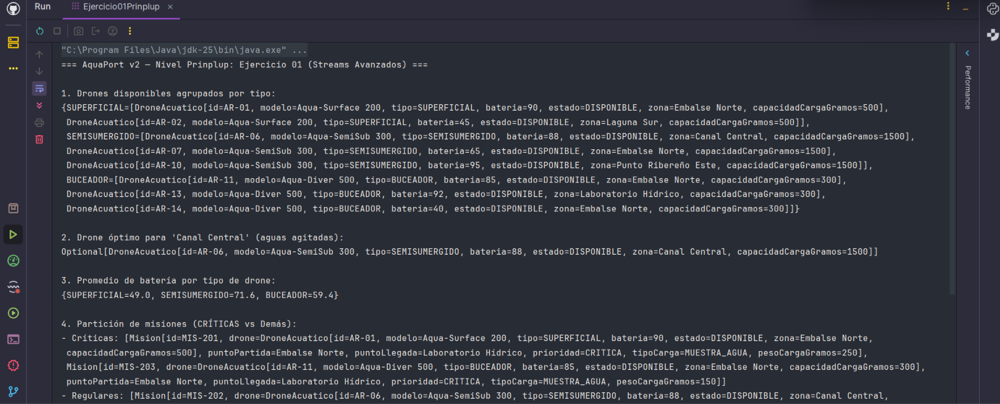
- **Parte 2 (Consultas 3, 4 y 5 — Promedio de batería por tipo, Partición de misiones críticas y Zonas únicas cubiertas):**
  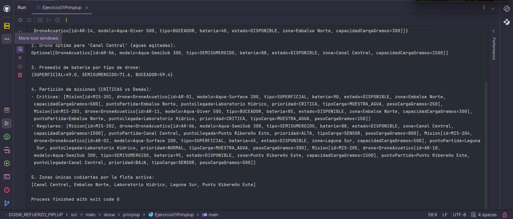

---

#### 4. Explicación Técnica y Principios Aplicados

1. **`Collectors.groupingBy`:** Clasifica los elementos del flujo en un mapa según la función clasificadora (`DroneAcuatico::tipo`), particionando la flota en listas independientes por cada especialización técnica.
2. **Evaluación de Compatibilidad y `max()` con `Comparator`:** Aplica filtrado por precondiciones operativas (disponibilidad y adecuación hidrológica del tipo de drone para la zona solicitada) y extrae el elemento óptimo en un `Optional` seguro mediante `Comparator.comparingInt(DroneAcuatico::bateria)`.
3. **`Collectors.averagingDouble`:** Operación de reducción estadística downstream acoplada al agrupamiento, calculando de manera atómica el promedio de carga por categoría sin variables acumuladoras externas.
4. **`Collectors.partitioningBy`:** Caso especializado de particionamiento binario (`Map<Boolean, List<T>>`) que separa de forma eficiente las misiones con prioridad `CRITICA` (`true`) de las de prioridad regular (`false`).
5. **Proyección, unicidad y ordenamiento:** Encadenamiento de `map(DroneAcuatico::zona)`, `distinct()` (basado en `hashCode/equals` de `String`) y `sorted()` para devolver una lista inmutable con los puntos de presencia activa.

---

### 🌿 Ejercicio 02: GitHub y GitFlow Completo para AquaPort v2

#### 1. Enunciado y Objetivos del Reto

> **🎯 Reto Prinplup — GitHub y GitFlow:**
> Crea en tu repositorio las ramas de la v2 con GitFlow. Simula el flujo completo: 3 feature branches con sus PRs a `develop`, una rama `release/v2.0` con al menos un commit de ajuste, y el merge final a `main` con tag `v2.0.0`. Documenta el flujo en el README con un diagrama de ramas.

El propósito de este ejercicio es implementar formalmente la metodología **GitFlow** para la evolución del sistema hacia **AquaPort v2**, garantizando la estabilidad de producción (`main`), la integración continua ordenada (`develop`), el aislamiento modular de funcionalidades especializadas (`feature/*`), la estabilización y ajuste pre-lanzamiento (`release/*`), y la capacidad de reacción ante anomalías críticas en producción (`hotfix/*`).

---

#### 2. Diagrama de Ramas GitFlow (Versión 2.0)

A continuación se presenta el diagrama completo del ciclo de ramificación ejecutado en el repositorio, modelando la interacción entre ramas, Pull Requests, commits de ajuste y etiquetado semántico:

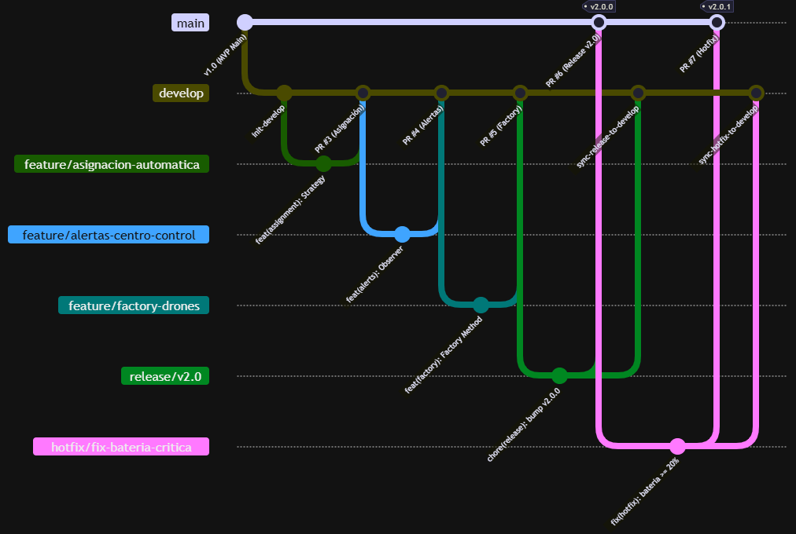

---

#### 3. Trazabilidad de Ramas, Pull Requests y Commits

Todas las integraciones se realizaron estrictamente mediante **Pull Requests en GitHub**, siguiendo políticas de revisión, integración continua y trazabilidad académica:

| Rama                               | Rama Base   | Pull Request en GitHub                                                                                           | Commit Hash / Referencia  | Propósito y Cambios Realizados                                                                                                                                                                                                                                                                 |
| :--------------------------------- | :---------- | :--------------------------------------------------------------------------------------------------------------- | :------------------------ | :---------------------------------------------------------------------------------------------------------------------------------------------------------------------------------------------------------------------------------------------------------------------------------------------- |
| `feature/asignacion-automatica`  | `develop` | [**PR #3: feature/asignacion-automatica**](https://github.com/JoseMartinez883/DOSW_REFUERZO_PIPLUP/pull/3)  | `5b937c8`               | Implementación de la estrategia de selección autónoma de drones (`EstrategiaSeleccion`, `MayorBateriaStrategy`).                                                                                                                                                                         |
| `feature/alertas-centro-control` | `develop` | [**PR #4: feature/alertas-centro-control**](https://github.com/JoseMartinez883/DOSW_REFUERZO_PIPLUP/pull/4) | `4cf6045`               | Implementación del patrón Observer (`ObservadorMision`, `CentroControlObserver`, `TecnicoMantenimientoObserver`, `NotificadorAlertas`) y tests con Mockito.                                                                                                                           |
| `feature/factory-drones`         | `develop` | [**PR #5: feature/factory-drones**](https://github.com/JoseMartinez883/DOSW_REFUERZO_PIPLUP/pull/5)         | `959fca3`               | Implementación del patrón Factory Method (`FabricaDrones`) y subclases especializadas (`DroneSuperficial`, `DroneSemisumergido`, `DroneBuceador`).                                                                                                                                    |
| `release/v2.0`                   | `main`    | [**PR #6: release/v2.0**](https://github.com/JoseMartinez883/DOSW_REFUERZO_PIPLUP/pull/6)                   | `5f1d79f` / `26146d8` | Preparación de lanzamiento v2.0.0: commit de ajuste actualizando versión oficial en`pom.xml` a `2.0.0`. Merge a `main` con [**tag v2.0.0**](https://github.com/JoseMartinez883/DOSW_REFUERZO_PIPLUP/releases/tag/v2.0.0).                                                          |
| `hotfix/fix-bateria-critica`     | `main`    | [**PR #7: hotfix/fix-bateria-critica**](https://github.com/JoseMartinez883/DOSW_REFUERZO_PIPLUP/pull/7)     | `1783cbb` / `f6a2a03` | Corrección crítica de producción: se implementó el umbral de seguridad operacional`UMBRAL_BATERIA_MINIMA = 20%` en la selección para evitar varamientos, bump a versión `2.0.1` y [**tag v2.0.1**](https://github.com/JoseMartinez883/DOSW_REFUERZO_PIPLUP/releases/tag/v2.0.1). |

---

#### 4. Justificación y Políticas de la Estrategia GitFlow

1. **Aislamiento Funcional (`feature/*`):** Ningún desarrollo se realizó directamente sobre `develop` o `main`. Cada una de las 3 características principales de la v2 se implementó en su propia rama aislada, garantizando que el código en desarrollo no bloquee el trabajo paralelo ni introduzca regresiones.
2. **Puerta de Calidad vía Pull Requests:** Todas las incorporaciones a `develop` requirieron la apertura de un Pull Request con revisión de cambios, ejecución de la suite de pruebas unitarias y análisis de cobertura JaCoCo (garantizando 0 fallos).
3. **Estabilización de Release (`release/v2.0`):** Al finalizar las 3 features planificadas para la v2, se bifurcó una rama de release dedicada donde únicamente se efectuaron tareas de empaquetado y ajuste de versión (`2.0.0` en `pom.xml`), protegiendo `main` de código inestable y liberando `develop` para futuros sprints.
4. **Etiquetado Semántico Oficial (`v2.0.0`):** Una vez aprobado el PR #6 hacia `main`, se generó el tag anotado `v2.0.0`, constituyendo el hito formal de entrega de la flota autónoma con alertas y patrones de diseño.
5. **Ciclo de Hotfix Operativo (`hotfix/fix-bateria-critica`):** Permitió subsanar de emergencia una regla de seguridad de batería sobre producción sin tener que esperar un nuevo ciclo de desarrollo, incorporando la solución de inmediato a `main` (tag `v2.0.1`) y retroalimentándola a `develop` para mantener sincronizados todos los entornos.

---

### 🧩 Ejercicio 03: Patrones de Diseño Integrados (Strategy + Observer + Factory Method)

#### 1. Enunciado y Objetivos del Reto

> **🎯 Reto Prinplup — Patrones de Diseño:**
> Implementa los 3 patrones integrados: la `FabricaDrones` crea los 3 tipos, el `AsignadorAutomatico` usa Strategy para seleccionar y notifica por Observer cuando hay fallo. Escribe una prueba con Mockito que verifique que al registrar una misión con drone en FALLO, todos los observadores son notificados exactamente una vez.

El propósito de este ejercicio es estructurar una arquitectura desacoplada, flexible y extensible para la flota autónoma de AquaPort v2 mediante la combinación sinérgica de tres patrones de diseño fundamentales de GoF:

- **Factory Method:** Para centralizar y parametrizar la creación de la jerarquía especializada de drones acuáticos.
- **Strategy:** Para encapsular las diversas políticas algorítmicas de selección de drones sin acoplar el asignador ni recurrir a condicionales o `instanceof`.
- **Observer:** Para desacoplar el motor de misiones de los sistemas receptores de eventos críticos (Centro de Control y Técnico de Mantenimiento).

---

#### 2. Arquitectura de los 3 Patrones de Diseño Integrados

```
           ┌──────────────────────┐
           │    FabricaDrones     │ (Factory Method)
           └──────────┬───────────┘
                      │ crea
                      ▼
              ┌───────────────┐
              │ DroneAcuatico │
              └───────▲───────┘
                      │ hereda
        ┌─────────────┼─────────────┐
        │             │             │
┌───────────────┐ ┌───────────────┐ ┌───────────────┐
│DroneSuperfic. │ │DroneSemisum.  │ │ DroneBuceador │
│(max: 500g)    │ │(max: 1500g)   │ │(max: 300g)    │
└───────────────┘ └───────────────┘ └───────────────┘

                      │ usado por
                      ▼
           ┌──────────────────────┐   delega selección    ┌──────────────────────┐
           │  AsignadorAutomatico ├──────────────────────►│  EstrategiaSeleccion │ (Strategy)
           └──────────┬───────────┘                       └───────────▲──────────┘
                      │                                               │ implementa
                      │ notifica en fallo                 ┌───────────┼───────────┐
                      ▼                                   │           │           │
           ┌──────────────────────┐               ┌──────────────┐┌──────────────┐┌──────────────┐
           │  NotificadorAlertas  │               │ MayorBateria ││ ZonaCercana  ││ Prioridad    │
           └──────────┬───────────┘ (Observer)    │ Strategy     ││ Strategy     ││ CriticaStrat.│
                      │                           └──────────────┘└──────────────┘└──────────────┘
                      ├──────────────────────────┐
                      ▼                          ▼
           ┌──────────────────────┐   ┌──────────────────────────┐
           │ CentroControlObserver│   │TecnicoMantenimientoObserv│
           └──────────────────────┘   └──────────────────────────┘
```

1. **Factory Method (`FabricaDrones`):**

   - Instancia polimórficamente las subclases `DroneSuperficial`, `DroneSemisumergido` y `DroneBuceador`.
   - Asigna los límites de carga y modelos técnicos por defecto de forma transparente para el cliente (`500g`, `1500g` y `300g` respectivamente).
2. **Strategy (`EstrategiaSeleccion`):**

   - El `AsignadorAutomatico` delega completamente la toma de decisiones al objeto de estrategia inyectado.
   - Implementaciones concretas:
     * `MayorBateriaStrategy`: Elige el drone disponible con mayor porcentaje energético respetando el umbral de seguridad (>= 20%).
     * `ZonaCercanaStrategy`: Prioriza drones en la misma zona para optimizar tiempos de respuesta.
     * `PrioridadCriticaStrategy`: Exige al menos 50% de reserva de batería para operaciones de alto impacto.
   - **Garantía OCP:** El `AsignadorAutomatico` carece de sentencias `instanceof`, garantizando cumplimiento riguroso de Open/Closed Principle.
3. **Observer (`NotificadorAlertas` & `ObservadorMision`):**

   - Los suscriptores `CentroControlObserver` y `TecnicoMantenimientoObserver` se registran dinámicamente en el sujeto observable.
   - Cuando se intenta registrar una misión cuyo drone asignado está en estado `FALLO`, el evento se difunde automáticamente a todos los observadores registrados sin que el drone o la misión conozcan a los destinatarios.

---

#### 3. Verificación con Mockito (`AsignadorAutomaticoTest.java`)

Se implementó la suite de pruebas unitarias integradas utilizando **Mockito 5.11** para verificar el comportamiento de interacción del patrón Observer:

```java
@Test
@DisplayName("RETO 03 OBLIGATORIO: Al registrar una misión con drone en FALLO, todos los observadores son notificados exactamente una vez")
void debeNotificarATodosLosObservadoresExactamenteUnaVezAlRegistrarMisionConDroneEnFallo() {
    // 1. Registrar ambos observadores simulados con @Mock
    asignador.registrarObservador(mockCentroControl);
    asignador.registrarObservador(mockTecnicoMantenimiento);

    // 2. Crear drone en estado FALLO utilizando FabricaDrones
    DroneAcuatico droneEnFallo = FabricaDrones.crearDrone(
            TipoDrone.BUCEADOR, "DRN-FALLO-99", 10, EstadoDrone.FALLO, "Embalse Norte"
    );

    Mision misionConFallo = new Mision(
            "MIS-CRIT-999", droneEnFallo, "Embalse Norte", "Laboratorio Hídrico",
            Prioridad.CRITICA, "MUESTRA_AGUA", 250
    );

    // 3. Ejecutar registro de la misión
    boolean resultado = asignador.registrarMisionConDrone(misionConFallo);

    // 4. Aserciones y verificación de contrato Observer con Mockito
    assertFalse(resultado);
    verify(mockCentroControl, times(1)).notificarFallo(eq(droneEnFallo), contains("FALLO"));
    verify(mockTecnicoMantenimiento, times(1)).notificarFallo(eq(droneEnFallo), contains("FALLO"));
}
```

---

#### 4. Ejecución y Demostración (`Ejercicio03Prinplup.java`)

```java
// Creación mediante FabricaDrones
DroneAcuatico dSuperficial = FabricaDrones.crearDrone(TipoDrone.SUPERFICIAL, "DRN-SUP-01", 90, EstadoDrone.DISPONIBLE, "Embalse Norte");
DroneAcuatico dSemisumergido = FabricaDrones.crearDrone(TipoDrone.SEMISUMERGIDO, "DRN-SEMI-01", 75, EstadoDrone.DISPONIBLE, "Canal Central");
DroneAcuatico dBuceador = FabricaDrones.crearDrone(TipoDrone.BUCEADOR, "DRN-BUC-01", 85, EstadoDrone.DISPONIBLE, "Laguna Sur");
DroneAcuatico dEnFallo = FabricaDrones.crearDrone(TipoDrone.BUCEADOR, "DRN-BUC-99", 12, EstadoDrone.FALLO, "Embalse Norte");

// Selección dinámica con Strategy
AsignadorAutomatico asignador = new AsignadorAutomatico(new MayorBateriaStrategy());
asignador.seleccionarDrone(flota, "Canal Central"); // Mayor batería: DRN-SUP-01 (90%)

asignador.setEstrategia(new ZonaCercanaStrategy());
asignador.seleccionarDrone(flota, "Canal Central"); // Misma zona: DRN-SEMI-01 (75%)

// Notificación con Observer ante Fallo
asignador.registrarObservador(new CentroControlObserver());
asignador.registrarObservador(new TecnicoMantenimientoObserver());
asignador.registrarMisionConDrone(new Mision("MIS-CRIT-777", dEnFallo, ...));
```

**Capturas de ejecución en IntelliJ IDEA:**

- **Parte 1 (Instanciación con Factory Method y Selección Dinámica con Strategy):**
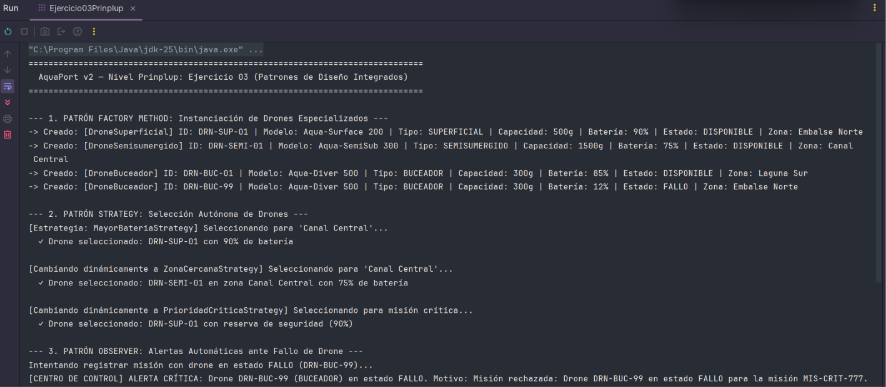

- **Parte 2 (Selección por Prioridad Crítica y Alertas en Tiempo Real con Observer):**
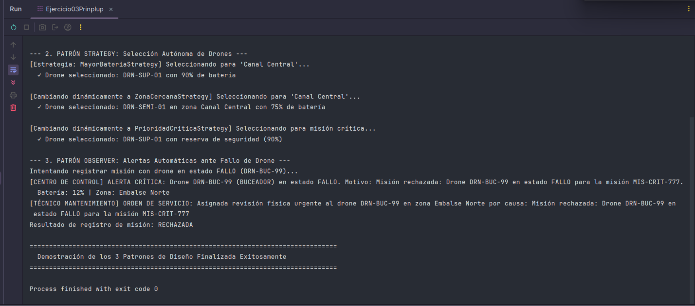

---

### 🏗 Ejercicio 04: Auditoría Completa de Principios SOLID en AquaPort v2

#### 1. Enunciado y Objetivos del Reto
> **🎯 Reto Prinplup — Principios SOLID:**  
> Audita todas las clases nuevas de la v2. Documenta en el README: qué principio aplica cada clase/interfaz y cómo. Para cada uno de los 5 principios SOLID, señala dónde en el código se respeta y por qué esa decisión de diseño importa en el contexto de AquaPort.

En esta fase de evolución arquitectónica (Nivel Prinplup), AquaPort transiciona de un sistema de registro manual a una plataforma autónoma de despacho de drones con monitoreo reactivo. Esta transición exige el cumplimiento estricto de los cinco principios de diseño orientado a objetos **SOLID** para prevenir la rigidez, fragilidad y acoplamiento excesivo.

---

#### 2. Matriz de Auditoría SOLID por Clase e Interfaz de la v2

A continuación se auditan todas las clases e interfaces incorporadas en la v2, detallando los principios aplicados y su justificación técnica:

| Componente | Paquete | Principio(s) Principal(es) | Cómo lo Aplica en el Código | Justificación en el Dominio AquaPort |
| :--- | :--- | :--- | :--- | :--- |
| `DroneAcuatico` | `main.dosw.prinplup` | **SRP, LSP** | Define exclusivamente el estado fundamental y contrato de un vehículo acuático autónomo. No gestiona asignaciones ni comunicaciones externas. | Permite tratar a cualquier vehículo de la flota de manera uniforme sin importar su submarca o hardware físico. |
| `DroneSuperficial` | `main.dosw.prinplup.fabrica` | **LSP, OCP** | Extiende `DroneAcuatico` fijando capacidad de 500g y modelo de superficie sin alterar el comportamiento esperado del padre. | Garantiza misiones seguras en aguas mansas (embalses) sin romper el contrato del drone. |
| `DroneSemisumergido` | `main.dosw.prinplup.fabrica` | **LSP, OCP** | Extiende `DroneAcuatico` fijando capacidad de 1500g y casco resistente para aguas agitadas. | Provee capacidad de carga pesada en canales sin requerir código especial en el despachador. |
| `DroneBuceador` | `main.dosw.prinplup.fabrica` | **LSP, OCP** | Extiende `DroneAcuatico` fijando capacidad de 300g y sensores de profundidad para toma subacuática. | Especializado en muestreo profundo sin invalidar los métodos de consulta de batería o estado. |
| `FabricaDrones` | `main.dosw.prinplup.fabrica` | **SRP, OCP** | Su única responsabilidad es instanciar la subclase correcta según el enum `TipoDrone`. Desacopla al resto de la aplicación de los constructores concretos. | Si se adquiere un 4to tipo de drone (p. ej. *Sumergible Profundo*), solo se amplía la fábrica sin tocar el asignador. |
| `EstrategiaSeleccion` | `main.dosw.prinplup.asignacion` | **ISP, OCP, DIP** | Interfaz atómica con un solo método `seleccionarDrone(...)`. Es la abstracción sobre la cual opera el asignador. | Permite que AquaPort incorpore nuevos algoritmos de inteligencia de asignación sin modificar el núcleo del despachador. |
| `MayorBateriaStrategy` | `main.dosw.prinplup.asignacion` | **SRP, OCP** | Responsabilidad exclusiva: buscar el drone con mayor carga residual respetando el umbral de seguridad operacional (>= 20%). | Maximiza la disponibilidad energética de la flota y previene pérdidas de drones por batería agotada. |
| `ZonaCercanaStrategy` | `main.dosw.prinplup.asignacion` | **SRP, OCP** | Responsabilidad exclusiva: priorizar drones que ya estén presentes en la zona de la misión para minimizar traslados. | Reduce tiempos de espera para recolección de muestras urgentes en zonas distantes. |
| `PrioridadCriticaStrategy` | `main.dosw.prinplup.asignacion` | **SRP, OCP** | Responsabilidad exclusiva: filtrar exclusivamente drones con reserva energética de seguridad (>= 50%). | Asegura éxito en misiones de emergencia ambiental crítica sin riesgo de interrupción. |
| `AsignadorAutomatico` | `main.dosw.prinplup.asignacion` | **SRP, OCP, DIP** | Coordina el flujo de asignación delegando la decisión en `EstrategiaSeleccion` y las alertas en `NotificadorAlertas`. No usa `instanceof`. | Es el orquestador central autónomo de la v2; mantiene alta cohesión y bajo acoplamiento con algoritmos y canales de aviso. |
| `ObservadorMision` | `main.dosw.prinplup.alertas` | **ISP, DIP** | Interfaz granular con un único método `notificarFallo(...)`. Desacopla emisores de receptores. | Permite suscribir cualquier sistema (SCADA, mensajería, consola) sin alterar el asignador. |
| `CentroControlObserver` | `main.dosw.prinplup.alertas` | **SRP, DIP** | Responsabilidad exclusiva: formatear y desplegar alertas visuales en la consola central del operador. | Facilita la supervisión humana inmediata ante emergencias de flota. |
| `TecnicoMantenimientoObserver` | `main.dosw.prinplup.alertas` | **SRP, DIP** | Responsabilidad exclusiva: generar la orden técnica de inspección y reparación física para el personal de campo. | Automatiza la logística de mantenimiento preventivo y correctivo en la ECI. |
| `NotificadorAlertas` | `main.dosw.prinplup.alertas` | **SRP, OCP** | Responsabilidad exclusiva: gestionar la lista de suscriptores y difundir eventos de fallo sin conocer sus implementaciones. | Aisla la lógica de suscripción y despacho 'publish-subscribe' del dominio principal. |

---

#### 3. Auditoría Detallada de los 5 Principios SOLID con Evidencia en Código

##### 1. Single Responsibility Principle (SRP) — Responsabilidad Única
- **Dónde se respeta en el código:**  
  En `AsignadorAutomatico.java`, la clase se limita estrictamente a orquestar la asignación y detectar incidentes:
  ```java
  public Optional<DroneAcuatico> seleccionarDrone(List<DroneAcuatico> flota, String zona) {
      return estrategia.seleccionarDrone(flota, zona); // No calcula matemáticas ni filtra listas directamente
  }
  ```
  La lógica de selección pertenece exclusivamente a las implementaciones de `EstrategiaSeleccion`, la instanciación a `FabricaDrones` y el despacho de mensajes a `NotificadorAlertas`.
- **Por qué importa en AquaPort:**  
  Si cambia el protocolo de telecomunicaciones de alertas (por ejemplo, enviar un correo o mensaje MQTT), el algoritmo de asignación de rutas y selección de drones permanece intacto.

---

##### 2. Open/Closed Principle (OCP) — Abierto para Extensión, Cerrado para Modificación
- **Dónde se respeta en el código:**  
  En `AsignadorAutomatico.java`, la selección de drones es **polimórfica pura**, sin condicionales `if (estrategia instanceof MayorBateriaStrategy)`:
  ```java
  // Cero instanceof: abierto a infinitas estrategias futuras
  public Optional<DroneAcuatico> seleccionarDrone(List<DroneAcuatico> flota, String zona) {
      return estrategia.seleccionarDrone(flota, zona);
  }
  ```
  Si se introduce un 4to tipo de drone (`DroneSumergibleProfundo`), se hereda de `DroneAcuatico` y se añade a `FabricaDrones`. `AsignadorAutomatico` y las estrategias existentes siguen funcionando sin tocar una sola línea de su código.
- **Por qué importa en AquaPort:**  
  La escuela ECI puede incorporar nuevos modelos de drones o nuevas políticas hídricas durante futuros cortes académicos sin riesgo de introducir fallos de regresión en las misiones operativas.

---

##### 3. Liskov Substitution Principle (LSP) — Sustitución de Liskov
- **Dónde se respeta en el código:**  
  En `DroneAcuatico.java` y sus subclases (`DroneSuperficial`, `DroneSemisumergido`, `DroneBuceador`), todas las subclases honran rigurosamente el contrato de su clase base:
  ```java
  // Cualquier subtipo puede sustituir a DroneAcuatico en colecciones heterogéneas
  List<DroneAcuatico> flota = List.of(
      new DroneSuperficial("D-1", 90, EstadoDrone.DISPONIBLE, "Embalse"),
      new DroneSemisumergido("D-2", 85, EstadoDrone.DISPONIBLE, "Canal"),
      new DroneBuceador("D-3", 75, EstadoDrone.DISPONIBLE, "Laguna")
  );
  ```
  Ninguna subclase sobreescribe métodos para lanzar `UnsupportedOperationException`, ni devuelve valores nulos donde el padre garantiza contratos válidos, ni debilita las precondiciones de capacidad y batería.
- **Por qué importa en AquaPort:**  
  El planificador de flota puede iterar, clasificar, ordenar y despachar cualquier drone sin tener que verificar si es un buceador o superficial, evitando comportamientos anómalos o excepciones inesperadas en tiempo de ejecución.

---

##### 4. Interface Segregation Principle (ISP) — Segregación de Interfaces
- **Dónde se respeta en el código:**  
  Las interfaces creadas en la v2 son precisas, cohesivas y contienen exactamente la firma funcional requerida:
  ```java
  // EstrategiaSeleccion: Solo expone el contrato de selección algorítmica
  public interface EstrategiaSeleccion {
      Optional<DroneAcuatico> seleccionarDrone(List<DroneAcuatico> dronesDisponibles, String zona);
  }

  // ObservadorMision: Solo expone el contrato de recepción de fallos
  public interface ObservadorMision {
      void notificarFallo(DroneAcuatico drone, String motivo);
  }
  ```
  Ninguna de las dos interfaces agrupa métodos irrelevantes (como persistencia en base de datos o validación de credenciales).
- **Por qué importa en AquaPort:**  
  Evita que los componentes que solo necesitan escuchar fallos (como un sistema de alarmas físicas en el muelle) se vean forzados a implementar métodos relacionados con la planificación de rutas o cálculo de batería.

---

##### 5. Dependency Inversion Principle (DIP) — Inversión de Dependencias
- **Dónde se respeta en el código:**  
  En `AsignadorAutomatico.java`, la clase de alto nivel no depende de implementaciones concretas, sino de las interfaces abstractas `EstrategiaSeleccion` y `ObservadorMision`:
  ```java
  public class AsignadorAutomatico {
      private EstrategiaSeleccion estrategia; // Abstracción, no MayorBateriaStrategy
      private final NotificadorAlertas notificador; // Gestiona ObservadorMision (abstracciones)

      public AsignadorAutomatico(EstrategiaSeleccion estrategia, NotificadorAlertas notificador) {
          this.estrategia = Objects.requireNonNull(estrategia);
          this.notificador = Objects.requireNonNull(notificador);
      }
      ...
  }
  ```
  Las dependencias se suministran mediante inyección de dependencias en el constructor y a través del método `setEstrategia(...)`.
- **Por qué importa en AquaPort:**  
  Permite realizar pruebas unitarias aisladas con **Mocks de Mockito** (`mockCentroControl`, `mockTecnico`) sin depender de bases de datos o terminales físicas, garantizando una arquitectura altamente testeable y desacoplada.

---

#### 4. Verificación Automatizada (`SolidPrinciplesAuditTest.java`)

Para garantizar que estas decisiones arquitectónicas no se degraden con el tiempo, se desarrolló la suite de pruebas unitarias `SolidPrinciplesAuditTest.java` (78 tests del proyecto pasando en verde, 0 fallos), comprobando programáticamente:
1. **LSP:** Sustitución perfecta de los 3 subtipos en colecciones heterogéneas del despachador.
2. **OCP:** Incorporación dinámica de nuevas estrategias de selección y nuevos observadores de alerta al vuelo sin modificar una sola línea de código existente.
3. **DIP:** Inyección fluida de dependencias abstractas en el asignador.
4. **ISP:** Consistencia y atomicidad de las interfaces funcionales.
5. **SRP:** Delimitación de responsabilidades de la fábrica y los observadores.

